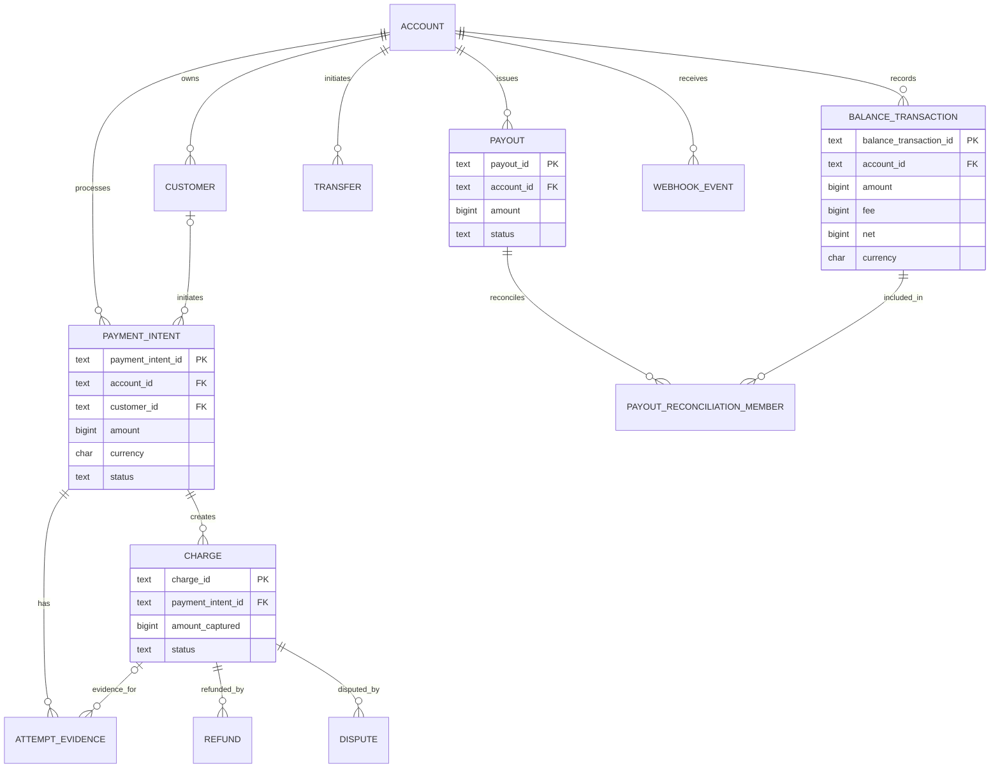
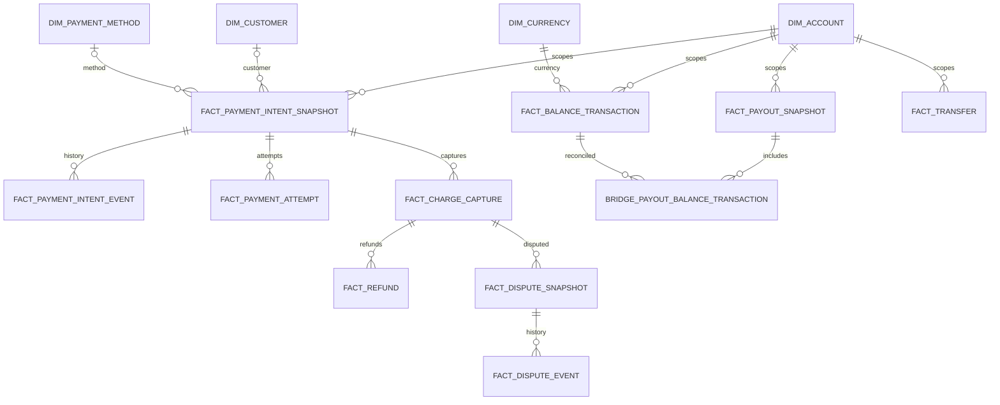
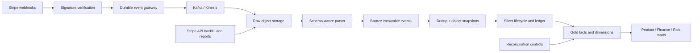

# Module 7 — Mock Interview Case 4
# Design a Data Warehouse Schema for Stripe Payments
## Principal Data Engineer interview masterclass — benchmark edition

> **Case status:** Rebuilt benchmark case  
> **Purpose:** A realistic, technically defensible interview exercise for Senior Staff / Principal Data Engineer candidates.  
> **Important boundary:** This is an educational operational schema inspired by publicly documented Stripe API objects and event semantics. It is **not** a claim about Stripe's private internal database schema. The warehouse is a proposed analytical model, not Stripe's own warehouse.

---

## 0. How to use this case

This case is deliberately broader than a star-schema exercise. A strong Principal Data Engineer must separate the payment lifecycle, processor balance movements, merchant transfers, and bank payouts; define the grain of each dataset; preserve event history; design idempotent ingestion; and prove financial reconciliation.

Recommended practice sequence:

1. Spend 10 minutes clarifying scope and business outcomes.
2. Spend 10–15 minutes defining entities, lifecycle states, measures, and grains.
3. Spend 15 minutes drawing the operational and analytical models.
4. Spend 15–20 minutes explaining ingestion, deduplication, late data, and replay.
5. Spend 15 minutes writing the most important DDL and SQL.
6. Spend 10 minutes on reconciliation, failure modes, governance, and trade-offs.

Do not begin by drawing `fact_payments`. First establish what “payment” means to the business and which financial question the model must answer.

### SQL dialects used

- **Operational source fixture:** PostgreSQL 16 syntax.
- **Warehouse DDL and transformations:** Snowflake SQL syntax, with ANSI-style SQL where possible.
- The examples are intentionally not presented as one portable SQL dialect. Production implementations must be adapted to the chosen warehouse and tested there.

### Reference facts to keep straight

- A PaymentIntent represents the intent to collect a payment and has a lifecycle. It is not a payout to a bank.
- A PaymentIntent can experience multiple attempts; model attempts as an analytical entity derived from event/object history when the provider does not expose a universal standalone attempt table.
- A successful PaymentIntent does not mean funds have been paid out to the merchant's bank.
- A BalanceTransaction is the financial movement in the Stripe balance. Its `amount`, `fee`, and `net` are signed/minor-unit values with documented semantics; retain them rather than attempting to reconstruct all money movements from payment objects.
- A Payout is a separate movement from a Stripe balance to an external account. Its own `balance_transaction` is not a substitute for the full set of transactions being reconciled to that payout.
- For automatic payouts, the payout-reconciliation lifecycle/event indicates when the underlying balance transactions paid out can be queried. The analytical allocation bridge below is derived from the reconciliation data/API/report, not assumed to be a direct foreign key on every balance transaction.
- Event delivery is asynchronous. Do not assume events arrive once or in lifecycle order. Persist provider event IDs, verify signatures, deduplicate, and reconcile periodically against API snapshots/reports.

---

# 1. Interview prompt and expected outcome

## Prompt

“Design a data platform and warehouse model for a Stripe-like payment processor. Product, finance, operations, risk, and merchant-success teams need reliable analytics across payment attempts, successful charges/captures, refunds, disputes, balance movements, transfers, and payouts. The platform processes tens of millions of payment lifecycle events per day, supports multiple currencies and connected accounts, and must provide both near-real-time operational metrics and finance-grade reconciliation.”

## What the interviewer is testing

| Competency | Strong Principal-level evidence |
|---|---|
| Problem framing | Separates product funnel metrics from financial accounting and payout reconciliation |
| Grain discipline | Defines one row per PaymentIntent, attempt, refund, dispute event, balance transaction, payout, and payout allocation |
| Domain modelling | Understands PaymentIntent, Charge/capture, Refund, Dispute, Transfer, BalanceTransaction, Payout distinctions |
| Event architecture | Handles duplicate/out-of-order webhooks, replay, API backfills, schema/API version changes |
| Financial correctness | Uses integer minor units, currency-aware arithmetic, signed movements, reconciliation controls |
| Warehouse design | Uses event facts, transaction facts, accumulating snapshots, SCDs, bridges and semantic metrics appropriately |
| Scale | Designs partitioning/clustering, incremental processing, late-arrival handling and workload isolation |
| Governance | Minimizes PCI/PII exposure, enforces retention, access controls, deletion propagation and auditability |
| Leadership | States assumptions, negotiates scope, identifies risks, and explains operational ownership |

## Clarify the business objective

There are at least four distinct analytical products:

1. **Payment conversion:** Did a customer complete a payment? How many attempts were needed? Where did they fail?
2. **Payment operations:** What is pending, processing, capturable, captured, refunded, or disputed?
3. **Balance accounting:** What changed the processor balance, when did it become available, and what was the fee/net impact?
4. **Payout reconciliation:** Which balance transactions were included in a payout, and does the payout reconcile to the bank settlement?

A model that combines all four into a single `fact_payment` will create ambiguous measures, fanout, and incorrect financial reporting.

---

# 2. Requirement-gathering dialogue

The following is a model conversation. The candidate should lead it, not wait for the interviewer to provide every requirement.

### Q1. What does “payment” mean in the requested analytics?

**Interviewer:** We want a payment warehouse. What is your first question?

**Candidate:** I would clarify whether “payment” means a customer payment attempt, a PaymentIntent lifecycle, a successful charge/capture, a processor balance movement, or a merchant payout. These are related but have different grains and business meanings. I propose modelling each explicitly and connecting them through provider IDs and carefully governed bridges.

**Interviewer follow-up:** Why not one payment fact with status?

**Candidate:** A single current-state row loses attempts and lifecycle transitions. It also mixes gross customer payment amount with fees, refunds, disputes, transfers, and bank payouts. I would maintain an accumulating PaymentIntent snapshot for funnel reporting, immutable event facts for history, and separate financial facts for balance transactions and payouts.

### Q2. Who are the primary users?

**Candidate:** Finance needs signed movements, fees, availability dates, payout reconciliation, and audit trails. Product needs authorization/confirmation/success conversion and failure reasons. Risk needs dispute and fraud outcomes. Merchant operations need account-level trends and payout delays. I would publish separate semantic marts with common conformed dimensions.

### Q3. What is the primary payment lifecycle?

**Candidate:** At a high level: PaymentIntent created, confirmed, possibly requires action, processing, may fail and be retried, may require capture, then may succeed or be canceled. The exact state transitions depend on payment method and integration. I would not encode an assumed single linear state machine. I would preserve the provider's raw event and object state, then derive normalized lifecycle states with versioned rules.

### Q4. Can one PaymentIntent have multiple attempts?

**Candidate:** Yes. The model must retain the history of attempts. I would not assume a standalone provider `payment_attempt` API object universally exists. I would derive an attempt record from documented attempt-related object/event evidence, with an explicit `attempt_derivation_method` and confidence/coverage flag. If the source integration has its own checkout attempt ID, I would preserve it as a separate merchant-side identifier.

### Q5. Does PaymentIntent success mean the merchant has received the money?

**Candidate:** No. It means the payment flow has succeeded according to the PaymentIntent lifecycle. Funds can still be pending in the processor balance, subject to fees, reserves, refunds, disputes, transfers, and payout timing. I would report payment success and payout settlement as separate metrics.

### Q6. How do we measure payment conversion?

**Candidate:** We need a denominator definition. A useful first metric is successful PaymentIntents divided by eligible PaymentIntents created in a cohort window. I would separately report attempt-level success rate and intent-level conversion. Exclude canceled/test intents and define treatment for asynchronous payment methods. Do not compare a same-day numerator with a cohort denominator without an explicit maturity window.

### Q7. What is the authoritative source for money movement?

**Candidate:** The processor's BalanceTransaction object is the authoritative analytical source for changes to the processor balance. I would preserve its ID, source object reference, amount, fee, net, currency, reporting category, type, status, created timestamp, and available-on timestamp. I would reconcile its net effect to balance and payout reports rather than rebuilding it solely from charges and refunds.

### Q8. How should money be stored?

**Candidate:** Store provider amounts as signed integer minor units plus ISO currency. Do not use floating point. Currency exponent is not universally two decimal places, so conversion to display units must use currency metadata. Preserve original transaction currency and balance currency where they differ. Store FX rate and source when supplied.

### Q9. How are refunds represented?

**Candidate:** One row per Refund object, with original charge/payment references, requested amount, currency, status, reason, created timestamp, and associated balance movement when available. Partial refunds mean multiple refund rows can relate to one charge. A refunded amount is not simply a boolean on the payment.

### Q10. How are disputes represented?

**Candidate:** I would maintain a dispute snapshot for current state and a dispute lifecycle event fact for history. Disputes can create multiple balance movements across their lifecycle. Keep the dispute's balance transaction references where provided and do not assume one dispute equals one balance transaction.

### Q11. How do payouts relate to balance transactions?

**Candidate:** A payout is a separate object with its own amount, currency, status, arrival date, destination, and a balance transaction associated with the payout itself. For reconciliation, the underlying transactions included in a payout are obtained through payout reconciliation data or the relevant reporting/API workflow. I would model that relationship as a bridge with provenance and reconciliation batch ID, not invent a direct FK from every source balance transaction to payout.

### Q12. What about Stripe Connect?

**Candidate:** Every relevant record needs account context: platform account and, where applicable, connected account. The same external object ID should not be assumed globally unique across all tenants unless the provider guarantees that. I would use `(provider, account_scope_id, object_id)` as the warehouse natural key. Transfers, application fees, destination charges, and separate charges/transfers require explicit modelling and accounting rules.

### Q13. How fresh must the data be?

**Candidate:** Product funnel dashboards may need 1–5 minute freshness. Finance reconciliation can be hourly or daily, depending on the close process and source finality. I would publish separate SLAs and not force expensive finance-grade reconciliation into the lowest-latency path.

### Q14. How much history is needed?

**Candidate:** Payment and financial history should follow regulatory, contractual, and accounting retention requirements. Raw webhook payload retention can be shorter and more restricted than normalized financial facts. We need legal and compliance sign-off before setting exact retention periods. I would preserve immutable financial audit facts for the approved period and support deletion/tokenization of personal data where legally required.

### Q15. What is the expected volume?

**Candidate:** I would ask for peak events/sec, daily intents, balance transaction count, connected-account count, average payload size, and replay/backfill volume. For this exercise, assume tens of millions of events/day with bursty peaks. The architecture should scale horizontally and avoid per-event warehouse merges.

### Q16. What is the required correctness?

**Candidate:** Payment funnel metrics can tolerate a small delay but not double counting. Finance outputs require exact-once business effects, not a claim of exactly-once delivery. I would achieve effectively-once processing through durable event capture, unique event keys, idempotent transformations, reconciliation, and auditable corrections.

### Q17. What happens when events arrive out of order?

**Candidate:** Keep event creation time, provider event ID, object ID, ingestion time, and object version/API version. Do not overwrite current state based solely on latest arrival. Use provider object retrieval or monotonic version/created-time rules where available, and retain the full event history. A periodic snapshot reconciliation repairs gaps.

### Q18. What is out of scope for the first release?

**Candidate:** I would propose a first release covering PaymentIntent lifecycle, derived attempts, refunds, disputes, balance transactions, payouts, and payout reconciliation. Subscription billing, invoices, tax, issuing, treasury, and network-level authorization data can be separate bounded contexts unless the business requires them now.

---

# 3. Business process, metrics, and definitions

## 3.1 Core entity distinctions

| Concept | Business meaning | Analytical grain |
|---|---|---|
| PaymentIntent | Customer's intent to pay a specified amount | One row per PaymentIntent ID and account scope |
| Attempt (derived) | One attempt to confirm/process a PaymentIntent | One row per derived attempt ID |
| Charge / capture | A successful or attempted charge object; capture may be separate for manual capture flows | One row per charge/capture object or capture movement, depending on source |
| Refund | A full or partial refund object | One row per Refund ID |
| Dispute | A customer/bank dispute against a payment | One row per Dispute ID for snapshot; one row per dispute event for history |
| BalanceTransaction | A movement affecting the processor balance | One row per BalanceTransaction ID |
| Transfer | Movement of funds to a connected account | One row per Transfer ID |
| Payout | Movement from processor balance to external account | One row per Payout ID |
| Payout reconciliation allocation | Link between a payout and the underlying balance transaction included in its reconciliation set | One row per payout × balance transaction × reconciliation batch |

**Critical distinction:** `fact_payment_intent` is not the ledger. `fact_balance_transaction` is not a payment funnel table. `fact_payout` is not the list of charges in a payout.

## 3.2 Metric contracts

| Metric | Definition | Grain / time basis | Common trap |
|---|---|---|---|
| Intent conversion rate | Eligible intents with terminal successful payment / eligible created intents | Intent creation cohort | Counting attempts as intents |
| Attempt success rate | Successful attempts / all classified attempts | Attempt | Treating a retried intent as multiple customer orders |
| Payment volume (gross) | Sum of successful captured payment amount, by payment currency | Capture/charge | Adding refunds or payout amounts into gross volume |
| Refund rate | Refunded amount / captured amount, same currency and cohort rules | Refund/capture | Boolean refunded flag; mixing currencies |
| Dispute rate | Disputed captured amount or disputed payment count / eligible captured payments | Dispute/capture cohort | Counting dispute updates as new disputes |
| Processor fee rate | Balance transaction fee / relevant gross balance movement | Balance transaction | Recomputing fees from a static rate |
| Net balance impact | Sum of signed `net` values | Balance transaction currency and account | Summing across currencies |
| Payout completion rate | Paid payouts / payout attempts | Payout | Treating PaymentIntent success as payout success |
| Payout reconciliation variance | Payout expected amount minus reconciled underlying net amount under defined policy | Payout and reconciliation batch | Including payout's own debit transaction in the underlying set |
| Pending balance | Sum of balance movements whose funds status is pending, by currency | Balance snapshot/time | Using PaymentIntent processing status as balance status |

### 3.3 Cohort and time semantics

Use at least these timestamps:

- `provider_created_at`: when the provider says the object/event was created.
- `provider_event_created_at`: event creation time for a webhook event.
- `ingested_at`: when the platform durably received it.
- `processed_at`: when a transformation successfully processed it.
- `available_on`: when a balance transaction's net funds become available.
- `payout_arrival_date`: expected/actual payout arrival date.
- `business_effective_at`: derived timestamp selected for a business metric, with a documented rule.

Do not silently substitute ingestion time for event time. Late arrival is expected. Use UTC for event storage; retain business timezone only as an explicit reporting attribute.

---

# 4. Operational source model (educational fixture)

The following PostgreSQL fixture is intentionally normalized enough to demonstrate the provider lifecycle. It is not a replica of Stripe's private schema and does not claim every object exists as a separate API resource in every integration.

## 4.1 Source entities and keys

| Table | PK | Important FKs / uniqueness | Mutation semantics |
|---|---|---|---|
| `src_account` | `account_id` | Provider account scope | Account metadata changes |
| `src_customer` | `customer_id` | `account_id` → account | PII-bearing profile; mutable/deletable |
| `src_payment_intent` | `payment_intent_id` | Account-scoped unique ID; optional customer | Mutable current object snapshot |
| `src_payment_attempt_evidence` | `attempt_evidence_id` | PaymentIntent FK; optional charge FK | Educational derived attempt evidence |
| `src_charge` | `charge_id` | PaymentIntent FK | Charge object; may be updated |
| `src_refund` | `refund_id` | Charge FK | Refund status may change |
| `src_dispute` | `dispute_id` | Charge FK | Mutable lifecycle snapshot |
| `src_balance_transaction` | `balance_transaction_id` | Optional source object type/id; account FK | Financial movement; immutable core amount with lifecycle status |
| `src_transfer` | `transfer_id` | Account FK; optional source transaction | Transfer object |
| `src_payout` | `payout_id` | Account FK; optional payout balance transaction FK | Payout status updates |
| `src_payout_reconciliation_member` | composite key | Payout FK + balance transaction FK + batch | Derived from reconciliation response/report |
| `src_webhook_event` | `event_id` | Account FK; optional object ID | Immutable delivery/event envelope |

For provider data, object IDs are often globally unique-looking strings, but a robust multi-tenant warehouse still scopes keys by provider account and environment (`livemode`). The fixture uses account scope for clarity.

## 4.2 PostgreSQL 16 DDL — source fixture

```sql
CREATE TABLE src_account (
    account_id       text PRIMARY KEY,
    account_type     text NOT NULL CHECK (account_type IN ('platform','connected')),
    country_code     char(2),
    default_currency char(3),
    livemode         boolean NOT NULL,
    created_at       timestamptz NOT NULL
);

CREATE TABLE src_customer (
    customer_id      text PRIMARY KEY,
    account_id       text NOT NULL REFERENCES src_account(account_id),
    email_token      text, -- tokenized; do not store raw email in analytical marts
    country_code     char(2),
    created_at       timestamptz NOT NULL,
    updated_at       timestamptz NOT NULL,
    deleted_at       timestamptz
);

CREATE TABLE src_payment_intent (
    payment_intent_id text PRIMARY KEY,
    account_id        text NOT NULL REFERENCES src_account(account_id),
    customer_id       text REFERENCES src_customer(customer_id),
    merchant_order_id text,
    amount             bigint NOT NULL CHECK (amount >= 0),
    amount_received    bigint NOT NULL DEFAULT 0 CHECK (amount_received >= 0),
    currency           char(3) NOT NULL,
    status             text NOT NULL,
    capture_method     text NOT NULL CHECK (capture_method IN ('automatic','manual')),
    confirmation_method text NOT NULL,
    payment_method_type text,
    latest_charge_id   text,
    created_at         timestamptz NOT NULL,
    updated_at         timestamptz NOT NULL,
    canceled_at        timestamptz,
    livemode           boolean NOT NULL
);
CREATE INDEX ix_src_payment_intent_order
    ON src_payment_intent(account_id, merchant_order_id);

CREATE TABLE src_charge (
    charge_id          text PRIMARY KEY,
    account_id         text NOT NULL REFERENCES src_account(account_id),
    payment_intent_id  text NOT NULL REFERENCES src_payment_intent(payment_intent_id),
    amount             bigint NOT NULL CHECK (amount >= 0),
    amount_captured    bigint NOT NULL DEFAULT 0 CHECK (amount_captured >= 0),
    amount_refunded    bigint NOT NULL DEFAULT 0 CHECK (amount_refunded >= 0),
    currency           char(3) NOT NULL,
    status             text NOT NULL,
    paid               boolean NOT NULL,
    captured           boolean NOT NULL,
    failure_code       text,
    created_at         timestamptz NOT NULL,
    updated_at         timestamptz NOT NULL
);

ALTER TABLE src_payment_intent
ADD CONSTRAINT fk_pi_latest_charge
FOREIGN KEY (latest_charge_id) REFERENCES src_charge(charge_id)
DEFERRABLE INITIALLY DEFERRED;

-- This is an analytical evidence table, not a claim that Stripe exposes a
-- universal standalone PaymentAttempt resource.
CREATE TABLE src_payment_attempt_evidence (
    attempt_evidence_id text PRIMARY KEY,
    account_id          text NOT NULL REFERENCES src_account(account_id),
    payment_intent_id   text NOT NULL REFERENCES src_payment_intent(payment_intent_id),
    charge_id           text REFERENCES src_charge(charge_id),
    attempt_sequence    integer NOT NULL CHECK (attempt_sequence > 0),
    evidence_source     text NOT NULL,
    outcome             text NOT NULL,
    failure_code        text,
    started_at          timestamptz NOT NULL,
    completed_at        timestamptz,
    UNIQUE (payment_intent_id, attempt_sequence)
);

CREATE TABLE src_refund (
    refund_id           text PRIMARY KEY,
    account_id          text NOT NULL REFERENCES src_account(account_id),
    charge_id           text NOT NULL REFERENCES src_charge(charge_id),
    amount              bigint NOT NULL CHECK (amount > 0),
    currency            char(3) NOT NULL,
    status              text NOT NULL,
    reason              text,
    balance_transaction_id text,
    created_at          timestamptz NOT NULL,
    updated_at          timestamptz NOT NULL
);

CREATE TABLE src_dispute (
    dispute_id          text PRIMARY KEY,
    account_id          text NOT NULL REFERENCES src_account(account_id),
    charge_id           text NOT NULL REFERENCES src_charge(charge_id),
    amount              bigint NOT NULL CHECK (amount > 0),
    currency            char(3) NOT NULL,
    reason              text,
    status              text NOT NULL,
    evidence_due_at     timestamptz,
    created_at          timestamptz NOT NULL,
    updated_at          timestamptz NOT NULL
);

CREATE TABLE src_balance_transaction (
    balance_transaction_id text PRIMARY KEY,
    account_id             text NOT NULL REFERENCES src_account(account_id),
    source_object_type     text,
    source_object_id       text,
    type                   text NOT NULL,
    reporting_category     text,
    amount                 bigint NOT NULL,
    fee                    bigint NOT NULL DEFAULT 0 CHECK (fee >= 0),
    net                    bigint NOT NULL,
    currency               char(3) NOT NULL,
    exchange_rate          numeric(20,10),
    status                 text NOT NULL CHECK (status IN ('pending','available')),
    created_at             timestamptz NOT NULL,
    available_on           timestamptz,
    CHECK (net = amount - fee)
);

CREATE TABLE src_transfer (
    transfer_id            text PRIMARY KEY,
    account_id             text NOT NULL REFERENCES src_account(account_id),
    destination_account_id text NOT NULL,
    amount                 bigint NOT NULL CHECK (amount > 0),
    currency               char(3) NOT NULL,
    source_transaction_id  text,
    status                 text NOT NULL,
    created_at             timestamptz NOT NULL
);

CREATE TABLE src_payout (
    payout_id              text PRIMARY KEY,
    account_id             text NOT NULL REFERENCES src_account(account_id),
    amount                 bigint NOT NULL CHECK (amount > 0),
    currency               char(3) NOT NULL,
    status                 text NOT NULL,
    method                 text,
    automatic              boolean NOT NULL,
    arrival_date           date,
    destination_token      text,
    payout_balance_transaction_id text
        REFERENCES src_balance_transaction(balance_transaction_id),
    reconciliation_status  text,
    created_at             timestamptz NOT NULL,
    updated_at             timestamptz NOT NULL
);

-- Derived from provider payout reconciliation output or a finance-approved
-- report. Provenance is mandatory because this is not a direct source FK.
CREATE TABLE src_payout_reconciliation_member (
    payout_id              text NOT NULL REFERENCES src_payout(payout_id),
    balance_transaction_id text NOT NULL
        REFERENCES src_balance_transaction(balance_transaction_id),
    reconciliation_batch_id text NOT NULL,
    source_report_id       text,
    included_net_amount    bigint NOT NULL,
    currency               char(3) NOT NULL,
    extracted_at           timestamptz NOT NULL,
    PRIMARY KEY (payout_id, balance_transaction_id, reconciliation_batch_id)
);

CREATE TABLE src_webhook_event (
    event_id               text PRIMARY KEY,
    account_id             text NOT NULL REFERENCES src_account(account_id),
    event_type             text NOT NULL,
    object_type            text,
    object_id              text,
    api_version            text,
    provider_created_at    timestamptz NOT NULL,
    received_at            timestamptz NOT NULL,
    request_id             text,
    livemode               boolean NOT NULL,
    payload                jsonb NOT NULL,
    payload_sha256         text NOT NULL
);
```

### Source model caveats

1. The source fixture stores a mutable current-state object plus an immutable event envelope. A production ingestion system should also retain the raw payload in a restricted raw zone with checksum and schema/API version.
2. `src_payment_attempt_evidence` is deliberately named “evidence”: attempt derivation depends on the integration and provider event/object history. Do not claim every payment provider has a first-class attempt table.
3. `src_payout_reconciliation_member` is a derived extraction. It must retain reconciliation batch/report provenance and be reconciled to the payout's own balance movement separately.
4. `src_balance_transaction` enforces `net = amount - fee` for this fixture. Validate the exact provider semantics for every balance transaction category and source API version before applying that constraint universally.
5. `source_object_id` is polymorphic. A conventional FK cannot validate it without a typed source-reference registry.

## 4.3 Sample source records

Amounts below are in USD cents. They are deliberately small enough to verify by hand.

### Accounts and customers

```sql
INSERT INTO src_account VALUES
('acct_platform','platform','US','usd',true,'2026-01-01T00:00:00Z'),
('acct_merchant_a','connected','US','usd',true,'2026-01-01T00:00:00Z');

INSERT INTO src_customer VALUES
('cus_101','acct_platform','tok_email_01','US','2026-03-01T10:00:00Z',
 '2026-03-01T10:00:00Z',NULL),
('cus_102','acct_platform','tok_email_02','CA','2026-03-01T10:05:00Z',
 '2026-03-01T10:05:00Z',NULL);
```

### PaymentIntent and charge lifecycle

```sql
INSERT INTO src_payment_intent VALUES
('pi_1001','acct_platform','cus_101','order_9001',10000,10000,'usd',
 'succeeded','automatic','automatic','card',NULL,
 '2026-03-10T10:00:00Z','2026-03-10T10:00:08Z',NULL,true),
('pi_1002','acct_platform','cus_102','order_9002',5000,0,'usd',
 'requires_payment_method','automatic','automatic','card',NULL,
 '2026-03-10T10:02:00Z','2026-03-10T10:02:20Z',NULL,true),
('pi_1003','acct_platform','cus_101','order_9003',8000,8000,'usd',
 'succeeded','manual','automatic','card',NULL,
 '2026-03-10T10:04:00Z','2026-03-10T10:05:00Z',NULL,true);

INSERT INTO src_charge VALUES
('ch_1001','acct_platform','pi_1001',10000,10000,2000,'usd',
 'succeeded',true,true,NULL,'2026-03-10T10:00:07Z','2026-03-10T10:00:08Z'),
('ch_1003','acct_platform','pi_1003',8000,8000,0,'usd',
 'succeeded',true,true,NULL,'2026-03-10T10:04:50Z','2026-03-10T10:05:00Z');

UPDATE src_payment_intent SET latest_charge_id = 'ch_1001'
WHERE payment_intent_id = 'pi_1001';
UPDATE src_payment_intent SET latest_charge_id = 'ch_1003'
WHERE payment_intent_id = 'pi_1003';

INSERT INTO src_payment_attempt_evidence VALUES
('att_1001_1','acct_platform','pi_1001','ch_1001',1,'charge.created','succeeded',
 NULL,'2026-03-10T10:00:03Z','2026-03-10T10:00:08Z'),
('att_1002_1','acct_platform','pi_1002',NULL,1,'payment_intent.payment_failed',
 'failed','insufficient_funds','2026-03-10T10:02:05Z','2026-03-10T10:02:20Z'),
('att_1003_1','acct_platform','pi_1003','ch_1003',1,'charge.created','succeeded',
 NULL,'2026-03-10T10:04:45Z','2026-03-10T10:05:00Z');
```

### Refund, dispute, balance movement, transfer and payout

```sql
INSERT INTO src_refund VALUES
('re_2001','acct_platform','ch_1001',2000,'usd','succeeded','requested_by_customer',
 'txn_refund_2001','2026-03-12T09:00:00Z','2026-03-12T09:00:10Z');

INSERT INTO src_dispute VALUES
('dp_3001','acct_platform','ch_1003',8000,'usd','fraudulent','under_review',
 '2026-03-25T00:00:00Z','2026-03-15T12:00:00Z','2026-03-15T12:00:00Z');

INSERT INTO src_balance_transaction VALUES
('txn_charge_1001','acct_platform','charge','ch_1001','charge','charge',10000,320,9680,
 'usd',NULL,'available','2026-03-10T10:00:08Z','2026-03-12T00:00:00Z'),
('txn_refund_2001','acct_platform','refund','re_2001','refund','refund',-2000,0,-2000,
 'usd',NULL,'available','2026-03-12T09:00:10Z','2026-03-12T09:00:10Z'),
('txn_charge_1003','acct_platform','charge','ch_1003','charge','charge',8000,256,7744,
 'usd',NULL,'available','2026-03-10T10:05:00Z','2026-03-12T00:00:00Z'),
('txn_dispute_3001','acct_platform','dispute','dp_3001','adjustment','dispute',-8000,0,-8000,
 'usd',NULL,'available','2026-03-15T12:00:00Z','2026-03-15T12:00:00Z'),
('txn_payout_4001','acct_platform','payout','po_4001','payout','payout',-7424,0,-7424,
 'usd',NULL,'available','2026-03-16T08:00:00Z','2026-03-16T08:00:00Z');

INSERT INTO src_transfer VALUES
('tr_5001','acct_platform','acct_merchant_a',5000,'usd','txn_charge_1001',
 'paid','2026-03-13T11:00:00Z');

INSERT INTO src_payout VALUES
('po_4001','acct_platform',7424,'usd','paid','standard',true,'2026-03-17',
 'tok_bank_1234','txn_payout_4001','completed',
 '2026-03-16T08:00:00Z','2026-03-16T08:30:00Z');

INSERT INTO src_payout_reconciliation_member VALUES
('po_4001','txn_charge_1001','batch_20260316_01','report_01',9680,'usd',
 '2026-03-16T08:05:00Z'),
('po_4001','txn_refund_2001','batch_20260316_01','report_01',-2000,'usd',
 '2026-03-16T08:05:00Z'),
('po_4001','txn_charge_1003','batch_20260316_01','report_01',7744,'usd',
 '2026-03-16T08:05:00Z'),
('po_4001','txn_dispute_3001','batch_20260316_01','report_01',-8000,'usd',
 '2026-03-16T08:05:00Z');
```

The example payout membership sums to 7,424 cents: `9,680 - 2,000 + 7,744 - 8,000 = 7,424`. The payout's own `-7,424` balance transaction is a separate debit and must **not** be included in the underlying member set.

---

# 5. Source ER diagram



**Explain optionality:** A PaymentIntent can have no Charge if it fails or is canceled before a successful charge. One intent can have multiple attempt evidences. A charge can have zero or many refunds and zero or more dispute-related lifecycle movements. A payout can reconcile to many balance transactions, and a balance transaction can be associated with a reconciliation set according to provider/accounting rules. Keep the reconciliation batch in the bridge key.

---

# 6. Data profiling and source-quality controls

Before modelling, profile the source rather than assuming clean provider payloads.

| Profiling question | Example check | Why it matters |
|---|---|---|
| Are event IDs unique? | Duplicate `event_id` count | Webhook retry and replay |
| Are object IDs scoped? | Duplicate object ID across account/livemode | Tenant isolation |
| Are amounts valid? | Negative PaymentIntent amount; `net != amount-fee` | Financial correctness |
| Are currencies valid? | Unknown ISO code / exponent | Correct display and aggregation |
| Are timestamps plausible? | `available_on < created_at` | Source defects or timezone conversion |
| Do references resolve? | Charge with missing PaymentIntent | Incomplete extraction or late arrival |
| Are event states out of order? | Earlier provider event arrives later | Current-state corruption |
| Are payload schemas changing? | API version distribution | Parser compatibility |
| Is reconciliation complete? | Payout members vs payout amount | Finance close risk |
| Are personal fields present? | Email, address, card details in payload | Data minimization and PCI scope |

### Example SQL profiling checks (PostgreSQL)

```sql
-- Duplicate event identifiers should be impossible in the durable event ledger.
SELECT event_id, COUNT(*)
FROM src_webhook_event
GROUP BY event_id
HAVING COUNT(*) > 1;

-- Detect source rows whose financial arithmetic does not reconcile.
SELECT balance_transaction_id, amount, fee, net
FROM src_balance_transaction
WHERE net <> amount - fee;

-- Find orphaned or late-arriving references after the agreed completeness window.
SELECT c.charge_id, c.payment_intent_id
FROM src_charge c
LEFT JOIN src_payment_intent p
  ON p.payment_intent_id = c.payment_intent_id
WHERE p.payment_intent_id IS NULL;

-- Payout reconciliation members should be single-currency within a payout.
SELECT payout_id, COUNT(DISTINCT currency) AS currencies
FROM src_payout_reconciliation_member
GROUP BY payout_id
HAVING COUNT(DISTINCT currency) > 1;
```

Do not immediately delete “bad” rows. Route them to a quarantine table with reason code, source reference, first-seen time, and remediation status.

---

# 7. Conceptual and logical warehouse model

## 7.1 Modelling strategy

Use a hybrid model:

- **Immutable event facts** preserve lifecycle and webhook evidence.
- **Transaction facts** preserve money movement at provider-defined grain.
- **Accumulating snapshots** support current lifecycle and funnel reporting.
- **SCD dimensions** preserve merchant/account and selected customer attributes over time.
- **Bridge tables** represent many-to-many or derived relationships, especially payout reconciliation.
- **Semantic marts** provide governed metric definitions for product and finance.

Do not use one giant denormalized fact as the system of record.

## 7.2 Target table inventory and explicit grain

| Target table | Grain | Primary analytical use |
|---|---|---|
| `dim_account` | One row per account version | Platform/connected-account reporting |
| `dim_customer` | One row per customer version | Privacy-aware customer cohorts |
| `dim_currency` | One row per currency code | Exponent and display conversion |
| `dim_payment_method` | One row per method type/version | Method performance |
| `dim_failure_reason` | One row per normalized failure code | Failure analysis |
| `dim_date` | One row per calendar date | Calendar reporting |
| `fact_payment_intent_snapshot` | One row per PaymentIntent current snapshot | Conversion and operational funnel |
| `fact_payment_intent_event` | One row per provider event affecting a PaymentIntent | Lifecycle history |
| `fact_payment_attempt` | One row per derived attempt | Attempt-level performance |
| `fact_charge_capture` | One row per charge/capture object (capture events separately if multicapture is enabled) | Captured volume |
| `fact_refund` | One row per Refund object | Refund volume and status |
| `fact_dispute_snapshot` | One row per dispute current snapshot | Current dispute exposure |
| `fact_dispute_event` | One row per dispute lifecycle event | Dispute history |
| `fact_balance_transaction` | One row per BalanceTransaction | Financial ledger movement |
| `fact_transfer` | One row per Transfer object | Connect money movement |
| `fact_payout_snapshot` | One row per payout current snapshot | Payout status and timing |
| `bridge_payout_balance_transaction` | One row per payout × balance transaction × reconciliation batch | Payout composition/reconciliation |
| `fact_webhook_event` | One row per unique provider event ID | Ingestion reliability and event audit |

## 7.3 Target ER diagram



The ERD is conceptual. In a physical warehouse, dimensions may be joined by surrogate keys and facts may retain provider natural keys for traceability. The payout bridge's relationship is many-to-many across reconciliation batches, not a direct provider FK.

---

# 8. Detailed source-to-target mapping

The mapping must specify actual columns and transformations. “Preserve IDs and normalize enums” is not sufficient for a production design.

| Source | Source column | Target | Target column | Transformation / rule |
|---|---|---|---|---|
| `src_payment_intent` | `payment_intent_id` | `fact_payment_intent_snapshot` | `payment_intent_id` | Preserve scoped provider natural key |
| `src_payment_intent` | `account_id` | `fact_payment_intent_snapshot` | `account_sk` | Resolve SCD2 account row effective at intent creation |
| `src_payment_intent` | `customer_id` | `fact_payment_intent_snapshot` | `customer_sk` | Resolve customer version; use unknown/deleted key when absent |
| `src_payment_intent` | `amount` | `fact_payment_intent_snapshot` | `requested_amount_minor` | Preserve integer minor units |
| `src_payment_intent` | `amount_received` | `fact_payment_intent_snapshot` | `amount_received_minor` | Preserve provider amount; do not infer from balance ledger |
| `src_payment_intent` | `currency` | `fact_payment_intent_snapshot` | `currency_sk` | Validate ISO code and join `dim_currency` |
| `src_payment_intent` | `status` | `fact_payment_intent_snapshot` | `provider_status` | Preserve raw status; derive normalized lifecycle status separately |
| `src_payment_intent` | `capture_method` | `fact_payment_intent_snapshot` | `capture_method` | Normalize known enum; unknown values retained in raw field |
| `src_payment_intent` | `created_at` | `fact_payment_intent_snapshot` | `created_at_utc` | Convert to UTC timestamp without losing source precision |
| `src_payment_intent` | `updated_at` | `fact_payment_intent_snapshot` | `source_updated_at_utc` | Watermark only when provider semantics are reliable |
| `src_payment_attempt_evidence` | `attempt_sequence` | `fact_payment_attempt` | `attempt_number` | Validate unique within PaymentIntent |
| `src_payment_attempt_evidence` | `evidence_source` | `fact_payment_attempt` | `derivation_source` | Preserve lineage and method |
| `src_payment_attempt_evidence` | `outcome` | `fact_payment_attempt` | `attempt_outcome` | Map to controlled taxonomy; retain raw outcome |
| `src_charge` | `amount_captured` | `fact_charge_capture` | `captured_amount_minor` | Use capture-specific amount, not intent requested amount |
| `src_charge` | `amount_refunded` | `fact_charge_capture` | `provider_refunded_amount_minor` | Treat as source snapshot, reconcile to refund rows |
| `src_refund` | `refund_id` | `fact_refund` | `refund_id` | One row per refund object |
| `src_refund` | `amount` | `fact_refund` | `refund_amount_minor` | Positive requested refund amount; status determines completion |
| `src_dispute` | `status` | `fact_dispute_snapshot` | `provider_status` | Current snapshot; event fact preserves transitions |
| `src_balance_transaction` | `amount` | `fact_balance_transaction` | `gross_amount_minor` | Signed amount exactly as source |
| `src_balance_transaction` | `fee` | `fact_balance_transaction` | `fee_amount_minor` | Preserve source sign convention; validate category |
| `src_balance_transaction` | `net` | `fact_balance_transaction` | `net_amount_minor` | Preserve provider net; reconcile against amount-fee |
| `src_balance_transaction` | `reporting_category` | `fact_balance_transaction` | `reporting_category` | Retain raw and normalized category |
| `src_balance_transaction` | `available_on` | `fact_balance_transaction` | `available_on_utc` | Nullable until provider reports it |
| `src_payout` | `amount` | `fact_payout_snapshot` | `payout_amount_minor` | Positive payout amount in payout currency |
| `src_payout` | `status` | `fact_payout_snapshot` | `payout_status` | Preserve provider status and normalized status |
| `src_payout_reconciliation_member` | `payout_id` | `bridge_payout_balance_transaction` | `payout_sk` | Resolve payout natural key |
| `src_payout_reconciliation_member` | `balance_transaction_id` | `bridge_payout_balance_transaction` | `balance_transaction_sk` | Resolve ledger natural key |
| `src_payout_reconciliation_member` | `included_net_amount` | `bridge_payout_balance_transaction` | `included_net_amount_minor` | Preserve reconciliation report amount |
| `src_payout_reconciliation_member` | `reconciliation_batch_id` | `bridge_payout_balance_transaction` | `reconciliation_batch_id` | Retain batch lineage; composite uniqueness |
| `src_webhook_event` | `event_id` | `fact_webhook_event` | `provider_event_id` | Unique idempotency key within account/environment scope |
| `src_webhook_event` | `api_version` | `fact_webhook_event` | `provider_api_version` | Preserve version used to render event object |
| `src_webhook_event` | `received_at` | `fact_webhook_event` | `ingested_at_utc` | Ingestion timestamp; never substitute for provider time |

### Null, reject, and default rules

- Missing `customer_id`: use an explicit unknown customer surrogate key; do not fabricate a customer.
- Unknown currency: quarantine financial row; never default to USD.
- Missing `available_on`: retain null and report “not yet available” only if the provider's status supports that interpretation.
- Unknown provider enum: preserve raw value, map to `UNKNOWN`, alert on new enum frequency.
- Unresolved source reference: stage as pending reference, retry after a bounded delay, then quarantine; do not silently drop.
- Deleted customer: keep financial facts and replace/anonymize personal dimension attributes according to legal policy. A customer deletion must not erase financial audit facts unless legal requirements specifically demand it.

---

# 9. Warehouse physical design — Snowflake SQL

## 9.1 Dimensions

```sql
CREATE TABLE IF NOT EXISTS DIM_ACCOUNT (
    ACCOUNT_SK NUMBER(38,0) AUTOINCREMENT,
    ACCOUNT_ID VARCHAR(100) NOT NULL,
    ACCOUNT_TYPE VARCHAR(30) NOT NULL,
    COUNTRY_CODE VARCHAR(2),
    DEFAULT_CURRENCY VARCHAR(3),
    LIVEMODE BOOLEAN NOT NULL,
    EFFECTIVE_FROM TIMESTAMP_NTZ NOT NULL,
    EFFECTIVE_TO TIMESTAMP_NTZ,
    IS_CURRENT BOOLEAN NOT NULL,
    RECORD_HASH VARCHAR(64),
    CREATED_AT TIMESTAMP_NTZ NOT NULL,
    UPDATED_AT TIMESTAMP_NTZ NOT NULL,
    CONSTRAINT PK_DIM_ACCOUNT PRIMARY KEY (ACCOUNT_SK)
);

CREATE TABLE IF NOT EXISTS DIM_CUSTOMER (
    CUSTOMER_SK NUMBER(38,0) AUTOINCREMENT,
    CUSTOMER_ID VARCHAR(100) NOT NULL,
    ACCOUNT_ID VARCHAR(100) NOT NULL,
    COUNTRY_CODE VARCHAR(2),
    PRIVACY_STATE VARCHAR(30) NOT NULL,
    EFFECTIVE_FROM TIMESTAMP_NTZ NOT NULL,
    EFFECTIVE_TO TIMESTAMP_NTZ,
    IS_CURRENT BOOLEAN NOT NULL,
    CREATED_AT TIMESTAMP_NTZ NOT NULL,
    UPDATED_AT TIMESTAMP_NTZ NOT NULL,
    CONSTRAINT PK_DIM_CUSTOMER PRIMARY KEY (CUSTOMER_SK)
);

CREATE TABLE IF NOT EXISTS DIM_CURRENCY (
    CURRENCY_SK NUMBER(38,0) AUTOINCREMENT,
    CURRENCY_CODE VARCHAR(3) NOT NULL,
    MINOR_UNIT_EXPONENT NUMBER(2,0) NOT NULL,
    IS_ACTIVE BOOLEAN NOT NULL,
    CONSTRAINT PK_DIM_CURRENCY PRIMARY KEY (CURRENCY_SK)
);

CREATE TABLE IF NOT EXISTS DIM_PAYMENT_METHOD (
    PAYMENT_METHOD_SK NUMBER(38,0) AUTOINCREMENT,
    PAYMENT_METHOD_TYPE VARCHAR(50) NOT NULL,
    PAYMENT_METHOD_FAMILY VARCHAR(50),
    EFFECTIVE_FROM TIMESTAMP_NTZ NOT NULL,
    EFFECTIVE_TO TIMESTAMP_NTZ,
    IS_CURRENT BOOLEAN NOT NULL,
    CONSTRAINT PK_DIM_PAYMENT_METHOD PRIMARY KEY (PAYMENT_METHOD_SK)
);
```

Snowflake constraints are primarily informational for standard tables; enforce uniqueness and referential integrity through ingestion tests, data quality assertions, and controlled merge logic.

## 9.2 Payment lifecycle facts

```sql
CREATE TABLE IF NOT EXISTS FACT_PAYMENT_INTENT_SNAPSHOT (
    PAYMENT_INTENT_SK NUMBER(38,0) AUTOINCREMENT,
    PAYMENT_INTENT_ID VARCHAR(100) NOT NULL,
    ACCOUNT_SK NUMBER(38,0) NOT NULL,
    CUSTOMER_SK NUMBER(38,0),
    PAYMENT_METHOD_SK NUMBER(38,0),
    CURRENCY_SK NUMBER(38,0) NOT NULL,
    MERCHANT_ORDER_ID VARCHAR(150),
    REQUESTED_AMOUNT_MINOR NUMBER(38,0) NOT NULL,
    AMOUNT_RECEIVED_MINOR NUMBER(38,0) NOT NULL,
    PROVIDER_STATUS VARCHAR(60) NOT NULL,
    NORMALIZED_STATUS VARCHAR(40) NOT NULL,
    CAPTURE_METHOD VARCHAR(30),
    LIVEMODE BOOLEAN NOT NULL,
    CREATED_AT_UTC TIMESTAMP_NTZ NOT NULL,
    SOURCE_UPDATED_AT_UTC TIMESTAMP_NTZ,
    FIRST_SEEN_AT_UTC TIMESTAMP_NTZ NOT NULL,
    LAST_SEEN_AT_UTC TIMESTAMP_NTZ NOT NULL,
    IS_DELETED BOOLEAN NOT NULL DEFAULT FALSE,
    RECORD_HASH VARCHAR(64) NOT NULL,
    CONSTRAINT PK_FACT_PAYMENT_INTENT PRIMARY KEY (PAYMENT_INTENT_SK)
);

CREATE TABLE IF NOT EXISTS FACT_PAYMENT_INTENT_EVENT (
    PAYMENT_INTENT_EVENT_SK NUMBER(38,0) AUTOINCREMENT,
    PROVIDER_EVENT_ID VARCHAR(100) NOT NULL,
    ACCOUNT_ID VARCHAR(100) NOT NULL,
    PAYMENT_INTENT_ID VARCHAR(100) NOT NULL,
    EVENT_TYPE VARCHAR(100) NOT NULL,
    PROVIDER_API_VERSION VARCHAR(50),
    PROVIDER_EVENT_CREATED_AT_UTC TIMESTAMP_NTZ NOT NULL,
    INGESTED_AT_UTC TIMESTAMP_NTZ NOT NULL,
    PROCESSED_AT_UTC TIMESTAMP_NTZ,
    EVENT_OBJECT_STATUS VARCHAR(60),
    PAYLOAD_HASH VARCHAR(64) NOT NULL,
    CONSTRAINT PK_FACT_PI_EVENT PRIMARY KEY (PAYMENT_INTENT_EVENT_SK)
);

CREATE TABLE IF NOT EXISTS FACT_PAYMENT_ATTEMPT (
    PAYMENT_ATTEMPT_SK NUMBER(38,0) AUTOINCREMENT,
    ACCOUNT_ID VARCHAR(100) NOT NULL,
    PAYMENT_INTENT_ID VARCHAR(100) NOT NULL,
    ATTEMPT_ID VARCHAR(150) NOT NULL,
    ATTEMPT_NUMBER NUMBER(10,0) NOT NULL,
    CHARGE_ID VARCHAR(100),
    ATTEMPT_OUTCOME VARCHAR(40) NOT NULL,
    FAILURE_CODE VARCHAR(100),
    DERIVATION_SOURCE VARCHAR(100) NOT NULL,
    DERIVATION_CONFIDENCE VARCHAR(20) NOT NULL,
    STARTED_AT_UTC TIMESTAMP_NTZ NOT NULL,
    COMPLETED_AT_UTC TIMESTAMP_NTZ,
    INGESTED_AT_UTC TIMESTAMP_NTZ NOT NULL,
    CONSTRAINT PK_FACT_PAYMENT_ATTEMPT PRIMARY KEY (PAYMENT_ATTEMPT_SK)
);

CREATE TABLE IF NOT EXISTS FACT_CHARGE_CAPTURE (
    CHARGE_CAPTURE_SK NUMBER(38,0) AUTOINCREMENT,
    ACCOUNT_ID VARCHAR(100) NOT NULL,
    CHARGE_ID VARCHAR(100) NOT NULL,
    PAYMENT_INTENT_ID VARCHAR(100) NOT NULL,
    CURRENCY_SK NUMBER(38,0) NOT NULL,
    CHARGE_AMOUNT_MINOR NUMBER(38,0) NOT NULL,
    CAPTURED_AMOUNT_MINOR NUMBER(38,0) NOT NULL,
    PROVIDER_STATUS VARCHAR(50) NOT NULL,
    PAID BOOLEAN NOT NULL,
    CAPTURED BOOLEAN NOT NULL,
    CREATED_AT_UTC TIMESTAMP_NTZ NOT NULL,
    SOURCE_UPDATED_AT_UTC TIMESTAMP_NTZ,
    CONSTRAINT PK_FACT_CHARGE_CAPTURE PRIMARY KEY (CHARGE_CAPTURE_SK)
);
```

For multicapture, create a separate `FACT_CAPTURE_EVENT` at one row per capture movement. Do not overload the one-row-per-Charge table with a grain that changes depending on integration settings.

## 9.3 Refunds, disputes and financial ledger

```sql
CREATE TABLE IF NOT EXISTS FACT_REFUND (
    REFUND_SK NUMBER(38,0) AUTOINCREMENT,
    ACCOUNT_ID VARCHAR(100) NOT NULL,
    REFUND_ID VARCHAR(100) NOT NULL,
    CHARGE_ID VARCHAR(100) NOT NULL,
    CURRENCY_SK NUMBER(38,0) NOT NULL,
    REFUND_AMOUNT_MINOR NUMBER(38,0) NOT NULL,
    REFUND_STATUS VARCHAR(40) NOT NULL,
    REFUND_REASON VARCHAR(80),
    BALANCE_TRANSACTION_ID VARCHAR(100),
    CREATED_AT_UTC TIMESTAMP_NTZ NOT NULL,
    SOURCE_UPDATED_AT_UTC TIMESTAMP_NTZ,
    CONSTRAINT PK_FACT_REFUND PRIMARY KEY (REFUND_SK)
);

CREATE TABLE IF NOT EXISTS FACT_DISPUTE_SNAPSHOT (
    DISPUTE_SK NUMBER(38,0) AUTOINCREMENT,
    ACCOUNT_ID VARCHAR(100) NOT NULL,
    DISPUTE_ID VARCHAR(100) NOT NULL,
    CHARGE_ID VARCHAR(100) NOT NULL,
    CURRENCY_SK NUMBER(38,0) NOT NULL,
    DISPUTED_AMOUNT_MINOR NUMBER(38,0) NOT NULL,
    DISPUTE_REASON VARCHAR(80),
    PROVIDER_STATUS VARCHAR(50) NOT NULL,
    EVIDENCE_DUE_AT_UTC TIMESTAMP_NTZ,
    CREATED_AT_UTC TIMESTAMP_NTZ NOT NULL,
    SOURCE_UPDATED_AT_UTC TIMESTAMP_NTZ,
    CONSTRAINT PK_FACT_DISPUTE PRIMARY KEY (DISPUTE_SK)
);

CREATE TABLE IF NOT EXISTS FACT_DISPUTE_EVENT (
    DISPUTE_EVENT_SK NUMBER(38,0) AUTOINCREMENT,
    PROVIDER_EVENT_ID VARCHAR(100) NOT NULL,
    ACCOUNT_ID VARCHAR(100) NOT NULL,
    DISPUTE_ID VARCHAR(100) NOT NULL,
    EVENT_TYPE VARCHAR(100) NOT NULL,
    PROVIDER_EVENT_CREATED_AT_UTC TIMESTAMP_NTZ NOT NULL,
    INGESTED_AT_UTC TIMESTAMP_NTZ NOT NULL,
    STATUS_AFTER_EVENT VARCHAR(50),
    PAYLOAD_HASH VARCHAR(64) NOT NULL,
    CONSTRAINT PK_FACT_DISPUTE_EVENT PRIMARY KEY (DISPUTE_EVENT_SK)
);

CREATE TABLE IF NOT EXISTS FACT_BALANCE_TRANSACTION (
    BALANCE_TRANSACTION_SK NUMBER(38,0) AUTOINCREMENT,
    ACCOUNT_ID VARCHAR(100) NOT NULL,
    BALANCE_TRANSACTION_ID VARCHAR(100) NOT NULL,
    SOURCE_OBJECT_TYPE VARCHAR(60),
    SOURCE_OBJECT_ID VARCHAR(100),
    TRANSACTION_TYPE VARCHAR(80) NOT NULL,
    REPORTING_CATEGORY VARCHAR(80),
    CURRENCY_SK NUMBER(38,0) NOT NULL,
    GROSS_AMOUNT_MINOR NUMBER(38,0) NOT NULL,
    FEE_AMOUNT_MINOR NUMBER(38,0) NOT NULL,
    NET_AMOUNT_MINOR NUMBER(38,0) NOT NULL,
    EXCHANGE_RATE NUMBER(20,10),
    BALANCE_STATUS VARCHAR(30) NOT NULL,
    CREATED_AT_UTC TIMESTAMP_NTZ NOT NULL,
    AVAILABLE_ON_UTC TIMESTAMP_NTZ,
    EXTRACTED_AT_UTC TIMESTAMP_NTZ NOT NULL,
    SOURCE_RECORD_HASH VARCHAR(64) NOT NULL,
    CONSTRAINT PK_FACT_BALANCE_TXN PRIMARY KEY (BALANCE_TRANSACTION_SK)
);
```

## 9.4 Transfers, payouts and reconciliation bridge

```sql
CREATE TABLE IF NOT EXISTS FACT_TRANSFER (
    TRANSFER_SK NUMBER(38,0) AUTOINCREMENT,
    ACCOUNT_ID VARCHAR(100) NOT NULL,
    TRANSFER_ID VARCHAR(100) NOT NULL,
    DESTINATION_ACCOUNT_ID VARCHAR(100) NOT NULL,
    SOURCE_TRANSACTION_ID VARCHAR(100),
    AMOUNT_MINOR NUMBER(38,0) NOT NULL,
    CURRENCY_SK NUMBER(38,0) NOT NULL,
    TRANSFER_STATUS VARCHAR(40) NOT NULL,
    CREATED_AT_UTC TIMESTAMP_NTZ NOT NULL,
    CONSTRAINT PK_FACT_TRANSFER PRIMARY KEY (TRANSFER_SK)
);

CREATE TABLE IF NOT EXISTS FACT_PAYOUT_SNAPSHOT (
    PAYOUT_SK NUMBER(38,0) AUTOINCREMENT,
    ACCOUNT_ID VARCHAR(100) NOT NULL,
    PAYOUT_ID VARCHAR(100) NOT NULL,
    CURRENCY_SK NUMBER(38,0) NOT NULL,
    PAYOUT_AMOUNT_MINOR NUMBER(38,0) NOT NULL,
    PAYOUT_STATUS VARCHAR(40) NOT NULL,
    PAYOUT_METHOD VARCHAR(30),
    IS_AUTOMATIC BOOLEAN NOT NULL,
    ARRIVAL_DATE DATE,
    PAYOUT_BALANCE_TRANSACTION_ID VARCHAR(100),
    RECONCILIATION_STATUS VARCHAR(40),
    CREATED_AT_UTC TIMESTAMP_NTZ NOT NULL,
    SOURCE_UPDATED_AT_UTC TIMESTAMP_NTZ,
    CONSTRAINT PK_FACT_PAYOUT PRIMARY KEY (PAYOUT_SK)
);

CREATE TABLE IF NOT EXISTS BRIDGE_PAYOUT_BALANCE_TRANSACTION (
    PAYOUT_SK NUMBER(38,0) NOT NULL,
    BALANCE_TRANSACTION_SK NUMBER(38,0) NOT NULL,
    RECONCILIATION_BATCH_ID VARCHAR(150) NOT NULL,
    SOURCE_REPORT_ID VARCHAR(150),
    INCLUDED_NET_AMOUNT_MINOR NUMBER(38,0) NOT NULL,
    CURRENCY_SK NUMBER(38,0) NOT NULL,
    EXTRACTED_AT_UTC TIMESTAMP_NTZ NOT NULL,
    ALLOCATION_PROVENANCE VARCHAR(80) NOT NULL,
    PRIMARY KEY (PAYOUT_SK, BALANCE_TRANSACTION_SK, RECONCILIATION_BATCH_ID)
);
```

The bridge is deliberately keyed by reconciliation batch. If a provider report is corrected or reissued, preserve both versions and mark the authoritative batch rather than destructively overwriting the evidence.

## 9.5 Webhook event ledger and staging

```sql
CREATE TABLE IF NOT EXISTS FACT_WEBHOOK_EVENT (
    WEBHOOK_EVENT_SK NUMBER(38,0) AUTOINCREMENT,
    PROVIDER_EVENT_ID VARCHAR(100) NOT NULL,
    ACCOUNT_ID VARCHAR(100) NOT NULL,
    EVENT_TYPE VARCHAR(120) NOT NULL,
    OBJECT_TYPE VARCHAR(80),
    OBJECT_ID VARCHAR(100),
    PROVIDER_API_VERSION VARCHAR(50),
    PROVIDER_CREATED_AT_UTC TIMESTAMP_NTZ NOT NULL,
    INGESTED_AT_UTC TIMESTAMP_NTZ NOT NULL,
    REQUEST_ID VARCHAR(100),
    LIVEMODE BOOLEAN NOT NULL,
    PAYLOAD_HASH VARCHAR(64) NOT NULL,
    PROCESSING_STATUS VARCHAR(30) NOT NULL,
    ERROR_CODE VARCHAR(100),
    CONSTRAINT PK_FACT_WEBHOOK_EVENT PRIMARY KEY (WEBHOOK_EVENT_SK)
);
```

Snowflake does not enforce ordinary uniqueness constraints on standard tables in the same way as OLTP databases. Build a tested `MERGE` keyed by `(ACCOUNT_ID, LIVEMODE, PROVIDER_EVENT_ID)` and monitor duplicate counts.

---

# 10. End-to-end ingestion and transformation SQL

## 10.1 Ingestion architecture



Recommended controls:

- Verify webhook signatures before accepting payloads.
- Persist the raw body and headers needed for audit before acknowledging.
- Acknowledge quickly; process asynchronously.
- Use provider event ID as the delivery dedupe key, scoped by account and live/test environment.
- Keep object ID, event type, provider event time, ingestion time, API version, request ID, and payload hash.
- Use a dead-letter/quarantine path for schema failures and unresolved references.
- Backfill through paginated API/report extraction with checkpointed cursors and overlapping time windows.
- Reconcile snapshots and reports because webhook delivery alone is not a complete accounting strategy.

## 10.2 Deduplicate provider events

Assume a Snowflake staging table `STG_WEBHOOK_EVENT` has already been loaded from the raw event stream.

```sql
MERGE INTO FACT_WEBHOOK_EVENT tgt
USING (
    SELECT
        ACCOUNT_ID,
        LIVEMODE,
        PROVIDER_EVENT_ID,
        EVENT_TYPE,
        OBJECT_TYPE,
        OBJECT_ID,
        PROVIDER_API_VERSION,
        PROVIDER_CREATED_AT_UTC,
        INGESTED_AT_UTC,
        REQUEST_ID,
        PAYLOAD_HASH
    FROM STG_WEBHOOK_EVENT
    QUALIFY ROW_NUMBER() OVER (
        PARTITION BY ACCOUNT_ID, LIVEMODE, PROVIDER_EVENT_ID
        ORDER BY INGESTED_AT_UTC ASC, PAYLOAD_HASH
    ) = 1
) src
ON  tgt.ACCOUNT_ID = src.ACCOUNT_ID
AND tgt.PROVIDER_EVENT_ID = src.PROVIDER_EVENT_ID
AND tgt.LIVEMODE = src.LIVEMODE
WHEN NOT MATCHED THEN INSERT (
    PROVIDER_EVENT_ID, ACCOUNT_ID, EVENT_TYPE, OBJECT_TYPE, OBJECT_ID,
    PROVIDER_API_VERSION, PROVIDER_CREATED_AT_UTC, INGESTED_AT_UTC,
    REQUEST_ID, LIVEMODE, PAYLOAD_HASH, PROCESSING_STATUS
) VALUES (
    src.PROVIDER_EVENT_ID, src.ACCOUNT_ID, src.EVENT_TYPE, src.OBJECT_TYPE,
    src.OBJECT_ID, src.PROVIDER_API_VERSION, src.PROVIDER_CREATED_AT_UTC,
    src.INGESTED_AT_UTC, src.REQUEST_ID, src.LIVEMODE, src.PAYLOAD_HASH,
    'RECEIVED'
);
```

If the same event ID arrives with a different payload hash, do not silently select one. Raise an integrity alert and retain both raw deliveries in the raw layer. The event ledger should represent one logical event, while the delivery log may represent multiple delivery attempts.

## 10.3 Derive intent-level current state

For mutable source snapshots, use provider `updated_at` where reliable and retain first/last seen times. Do not use event arrival order as the state ordering rule.

```sql
MERGE INTO FACT_PAYMENT_INTENT_SNAPSHOT tgt
USING (
    SELECT *
    FROM STG_PAYMENT_INTENT
    QUALIFY ROW_NUMBER() OVER (
        PARTITION BY ACCOUNT_ID, LIVEMODE, PAYMENT_INTENT_ID
        ORDER BY SOURCE_UPDATED_AT_UTC DESC, EXTRACTED_AT_UTC DESC
    ) = 1
) src
ON  tgt.ACCOUNT_ID = src.ACCOUNT_ID
AND tgt.PAYMENT_INTENT_ID = src.PAYMENT_INTENT_ID
WHEN MATCHED AND src.RECORD_HASH <> tgt.RECORD_HASH THEN UPDATE SET
    REQUESTED_AMOUNT_MINOR = src.AMOUNT,
    AMOUNT_RECEIVED_MINOR = src.AMOUNT_RECEIVED,
    PROVIDER_STATUS = src.STATUS,
    NORMALIZED_STATUS = src.NORMALIZED_STATUS,
    SOURCE_UPDATED_AT_UTC = src.SOURCE_UPDATED_AT_UTC,
    LAST_SEEN_AT_UTC = src.EXTRACTED_AT_UTC,
    RECORD_HASH = src.RECORD_HASH
WHEN NOT MATCHED THEN INSERT (
    PAYMENT_INTENT_ID, ACCOUNT_SK, CUSTOMER_SK, CURRENCY_SK,
    MERCHANT_ORDER_ID, REQUESTED_AMOUNT_MINOR, AMOUNT_RECEIVED_MINOR,
    PROVIDER_STATUS, NORMALIZED_STATUS, CAPTURE_METHOD, LIVEMODE,
    CREATED_AT_UTC, SOURCE_UPDATED_AT_UTC, FIRST_SEEN_AT_UTC,
    LAST_SEEN_AT_UTC, IS_DELETED, RECORD_HASH
) VALUES (
    src.PAYMENT_INTENT_ID, src.ACCOUNT_SK, src.CUSTOMER_SK, src.CURRENCY_SK,
    src.MERCHANT_ORDER_ID, src.AMOUNT, src.AMOUNT_RECEIVED,
    src.STATUS, src.NORMALIZED_STATUS, src.CAPTURE_METHOD, src.LIVEMODE,
    src.CREATED_AT_UTC, src.SOURCE_UPDATED_AT_UTC, src.EXTRACTED_AT_UTC,
    src.EXTRACTED_AT_UTC, FALSE, src.RECORD_HASH
);
```

For full SCD2 history of mutable dimensions, use a separate dimension merge process. The PaymentIntent snapshot above is an operational current-state fact, not an SCD2 dimension.

## 10.4 Load balance transactions idempotently

```sql
MERGE INTO FACT_BALANCE_TRANSACTION tgt
USING (
    SELECT *
    FROM STG_BALANCE_TRANSACTION
    QUALIFY ROW_NUMBER() OVER (
        PARTITION BY ACCOUNT_ID, BALANCE_TRANSACTION_ID
        ORDER BY EXTRACTED_AT_UTC DESC
    ) = 1
) src
ON tgt.ACCOUNT_ID = src.ACCOUNT_ID
AND tgt.BALANCE_TRANSACTION_ID = src.BALANCE_TRANSACTION_ID
WHEN MATCHED AND src.SOURCE_RECORD_HASH <> tgt.SOURCE_RECORD_HASH THEN UPDATE SET
    BALANCE_STATUS = src.STATUS,
    AVAILABLE_ON_UTC = src.AVAILABLE_ON_UTC,
    EXTRACTED_AT_UTC = src.EXTRACTED_AT_UTC,
    SOURCE_RECORD_HASH = src.SOURCE_RECORD_HASH
WHEN NOT MATCHED THEN INSERT (
    ACCOUNT_ID, BALANCE_TRANSACTION_ID, SOURCE_OBJECT_TYPE, SOURCE_OBJECT_ID,
    TRANSACTION_TYPE, REPORTING_CATEGORY, CURRENCY_SK, GROSS_AMOUNT_MINOR,
    FEE_AMOUNT_MINOR, NET_AMOUNT_MINOR, EXCHANGE_RATE, BALANCE_STATUS,
    CREATED_AT_UTC, AVAILABLE_ON_UTC, EXTRACTED_AT_UTC, SOURCE_RECORD_HASH
) VALUES (
    src.ACCOUNT_ID, src.BALANCE_TRANSACTION_ID, src.SOURCE_OBJECT_TYPE,
    src.SOURCE_OBJECT_ID, src.TRANSACTION_TYPE, src.REPORTING_CATEGORY,
    src.CURRENCY_SK, src.AMOUNT, src.FEE, src.NET, src.EXCHANGE_RATE,
    src.STATUS, src.CREATED_AT_UTC, src.AVAILABLE_ON_UTC,
    src.EXTRACTED_AT_UTC, src.SOURCE_RECORD_HASH
);
```

Financial amount fields should generally be immutable for a given provider balance transaction ID. If a later extraction changes amount, fee, net, or currency, treat it as a high-severity source correction: preserve old and new hashes and investigate rather than casually updating the ledger.

## 10.5 Load payout reconciliation bridge

```sql
MERGE INTO BRIDGE_PAYOUT_BALANCE_TRANSACTION tgt
USING STG_PAYOUT_RECONCILIATION_MEMBER src
ON  tgt.PAYOUT_SK = src.PAYOUT_SK
AND tgt.BALANCE_TRANSACTION_SK = src.BALANCE_TRANSACTION_SK
AND tgt.RECONCILIATION_BATCH_ID = src.RECONCILIATION_BATCH_ID
WHEN NOT MATCHED THEN INSERT (
    PAYOUT_SK, BALANCE_TRANSACTION_SK, RECONCILIATION_BATCH_ID,
    SOURCE_REPORT_ID, INCLUDED_NET_AMOUNT_MINOR, CURRENCY_SK,
    EXTRACTED_AT_UTC, ALLOCATION_PROVENANCE
) VALUES (
    src.PAYOUT_SK, src.BALANCE_TRANSACTION_SK, src.RECONCILIATION_BATCH_ID,
    src.SOURCE_REPORT_ID, src.INCLUDED_NET_AMOUNT_MINOR, src.CURRENCY_SK,
    src.EXTRACTED_AT_UTC, src.ALLOCATION_PROVENANCE
);
```

Do not sum multiple reconciliation batches as if they were separate money movements. Select the authoritative batch for the report date or compare batches as versions.

---

# 11. Worked example: from payment to refund, dispute, balance and payout

This is the most important exercise. Walk the interviewer through each grain and show the arithmetic.

## 11.1 Source facts

PaymentIntent `pi_1001` requests 10,000 cents. It succeeds. Charge `ch_1001` captures 10,000 cents. The processor fee is 320 cents. Later, a refund of 2,000 cents is issued. Another charge `ch_1003` captures 8,000 cents, but later receives an 8,000-cent dispute debit. The payout reconciliation set includes the two charges, refund, and dispute.

### Payment-level facts

| PaymentIntent | Requested | Received | Final state |
|---|---:|---:|---|
| pi_1001 | 10,000 | 10,000 | succeeded |
| pi_1002 | 5,000 | 0 | requires_payment_method / failed attempt |
| pi_1003 | 8,000 | 8,000 | succeeded |

### Attempt-level facts

| Attempt | Intent | Attempt no. | Outcome | Failure code |
|---|---|---:|---|---|
| att_1001_1 | pi_1001 | 1 | succeeded | null |
| att_1002_1 | pi_1002 | 1 | failed | insufficient_funds |
| att_1003_1 | pi_1003 | 1 | succeeded | null |

The intent conversion denominator is 3, successful intents are 2, and intent conversion is 66.67% under this simplified cohort definition. Attempt success is 2 / 3 = 66.67% here, but the two rates diverge when one intent has multiple attempts.

## 11.2 Balance transaction facts

| Balance transaction | Source | Gross amount | Fee | Net | Currency |
|---|---|---:|---:|---:|---|
| txn_charge_1001 | charge ch_1001 | +10,000 | 320 | +9,680 | USD |
| txn_refund_2001 | refund re_2001 | -2,000 | 0 | -2,000 | USD |
| txn_charge_1003 | charge ch_1003 | +8,000 | 256 | +7,744 | USD |
| txn_dispute_3001 | dispute dp_3001 | -8,000 | 0 | -8,000 | USD |

Net underlying amount = `9,680 - 2,000 + 7,744 - 8,000 = 7,424` cents.

The payout object is 7,424 cents. The payout's own balance transaction is `-7,424` cents, which represents the debit from the processor balance. It is not one of the underlying credits/debits included in the payout composition.

## 11.3 Reconciliation query

```sql
-- Snowflake SQL. Select one authoritative reconciliation batch.
WITH chosen_batch AS (
    SELECT
        PAYOUT_SK,
        MAX(RECONCILIATION_BATCH_ID) AS RECONCILIATION_BATCH_ID
    FROM BRIDGE_PAYOUT_BALANCE_TRANSACTION
    GROUP BY PAYOUT_SK
),
members AS (
    SELECT
        b.PAYOUT_SK,
        b.CURRENCY_SK,
        SUM(b.INCLUDED_NET_AMOUNT_MINOR) AS RECONCILED_MEMBER_NET_MINOR,
        COUNT(*) AS MEMBER_COUNT
    FROM BRIDGE_PAYOUT_BALANCE_TRANSACTION b
    JOIN chosen_batch c
      ON c.PAYOUT_SK = b.PAYOUT_SK
     AND c.RECONCILIATION_BATCH_ID = b.RECONCILIATION_BATCH_ID
    GROUP BY b.PAYOUT_SK, b.CURRENCY_SK
)
SELECT
    p.PAYOUT_ID,
    p.PAYOUT_AMOUNT_MINOR,
    m.RECONCILED_MEMBER_NET_MINOR,
    p.PAYOUT_AMOUNT_MINOR - m.RECONCILED_MEMBER_NET_MINOR AS VARIANCE_MINOR,
    m.MEMBER_COUNT
FROM FACT_PAYOUT_SNAPSHOT p
JOIN members m
  ON m.PAYOUT_SK = p.PAYOUT_SK;
```

**Expected result:** payout amount `7424`, reconciled member net `7424`, variance `0`, member count `4`.

In production, `MAX(batch_id)` is not a safe universal batch-selection policy. Use an explicit authoritative flag, report completion timestamp, correction/version sequence, and finance-approved selection rule. The simple query is illustrative only.

## 11.4 Ledger arithmetic assertions

```sql
-- Expected: no rows.
SELECT BALANCE_TRANSACTION_ID
FROM FACT_BALANCE_TRANSACTION
WHERE NET_AMOUNT_MINOR <> GROSS_AMOUNT_MINOR - FEE_AMOUNT_MINOR;

-- Expected for this fixture: one payout and zero variance.
SELECT
    p.PAYOUT_ID,
    SUM(b.INCLUDED_NET_AMOUNT_MINOR) AS RECONCILED_NET
FROM FACT_PAYOUT_SNAPSHOT p
JOIN BRIDGE_PAYOUT_BALANCE_TRANSACTION b
  ON b.PAYOUT_SK = p.PAYOUT_SK
WHERE b.RECONCILIATION_BATCH_ID = 'batch_20260316_01'
GROUP BY p.PAYOUT_ID
HAVING SUM(b.INCLUDED_NET_AMOUNT_MINOR) <> MAX(p.PAYOUT_AMOUNT_MINOR);
```

## 11.5 Reconciliation nuance to discuss

The simple example deliberately uses one currency and one completed reconciliation batch. Real systems must account for:

- Balance transactions in multiple currencies or separate source-type balances.
- FX conversion and fees, with both original payment currency and balance currency.
- Payout failure/cancellation and subsequent failure or reversal balance transactions.
- Reserves, adjustments, top-ups, transfers, dispute fees, fee refunds, and other balance transaction categories.
- Timing differences between balance availability and payout creation/arrival.
- Partial captures and partial refunds.
- Payout reconciliation data arriving after payout creation.
- Report corrections and replayed extraction batches.

Never “force” reconciliation by inserting an unexplained adjustment. Record the variance, classify it, and route it to finance operations.

---

# 12. SQL analytics exercises

## Exercise A — Intent conversion by day and payment method

```sql
SELECT
    DATE_TRUNC('DAY', f.CREATED_AT_UTC) AS INTENT_DATE,
    pm.PAYMENT_METHOD_TYPE,
    COUNT(*) AS INTENT_COUNT,
    COUNT_IF(f.NORMALIZED_STATUS = 'SUCCEEDED') AS SUCCEEDED_INTENTS,
    DIV0(COUNT_IF(f.NORMALIZED_STATUS = 'SUCCEEDED'), COUNT(*)) AS CONVERSION_RATE
FROM FACT_PAYMENT_INTENT_SNAPSHOT f
LEFT JOIN DIM_PAYMENT_METHOD pm
  ON pm.PAYMENT_METHOD_SK = f.PAYMENT_METHOD_SK
WHERE f.LIVEMODE = TRUE
GROUP BY 1, 2
ORDER BY 1, 2;
```

Explain whether canceled, test, and immature asynchronous intents belong in the denominator. The metric contract must answer this.

## Exercise B — Attempts per intent and retry recovery

```sql
WITH per_intent AS (
    SELECT
        ACCOUNT_ID,
        PAYMENT_INTENT_ID,
        COUNT(*) AS ATTEMPT_COUNT,
        COUNT_IF(ATTEMPT_OUTCOME = 'SUCCEEDED') AS SUCCESSFUL_ATTEMPTS,
        MIN(IFF(ATTEMPT_OUTCOME = 'SUCCEEDED', ATTEMPT_NUMBER, NULL))
            AS FIRST_SUCCESS_ATTEMPT_NUMBER
    FROM FACT_PAYMENT_ATTEMPT
    GROUP BY 1, 2
)
SELECT
    ATTEMPT_COUNT,
    COUNT(*) AS INTENT_COUNT,
    COUNT_IF(SUCCESSFUL_ATTEMPTS > 0) AS EVENTUALLY_SUCCEEDED_INTENTS,
    AVG(FIRST_SUCCESS_ATTEMPT_NUMBER) AS AVG_ATTEMPT_NUMBER_TO_SUCCESS
FROM per_intent
GROUP BY ATTEMPT_COUNT
ORDER BY ATTEMPT_COUNT;
```

Caveat: only compare intents with complete attempt histories. An attempt derivation gap can bias retry metrics.

## Exercise C — Refund rate by capture cohort

```sql
WITH captured AS (
    SELECT
        ACCOUNT_ID,
        CHARGE_ID,
        CURRENCY_SK,
        DATE_TRUNC('MONTH', CREATED_AT_UTC) AS CAPTURE_MONTH,
        CAPTURED_AMOUNT_MINOR
    FROM FACT_CHARGE_CAPTURE
    WHERE CAPTURED = TRUE
),
refunds AS (
    SELECT
        ACCOUNT_ID,
        CHARGE_ID,
        CURRENCY_SK,
        SUM(IFF(REFUND_STATUS = 'succeeded', REFUND_AMOUNT_MINOR, 0))
            AS SUCCESSFUL_REFUND_MINOR
    FROM FACT_REFUND
    GROUP BY 1, 2, 3
)
SELECT
    c.CAPTURE_MONTH,
    c.CURRENCY_SK,
    SUM(c.CAPTURED_AMOUNT_MINOR) AS CAPTURED_MINOR,
    SUM(COALESCE(r.SUCCESSFUL_REFUND_MINOR, 0)) AS REFUNDED_MINOR,
    DIV0(SUM(COALESCE(r.SUCCESSFUL_REFUND_MINOR, 0)),
         SUM(c.CAPTURED_AMOUNT_MINOR)) AS REFUND_RATE
FROM captured c
LEFT JOIN refunds r
  ON r.ACCOUNT_ID = c.ACCOUNT_ID
 AND r.CHARGE_ID = c.CHARGE_ID
 AND r.CURRENCY_SK = c.CURRENCY_SK
GROUP BY 1, 2;
```

For cohort reporting, allow a maturity window so older captures have had more time to be refunded. Do not interpret immature cohorts as final.

## Exercise D — Current pending balance by currency

```sql
SELECT
    ACCOUNT_ID,
    CURRENCY_SK,
    SUM(NET_AMOUNT_MINOR) AS PENDING_NET_MINOR
FROM FACT_BALANCE_TRANSACTION
WHERE BALANCE_STATUS = 'pending'
GROUP BY 1, 2;
```

A production balance snapshot should also include the snapshot timestamp and a defined treatment of pending-to-available status transitions to avoid double counting across snapshots.

---

# 13. Data platform architecture and reliability

## 13.1 Webhook ingestion

1. Verify signature using the unmodified raw request body and endpoint secret.
2. Validate basic envelope fields and environment/account scope.
3. Persist the delivery envelope and raw payload durably.
4. Publish an event reference to the stream.
5. Return a success response only after durable acceptance.
6. Process asynchronously with bounded retries and a dead-letter path.
7. Deduplicate by provider event ID; record repeated deliveries separately for observability.
8. Periodically fetch canonical objects and reconcile with event-derived state.

Never put secret keys, client secrets, card PAN, CVC, or unnecessary raw PII in general-purpose logs or analytical tables.

## 13.2 Out-of-order events

Example: `payment_intent.succeeded` is ingested before an earlier `payment_intent.processing` event due to delivery delay.

Bad approach:
- Update the current snapshot to `processing` because that event arrived last.

Better approach:
- Store both events immutably.
- Order by provider event creation time only when it is meaningful and ties are handled.
- Retrieve canonical object state for critical entities.
- Use object `updated_at` or a source version where available.
- Maintain event-derived transition history separately from canonical current state.
- Reconcile periodically to repair missed events.

Do not assume provider timestamps alone totally order all events; equal timestamps and asynchronous object expansion can occur.

## 13.3 API backfills and pagination

- Use provider-supported cursor pagination (`starting_after` / `ending_before`) where applicable.
- Persist cursor checkpoints per endpoint, account, and extraction window.
- Use overlapping time windows to recover late updates.
- Upsert by scoped provider object ID.
- Record extraction time and API version.
- Rate-limit by account and endpoint; implement exponential backoff and retry-after handling.
- Avoid relying only on the Events API for historical recovery; event-list retention is bounded. Use canonical object list/retrieve APIs and financial reports for older recovery where available.
- Store the request parameters, page cursor, response checksum, and run ID for audit.

## 13.4 Idempotency and replay

Idempotency is not the same as exactly-once transport.

| Layer | Idempotency key / control |
|---|---|
| Webhook delivery | `(account_id, livemode, event_id)` |
| Object snapshot | `(account_id, livemode, object_id)` |
| Balance ledger | `(account_id, balance_transaction_id)` |
| Refund | `(account_id, refund_id)` |
| Payout | `(account_id, payout_id)` |
| Payout reconciliation | `(payout_id, balance_transaction_id, batch_id)` |
| Warehouse batch | `pipeline_run_id + source_watermark` |

A replay should produce the same business facts and metrics. If source corrections legitimately change state, the correction must be traceable to the new source version and run.

## 13.5 Late-arriving dimensions and facts

- Create an unknown surrogate key for missing dimensions.
- Resolve late-arriving account/customer records with a controlled restatement or inferred-member update.
- Keep fact natural keys so surrogate key corrections are possible.
- Do not drop a balance transaction because its source charge has not arrived.
- Build a reference-resolution queue with retry and age metrics.
- Use event time for business windows and ingestion time for pipeline monitoring.

---

# 14. Performance and scalability

## 14.1 Partitioning and clustering

For large event and ledger tables:

- Partition or cluster by event/created date where the platform supports it.
- Cluster/organize high-selectivity account and object identifiers based on measured workload.
- Avoid over-partitioning by high-cardinality IDs.
- Separate raw payload storage from frequently queried relational columns.
- Use incremental micro-batches for near-real-time facts and larger compaction/backfill jobs for historical corrections.
- Keep high-volume webhook event facts narrow; store payload in governed object storage and reference it by immutable URI/hash.

For Snowflake, use micro-partition pruning and consider clustering only after measuring pruning depth and query profile. For Databricks/Delta, use partitioning selectively, liquid clustering or data skipping according to current platform capabilities and file sizes. For Redshift, sort/distribution design should be driven by join and filter patterns.

## 14.2 Workload isolation

| Workload | Suggested serving pattern |
|---|---|
| Real-time payment operations | Stream-derived narrow aggregate or low-latency serving store |
| Product funnel | Gold aggregate tables with short refresh interval |
| Finance ledger and reconciliation | Auditable detail facts plus certified reconciliation marts |
| Risk analytics | Restricted feature/event datasets with governed access |
| Ad hoc analysis | Governed warehouse with workload/resource isolation |

Do not let dashboard concurrency starve reconciliation or backfills.

## 14.3 Data quality and SLOs

| Control | Example target / action |
|---|---|
| Webhook durable acceptance | 99.9% within agreed gateway latency |
| Event processing lag | p95 below 2 minutes for operational path |
| Duplicate logical event rate | 0 after dedupe; delivery duplicates monitored |
| Balance ledger uniqueness | 100% unique scoped balance transaction IDs |
| Ledger arithmetic | 100% pass for categories where equation applies |
| Payout reconciliation | 100% of completed payouts classified as matched, timing difference, or investigated |
| Unknown currency | Zero accepted into certified finance mart |
| Event/API version coverage | 100% observed versions parsed or quarantined |
| Backfill completeness | Watermark and count reconciliation per endpoint |
| PII leakage | Zero raw PAN/CVC/secrets in analytical zones |

SLO values are proposed starting points, not provider guarantees. Final values should be negotiated with product and finance.

---

# 15. Governance, security, privacy and auditability

- Keep cardholder data out of the warehouse unless there is a documented, approved PCI scope. Prefer provider tokens and non-sensitive payment-method metadata.
- Tokenize customer identifiers in broad analytical marts. Restrict re-identification mappings.
- Separate production/live data from test-mode data.
- Enforce account-level row access for connected-account data.
- Apply least-privilege roles for finance, risk, support, product, and data engineering.
- Encrypt data in transit and at rest; manage secrets outside code and logs.
- Track lineage from raw webhook/report to staging, facts, semantic metrics, and dashboards.
- Retain payloads only as long as necessary and approved. Preserve hashes and normalized financial facts according to accounting/legal retention.
- Support privacy deletion through customer dimension anonymization/token deletion and downstream propagation, without silently corrupting financial facts.
- Version metric definitions and provider enum mappings.
- Maintain audit records for manual adjustments, reconciliation overrides, and restatements.

**Principal-level point:** privacy deletion and financial audit retention can conflict. Do not solve this by retaining every personal field forever or deleting every related transaction. Work with legal/compliance to separate personal data from required financial records, minimize the retained fields, and document the lawful basis and retention policy.

---

# 16. Extended interviewer–candidate simulation

### Challenge 1 — “The dashboard says $1.2M paid, but the bank payout is $1.1M. Which table is wrong?”

**Candidate:** Not necessarily any table. Captured payment volume, processor balance net, and payout cash movement are different measures. I would reconcile the gap through balance transactions: fees, refunds, disputes, reserves, transfers, timing, FX, and other adjustments. Then I would inspect payout reconciliation membership and compare its net to the payout amount. I would not compare gross captured volume directly to bank payout.

**Interviewer:** What if the payout membership totals correctly but bank statement is different?

**Candidate:** Then I would inspect payout status, expected arrival date, bank-side settlement reference, currency conversion, failed payout/reversal, and bank statement cut-off. I would create a reconciliation status dimension: matched, timing, FX, provider adjustment, bank variance, and unresolved. Finance owns classification of unresolved variances.

### Challenge 2 — “Can we delete duplicate webhook events?”

**Candidate:** We can deduplicate the logical event in the curated event fact, but should retain delivery attempts in an operational delivery log. If duplicate deliveries have different payload hashes, that is not an ordinary duplicate; it requires investigation. Raw evidence retention should be restricted and time-bounded.

### Challenge 3 — “The succeeded event arrived, then a failed event arrived later. What is the status?”

**Candidate:** The latest arrival is not necessarily the latest business state. I retain both events, inspect provider event time and object update time, retrieve the canonical PaymentIntent if needed, and derive the current snapshot from a deterministic precedence rule. I also monitor impossible or unexpected transitions.

### Challenge 4 — “Why have both an event fact and a snapshot fact?”

**Candidate:** They answer different questions. The event fact answers “what happened and when did we observe it?” The snapshot answers “what is the current known state?” An event stream is append-only evidence; a snapshot is a projection. Rebuilding a snapshot from events is useful, but it must account for provider semantics and gaps.

### Challenge 5 — “Why not calculate net revenue as captured amount minus refunds?”

**Candidate:** That is a product-level net collected metric under a specific definition, not necessarily processor balance net or accounting revenue. It omits fees, disputes, taxes, transfers, reserves, FX, and recognition rules. I would name it precisely—such as `captured_less_successful_refunds`—and avoid calling it revenue without finance approval.

### Challenge 6 — “How do you handle a refund that is pending for two days?”

**Candidate:** The refund fact has a status and lifecycle timestamps. The product metric can distinguish requested, pending, succeeded, and failed refunds. The ledger movement may appear at a different time. I would not subtract pending refunds from a certified settled cash metric until the finance policy says they should be included.

### Challenge 7 — “A dispute is won. Do we delete the original dispute debit?”

**Candidate:** No. Keep the original debit and the later reinstatement/credit as separate balance transactions. The dispute snapshot can become won, but the ledger remains append-only. This is exactly why dispute state and financial movement must be modelled separately.

### Challenge 8 — “Can we aggregate all currencies into USD?”

**Candidate:** Only with an explicit FX conversion policy. Preserve original amount/currency and balance amount/currency. Store the applied rate, rate timestamp/source, and rounding method. Certified finance reports should reconcile in the settlement currency and present translated values as a separate measure.

### Challenge 9 — “Why is attempt data derived?”

**Candidate:** Because payment attempt is not a universal independent source table across every integration and API surface. We need to derive it from the strongest available evidence—provider events, charge objects, request IDs, and merchant integration IDs—and expose derivation provenance. If completeness is insufficient, publish an attempt-coverage metric and avoid false precision.

### Challenge 10 — “How would you backfill six months of payments?”

**Candidate:** Define endpoints and object dependencies, extract by bounded time windows with cursor checkpoints, respect API rate limits, and write immutable raw pages with checksums. Use idempotent upserts by scoped object ID. Extract events only within their documented retention; use object APIs and finance reports for older periods. Reconcile row counts, amount totals, currencies, and balance transaction totals by day/account. Run in shadow mode before switching certified marts.

### Challenge 11 — “A customer asks to delete their account. What happens?”

**Candidate:** Trigger a governed privacy workflow. Identify personal attributes and derived copies through lineage. Tokenize/delete personal identifiers where required, propagate deletion to allowed downstream systems, and retain only the minimal financial facts that legal/accounting policy requires. The workflow needs evidence of completion and an exception path for legally retained records.

### Challenge 12 — “What would you do if a new `reporting_category` appears?”

**Candidate:** Preserve the raw value, route it to an unknown category bucket, alert finance/data owners, and block certification if the category affects accounting classification. Add a versioned mapping after review. Never silently map it to `other` in a way that changes net reporting.

### Challenge 13 — “How do you prove the payout bridge is complete?”

**Candidate:** Compare extracted member count and net by payout/currency to the provider reconciliation response/report, retain report ID and batch ID, and compare to the payout amount under the documented payout policy. Track reconciliation completion status and unresolved variance. The payout's own debit transaction is reconciled separately.

### Challenge 14 — “What if the reconciliation report is corrected?”

**Candidate:** Store a new batch/version, do not overwrite the original evidence, mark which batch is authoritative for each reporting close, and restate the certified mart with a visible restatement record. Preserve the prior close snapshot for audit.

### Challenge 15 — “How do you avoid warehouse merge bottlenecks?”

**Candidate:** Micro-batch by account/date or hash buckets, stage to immutable files, dedupe before merge, and merge bounded partitions. Keep the event ledger append-only where possible. Use separate pipelines for snapshots and financial ledger facts. Monitor skew, small files, lock/warehouse contention, and merge duration. For high-volume streams, a streaming state store can produce compact change sets before warehouse load.

### Challenge 16 — “What is your most important design decision?”

**Candidate:** Separating payment lifecycle from financial ledger and payout reconciliation. That single decision protects metric correctness, prevents fanout, and gives finance an auditable path from customer intent to processor balance to payout.

---

# 17. Principal-level design challenges with model answers

## Scenario A — One PaymentIntent, multiple attempts, one successful charge

**Question:** How do you model the retries without inflating payment conversion?

**Model answer:**
- `fact_payment_intent_snapshot`: one row per intent.
- `fact_payment_attempt`: one row per derived attempt.
- `fact_charge_capture`: one row per charge/capture grain.
- Conversion is calculated at intent grain; retry recovery is calculated at attempt/intent grain.
- Use a derivation method and coverage field for attempts.
- Test that each intent appears once in the intent denominator.

## Scenario B — Partial capture and multiple capture events

**Question:** A manual-capture PaymentIntent is authorized for $100, then captures $60 and later $25. How do you model it?

**Model answer:**
- Keep the PaymentIntent snapshot with requested and received/capturable amounts.
- Preserve Charge object identity.
- Add `fact_capture_event` at one row per capture movement, with capture ID if the source provides one, amount, currency, created time, and final-capture flag.
- Do not create two PaymentIntents.
- Reconcile sum of capture events to the source object's captured amount.
- Keep remaining authorization/cancellation release separate from captured volume.

## Scenario C — Dispute won after payout

**Question:** The original payment was paid out, then a dispute debit occurs, then the merchant wins and funds are reinstated. What is the model?

**Model answer:**
- The original charge balance transaction remains positive.
- The dispute debit is a separate negative balance transaction.
- The reinstatement is a separate positive balance transaction when present.
- Dispute lifecycle event fact records created, evidence submitted, won/lost/closed.
- Payout composition is based on the reconciliation batch for that payout; later dispute movements belong to a later balance/payout period.
- Never rewrite the original payout to include a later reinstatement.

## Scenario D — A single merchant has USD and EUR settlements

**Question:** Can finance report one net number?

**Model answer:**
- First report net by settlement/balance currency.
- If a consolidated base-currency view is needed, apply a documented FX rate source and timestamp.
- Store source amount/currency, balance amount/currency, exchange rate, converted amount, and rounding.
- Do not sum integer minor units across currencies.
- Reconcile original currency and settlement currency independently.

## Scenario E — Event API retention is shorter than requested historical backfill

**Question:** How do you reconstruct history older than the event endpoint can return?

**Model answer:**
- Use canonical object list/retrieve endpoints and financial reporting exports for available history.
- Distinguish current state from event history; you cannot reconstruct every historical transition if the source no longer exposes it.
- Mark reconstructed history with provenance and completeness flags.
- Ask finance/product whether historical transition-level metrics are truly required.
- Document gaps instead of inventing event timestamps.

## Scenario F — Connected account data isolation

**Question:** How do you prevent one connected merchant from seeing another's data?

**Model answer:**
- Carry account scope on every fact and dimension relationship.
- Enforce row access policies in certified marts and semantic layer.
- Keep platform and connected-account roles distinct.
- Test negative access cases automatically.
- Avoid relying solely on dashboard filters as a security boundary.

---

# 18. Design trade-offs and alternatives

| Decision | Option 1 | Option 2 | Recommendation |
|---|---|---|---|
| Payment lifecycle | Current snapshot only | Snapshot + immutable event fact | Snapshot + event fact |
| Attempt modelling | Pretend provider attempt table exists | Derived attempt evidence with provenance | Derived, with coverage metric |
| Financial truth | Recompute from charge/refund objects | Provider balance transaction ledger | Preserve provider ledger; reconcile |
| Payout composition | Direct FK from balance transaction to payout | Reconciliation bridge with batch provenance | Bridge, sourced from reconciliation output |
| Customer modelling | Raw PII in dimensions | Tokenized/minimized customer dimension | Tokenized/minimized |
| Late events | Last arrival wins | Provider-time/canonical-state reconciliation | Deterministic projection + reconciliation |
| FX | Convert everything at ingestion | Preserve native currencies and add governed FX layer | Preserve native first |
| Corrections | Overwrite history | Versioned source evidence and restatement | Versioned evidence |

### When would you choose a normalized warehouse instead?

If the primary users are finance analysts who need flexible drill-through and strong audit trails, a normalized vault/core model can be valuable upstream of dimensional marts. A Data Vault-style raw vault can preserve source history and lineage, while dimensional marts serve business questions. Do not force every workload into a single modelling style.

### When is an event-sourced canonical model justified?

When many downstream products need replayable lifecycle history, and event completeness/order semantics are understood. It is not automatically correct to treat provider webhooks as a complete event log. Use canonical object snapshots and periodic reconciliation to repair gaps.

---

# 19. Assessment rubric

Score each area from 0 to 4.

| Area | 0 — Weak | 2 — Competent | 4 — Principal-level |
|---|---|---|---|
| Requirements | Draws tables immediately | Identifies core users and metrics | Negotiates scope, SLAs, definitions, and exclusions |
| Domain accuracy | Treats payment/payout as same | Knows major objects | Explains lifecycle, ledger, Connect, refunds/disputes, reconciliation nuances |
| Grain | Vague fact grain | Most grains defined | Every fact/bridge has explicit grain and fanout controls |
| Source modelling | Generic entities | Reasonable schema | Keys, nullability, mutation, source semantics, sample records, provenance |
| Warehouse | One wide fact | Multiple facts/dimensions | Hybrid event, transaction, snapshot, SCD, bridge architecture |
| SQL | Sketches only | Basic queries | Executable dedupe, merges, reconciliation, assertions, expected outputs |
| Reliability | Mentions retries | Basic idempotency | Out-of-order, replay, backfill, API versioning, late data, recovery |
| Finance | Gross minus refunds | Understands fees/net | Signed balance movements, currency, payout member bridge, variance workflow |
| Security | Generic access control | PII awareness | PCI minimization, connected-account isolation, deletion/retention conflict |
| Leadership | Defends first idea | Explains trade-offs | Identifies risks, owners, rollout, SLOs, and operational accountability |

**Interpretation**
- 0–15: Not ready for senior data modelling interviews.
- 16–25: Mid/senior competence; needs domain depth.
- 26–32: Strong senior / staff candidate.
- 33–36: Principal-level reasoning in most areas.
- 37–40: Exceptional; still validate with practical SQL and system design.

A score is a coaching aid, not a hiring decision.

---

# 20. Candidate's 2-minute closing summary

“I would not model this as one payment fact. I would separate customer payment intent and attempt history from charge/capture, refunds, disputes, processor balance movements, transfers, and payouts. The key financial fact is the provider balance transaction, stored with signed integer minor-unit amounts, currency, fee, net, reporting category, and availability timing. Payout composition is a separately sourced reconciliation bridge with batch provenance, not an assumed direct FK. 

For ingestion, I would verify and durably persist webhooks, deduplicate by scoped provider event ID, retain API version and raw payload hash, and process asynchronously. Because events can be duplicated, delayed, or out of order, I would maintain immutable event history, canonical object snapshots, and periodic API/report reconciliation. 

The warehouse would use event facts, transaction facts, accumulating snapshots, SCD dimensions, and explicit bridge tables. I would publish separate product and finance metrics with governed definitions, preserve native currencies, and build reconciliation variance workflows rather than forcing numbers to match. Finally, I would enforce connected-account isolation, minimize PCI/PII exposure, and make every financial metric traceable back to provider evidence.”

---

# 21. Practice assignments

## Assignment 1 — Draw the model

Create a logical ERD containing:
- Account, Customer, PaymentIntent, AttemptEvidence, Charge, Refund, Dispute, BalanceTransaction, Transfer, Payout, PayoutReconciliationMember, WebhookEvent.
- PK/FK, optionality, and cardinality.
- Explicitly label the payout bridge as derived from reconciliation output.

## Assignment 2 — Extend the sample

Add:
- One PaymentIntent with two failed attempts and one successful attempt.
- One partial capture and two partial refunds.
- One dispute that is won and later reinstated.
- One payout failure and retry.
- One EUR payment that settles into USD balance currency.

Then write tests for every grain and amount reconciliation.

## Assignment 3 — Write five production tests

1. No duplicate scoped provider event IDs in the curated event fact.
2. No duplicate balance transaction natural keys.
3. No unsupported currency in certified financial marts.
4. Every completed payout reconciliation has a classified variance.
5. Every attempt fact has a valid parent PaymentIntent and derivation provenance.

## Assignment 4 — Explain the trade-offs aloud

Answer in under three minutes each:
- Why not calculate finance net from PaymentIntents?
- Why does a payout bridge need batch provenance?
- How do you handle an event that arrives after a later state?
- What do you do when the provider introduces a new reporting category?
- How do you preserve finance auditability while honoring customer deletion?

---

# 22. Official references and further reading

The following official Stripe documentation supports the object semantics used in this exercise. API fields and event availability can vary by API version and account configuration; always validate against the version used by the integration.

1. [PaymentIntents API](https://docs.stripe.com/api/payment_intents) — PaymentIntent object and lifecycle.
2. [Capture a PaymentIntent](https://docs.stripe.com/api/payment_intents/capture) — capture only when the intent is in a capturable state; amount-to-capture and partial capture behavior.
3. [Balance Transactions API](https://docs.stripe.com/api/balance_transactions) — balance movement fields including amount, fee, net, currency, status, available-on, and source.
4. [Payouts API](https://docs.stripe.com/api/payouts) — payout object, amount, currency, status, arrival date, and payout balance transaction.
5. [Create a payout](https://docs.stripe.com/api/payouts/create) — payout draws from available Stripe balance and starts pending.
6. [Events API](https://docs.stripe.com/api/events) — event object API version and bounded event listing.
7. [Webhook documentation](https://docs.stripe.com/webhooks) — webhook verification, delivery, and operational guidance.
8. [Disputes API](https://docs.stripe.com/api/disputes) — dispute lifecycle and associated balance transactions.
9. [Idempotent requests](https://docs.stripe.com/api/idempotent_requests) — safe retry semantics for API requests.
10. [Pagination](https://docs.stripe.com/api/pagination) — cursor-based list pagination.

## Source-specific facts verified for this case

- Stripe documents PaymentIntent capture as an operation for an uncaptured intent in `requires_capture`, with `amount_to_capture` not exceeding the original/capturable amount. [Capture a PaymentIntent](https://docs.stripe.com/api/payment_intents/capture)
- Stripe's payout object includes a `balance_transaction` reference and separate payout status/arrival details. [Payout object](https://docs.stripe.com/api/payouts)
- Stripe's dispute object can include associated balance transactions; those records expose amount, fee, net, currency, exchange rate, and availability-related fields. [Dispute object](https://docs.stripe.com/api/disputes)
- Stripe exposes lifecycle events such as PaymentIntent success/failure and payout created/paid/failed/reconciliation-completed. [Events API](https://docs.stripe.com/api/events)
- Stripe's Events API describes event object rendering according to the API version at event creation and has a bounded listing window; therefore it should not be treated as an indefinite event archive. [Events API](https://docs.stripe.com/api/events)

---

## Final interview checklist

Before declaring the design complete, verify that you can answer “yes” to all of these:

- [ ] Did I distinguish PaymentIntent, attempt, Charge/capture, BalanceTransaction, Transfer, and Payout?
- [ ] Did I define the grain of every fact and bridge?
- [ ] Did I preserve raw provider status and API version?
- [ ] Did I model duplicate and out-of-order events?
- [ ] Did I explain why a webhook event stream is not necessarily a complete accounting ledger?
- [ ] Did I retain signed integer minor units and currency?
- [ ] Did I separate original payment currency from balance/settlement currency?
- [ ] Did I explain payout reconciliation membership and batch provenance?
- [ ] Did I calculate the sample payout correctly and exclude its own debit from the member set?
- [ ] Did I define idempotency, replay, backfill, and source reconciliation?
- [ ] Did I include privacy, PCI, connected-account isolation, and audit controls?
- [ ] Did I state assumptions and identify what must be validated with Finance, Legal, and the provider API version?

**If you can defend every item above, you are demonstrating the level of domain precision expected in a Principal Data Engineer data-modelling interview.**
