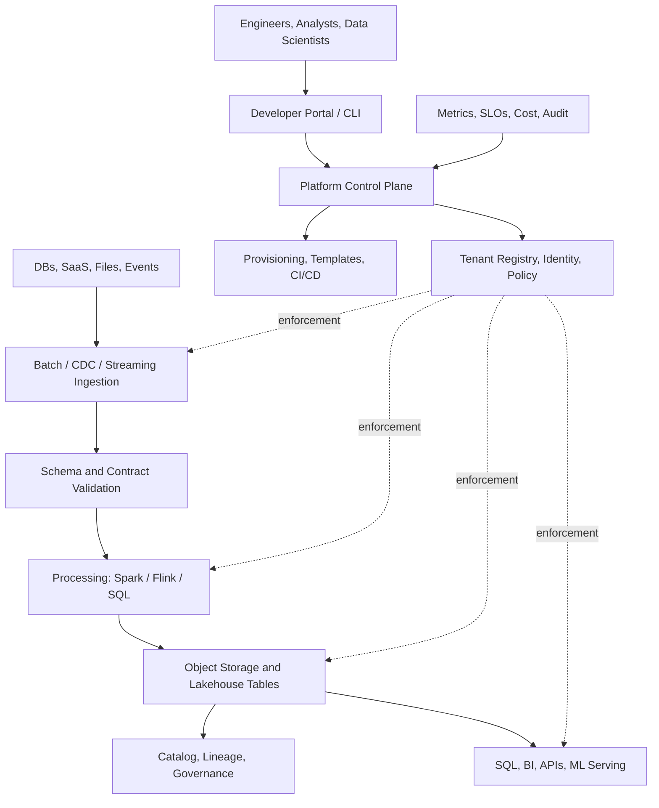

# 01. Design a Multi-Tenant Enterprise Data Platform

**Level:** Principal / Staff Data Engineer | **Interview:** 60 minutes  
**Themes:** platform architecture, tenant isolation, self-service, quotas, FinOps, governance, operating model

## 1. Problem statement
Multiple engineering, analytics, and data-science teams must ingest, transform, store, discover, and query data through a shared enterprise platform. Workloads have different latency, sensitivity, resource, and availability needs. Design a platform that offers common capabilities without creating a central bottleneck or allowing noisy neighbours to degrade other tenants.

The principal-level extension: evolve the architecture over 2–3 years without disrupting existing consumers.

## 2. Clarifying questions
| Area | Questions | Design impact |
|---|---|---|
| Tenant definition | Team, business unit, legal entity, or external customer? Can identities span tenants? | Identity and isolation boundary |
| Workloads | Batch, CDC, streaming, BI, ad-hoc SQL, ML, APIs? | Compute and serving |
| Scale | TB/day, peak events/sec, concurrent jobs/queries, table count, growth? | Capacity and partitioning |
| Freshness | Seconds, minutes, or daily by product? | Streaming versus batch |
| Sensitivity | PII/PHI, residency, retention, legal hold? | Dedicated boundaries and policy |
| Reliability | Availability, RPO, RTO, maintenance windows? | Redundancy and DR |
| Ownership | Who owns source contracts, pipelines, data products, incidents, costs? | Operating model |
| Constraints | Cloud, accounts, regions, Kubernetes, approved engines? | Deployment choices |

State assumptions explicitly. Example: 40 internal teams, 5 TB/day today, 3x growth over two years, batch and streaming, 15-minute freshness for critical operational analytics, multi-AZ production, and stronger isolation for regulated datasets.

## 3. Requirements
**Functional:** self-service onboarding; batch/CDC/event ingestion; schema and contract validation; scheduled and streaming processing; raw/standardized/curated storage; catalog and lineage; SQL/API/BI/ML access; usage metering; tenant lifecycle.

**Non-functional:** least privilege; explicit isolation guarantees; elastic but bounded resource use; durable and replayable ingestion; freshness and availability SLOs; auditable access; predictable cost; backward-compatible evolution.

## 4. Capacity estimation
- Storage/year ≈ daily raw volume × 365 × retention years, adjusted for compression, replication, and derived copies.
- At 5 TB/day, one year is about 1.8 PB logical input before compression/retention effects.
- Model tenant skew: average 125 GB/day across 40 tenants is not a safe per-tenant capacity assumption.
- Streaming throughput ≈ peak events/sec × average event bytes; add replication, protocol overhead, retention, and consumer fan-out.
- Compute sizing must account for peak concurrency, job duration, backfills, and query bursts—not only daily bytes.
Ask for retention, peak-to-average ratio, compression, backfill frequency, and query concurrency.

## 5. High-level architecture

## 6. Control plane versus data plane
**Control plane:** tenant registry, identity integration, policy, templates, provisioning, quotas, catalog registration, deployment metadata, cost attribution, and platform APIs.

**Data plane:** ingestion workers, brokers, processing engines, object storage, table formats, query engines, and serving endpoints.

Keep the control plane auditable and highly available. Define what happens if it is unavailable: already-running jobs should generally continue where safe, while provisioning and policy changes may pause. Security revocation semantics must not be weakened by stale cached policy.

## 7. Onboarding and tenant lifecycle
1. Team submits owner, purpose, data classification, region, cost centre, and workload type.
2. Policy engine validates approvals and regulatory constraints.
3. Provisioning creates identity groups, storage boundaries, compute queues, catalog namespaces, secrets references, and dashboards.
4. Templates create repository, CI/CD, contracts, pipeline scaffolding, and ownership metadata.
5. Readiness checks validate access boundaries, quotas, lineage, alerts, backup policy, and cost tags.
6. Team publishes a dataset and accepts operational ownership.

Use declarative configuration and idempotent provisioning. Model lifecycle states such as `REQUESTED → APPROVED → PROVISIONING → ACTIVE → SUSPENDED/RETIRING → DELETED`, with auditable transitions.

## 8. Tenant isolation: analyse every plane
| Plane | Shared model | Stronger isolation | Principal concern |
|---|---|---|---|
| Identity | SSO with tenant-scoped roles | Separate identity/account boundary | Confused-deputy and cross-tenant grants |
| Compute | Shared cluster with queues/pools | Dedicated cluster/account | Noisy neighbours and runtime isolation |
| Storage | Bucket prefixes and IAM | Separate buckets/accounts/keys | Policy blast radius and deletion |
| Metadata | Shared catalog namespaces | Separate catalogs/metastores | Metadata leakage and policy inheritance |
| Network | Segmented shared VPC | Separate VPC/account | Lateral movement |
| Serving | Shared endpoint with row/column policies | Dedicated endpoint | Authorization propagation |
| Operations | Shared on-call | Dedicated operational boundary | Incident blast radius |

Recommended default: logical isolation for standard workloads; dedicated accounts, keys, clusters, or endpoints for regulated, high-risk, or highly variable tenants. Define isolation tiers instead of promising identical boundaries for all.

Controls:
- Derive tenant identity from trusted authentication context, not a caller-controlled header alone.
- Enforce policy at SQL, notebooks, APIs, exports, service identities, and direct object access.
- Test negative access cases continuously.
- Treat logs, metrics, caches, temp files, metadata, and exports as possible leakage paths.
- Use per-tenant keys where risk or regulation justifies them.

## 9. Quotas, prioritization, and chargeback
Separate **quotas** (resource ceilings), **budgets** (financial guardrails), and **priority** (scheduling preference). Define workload classes, for example P0 critical ingestion, P1 business-critical transformations, P2 standard analytics, P3 ad-hoc/backfills. Apply limits to concurrent jobs, CPU/memory, executors, query slots, streaming throughput, storage, API rate, and expensive operations.

Use fair-share scheduling, admission control, queue isolation, and safe pre-emption only where supported. Attribute direct costs (compute, storage, query, egress, dedicated infrastructure) and allocate shared costs transparently. Start with showback before chargeback. Measure cost/TB ingested, cost/TB processed, cost/query, and cost/data product. CPU-hours alone is not a fair cost model.

## 10. Platform-owned versus team-owned
**Platform-owned:** identity integration, provisioning, infrastructure templates, CI/CD primitives, secrets, common connectors, orchestration primitives, catalog integration, policy enforcement, observability standards, cost telemetry.

**Team-owned:** domain semantics, source-specific logic, transformations, data contracts, quality thresholds, consumer documentation, and first-line pipeline ownership.

Treat the platform as a product. Domain teams own their data products. Define RACI for incidents, schema changes, access approvals, and cost overruns.

## 11. Reliability and failure scenarios
| Failure | Detection | Mitigation |
|---|---|---|
| Tenant floods compute | Queue depth, saturation, tenant latency | Admission control, fair-share queues, quotas, isolate offender |
| Bad schema rollout | Contract failures, null/unknown-field spikes | Quarantine, compatibility checks, versioning, replay |
| Duplicate ingestion | Duplicate-key and idempotency metrics | Stable event IDs, idempotent sink, dedupe |
| Catalog/control-plane outage | API errors, provisioning failures | Preserve safe running workloads; restore control plane |
| Cross-tenant access bug | Audit anomalies, policy tests | Deny-by-default, revoke, investigate, regression tests |
| Region failure | Health checks, replication lag | Tested failover, restore, reconcile offsets and snapshots |
| Cost runaway | Spend anomaly, budget breach | Alert, safe limits, owner escalation |

Do not claim “exactly once” across the entire distributed system without defining boundaries. Explain where source offsets, checkpoints, transactions, deduplication, and idempotent sinks provide effectively-once outcomes.

## 12. Security, governance, and lifecycle
Use federated identity, short-lived workload credentials, least privilege, encryption in transit/at rest, key rotation, classification, row/column controls, masking/tokenization, lineage, audit, retention, and deletion workflows. Deletion must consider replicas, derived tables, caches, exports, and backups according to policy. Enforce residency and cross-region transfer controls.

## 13. SLOs and adoption metrics
| Dimension | Example indicator |
|---|---|
| Ingestion | Accepted events available within freshness target |
| Pipeline | Tier-1 completion success rate |
| Freshness | Critical datasets within objective |
| Serving | Query/API availability and p95/p99 latency |
| Recovery | RPO/RTO proven in exercises |
| Isolation | Zero confirmed cross-tenant access incidents |
| Developer experience | Median approved-request to first production dataset |
| Adoption | Active teams, self-service onboarding, paved-road usage |
| Efficiency | Cost/TB, idle capacity, cost/data product |
| Quality | Contract compliance and data incident rate |

Define SLOs per service and workload class. Pipeline count alone is not a success metric.

## 14. Trade-offs
| Decision | Alternatives | Evaluation |
|---|---|---|
| Compute | Shared pools / dedicated clusters | Utilization vs isolation and noisy-neighbour risk |
| Storage | Prefix + IAM / separate accounts and keys | Cost and policy complexity vs blast-radius reduction |
| Processing | Unified engine / specialized batch and stream engines | Simplicity vs latency and operations |
| Catalog | Central / federated | Discovery consistency vs autonomy |
| Provisioning | Ticket-based / self-service API and IaC | Control vs developer lead time |

## 15. Two-to-three-year evolution
**0–6 months:** inventory tenants/workloads, define identity and isolation tiers, baseline catalog, cost tags, SLOs, and templates; pilot representative teams.

**6–18 months:** self-service provisioning, CI/CD, contracts, observability, quota management, showback, and automated policy tests.

**18–36 months:** workload-aware scheduling, stronger isolation tiers, multi-region where justified, federated domain ownership, advanced FinOps, and retirement of legacy paths.

Migrate incrementally: version APIs, expand-and-contract schemas, dual-run, reconcile counts/checksums/business aggregates, shadow-read, canary tenants, communicate deprecation windows, and retain rollback paths.

## 16. Principal-level follow-ups
**How do you guarantee isolation?** Threat-model identity, policy, storage IAM, catalog, compute credentials, network, serving, logs, caches, and exports. Use deny-by-default and automated adversarial tests. Dedicated boundaries for high-risk tenants.

**One shared Spark cluster for everyone?** Not universally. Shared pools improve utilization but risk noisy neighbours. Use workload classes, fair-share, per-tenant caps, and dedicated pools for sensitive or highly variable workloads.

**How do you allocate shared costs fairly?** Separate direct/shared costs, publish allocation logic, begin with showback, validate unit metrics with tenant owners, and watch for perverse incentives.

**What if control plane is down?** Existing workloads may continue on valid deployed configuration; new provisioning/deployments pause. Define cache expiry and revocation behaviour carefully.

**How do you handle a team requesting a different engine?** Support extension points only if security, lineage, observability, cost attribution, and ownership contracts are met.

**How do you prove success?** Measure time-to-first-data-product, self-service completion, freshness/reliability, incident burden, consumer satisfaction, adoption, unit cost, and platform toil.

## 17. Common mistakes
- Starting with product names before requirements.
- Treating a namespace or folder as complete isolation.
- Ignoring metadata, logs, caches, temp files, and exports.
- Claiming end-to-end exactly-once without semantics.
- Giving every team dedicated infrastructure without cost analysis.
- Calling dashboards observability without actionable SLOs.
- Big-bang migration and pipeline-count vanity metrics.

## 18. References
- [Kubernetes multi-tenancy](https://kubernetes.io/docs/concepts/security/multi-tenancy/)
- [Kubernetes resource quotas](https://kubernetes.io/docs/concepts/policy/resource-quotas/)
- [AWS Well-Architected Framework](https://docs.aws.amazon.com/wellarchitected/latest/framework/welcome.html)
- [AWS SaaS Lens](https://docs.aws.amazon.com/wellarchitected/latest/saas-lens/saas-lens.html)
- [Google SRE: Service Level Objectives](https://sre.google/sre-book/service-level-objectives/)
- [Apache Iceberg](https://iceberg.apache.org/docs/latest/)
- [Apache Kafka](https://kafka.apache.org/documentation/)
- [Apache Spark](https://spark.apache.org/docs/latest/)

## Interview execution framework
1. Clarify users, business outcomes, workload mix, scale, freshness, compliance, availability, RPO/RTO, budget, and ownership.
2. State assumptions; separate functional requirements from measurable non-functional requirements.
3. Estimate ingestion, retention, concurrency, throughput, and growth. Show formulas and uncertainty.
4. Draw the system boundaries and data flow before selecting products.
5. Deep-dive on the two or three highest-risk design decisions.
6. Cover failure handling, security, governance, observability, cost, and operating model.
7. Close with trade-offs, migration/evolution, and measurable success criteria.

## 60-minute walkthrough
- 0–5 min: clarify scope and assumptions.
- 5–12 min: requirements and capacity model.
- 12–22 min: high-level architecture and data flow.
- 22–38 min: deep dives into core design choices.
- 38–48 min: reliability, security, governance, and operations.
- 48–55 min: cost, SLOs, and trade-offs.
- 55–60 min: evolution roadmap and risks.

## Principal-level answer standard
A principal answer makes boundaries and ownership explicit; explains why alternatives were rejected; quantifies scale and cost; identifies failure domains and security trust boundaries; designs for operability; and describes incremental evolution without breaking consumers. Avoid product-name dumping, unsupported “exactly once” claims, and big-bang migrations.

## Evaluation rubric
| Dimension | Senior evidence | Principal evidence |
|---|---|---|
| Requirements | Captures stated needs | Resolves ambiguity and exposes conflicting objectives |
| Architecture | Sound components and flow | Clear boundaries, failure domains, and evolution strategy |
| Scale | Basic sizing | Skew, peak, concurrency, growth, and unit economics |
| Reliability | Retries and alerts | End-to-end correctness, recovery, replay, blast-radius control |
| Security | RBAC and encryption | Threat model across identity, data, metadata, network, caches, and exports |
| Leadership | Coordinates delivery | Ownership model, adoption, standards, funding, and migration governance |

## Practice exercises
- Draw the architecture from memory in 8–10 minutes.
- State five assumptions and explain which design decisions depend on them.
- Pick one component failure and walk through detection, containment, recovery, and correctness validation.
- Explain one decision you would reverse if scale, latency, or regulation changed.
- Deliver a three-minute executive summary without losing technical precision.
