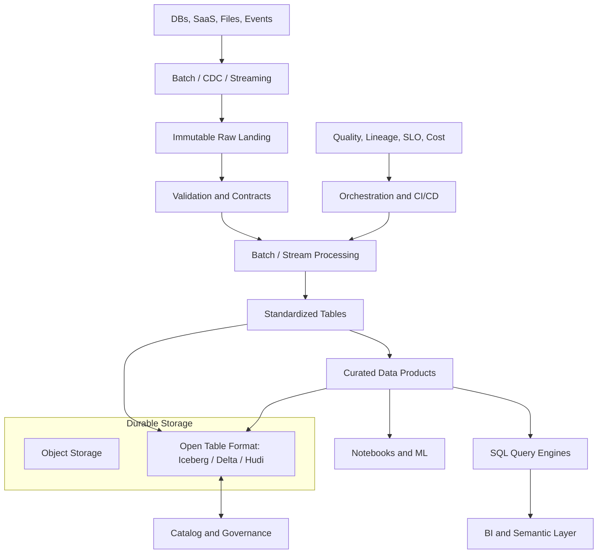

# 02. Design an Enterprise Lakehouse from Scratch

**Level:** Principal / Staff Data Engineer | **Interview:** 60 minutes  
**Themes:** open table formats, object storage, catalog, ingestion, concurrency, serving, maintenance

## 1. Problem statement
An enterprise has fragmented warehouses, object-storage lakes, and departmental ETL. It wants a governed lakehouse for BI, SQL, data science, ML, streaming ingestion, and data sharing. Design the architecture, choose table/catalog/compute patterns, handle concurrent readers and writers, and migrate without breaking consumers.

## 2. Clarifying questions
- Workloads: BI, interactive SQL, ML, streaming, data sharing?
- Volume/day, growth, table/file counts, query concurrency?
- Append, CDC upsert, deletes, late data, mutable dimensions?
- Freshness and query-latency targets?
- Do multiple engines need to read/write the same tables?
- Retention, time travel, legal hold, deletion, residency?
- Current source of truth and migration constraints?

## 3. Requirements
**Functional:** batch/CDC/stream ingestion; raw, standardized, curated datasets; ACID table operations; snapshots/time travel; schema and partition evolution; multi-engine access; catalog, lineage, ownership, classification, policies; compaction and retention.

**Non-functional:** durable storage independent of compute; correct commit semantics; query performance and concurrency; interoperability; security, audit, deletion, and cost efficiency.

## 4. Capacity model
Estimate daily bytes, growth, historical backfill, tables, files, average file size, micro-batch commit rate, query scans, concurrency, update/delete rate, and retention. For example, 2 TB/day is ~730 TB/year logical input before compression and retention. A five-minute micro-batch can create 288 commits/day/table; monitor metadata and small-file pressure. Size from measured workloads, not a generic target.

## 5. Architecture

## 6. Separate the concepts
- **Object storage:** durable file storage.
- **Table format:** manages table metadata, snapshots, schema/partition evolution, and commit semantics.
- **Catalog:** coordinates table registration/metadata access and may integrate identity/governance.
- **Query/compute engine:** executes SQL, batch, or streaming work.

These are related but not interchangeable. Evaluate the exact compatibility and concurrency guarantees of selected versions and engines.

## 7. Data zones and table design
- **Raw:** immutable source capture, source identity, ingestion timestamp, schema version, replay metadata.
- **Standardized:** validated types, normalized timestamps, deduplication, explicit contracts.
- **Curated:** business entities, aggregates, consumer-facing products.

Zones need not be separate buckets. Choose physical boundaries based on security, lifecycle, ownership, and operations. Partition by useful predicates with manageable cardinality; avoid partition explosion. Consider hidden partitioning, partition evolution, sort/clustering strategies, and query statistics where supported.

## 8. Ingestion and correctness
**Batch:** manifest/checkpoint ingestion, immutable landing, deterministic transforms, idempotent commits; retain source file identity and checksum.

**CDC:** preserve operation, primary key, source log position, transaction metadata, and source timestamp. Define deletes, out-of-order events, schema changes, and snapshot-to-stream handoff.

**Streaming:** control commit frequency and small files. Align source offsets and sink commit semantics; document replay. Validate schema and quarantine invalid events.

Correctness needs stable keys, idempotent writes, deterministic transforms, bounded late-data policy, and reconciliation. A table format does not automatically solve application-level duplicates or event ordering.

## 9. Concurrency and table maintenance
Discuss optimistic concurrency, commit conflicts/retries, atomic visibility, snapshot isolation, schema evolution, reader/writer compatibility, and multi-engine write support. Automate compaction, snapshot expiration, orphan cleanup, manifest/metadata maintenance, statistics, and retention. Coordinate maintenance with active writers/readers and use safe age thresholds.

## 10. Serving and performance
Select engines by workload: BI concurrency, exploratory SQL, ML scans, or streaming freshness. Optimize file size distribution, partition pruning, predicate/column pushdown, statistics, sorting/clustering, caching, and workload queues. Monitor scan amplification, small-file ratio, commit rate, queue wait, and tail latency.

## 11. Security and governance
Central identity; catalog and storage authorization; row/column policies at supported access paths; encryption and private connectivity; classification, lineage, audit, retention, and deletion. Ensure direct object-store access cannot bypass table-level controls. Test every engine, notebook, API, and export path.

## 12. Reliability and DR
Set RPO/RTO separately for object data, catalog metadata, orchestration state, and source offsets. Test restore of catalog pointers and snapshots, not just object existence. Reconcile offsets after failover. Failure cases: catalog outage during commit, partial writes, writer conflict, compaction racing with readers, bad schema rollout, accidental deletion, region loss.

## 13. Cost
Track storage tiers, requests/list operations, compute, query scans, egress, replication, metadata operations, and maintenance. Use workload-specific compute and autoscaling guardrails. Measure cost per successful pipeline, query, and data product—not just cost/TB stored.

## 14. Trade-offs
| Choice | Alternatives | Criteria |
|---|---|---|
| Table format | Iceberg / Delta / Hudi | Engine interoperability, concurrency, updates, ecosystem |
| Catalog | Managed / REST / Hive-compatible | Availability, auth, multi-engine support |
| Compute | Spark / Flink / Trino / warehouse | Workload, latency, concurrency, skills |
| Layout | Partition / sort / cluster | Predicates, cardinality, write amplification |

## 15. Migration
Inventory datasets, owners, consumers, SLAs, and dependencies. Pilot representative workloads. Build parity; dual-write/replicate where justified; shadow-read and reconcile counts, checksums, and business aggregates. Migrate consumers behind stable views/contracts. Maintain rollback and source-of-truth rules. Decommission only after consumer sign-off and retention/legal checks.

## 16. Principal follow-ups
- **Why not lake + warehouse?** It may be right. Compare duplicated copies, governance, workload isolation, interoperability, latency, and operating cost.
- **Thousands of tiny files?** Measure size distribution, commit rate, scan amplification; tune batch cadence and compact incrementally.
- **Reproducible ML data?** Pin snapshots/immutable versions and record code, parameters, and lineage.
- **Two engines writing one table?** Verify exact catalog and commit support, test concurrency, define conflict retry and ownership.
- **Subject deletion?** Trace raw, derived, snapshots, replicas, exports, caches, backups; execute and verify format-specific deletion/expiration.

## 17. Common mistakes
Confusing table format/catalog/engine; ignoring metadata and small files; assuming all engines can safely co-write; forgetting snapshot retention and orphan files; migrating data without policy/lineage/consumers; failing to define replay semantics.

## 18. References
- [Apache Iceberg docs](https://iceberg.apache.org/docs/latest/) | [Specification](https://iceberg.apache.org/spec/)
- [Delta Lake docs](https://docs.delta.io/) | [Apache Hudi docs](https://hudi.apache.org/docs/overview/)
- [Spark SQL performance tuning](https://spark.apache.org/docs/latest/sql-performance-tuning.html)
- [Trino docs](https://trino.io/docs/current/)
- [AWS Well-Architected](https://docs.aws.amazon.com/wellarchitected/latest/framework/welcome.html)
- [OpenLineage](https://openlineage.io/docs/)

## Interview execution framework
1. Clarify users, business outcomes, workload mix, scale, freshness, compliance, availability, RPO/RTO, budget, and ownership.
2. State assumptions; separate functional requirements from measurable non-functional requirements.
3. Estimate ingestion, retention, concurrency, throughput, and growth. Show formulas and uncertainty.
4. Draw the system boundaries and data flow before selecting products.
5. Deep-dive on the two or three highest-risk design decisions.
6. Cover failure handling, security, governance, observability, cost, and operating model.
7. Close with trade-offs, migration/evolution, and measurable success criteria.

## 60-minute walkthrough
- 0–5 min: clarify scope and assumptions.
- 5–12 min: requirements and capacity model.
- 12–22 min: high-level architecture and data flow.
- 22–38 min: deep dives into core design choices.
- 38–48 min: reliability, security, governance, and operations.
- 48–55 min: cost, SLOs, and trade-offs.
- 55–60 min: evolution roadmap and risks.

## Principal-level answer standard
A principal answer makes boundaries and ownership explicit; explains why alternatives were rejected; quantifies scale and cost; identifies failure domains and security trust boundaries; designs for operability; and describes incremental evolution without breaking consumers. Avoid product-name dumping, unsupported “exactly once” claims, and big-bang migrations.

## Evaluation rubric
| Dimension | Senior evidence | Principal evidence |
|---|---|---|
| Requirements | Captures stated needs | Resolves ambiguity and exposes conflicting objectives |
| Architecture | Sound components and flow | Clear boundaries, failure domains, and evolution strategy |
| Scale | Basic sizing | Skew, peak, concurrency, growth, and unit economics |
| Reliability | Retries and alerts | End-to-end correctness, recovery, replay, blast-radius control |
| Security | RBAC and encryption | Threat model across identity, data, metadata, network, caches, and exports |
| Leadership | Coordinates delivery | Ownership model, adoption, standards, funding, and migration governance |

## Practice exercises
- Draw the architecture from memory in 8–10 minutes.
- State five assumptions and explain which design decisions depend on them.
- Pick one component failure and walk through detection, containment, recovery, and correctness validation.
- Explain one decision you would reverse if scale, latency, or regulation changed.
- Deliver a three-minute executive summary without losing technical precision.
