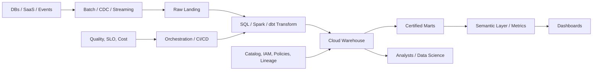

# 03. Design a Modern Cloud Data Warehouse

**Level:** Principal / Staff Data Engineer | **Interview:** 55–60 minutes  
**Themes:** analytical serving, dimensional modelling, concurrency, performance, governance, cost

## 1. Problem statement
Design a cloud warehouse for an enterprise receiving data from operational databases, SaaS, event streams, and partners. Finance, product, marketing, and operations require trusted metrics and interactive analytics with high concurrency, predictable performance, governance, and controlled cost.

## 2. Clarifying questions
What decisions/domains are supported? Volume/day and backfill size? Users, dashboards, concurrent queries? Freshness per subject? Read/transform workload mix? PII, audit, residency and retention? Self-service marts or certified central models? Current pain points and migration constraints?

## 3. Requirements
**Functional:** ingest/transform; dimensional and exploratory analytics; governed semantic definitions; RBAC, lineage, audit; data sharing; backfills and reproducible transformations.

**Non-functional:** availability, query concurrency, p95 latency, scalable compute, durable storage, workload isolation, recovery, security, and unit-cost transparency.

## 4. Capacity estimation
Estimate source volume, historical load, row/table growth, concurrent users, dashboard refresh bursts, query scan and latency, transformation windows, retention, and replication. Average concurrency hides morning bursts and month-end finance peaks. Use query history and representative profiles where possible.

## 5. Architecture

## 6. Data modelling
Declare fact grain before selecting columns. Use facts, dimensions, conformed dimensions, surrogate keys, and explicit business definitions. Choose SCD Type 1/2/hybrid based on historical reporting needs. Model late-arriving facts/dimensions, corrections, periodic snapshots, and accumulating snapshots deliberately. Govern metrics in semantic models rather than duplicating logic in dashboards.

“Active customer,” “revenue,” and “conversion” require explicit event-time, inclusion, currency, dedupe, and late-arrival rules.

## 7. Ingestion and transformation
Use batch for periodic extracts/backfills, CDC where source logs and constraints support it, streaming only when latency justifies complexity. Preserve source identity, extraction time, schema version, and replay metadata. Make transformations idempotent and version-controlled. Test contracts at boundaries and track lineage.

For incremental loads, persist watermarks/run metadata. Use overlap windows or log positions for late data. Do not advance a watermark before the corresponding data commit is durable.

## 8. Workload management
Classify interactive BI, scheduled transforms, ad-hoc exploration, data science, and backfills. Use separate compute pools/warehouses, resource monitors, queue limits, autosuspend/autoscaling, timeouts, and routing. Diagnose queue wait, execution time, spill, scan volume, and cache hit rate before changing concurrency.

## 9. Performance
Prune columns and partitions; use clustering/sort/distribution/indexing only when supported and justified by query patterns. Maintain statistics, optimize layout, materialize expensive reusable transforms selectively, and understand cache freshness/security. Review plans, skew, cardinality estimates, joins, and data movement. Avoid “always partition by date” without considering size and cardinality.

## 10. Security and governance
Federated identity, least privilege, row/column security, masking/tokenization, environment separation, secrets, private connectivity, query/export audit, certified datasets, ownership, lineage, retention, and control of extracts/notebooks/external stages.

## 11. Reliability and recovery
Define SLOs for ingestion, transformation, freshness, dashboard availability, and query latency. Test accidental deletion, bad deployment, corrupt source load, region outage, and credential compromise. Reconcile row counts and business totals. Specify backup/restore and time-travel limitations for the selected service.

## 12. Cost
Track compute runtime, concurrency, idle clusters, storage, egress, query scans, and retained history. Use budgets, alerts, auto-suspend, workload routing, query governance, and cost attribution by team/workload. Measure cost/query and cost/data product.

## 13. Trade-offs
| Decision | Alternatives | Trade-off |
|---|---|---|
| Warehouse/lakehouse | Managed warehouse / open tables | Simplicity vs interoperability/storage control |
| ELT/ETL | Warehouse / external compute | Operational simplicity vs specialized processing |
| Marts | Central / domain-owned | Consistency vs autonomy |
| Freshness | Streaming / micro-batch | Latency vs operational complexity |
| Compute | Shared / isolated pools | Utilization vs predictable latency |

## 14. Migration
Inventory reports, metrics, owners, dependencies, and query patterns. Agree canonical definitions. Migrate by domain/cohort. Run old/new transformations in parallel and reconcile row and business aggregates. Shield consumers with views or semantic layer. Use telemetry to confirm no dependencies before decommission.

## 15. Principal follow-ups
- **Metric inconsistency?** Named metric owner, grain/rules, versioned semantic model, tests, certification, visible local deviations.
- **Dashboard 10x slower?** Compare plan, scan, queue wait, layout, stats, concurrency, and changes before scaling compute.
- **One warehouse for all?** Not without evidence; isolate workload classes where it improves tail latency and cost attribution.
- **Late corrections?** Define event vs processing time, correction window, idempotent merge, and restatement expectations.
- **Prove migration?** Counts, key coverage, null distributions, aggregates, metric outputs, access, freshness, and consumer behaviour.

## 16. Common mistakes
Designing for average concurrency; no fact grain; timestamp-only CDC; duplicated metric logic; ignoring queueing; scaling before query-plan analysis; ignoring downstream extracts; decommissioning before dependency discovery.

## 17. References
- [Amazon Redshift docs](https://docs.aws.amazon.com/redshift/latest/mgmt/welcome.html)
- [Snowflake docs](https://docs.snowflake.com/)
- [dbt docs](https://docs.getdbt.com/)
- [Kimball dimensional modelling techniques](https://www.kimballgroup.com/data-warehouse-business-intelligence-resources/kimball-techniques/)
- [Spark SQL tuning](https://spark.apache.org/docs/latest/sql-performance-tuning.html)
- [Google SRE SLOs](https://sre.google/sre-book/service-level-objectives/)

## Interview execution framework
1. Clarify users, business outcomes, workload mix, scale, freshness, compliance, availability, RPO/RTO, budget, and ownership.
2. State assumptions; separate functional requirements from measurable non-functional requirements.
3. Estimate ingestion, retention, concurrency, throughput, and growth. Show formulas and uncertainty.
4. Draw the system boundaries and data flow before selecting products.
5. Deep-dive on the two or three highest-risk design decisions.
6. Cover failure handling, security, governance, observability, cost, and operating model.
7. Close with trade-offs, migration/evolution, and measurable success criteria.

## 60-minute walkthrough
- 0–5 min: clarify scope and assumptions.
- 5–12 min: requirements and capacity model.
- 12–22 min: high-level architecture and data flow.
- 22–38 min: deep dives into core design choices.
- 38–48 min: reliability, security, governance, and operations.
- 48–55 min: cost, SLOs, and trade-offs.
- 55–60 min: evolution roadmap and risks.

## Principal-level answer standard
A principal answer makes boundaries and ownership explicit; explains why alternatives were rejected; quantifies scale and cost; identifies failure domains and security trust boundaries; designs for operability; and describes incremental evolution without breaking consumers. Avoid product-name dumping, unsupported “exactly once” claims, and big-bang migrations.

## Evaluation rubric
| Dimension | Senior evidence | Principal evidence |
|---|---|---|
| Requirements | Captures stated needs | Resolves ambiguity and exposes conflicting objectives |
| Architecture | Sound components and flow | Clear boundaries, failure domains, and evolution strategy |
| Scale | Basic sizing | Skew, peak, concurrency, growth, and unit economics |
| Reliability | Retries and alerts | End-to-end correctness, recovery, replay, blast-radius control |
| Security | RBAC and encryption | Threat model across identity, data, metadata, network, caches, and exports |
| Leadership | Coordinates delivery | Ownership model, adoption, standards, funding, and migration governance |

## Practice exercises
- Draw the architecture from memory in 8–10 minutes.
- State five assumptions and explain which design decisions depend on them.
- Pick one component failure and walk through detection, containment, recovery, and correctness validation.
- Explain one decision you would reverse if scale, latency, or regulation changed.
- Deliver a three-minute executive summary without losing technical precision.
