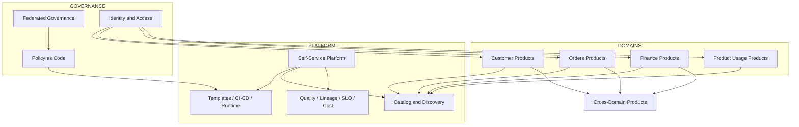

# 04. Design a Data Mesh Platform

**Level:** Principal / Staff Data Engineer | **Interview:** 60 minutes  
**Themes:** domain ownership, data products, federated governance, platform enablement, organizational design

## 1. Problem statement
A large enterprise's centralized data team cannot keep pace with dozens of business domains. Teams duplicate datasets, disagree on definitions, and wait in a central queue. Design a data mesh model that increases domain autonomy without sacrificing interoperability, security, quality, or enterprise trust.

A data mesh is not merely a distributed lake or a new tool. It changes ownership and operating model as well as technology.

## 2. Clarifying questions
How many domains and teams? Do domains have engineering/on-call capability? What are the bottlenecks? Which products cross domains? Who owns shared definitions and master data? What policies are mandatory? Is a platform team/catalog already available? What is current CI/CD and observability maturity?

## 3. Principles to operationalize
1. **Domain-oriented ownership:** domains own data they understand.
2. **Data as a product:** products have consumers, contracts, documentation, quality, freshness, support, and lifecycle.
3. **Self-serve platform:** common infrastructure removes repeated undifferentiated work.
4. **Federated computational governance:** global policies are agreed collaboratively and enforced automatically where possible.

Explain the team responsibility and technical interface implied by each principle.

## 4. Requirements
Domain teams publish discoverable products; consumers find/request/access them consistently; contracts define schema, semantics, quality, freshness, and compatibility; shared identity/catalog/lineage/policy/observability exist; cross-domain products compose; versions/deprecation are managed; access is auditable.

Non-functional: autonomy without fragmentation, interoperable semantics, enforceable security, reliable products with SLOs, low-friction onboarding, and clear ownership/cost accountability.

## 5. Architecture

Products may be tables, streams, APIs, or feature interfaces. A data product is a governed interface and operational commitment, not necessarily one physical table.

## 6. Data product contract
Minimum fields: name/domain/owner/steward; purpose and intended consumers; schema, semantics, keys, grain and event time; quality rules; freshness/availability/latency SLO; classification and access policy; lineage and source dependencies; compatibility/version/deprecation; cost attribution and lifecycle status.

Example: `orders.completed.v1` promises one record per completed order line, stable order-line ID, event timestamp, normalized currency, freshness within a defined objective, and an accountable owner. Validate the contract in CI.

## 7. Platform capabilities
Project templates, CI/CD, infrastructure provisioning, supported batch/CDC/stream patterns, storage/serving patterns, schema and contract registry, catalog/lineage, policy/access workflows, quality/SLO/alert templates, cost metering, docs/examples/support. Make the compliant path easiest; do not centralize every domain transformation.

## 8. Federated governance
Global standards: identity, classification, encryption, minimum metadata, interoperability, audit, retention. Domain decisions: business semantics, product quality thresholds, local modelling, release cadence. Joint decisions: shared identifiers, cross-domain metrics, reference data, breaking changes.

Policy councils without automation become bottlenecks; automation without accountable owners becomes brittle bureaucracy.

## 9. Interoperability and discovery
Shared conventions for identifiers, timestamps, units, currencies, schema evolution, glossary, canonical entities, product interfaces, lineage, certification, freshness, and deprecation. Federation does not mean every domain invents incompatible definitions of customer, order, or revenue.

## 10. Operating model and incentives
Roles: product owner (value/roadmap/consumers); product engineer (implementation/operations); steward (semantics/quality/policy); platform team (self-service infrastructure); governance group (enterprise standards/exceptions); consumers (contract-aware integration and feedback). Fund domain ownership. Without domain capacity and on-call responsibility, the mesh fails regardless of tools.

## 11. Reliability and security
Each product needs owner, SLO, dashboard, alert route, runbook, incident process, and consumer-impact view. Handle domain attrition through stewardship/succession. Security includes central identity, classification, purpose-based access, masking/tokenization, audit, revocation, downstream deletion, and cross-region controls. Domain ownership never implies unrestricted access.

## 12. Adoption metrics
Time to publish compliant product; products with owners/contracts/SLOs/lineage; reuse and active consumers; consumer satisfaction/time to access; freshness and quality attainment; breaking-change incidents; paved-road adoption; duplicate product reduction; ownership coverage and operational toil. Product count alone is not success.

## 13. Trade-offs and anti-patterns
| Choice | Benefit | Risk / response |
|---|---|---|
| Domain autonomy | Local speed | Fragmentation; shared standards/contracts |
| Central platform | Reuse | Bottleneck; self-service product model |
| Federated governance | Context-aware | Slow councils; policy automation |
| Certification | Trust | Bureaucracy; tiered automated checks |

Avoid renaming a central lake as mesh; treating every table as product; unfunded ownership; central approval for every change; inconsistent identifiers; ignoring consumers and lifecycle.

## 14. Roadmap
**0–3 months:** map domains, pain, consumers, ownership gaps, platform maturity; select pilot domains.  
**3–9 months:** define contract/metadata standards; deliver templates, catalog, access controls, SLO dashboards; publish high-value products.  
**9–18 months:** expand domains, automate governance, establish cross-domain patterns and funding.  
**18–36 months:** optimize product economics, federation, privacy-aware sharing, interoperability; retire duplicate central pipelines only after migration and ownership are proven.

## 15. Principal follow-ups
- **When not to adopt mesh?** If domains lack capability, funding, ownership, or platform foundations, mesh amplifies fragmentation. Improve foundations and pilot selectively.
- **Who owns cross-domain metrics?** Named business owner/steward for definition and engineering owner for implementation; shared contract and change process.
- **Prevent duplicate products?** Catalog, semantics, review, reuse metrics, clear domain boundaries; document legitimate variants.
- **Governance without slowing teams?** Templates, CI checks, policy-as-code, automatic metadata validation; human review for exceptions.
- **Product repeatedly misses SLO?** Visible incident, owner remediation, review SLO/funding realism, and transparent certification status.

## 16. Interview walkthrough
0–8 organizational context; 8–15 principles and operating model; 15–25 architecture; 25–35 product contract and interoperability; 35–45 governance/security/operations; 45–53 incentives and metrics; 53–60 roadmap and trade-offs.

## 17. References
- [Data Mesh principles and logical architecture](https://martinfowler.com/articles/data-mesh-principles.html)
- [Open Data Contract Standard](https://github.com/bitol-io/open-data-contract-standard)
- [OpenLineage](https://openlineage.io/docs/)
- [DataHub documentation](https://docs.datahub.com/)
- [AWS Well-Architected](https://docs.aws.amazon.com/wellarchitected/latest/framework/welcome.html)

## Interview execution framework
1. Clarify users, business outcomes, workload mix, scale, freshness, compliance, availability, RPO/RTO, budget, and ownership.
2. State assumptions; separate functional requirements from measurable non-functional requirements.
3. Estimate ingestion, retention, concurrency, throughput, and growth. Show formulas and uncertainty.
4. Draw the system boundaries and data flow before selecting products.
5. Deep-dive on the two or three highest-risk design decisions.
6. Cover failure handling, security, governance, observability, cost, and operating model.
7. Close with trade-offs, migration/evolution, and measurable success criteria.

## 60-minute walkthrough
- 0–5 min: clarify scope and assumptions.
- 5–12 min: requirements and capacity model.
- 12–22 min: high-level architecture and data flow.
- 22–38 min: deep dives into core design choices.
- 38–48 min: reliability, security, governance, and operations.
- 48–55 min: cost, SLOs, and trade-offs.
- 55–60 min: evolution roadmap and risks.

## Principal-level answer standard
A principal answer makes boundaries and ownership explicit; explains why alternatives were rejected; quantifies scale and cost; identifies failure domains and security trust boundaries; designs for operability; and describes incremental evolution without breaking consumers. Avoid product-name dumping, unsupported “exactly once” claims, and big-bang migrations.

## Evaluation rubric
| Dimension | Senior evidence | Principal evidence |
|---|---|---|
| Requirements | Captures stated needs | Resolves ambiguity and exposes conflicting objectives |
| Architecture | Sound components and flow | Clear boundaries, failure domains, and evolution strategy |
| Scale | Basic sizing | Skew, peak, concurrency, growth, and unit economics |
| Reliability | Retries and alerts | End-to-end correctness, recovery, replay, blast-radius control |
| Security | RBAC and encryption | Threat model across identity, data, metadata, network, caches, and exports |
| Leadership | Coordinates delivery | Ownership model, adoption, standards, funding, and migration governance |

## Practice exercises
- Draw the architecture from memory in 8–10 minutes.
- State five assumptions and explain which design decisions depend on them.
- Pick one component failure and walk through detection, containment, recovery, and correctness validation.
- Explain one decision you would reverse if scale, latency, or regulation changed.
- Deliver a three-minute executive summary without losing technical precision.
