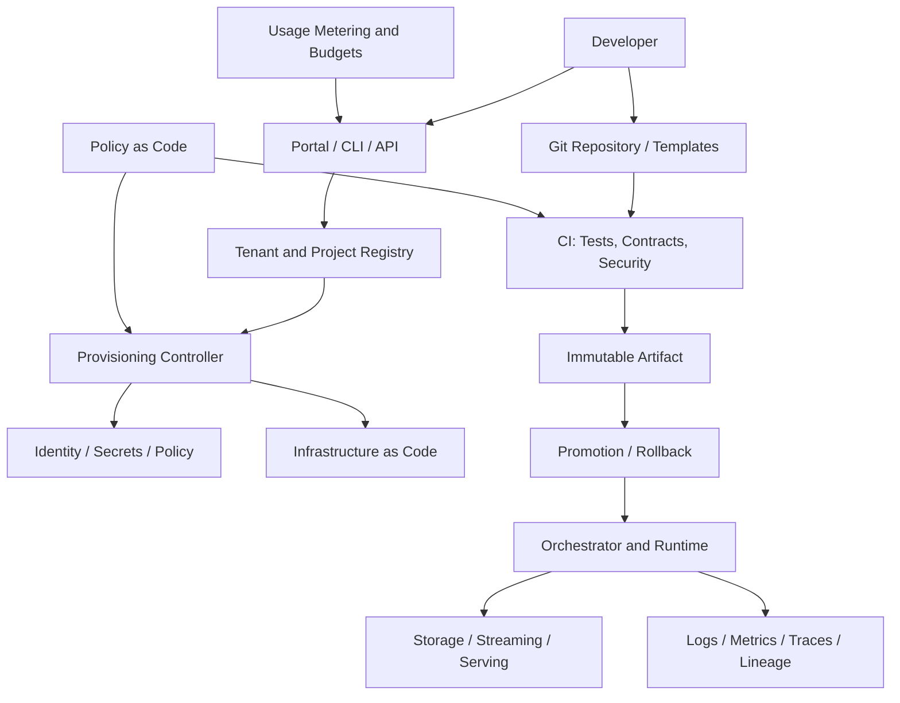

# 05. Design a Self-Service Data Platform for Multiple Engineering Teams

**Level:** Principal / Staff Data Engineer | **Interview:** 55–60 minutes  
**Themes:** developer experience, platform as product, golden paths, CI/CD, provisioning, guardrails, adoption

## 1. Problem statement
An organization has 25–100 engineering and analytics teams. Each independently provisions storage, orchestration, ingestion, compute, secrets, monitoring, and deployment workflows. This creates duplicated effort, inconsistent security, slow onboarding, and high operational toil. Design self-service capabilities so teams can build and operate pipelines safely without tickets for routine work.

The goal is not to eliminate platform engineers; it is to move them from repetitive provisioning to reusable capabilities, reliability, and platform evolution.

## 2. Clarifying questions
What are frequent developer requests and current lead times? Which workload types? What skills do teams have? What cloud/runtime/IaC stack? What production controls? Who owns code, infra, incidents and spend? How much customization? Target onboarding time and adoption?

## 3. Requirements
**Functional:** create workspaces through portal/CLI/API; generate repository/templates; provision approved infrastructure and identities; support environments; validate code/contracts/security/quality; deploy with promotion/rollback; expose logs/metrics/lineage/cost/runbooks; manage secrets/access/quotas/lifecycle.

**Non-functional:** secure-by-default, auditable, repeatable/idempotent, low time-to-first-pipeline, extensible without forks, reliable control plane, cost visibility, clear ownership.

## 4. Architecture

## 5. Platform product model
Treat developers as customers. Identify personas and jobs: onboard source, create pipeline, publish product, request access, debug failure, manage cost. Offer golden paths for common batch, CDC, streaming, and transformation workloads; documented extension points; support, docs, examples, changelog, status, and feedback. A paved road is the easiest safe path, not the only path.

## 6. Onboarding workflow
1. Authenticate through enterprise SSO.
2. Select team, environment, workload, classification, region, and cost centre.
3. Policy validates entitlement and approvals.
4. API creates project metadata and repository from versioned template.
5. Provisioning creates identities, secrets references, storage, queues, catalog namespace, and observability.
6. CI validates tests, schemas, policy, dependencies, ownership.
7. Deploy immutable artifact through environments.
8. Readiness checks verify SLOs, alerts, runbook, cost tags, access boundaries.
9. Team receives working example and operational ownership checklist.

Make workflow asynchronous and observable. Return request ID/status rather than holding an HTTP request open during provisioning.

## 7. Control plane and provisioning
Services: API gateway/authentication, tenant registry, template/artifact registry, provisioning controller/workflow, policy decision/enforcement, quota/budget, deployment state, audit/telemetry. Use declarative desired state and reconciliation loops. Provisioning must be idempotent and safe to retry. Model lifecycle and compensate for partial failure.

## 8. Golden paths
Templates for scheduled batch, CDC and merge, streaming, dbt/Spark transforms, data quality, and product publication. Include repository layout, config schema, tests/fixtures, contracts, CI/CD, secrets references (never literal secrets), logging/metrics/lineage, retry/backfill/idempotency, ownership and cost tags.

Do not create an opaque framework developers cannot debug. Expose understandable configuration and controlled escape hatches.

## 9. CI/CD and release management
Gate formatting/lint/static analysis, dependency/container scans, unit/integration tests, schema/contract compatibility, infrastructure policy, representative data quality, deployment plan, approvals for sensitive environments, canary, and post-deploy SLO/quality checks. Promote immutable artifacts. Roll back code/infra while treating irreversible data mutations separately.

## 10. Security and guardrails
SSO and short-lived workload identity; secret manager and rotation; RBAC/ABAC; approved images/dependencies; egress controls/private endpoints; classification and access; policy-as-code; provisioning/access audit; quotas and budgets. A blocked action should provide a clear reason and remediation path.

## 11. Observability
Standard telemetry: run ID, tenant, project, environment, dataset, code version, start/end, status, retries, records/bytes, freshness, lag, throughput, error category, quality result, compute/storage/query cost, correlation ID. Dashboards should answer: what is unhealthy, who is affected, which pipelines are late, what changed, who owns it, and cost impact.

## 12. Reliability and failure modes
| Failure | Response |
|---|---|
| Partial provisioning | Reconciliation, idempotent resources, compensating cleanup, visible state |
| Template upgrade breaks users | Versioned templates, compatibility policy, opt-in migration, rollback |
| CI unavailable | Queue jobs; preserve artifacts; block unsafe deploy |
| Secrets outage | Fail closed for new credentials; cache only if policy permits |
| Noisy tenant | Quotas, fair scheduling, concurrency limits |
| Platform API outage | Existing deployed jobs continue; new provisioning pauses |
| Bad deployment | Canary, health checks, rollback, data reconciliation |

## 13. Cost management
Default resource profiles, per-workload budgets, metering of compute/storage/network/orchestration/shared services. Show estimated cost before deployment and actual cost after execution. Safe limits and escalation should not silently terminate critical workloads. Measure cost/successful run, cost/TB, idle resources, cost/team/product.

## 14. Adoption metrics
Median workspace-ready time; time to first successful production pipeline; template adoption; self-service completion without intervention; deployment frequency/lead time; change failure and recovery time; API/provisioning reliability; developer satisfaction; support tickets/team; production pipelines with owner/SLO/lineage/runbook; platform toil.

Baseline before targets. Define what “workspace ready” includes and which approvals are outside the clock.

## 15. Build versus buy
| Capability | Options | Decision factors |
|---|---|---|
| Portal | Backstage / custom | UX, plugins, maintenance |
| Provisioning | Terraform / controller | State, idempotency, drift, policy |
| Orchestration | Airflow / managed service | Skills, workflow semantics, operations |
| Catalog | DataHub / managed | Discovery, lineage, governance |
| CI/CD | GitHub Actions / GitLab CI etc. | Enterprise controls, security, portability |

Build differentiating workflows; prefer mature commodity components unless requirements justify custom engineering.

## 16. Roadmap
**0–3 months:** developer research, request taxonomy, API contract, identity/project registry, one golden path pilot.  
**3–6 months:** provisioning, CI/CD, observability, cost tags, docs; onboard 3–5 teams.  
**6–12 months:** more templates, policy-as-code, quotas/budgets, catalog/lineage, self-service access.  
**12–24 months:** portal maturity, template migration automation, multi-region if required, platform SLOs and workload optimization.

## 17. Principal follow-ups
- **Avoid low adoption?** Research developer workflows, solve repeated pain, pilot, measure lead-time reduction and completion. Mandates are not product value.
- **Custom requirements?** Versioned extension points, policy boundaries, exception lifecycle; promote repeated exceptions into product features.
- **Upgrade hundreds of templates?** Separate template version from generated code; migration tooling, automated PRs, compatibility and deprecation policy.
- **Control plane down?** Existing workloads usually continue; new provisioning/deploy pauses. Define cached state, credential expiry, revocation and reconciliation.
- **Prove self-service?** Lead time, completion without intervention, adoption, reliability, satisfaction, reduced toil.

## 18. Common mistakes
Building portal before understanding workflows; UI-only self-service; non-idempotent provisioning; unversioned templates; missing security/cost CI gates; no pipeline owner/on-call; no developer metrics; permanent platform forks for every exception.

## 19. References
- [Backstage documentation](https://backstage.io/docs/)
- [Terraform documentation](https://developer.hashicorp.com/terraform/docs)
- [GitHub Actions](https://docs.github.com/actions)
- [Kubernetes controllers](https://kubernetes.io/docs/concepts/architecture/controller/)
- [Kubernetes resource quotas](https://kubernetes.io/docs/concepts/policy/resource-quotas/)
- [Google SRE SLOs](https://sre.google/sre-book/service-level-objectives/)
- [OpenLineage](https://openlineage.io/docs/)

## Interview execution framework
1. Clarify users, business outcomes, workload mix, scale, freshness, compliance, availability, RPO/RTO, budget, and ownership.
2. State assumptions; separate functional requirements from measurable non-functional requirements.
3. Estimate ingestion, retention, concurrency, throughput, and growth. Show formulas and uncertainty.
4. Draw the system boundaries and data flow before selecting products.
5. Deep-dive on the two or three highest-risk design decisions.
6. Cover failure handling, security, governance, observability, cost, and operating model.
7. Close with trade-offs, migration/evolution, and measurable success criteria.

## 60-minute walkthrough
- 0–5 min: clarify scope and assumptions.
- 5–12 min: requirements and capacity model.
- 12–22 min: high-level architecture and data flow.
- 22–38 min: deep dives into core design choices.
- 38–48 min: reliability, security, governance, and operations.
- 48–55 min: cost, SLOs, and trade-offs.
- 55–60 min: evolution roadmap and risks.

## Principal-level answer standard
A principal answer makes boundaries and ownership explicit; explains why alternatives were rejected; quantifies scale and cost; identifies failure domains and security trust boundaries; designs for operability; and describes incremental evolution without breaking consumers. Avoid product-name dumping, unsupported “exactly once” claims, and big-bang migrations.

## Evaluation rubric
| Dimension | Senior evidence | Principal evidence |
|---|---|---|
| Requirements | Captures stated needs | Resolves ambiguity and exposes conflicting objectives |
| Architecture | Sound components and flow | Clear boundaries, failure domains, and evolution strategy |
| Scale | Basic sizing | Skew, peak, concurrency, growth, and unit economics |
| Reliability | Retries and alerts | End-to-end correctness, recovery, replay, blast-radius control |
| Security | RBAC and encryption | Threat model across identity, data, metadata, network, caches, and exports |
| Leadership | Coordinates delivery | Ownership model, adoption, standards, funding, and migration governance |

## Practice exercises
- Draw the architecture from memory in 8–10 minutes.
- State five assumptions and explain which design decisions depend on them.
- Pick one component failure and walk through detection, containment, recovery, and correctness validation.
- Explain one decision you would reverse if scale, latency, or regulation changed.
- Deliver a three-minute executive summary without losing technical precision.
