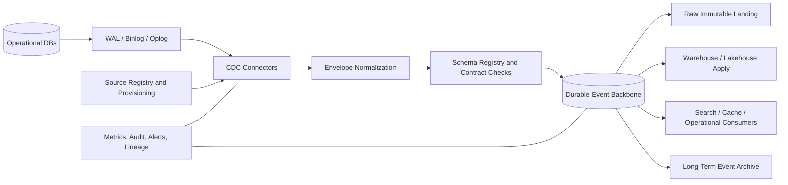

# 01. Design a High-Throughput CDC Ingestion Platform

**Level:** Principal / Staff Data Engineer  
**Interview duration:** 60 minutes  
**Core themes:** database log capture, Kafka, Debezium, schema evolution, ordering, replay, idempotent sinks, source protection

## 1. Problem statement

Design a shared change-data-capture (CDC) platform that continuously captures changes from hundreds of operational databases—such as PostgreSQL, MySQL, and MongoDB—and delivers them to a central event backbone and downstream lakehouse/warehouse consumers.

The platform must support initial snapshots and continuous changes, preserve source semantics, tolerate connector and broker failures, support replay, protect production databases, and onboard new sources with minimal bespoke engineering.

Principal-level extension: how do you guarantee that a database migration, connector upgrade, schema change, or regional failure does not silently corrupt downstream state?

## 2. Clarifying questions

| Topic | Questions | Why it matters |
|---|---|---|
| Source inventory | Which engines/versions? Self-managed or managed? Number of DBs/tables? | Connector compatibility and operational model |
| Capture mode | Initial snapshot, log-based CDC, polling, or hybrid? | Consistency and source load |
| Scale | Changes/sec average and peak? Average/max record size? | Partitions, broker, connector capacity |
| Semantics | Required ordering: global, per table, or per primary key? | Partition key and parallelism |
| Latency | Seconds, sub-minute, or minutes? | Poll/flush/commit cadence |
| Retention | How long must changes be replayable? | Broker retention and archive |
| Consumers | Lakehouse, cache, search, services, warehouse? | Fan-out and schema contract |
| Data policy | PII/PHI, masking, residency, deletes? | Security and downstream deletion |
| Source constraints | Can replication slots/binlogs be retained? Limits on connections and I/O? | Source protection |
| Recovery | RPO/RTO and acceptable re-snapshot duration? | Checkpointing and DR |

State assumptions, for example: 300 databases, 20,000 tables, 150k changes/sec average and 600k peak, 1.5 KB average event, p95 source-to-broker latency under 10 seconds, 7-day hot replay and 90-day archive, per-primary-key ordering, and multi-AZ deployment. Treat these as interview assumptions, not universal sizing rules.

## 3. Requirements

### Functional
- Register source databases and tables through a governed onboarding workflow.
- Capture initial snapshots and ongoing inserts, updates, and deletes.
- Preserve source identity, transaction/log position, event timestamp, operation, key, and schema version.
- Publish events to durable topics with tenant/domain isolation.
- Support schema registry/contract validation, routing, filtering, masking, and controlled fan-out.
- Support replay, re-snapshot, connector upgrades, pause/resume, and controlled decommissioning.
- Expose source lag, connector health, broker health, data quality, and cost.

### Non-functional
- Low and predictable end-to-end latency.
- No unbounded source impact or replication-log growth.
- At-least-once transport with idempotent downstream state application.
- Recoverable offsets and auditable checkpoints.
- Strong access controls and sensitive-data handling.
- Horizontal scaling and tenant isolation.
- Explicit freshness, availability, and recovery objectives.

## 4. Capacity estimation

Use a transparent model rather than guessing cluster size.

Assume 150,000 changes/sec average, 600,000 peak, and 1.5 KB serialized payload:
- Average payload ingress ≈ 225 MB/sec before protocol and replication overhead.
- Peak payload ingress ≈ 900 MB/sec.
- Daily logical payload ≈ 19.4 TB/day at the average rate.
- With replication factor 3, broker write traffic and disk requirements are materially higher; account for compression, indexes, segment overhead, retention, and consumer traffic separately.

For a 7-day hot retention period, start with:
`logical daily bytes × retention days × replication factor ÷ effective compression ratio`
Then add headroom and segment/index overhead. Do not assume compression ratio without measuring representative payloads.

Connector sizing:
- Estimate changes/sec per source and per connector task.
- Check source log generation and retention limits.
- Include snapshot throughput and the extra read load during initial capture.
- Model skew: one very active database/table can dominate a connector or partition.
- Estimate consumer fan-out separately; each independent consumer group reads the stream again.

Ask whether the target rate is sustained, bursty, or a short peak; average throughput is not a safe capacity target.

## 5. High-level architecture

### Main components
1. **Source registry/control plane:** owners, source version, connector config, table allowlist, data classification, secret reference, partitioning key, retention and SLO.
2. **Connector fleet:** log-based CDC connectors deployed in fault-isolated workers.
3. **Schema/contract service:** compatibility checks, schema IDs, ownership and approval.
4. **Event backbone:** durable partitioned topics, quotas, ACLs, retention, replication.
5. **Normalization/routing:** standard envelope, topic naming, optional filtering and tokenization.
6. **Consumers:** immutable raw archive and materialized downstream tables.
7. **Observability/control:** lag, source log retention, connector restarts, broker saturation, data quality, cost.

Keep control-plane provisioning separate from the high-volume data plane. Existing connectors should continue safely during a temporary control-plane outage, subject to credential expiry and policy-revocation requirements.

## 6. CDC event contract

A normalized envelope should preserve at least:
- `source.system`, `source.database`, `source.schema`, `source.table`
- Primary/business key
- Operation (`c`, `u`, `d`, snapshot/read marker as appropriate)
- `before` and `after` images where available and permitted
- Source transaction ID and log position (LSN/binlog position/oplog token)
- Source commit timestamp and connector processing timestamp
- Schema identifier/version
- Snapshot flag and transaction metadata
- Stable event identity or deterministic deduplication key

Do not discard source log position during normalization. It is essential for ordering, audit, replay, and gap detection.

## 7. Initial snapshot and streaming handoff

The snapshot-to-log handoff is one of the hardest correctness problems.

A robust connector must establish a consistent snapshot boundary and coordinate it with the log position from which streaming resumes. Explain the selected connector's documented algorithm and limitations rather than inventing a generic guarantee.

Interview walkthrough:
1. Connector obtains a consistent snapshot boundary according to source/connector semantics.
2. Snapshot rows are emitted with snapshot metadata.
3. Changes after the boundary are captured from the transaction log.
4. Downstream applies snapshot and change events with a defined ordering/deduplication rule.
5. Reconciliation validates counts, keys, and sampled business aggregates.
6. Snapshot completion is not declared until the connector and sink checkpoints are durable.

Discuss long-running snapshots, table locks or MVCC impact, replication-slot/binlog retention, concurrent DDL, and restart behaviour.

## 8. Ordering, keys, and delivery semantics

- A partitioned event log guarantees ordering only within a partition, not globally.
- Key by the entity/primary key when per-entity order is required.
- If multiple rows in a transaction must be observed atomically, preserve transaction metadata and decide whether consumers need transaction-boundary buffering.
- A connector may resend records after a crash; downstream must tolerate duplicates.
- Use source log position plus key/operation (or a stable event ID) for deterministic deduplication.
- For upsert sinks, apply only events newer than the stored source position where source semantics permit.
- Deletes must become durable tombstones/deletion records and propagate to derived products according to policy.

“Exactly once” at the broker does not automatically mean exactly-once effects in an external database or lakehouse. State the boundary: source capture, broker transaction, consumer offset, and sink commit are separate operations.

## 9. Schema evolution and DDL

Define compatibility policy by consumer contract:
- Additive nullable field: often backward compatible, but test defaults and downstream assumptions.
- Rename/drop/type narrowing: usually breaking unless explicitly migrated.
- Semantic change with same physical type: can be breaking even when schema registry accepts it.
- Primary-key change: affects partitioning, deduplication, and sink merge semantics.
- DDL propagation: decide whether to auto-apply, quarantine, or require approval.

Use schema versioning, compatibility checks in CI, consumer inventory, expand-and-contract migrations, and a quarantine path for incompatible events. Do not silently coerce a changed type into null.

## 10. Protecting operational databases

- Prefer log-based capture to repeated full-table polling when supported.
- Monitor replication-slot/binlog/oplog retention and disk growth.
- Set source-specific connector concurrency and snapshot throttles.
- Use read replicas only when their replication lag and log semantics meet correctness needs.
- Bound snapshot scans and avoid synchronized snapshots across all sources.
- Define emergency pause and slot cleanup procedures; do not drop a slot casually if it is the only recovery point.
- Agree source-owner change windows and incident escalation.

## 11. Failure handling and recovery

| Failure | Detection | Response and correctness check |
|---|---|---|
| Connector crashes | Task status, heartbeat, source lag | Restart from durable source offset; verify no log gap |
| Replication slot grows | Retained WAL/binlog bytes, disk trend | Throttle/repair connector; alert source owner; protect DB disk |
| Broker unavailable | Produce errors, ISR/replica health | Buffer only within safe bounds; pause capture if source retention risk is understood |
| Duplicate after restart | Duplicate event IDs/log positions | Idempotent sink and dedupe; count duplicate rate |
| Schema incompatibility | Registry rejection, deserialization errors | Quarantine, alert owner, compatibility fix, replay |
| Poison record | Repeated failure at same offset | Bounded retries, dead-letter/quarantine with source coordinates |
| Consumer falls behind | Consumer lag and age | Scale or throttle; assess retention horizon; replay if required |
| Region loss | Broker/connector health, replication lag | Promote tested DR path; reconcile source offsets and sink state |

A dead-letter queue is not a substitute for resolving data loss: retain original payload, headers, source coordinates, error, schema version, and replay workflow.

## 12. Security and governance

- Use workload identities and short-lived credentials where supported.
- Store secrets in a managed secret store; rotate without exposing credentials in config or logs.
- Apply source-level and topic-level ACLs; separate producer and consumer privileges.
- Classify fields and apply masking/tokenization before broad distribution where feasible.
- Ensure raw topics and archives have stricter access than curated products.
- Audit reads, exports, schema changes, connector changes, and access grants.
- Enforce retention and deletion through downstream lineage, not only broker TTL.
- Treat connector logs, DLQ payloads, metrics labels, and debugging dumps as sensitive data paths.

## 13. Observability and SLOs

Measure each stage, not only connector “running” status:
- Source log position and age of oldest unprocessed change.
- Connector throughput, task restarts, snapshot progress, errors.
- Broker produce latency, bytes/sec, under-replicated partitions, disk headroom.
- Consumer lag in records and, more importantly, event age.
- End-to-end source commit to sink availability latency.
- Schema rejection, quarantine, duplicate, and reconciliation rates.
- Cost per source, table, GB, and successful downstream dataset.

Example SLO: 99% of eligible source changes become queryable in the raw landing zone within 30 seconds over a rolling 28-day window. Define exclusions, measurement points, and alerting/error-budget policy with consumers.

## 14. Trade-offs

| Decision | Option A | Option B | Principal reasoning |
|---|---|---|---|
| Capture | Log-based CDC | Polling | Log fidelity/low source load vs source compatibility and simpler setup |
| Deployment | Shared connector fleet | Dedicated fleet per domain | Utilization vs blast-radius and isolation |
| Keying | Primary key | Source/table key | Per-entity order vs skew and partition count |
| Retention | Broker-only | Broker + object archive | Operational simplicity vs long replay horizon |
| Schema | Strict reject | Permissive evolution | Safety vs producer velocity |
| Sink | Raw append + downstream apply | Direct materialized sink | Audit/replay vs fewer hops |

## 15. Migration and 2-year evolution

**0–6 months:** inventory sources; define standard envelope and ownership; pilot two database engines; implement source protection, lag metrics, schema registry, raw archive, and replay runbook.

**6–12 months:** self-service source onboarding, connector fleet isolation, automated compatibility checks, cost attribution, standardized sink libraries, and DR drills.

**12–24 months:** multi-region where justified, workload-aware scheduling, automated source capacity guardrails, data contracts integrated into producer CI, and lineage-driven deletion.

Migrate from legacy pipelines source-by-source: parallel capture, compare log positions and row-level/business aggregates, shadow downstream materialization, canary consumers, then retire old path only after parity and rollback criteria pass.

## 16. Principal-level follow-up questions

**Q: How do you avoid missing changes during snapshot plus streaming?**  
A: Explain the source connector's snapshot boundary and log handoff algorithm. Persist source coordinates, validate restart behaviour, monitor retained-log headroom, and reconcile snapshot counts and post-boundary changes. Do not hand-wave this as “Debezium handles it.”

**Q: What if a replication slot is retained for days?**  
A: Track retained bytes and source disk headroom, set warning/critical thresholds, identify stalled connector/consumer, throttle snapshot or repair capacity, and define controlled slot recovery. Dropping a slot may make a gap unrecoverable without a re-snapshot.

**Q: How do you preserve transaction order?**  
A: Partition by key for per-key ordering; preserve transaction metadata and source coordinates. If consumers require atomic multi-row transactions, implement transaction-aware buffering/commit semantics and assess throughput impact.

**Q: How do you handle a primary-key update?**  
A: Treat as delete-old-key plus insert-new-key if source semantics emit that representation; ensure old-key tombstone and new-key upsert are ordered and sink logic handles both.

**Q: What is your exactly-once story?**  
A: Define each boundary. Prefer at-least-once transport plus stable event identity, durable checkpoints, idempotent sink writes, and reconciliation for effectively-once business state.

**Q: How do you support a new source engine?**  
A: Validate connector support/version, log semantics, snapshot consistency, DDL support, authentication, failover, and operational burden. Run compatibility and failure-injection tests before production onboarding.

## 17. Common interview mistakes
- Saying CDC is just a database connector pushing JSON.
- Ignoring snapshot/log handoff.
- Treating Kafka partition ordering as global ordering.
- Losing source coordinates during normalization.
- Assuming schema registry solves semantic compatibility.
- Ignoring replication-slot/binlog retention and source disk risk.
- Claiming end-to-end exactly-once without sink idempotency.
- Designing DLQ but no replay ownership or audit.
- Measuring record lag but not event age/freshness.

## 18. References
- [Debezium documentation](https://debezium.io/documentation/reference/stable/)
- [Debezium PostgreSQL connector](https://debezium.io/documentation/reference/stable/connectors/postgresql.html)
- [Debezium MySQL connector](https://debezium.io/documentation/reference/stable/connectors/mysql.html)
- [Apache Kafka documentation](https://kafka.apache.org/documentation/)
- [Kafka design](https://kafka.apache.org/documentation/#design)
- [Confluent Schema Registry compatibility](https://docs.confluent.io/platform/current/schema-registry/fundamentals/schema-evolution.html)
- [PostgreSQL logical decoding](https://www.postgresql.org/docs/current/logicaldecoding.html)
- [MySQL binary log](https://dev.mysql.com/doc/refman/8.4/en/binary-log.html)

## Reusable principal-level interview method

### 1. Clarify before designing
Ask about source systems and ownership; event/batch semantics; peak and sustained throughput; payload size; ordering scope; latency and freshness; replay horizon; retention; data sensitivity; regions; consumers; availability; RPO/RTO; budget; and operational ownership. If the interviewer does not provide values, state plausible assumptions and show how the design changes when they move.

### 2. Make semantics explicit
Distinguish event time from processing time; at-least-once delivery from effectively-once business outcomes; ordering per key from global ordering; source acknowledgement from durable sink commit; schema compatibility from semantic compatibility; and replay from backfill. Do not use “exactly once” as an unexplained slogan.

### 3. Structure the answer
1. Requirements and assumptions.
2. Capacity estimates and peak model.
3. High-level architecture and trust/failure boundaries.
4. Data contracts, partitioning, ordering, and delivery semantics.
5. State, checkpoints, offsets, retries, and replay.
6. Backpressure, scaling, and isolation.
7. Security, governance, observability, SLOs, and cost.
8. Failure walkthroughs and recovery.
9. Alternatives, trade-offs, and phased evolution.

### 4. Principal-level evidence
A strong answer identifies who owns each component, what is the source of truth, how correctness is proven, how a failure is contained, how capacity and cost are attributed, how schema changes are governed, and how migration proceeds without breaking consumers.

### 5. Suggested 60-minute pacing
- 0–7 min: clarify scope, requirements, assumptions.
- 7–13 min: capacity and workload model.
- 13–23 min: architecture and end-to-end data flow.
- 23–40 min: deep dive into semantics, state, scale, and failure modes.
- 40–50 min: security, governance, observability, SLOs, and cost.
- 50–57 min: trade-offs and evolution.
- 57–60 min: concise summary and risks.

### 6. Self-scoring rubric
Score each dimension 1–4: 1 = missing, 2 = basic, 3 = sound senior-level, 4 = principal-level with explicit trade-offs and operating model.
- Requirements and assumptions
- Capacity and bottleneck analysis
- Architecture and boundaries
- Correctness and delivery semantics
- Resilience and recovery
- Security and governance
- Observability and SLOs
- Cost and FinOps
- Ownership, migration, and evolution

A good practice target is no dimension below 3, with 4 in correctness, reliability, and trade-offs.

## Practical interview rehearsal

### Whiteboard drill
Draw the architecture without notes in 8 minutes. Label:
- Trust boundaries and identities.
- Durable state and source of truth.
- Retry/replay/checkpoint boundaries.
- Backpressure and isolation controls.
- Observability and ownership.

### Verbal drill
Deliver a 3-minute summary in this order: problem and assumptions; architecture; key correctness decision; biggest failure mode; cost/security trade-off; evolution plan.

### Challenge drill
Change one assumption at a time:
1. Peak throughput increases by 10x.
2. Latency target tightens from minutes to seconds.
3. One tenant generates 40% of traffic.
4. The source or sink is unavailable for six hours.
5. A breaking schema change arrives during a backfill.
Explain which components change, which guarantees weaken, and how you protect existing consumers.

### Interviewer scoring prompts
- Did the candidate quantify peak load and skew?
- Did they identify the real source of truth and durable checkpoint?
- Did they explain duplicate, loss, ordering, and replay semantics?
- Did they identify a failure mode that crosses component boundaries?
- Did they include security, SLOs, cost, and ownership?
- Did they describe a safe incremental migration?
