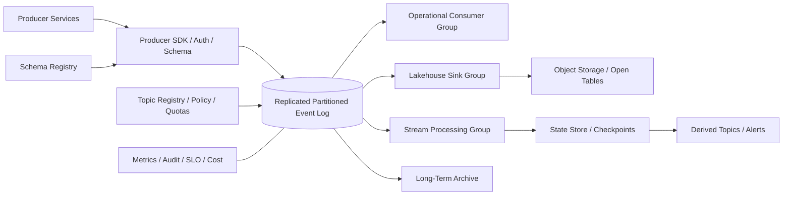

# 02. Design a Real-Time Event Streaming Platform

**Level:** Principal / Staff Data Engineer  
**Interview duration:** 60 minutes  
**Core themes:** Kafka architecture, partitioning, durability, consumer groups, schema governance, backpressure, multi-tenancy

## 1. Problem statement

Design an enterprise event streaming platform used by product services, operational systems, analytics, fraud detection, and data engineering teams. Producers publish business events; multiple independent consumer groups process them for real-time actions, lakehouse ingestion, metrics, and downstream services.

The platform must handle bursty traffic, preserve required ordering, isolate tenants, support replay, and remain operable during broker, network, consumer, and region failures.

Principal-level extension: how would you evolve from a single shared cluster to a governed, multi-region event platform as traffic and organizational adoption grow?

## 2. Clarifying questions

- What are event classes: business events, CDC, telemetry, commands?
- Average and peak events/sec, payload size, burst duration?
- Ordering scope: key, entity, partition, or global?
- Delivery latency and durability requirements?
- Number of topics, partitions, producers, consumer groups?
- Replay horizon and retention?
- Are consumers independent, and can they tolerate duplicates?
- Multi-tenant security, quotas, data classification, residency?
- Multi-region active-active, active-passive, or regional isolation?
- What is the acceptable loss/duplication/reordering behaviour?

Assumptions example: 250k events/sec average, 1M peak, 2 KB average payload, 100 producer services, 60 consumer groups, 24-hour hot retention plus 30-day archive, p99 publish-to-consume under 2 seconds for priority events.

## 3. Requirements

**Functional:** publish/subscribe; topic lifecycle; schema registry; ACLs; consumer groups; replay; dead-letter handling; event filtering/routing; archive; metrics and audit; self-service onboarding.

**Non-functional:** durable replicated storage; bounded publish/consume latency; horizontal scale; partition-level ordering; tenant isolation; recoverability; predictable cost; compatibility and operational simplicity.

## 4. Capacity and partition model

At 250k events/sec × 2 KB:
- Payload ingress ≈ 500 MB/sec average.
- Peak ≈ 2 GB/sec.
- Daily payload ≈ 43.2 TB before compression and protocol overhead.
- With replication factor 3, broker storage/write amplification must account for three replicas, retention, segment overhead, and compression.

Partition count is not chosen by a universal rule. Derive it from:
1. Required parallelism for the busiest consumer group.
2. Per-partition throughput observed in benchmark.
3. Number of brokers and replica placement.
4. Key distribution and skew.
5. Recovery/rebalance cost.
6. Operational overhead and metadata load.

Too few partitions limit parallelism; too many increase metadata, file handles, recovery, and rebalance overhead. Partition expansion can change key-to-partition mapping for common partitioners, so assess ordering and stateful consumer implications before increasing partitions.

## 5. Architecture

## 6. Topic and event design

Topic naming should encode domain and event purpose, not arbitrary team internals. Define owner, classification, retention, schema, partition key, compatibility mode, SLO, and lifecycle metadata.

Event envelope:
- Event ID, event type, schema version.
- Producer/service identity.
- Entity/business key.
- Event time and publish time.
- Correlation/causation IDs.
- Payload and classification metadata.

Avoid stuffing unbounded payloads into events. For large objects, store the object in durable storage and publish a reference with immutable identity, checksum, and access policy.

## 7. Partitioning and ordering

A partition is the unit of ordered log and consumer parallelism. Use stable keys to co-locate events that require ordering (for example, customer ID or order ID). Do not promise global ordering unless the system is intentionally serialized and capacity consequences are accepted.

Hot keys can overload a single partition. Mitigations include redesigning key granularity where semantics permit, splitting independent sub-entities, producer-side aggregation, or dedicated topics for exceptionally hot tenants. Do not salt a key if doing so breaks required entity order.

## 8. Producer design

Use asynchronous sends with bounded in-flight requests, batching, compression, retries, and acknowledgements consistent with durability requirements. Configure idempotent producer support where available and understand its scope and constraints. Use stable event IDs because producer retries and upstream application retries can still create logical duplicates.

Define:
- Required acknowledgement level and replication policy.
- Retry budget and delivery timeout.
- Batch size/linger trade-off.
- Compression and CPU impact.
- Maximum request and message size.
- Authentication and schema validation.
- Outbox pattern for atomically publishing events with a database transaction.

The transactional outbox pattern avoids the dual-write problem: application state and outbox record commit in one database transaction; a relay publishes the outbox event; downstream deduplicates by event ID.

## 9. Consumer groups and offset management

A consumer group distributes partitions among members. Parallelism is bounded by partition count for a single group. Offset commit timing is a correctness decision:
- Commit before processing: possible loss if processing fails after commit.
- Commit after processing: possible duplicate processing if crash occurs before commit.
- For external sinks, coordinate offset and sink commit where possible, or use idempotent sink writes and a recoverable checkpoint protocol.

Handle rebalances, slow members, max poll intervals, poison messages, and consumer lag. Monitor lag age, not just record count. Use cooperative/sticky assignment where supported and test deployment/rebalance behaviour.

## 10. Multi-tenancy and governance

Model tenant boundaries at topic, principal, quota, network, encryption, and operational levels. Use per-tenant or per-domain ACLs, producer identity, consumer group naming, quotas for ingress/egress/connections, and clear retention tiers. Prevent tenant-controlled topic names or headers from being trusted as authorization claims.

Set topic ownership, data classification, schema compatibility, retention, and deletion requirements in a registry. Build automated checks for unowned topics, over-retention, public access, and schema violations.

## 11. Backpressure and overload

Backpressure is end-to-end. If consumers slow:
1. Lag grows.
2. Retention headroom shrinks.
3. Broker disk and network load may increase.
4. Downstream freshness SLOs fail.
5. Producers may need bounded throttling or load shedding.

Define priorities and overload policy by event class. Critical business events may be protected while low-priority telemetry is sampled or dropped under explicit policy. Use quotas, bounded buffers, circuit breakers, consumer scaling, and admission control. Never add unbounded in-memory queues as a “fix.”

## 12. Reliability and failure scenarios

| Failure | Design response |
|---|---|
| Broker node loss | Replication, leader election, rack/AZ-aware placement, monitor under-replicated partitions |
| AZ loss | Multi-AZ replica placement and tested recovery objectives |
| Producer retry duplicates | Stable event ID, idempotent producer semantics, downstream dedupe |
| Consumer crash | Reprocess from committed offset; idempotent effects |
| Poison event | Bounded retry, quarantine/DLQ with original offset and replay tooling |
| Hot partition | Key-distribution telemetry, key redesign, isolated topic/tenant |
| Retention expiry while lagging | Alert on lag age/headroom; scale or archive; incident escalation |
| Rebalance storm | Stable membership, deployment control, partition assignment tuning |
| Region outage | Explicit replication/failover design and duplicate/order reconciliation |

## 13. Security

TLS in transit, encryption at rest, workload identity, least-privilege ACLs, secret rotation, private network paths, audit logs, sensitive-field classification, payload minimization, and controlled archive access. Consumer access is data access: audit and review it. Apply deletion requirements to archives and derived systems, not only broker retention.

## 14. SLOs and observability

- Publish success rate and p95/p99 publish latency.
- Consumer processing latency and lag age.
- Under-replicated partitions and ISR changes.
- Broker disk/network/CPU and request queue time.
- Rebalance frequency and duration.
- Schema rejection and DLQ rate.
- Per-tenant throughput, quota throttling, and spend.
- End-to-end event availability for critical products.

Example: 99.9% of priority events are available to designated consumer groups within 2 seconds, measured from producer acceptance to consumer processing acknowledgement. Define whether the SLO includes consumer-owned outages.

## 15. Cost and trade-offs

| Decision | Trade-off |
|---|---|
| Shared cluster vs dedicated clusters | Better utilization vs isolation and blast radius |
| Replication factor | Durability vs storage/network cost |
| Retention vs archive | Fast replay vs broker cost |
| More partitions | Parallelism vs metadata/recovery overhead |
| Compression | Lower network/disk vs CPU and latency |
| Multi-region sync vs async replication | Lower RPO vs latency/complexity |
| One event envelope vs domain-specific payloads | Standard tooling vs domain expressiveness |

## 16. Evolution roadmap

**0–6 months:** define event taxonomy, identity, schema contracts, topic registry, quotas, SLO dashboards, and producer libraries.

**6–12 months:** self-service topic provisioning, outbox guidance, automated contract tests, archive/replay, tiered retention, and workload isolation.

**12–24 months:** regional clusters where latency/residency requires, cross-region disaster recovery, automated capacity planning, domain event ownership, and policy-as-code.

Migrate consumers gradually with dual-read or shadow groups; compare counts and business effects; preserve old topics through a deprecation window; never cut over without replay and rollback plans.

## 17. Principal-level follow-ups

**Q: Can one consumer group have more active consumers than partitions?**  
A: Extra consumers are idle for that topic's partition assignment. Increase partitions only after assessing key mapping, state, and recovery impact.

**Q: Does Kafka guarantee exactly once?**  
A: Its transactions can provide exactly-once processing semantics within supported Kafka read-process-write boundaries. External side effects still require idempotency or a coordinated transaction protocol.

**Q: How do you handle a consumer that is 8 hours behind?**  
A: Compare lag age with retention headroom and SLO. Determine whether to scale, isolate, skip only under an approved policy, or replay from archive. Validate downstream correctness after recovery.

**Q: How do you avoid dual writes from an application DB and event topic?**  
A: Transactional outbox or CDC from the database log; stable event IDs and idempotent consumers.

**Q: How would you design multi-region?**  
A: Start from residency, latency, RPO/RTO, and active-write requirements. Prefer explicit regional ownership and asynchronous replication where acceptable; define conflict/duplicate/order semantics before active-active.

## 18. Common mistakes
- Assuming more partitions always improve performance.
- Using random keys when per-entity order matters.
- Ignoring hot-key skew.
- Committing offsets before durable sink effects.
- Treating consumer lag count as freshness.
- Claiming broker idempotence removes all duplicates.
- No topic ownership, retention, or schema lifecycle.
- Designing multi-region replication without conflict semantics.

## 19. References
- [Apache Kafka documentation](https://kafka.apache.org/documentation/)
- [Kafka design](https://kafka.apache.org/documentation/#design)
- [Kafka producer configuration](https://kafka.apache.org/documentation/#producerconfigs)
- [Kafka consumer configuration](https://kafka.apache.org/documentation/#consumerconfigs)
- [Kafka Connect](https://kafka.apache.org/documentation/#connect)
- [Confluent Schema Registry](https://docs.confluent.io/platform/current/schema-registry/index.html)
- [Debezium outbox event router](https://debezium.io/documentation/reference/stable/transformations/outbox-event-router.html)

## Reusable principal-level interview method

### 1. Clarify before designing
Ask about source systems and ownership; event/batch semantics; peak and sustained throughput; payload size; ordering scope; latency and freshness; replay horizon; retention; data sensitivity; regions; consumers; availability; RPO/RTO; budget; and operational ownership. If the interviewer does not provide values, state plausible assumptions and show how the design changes when they move.

### 2. Make semantics explicit
Distinguish event time from processing time; at-least-once delivery from effectively-once business outcomes; ordering per key from global ordering; source acknowledgement from durable sink commit; schema compatibility from semantic compatibility; and replay from backfill. Do not use “exactly once” as an unexplained slogan.

### 3. Structure the answer
1. Requirements and assumptions.
2. Capacity estimates and peak model.
3. High-level architecture and trust/failure boundaries.
4. Data contracts, partitioning, ordering, and delivery semantics.
5. State, checkpoints, offsets, retries, and replay.
6. Backpressure, scaling, and isolation.
7. Security, governance, observability, SLOs, and cost.
8. Failure walkthroughs and recovery.
9. Alternatives, trade-offs, and phased evolution.

### 4. Principal-level evidence
A strong answer identifies who owns each component, what is the source of truth, how correctness is proven, how a failure is contained, how capacity and cost are attributed, how schema changes are governed, and how migration proceeds without breaking consumers.

### 5. Suggested 60-minute pacing
- 0–7 min: clarify scope, requirements, assumptions.
- 7–13 min: capacity and workload model.
- 13–23 min: architecture and end-to-end data flow.
- 23–40 min: deep dive into semantics, state, scale, and failure modes.
- 40–50 min: security, governance, observability, SLOs, and cost.
- 50–57 min: trade-offs and evolution.
- 57–60 min: concise summary and risks.

### 6. Self-scoring rubric
Score each dimension 1–4: 1 = missing, 2 = basic, 3 = sound senior-level, 4 = principal-level with explicit trade-offs and operating model.
- Requirements and assumptions
- Capacity and bottleneck analysis
- Architecture and boundaries
- Correctness and delivery semantics
- Resilience and recovery
- Security and governance
- Observability and SLOs
- Cost and FinOps
- Ownership, migration, and evolution

A good practice target is no dimension below 3, with 4 in correctness, reliability, and trade-offs.

## Practical interview rehearsal

### Whiteboard drill
Draw the architecture without notes in 8 minutes. Label:
- Trust boundaries and identities.
- Durable state and source of truth.
- Retry/replay/checkpoint boundaries.
- Backpressure and isolation controls.
- Observability and ownership.

### Verbal drill
Deliver a 3-minute summary in this order: problem and assumptions; architecture; key correctness decision; biggest failure mode; cost/security trade-off; evolution plan.

### Challenge drill
Change one assumption at a time:
1. Peak throughput increases by 10x.
2. Latency target tightens from minutes to seconds.
3. One tenant generates 40% of traffic.
4. The source or sink is unavailable for six hours.
5. A breaking schema change arrives during a backfill.
Explain which components change, which guarantees weaken, and how you protect existing consumers.

### Interviewer scoring prompts
- Did the candidate quantify peak load and skew?
- Did they identify the real source of truth and durable checkpoint?
- Did they explain duplicate, loss, ordering, and replay semantics?
- Did they identify a failure mode that crosses component boundaries?
- Did they include security, SLOs, cost, and ownership?
- Did they describe a safe incremental migration?
