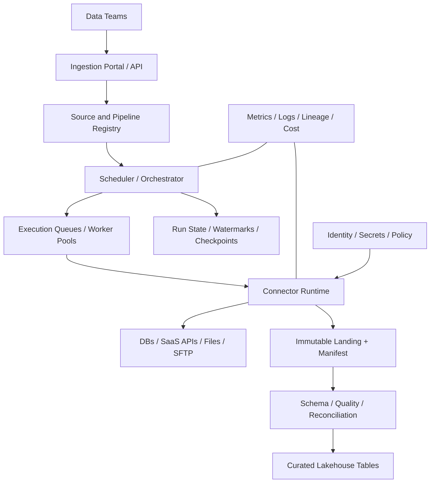

# 03. Design a Large-Scale Batch Ingestion and Orchestration Platform

**Level:** Principal / Staff Data Engineer  
**Interview duration:** 60 minutes  
**Core themes:** batch extraction, orchestration, incremental loads, watermarks, idempotency, backfills, dependency management

## 1. Problem statement

Design a platform to ingest data from thousands of sources—relational databases, SaaS APIs, SFTP/files, object stores, and partner feeds—into a governed lakehouse. Pipelines range from hourly incremental loads to daily multi-terabyte snapshots. Teams need self-service onboarding, retries, backfills, dependency management, data quality, and reliable delivery windows.

Principal-level extension: how do you provide a common ingestion platform while accommodating source-specific rate limits, authentication, schema behaviour, and data contracts?

## 2. Clarifying questions

- Source count/types, table count, API rate limits, file sizes?
- Full load vs incremental/CDC? Source support for updated_at, sequence, cursor, or change token?
- Data volume, peak schedule windows, and concurrency?
- Freshness SLAs and downstream dependencies?
- Late-arriving updates, deletes, and source corrections?
- Backfill frequency, duration, and isolation?
- Source owner and credentials lifecycle?
- Data classification, retention, and regional constraints?
- Existing orchestrator and runtime standards?

Assume 2,000 sources, 25,000 tables/endpoints, 20 TB/day, 4-hour ingestion window for priority data, and a mix of SQL, API, and file ingestion. Explicitly call out that API quotas and source load may be tighter bottlenecks than compute.

## 3. Requirements

**Functional:** connector registry; configurable extraction; full/incremental modes; schema discovery; secure credentials; landing and manifests; scheduling/dependency management; retries; backfills; quality checks; lineage; alerting; ownership and cost attribution.

**Non-functional:** idempotent runs; no silent gaps; source protection; bounded concurrency; resumability; observability; tenant isolation; scalable orchestration metadata; predictable operational load.

## 4. Architecture

## 5. Platform layers

1. **Onboarding/control plane:** source registration, owner, credentials reference, classification, extraction configuration, schedule, SLO, cost centre.
2. **Orchestration:** dependency graph, schedules, queues, concurrency, retries, backfill and pause/resume.
3. **Connector runtime:** isolated workers and standardized connector interface.
4. **Landing:** immutable source extracts, manifests, checksums, source metadata.
5. **Validation:** schema, row counts, key uniqueness, null/range checks, freshness, source-to-target reconciliation.
6. **Curated load:** idempotent merge/append and publish.
7. **Observability:** run state, freshness, data quality, lineage, cost, alerting.

## 6. Incremental extraction strategies

| Strategy | Benefits | Risks / required safeguards |
|---|---|---|
| `updated_at` watermark | Simple, widely available | Timestamp precision, late updates, deletes, clock skew |
| Monotonic sequence/ID | Efficient range extraction | Only safe if ordering and mutation assumptions hold |
| API cursor/page token | Provider-native pagination | Token expiry, rate limits, inconsistent page snapshots |
| CDC/log position | Captures updates/deletes and order | Connector/source complexity and log retention |
| File manifest | Reliable file-level tracking | Late files, duplicate names, partial uploads |

For timestamp watermarks, use a deliberate overlap window and deduplicate by stable key/version. Store both lower and upper bounds for each run. Do not update the committed watermark until data is durably landed, validated, and the run state is committed.

## 7. Run state machine and idempotency

Example state machine:

`REQUESTED → QUEUED → EXTRACTING → LANDED → VALIDATING → COMMITTING → SUCCEEDED`

Failure states should distinguish retryable, terminal, quarantined, cancelled, and superseded runs.

Persist:
- Pipeline/run ID and code/config version.
- Source cursor/watermark start and end.
- Extracted file/object manifest and checksums.
- Row/byte counts and schema version.
- Validation outcomes.
- Target commit/snapshot identifier.
- Retry attempts and error category.

Use deterministic run IDs or idempotency keys. Write to a run-specific staging path, then publish atomically through a manifest/transactional table commit. A retry should either resume safely or repeat without duplicating target state.

## 8. Orchestration at scale

Avoid one scheduler process becoming the execution engine. Separate scheduling, metadata state, queueing, worker execution, and sensor/event handling. Use pools by source class and workload priority. Apply concurrency at global, tenant, source, and endpoint levels.

Control schedule storms: thousands of jobs scheduled at midnight can overload APIs, databases, metadata stores, and worker pools. Add jitter, time windows, admission control, and priority queues. Keep DAG/task granularity useful; overly fine-grained tasks inflate scheduler metadata and overhead.

## 9. Source-specific safeguards

**Databases:** query timeouts, snapshot isolation, read replicas where appropriate, bounded parallelism, incremental predicates, and source-side load monitoring.

**SaaS APIs:** provider quotas, per-tenant token buckets, `Retry-After`, cursor persistence, page-level checkpoints, and incremental overlap.

**Files/SFTP:** atomic arrival convention, completion markers, manifest/checksum, file identity, late-arrival handling, and quarantine.

**Partners:** schema contracts, delivery windows, encryption, authentication, duplicate delivery, and dispute/reconciliation process.

## 10. Backfills and reprocessing

Backfills are first-class workloads, not ad-hoc scripts. Require date/key range, reason, owner, expected volume, target behaviour, cost estimate, and priority. Isolate from production freshness workloads. Use immutable raw landing so transformations can be replayed without re-extracting sources where possible.

Define whether backfill overwrites, merges, or creates a new version. Reconcile expected versus actual partitions/keys. Support cancellation and resume. Avoid allowing a historical backfill to advance the live ingestion watermark.

## 11. Failure handling

| Failure | Response |
|---|---|
| Source API throttles | Honour `Retry-After`, token bucket, bounded exponential backoff with jitter |
| Partial file upload | Require completion marker/manifest; do not ingest incomplete object |
| Worker crashes | Run lease expiry, checkpoint/resume or safe retry |
| Target commit succeeds but orchestrator crashes | Detect committed target snapshot/idempotency key before retry |
| Watermark advances too early | Two-phase run-state commit; recover from prior durable cursor |
| Schema drift | Quarantine or compatibility path; notify owner; preserve raw |
| Schedule storm | Jitter, admission control, pools, queue limits |
| Backfill starves production | Priority queues, dedicated capacity, quotas |
| Source outage | Circuit breaker, pause/retry policy, freshness incident |

## 12. Data quality and reconciliation

Quality checks should match data semantics:
- Structural: schema, type, required fields.
- Row-level: null, range, format, domain constraints.
- Relational: uniqueness, referential integrity.
- Temporal: freshness, monotonicity, event-time bounds.
- Aggregate: counts, sums, control totals.
- Source-target reconciliation: keys, counts, checksums, business aggregates.

Distinguish warning from blocking checks. A failed check should have owner, severity, evidence, and remediation. Preserve raw input and validation report for replay/audit.

## 13. Security and governance

Use source-scoped identities, secret manager references, rotation, least privilege, private connectivity, encryption, classification, masking, access audit, and retention. Avoid logging API tokens, full PII rows, or connection strings. Ensure staging and temporary files have the same protection as curated tables.

## 14. SLOs and metrics

- On-time completion rate by criticality.
- Source-to-landing and source-to-curated freshness.
- Successful run rate and retry rate.
- Queue wait and execution duration.
- Source/API throttling and failure rate.
- Watermark age and cursor progress.
- Rows/bytes extracted and committed.
- Reconciliation and quality failure rates.
- Backfill completion and production impact.
- Cost per source/table/GB and idle worker utilization.

Example SLO: 99% of Tier-1 source tables land within 20 minutes of their scheduled window, with a separate freshness SLI for end-to-end curated availability.

## 15. Trade-offs

- Centralized orchestration vs federated schedulers.
- Generic connector framework vs source-specific adapters.
- Shared worker pools vs isolated pools.
- Timestamp watermark vs CDC.
- Immutable raw landing vs direct-to-target.
- Full refresh vs incremental merge.
- Strict schema gate vs tolerant raw capture.

Choose based on source capability, correctness, latency, operational burden, and recovery requirements—not fashion.

## 16. Evolution roadmap

**0–6 months:** source inventory, standardized config, secure secrets, immutable landing/manifests, run state, basic retries and metrics.

**6–12 months:** source-specific connector libraries, self-service onboarding, contract checks, backfill service, priority queues, cost attribution.

**12–24 months:** event-driven scheduling, adaptive concurrency, automated reconciliation, lineage-driven impact, multi-region DR, and migration from legacy scripts.

Migrate source-by-source with shadow extraction, count/key/aggregate comparisons, freshness checks, and rollback. Keep source-specific exceptions visible rather than burying them in generic abstractions.

## 17. Principal-level follow-ups

**Q: How do you avoid losing records with an `updated_at` watermark?**  
A: Define timestamp semantics, precision, timezone, update behaviour, and delete capture. Use overlap and stable-key/version dedupe; commit watermark only after durable target commit; periodically reconcile. If guarantees are inadequate, use CDC.

**Q: What happens if target write succeeds but task times out?**  
A: Retry checks a deterministic run/commit ID or target snapshot before applying again. The target operation must be idempotent or transactionally published.

**Q: How do you handle API pagination while records are changing?**  
A: Use provider snapshot/cursor semantics if available; persist cursor after each durable page; account for duplicates and late changes with overlap/reconciliation. Document limits if the API has no consistent snapshot.

**Q: How do you prevent backfills from delaying Tier-1 pipelines?**  
A: Separate pools/queues, quotas, admission control, and priority scheduling; cap backfill concurrency and expose expected completion/cost.

**Q: Why not one generic connector for all sources?**  
A: Standardize lifecycle, observability, configuration, and contracts; keep extraction semantics source-specific behind adapters. Avoid a lowest-common-denominator abstraction that hides correctness differences.

## 18. Common mistakes
- Updating watermarks before durable commit.
- Treating API page number as a durable cursor without provider guarantees.
- No plan for deletes or late updates.
- Unbounded retries and synchronized retry storms.
- Backfills sharing unlimited production capacity.
- No immutable landing or source-to-target reconciliation.
- A giant DAG with thousands of tiny tasks.
- Credentials or raw sensitive data in logs.

## 19. References
- [Apache Airflow documentation](https://airflow.apache.org/docs/)
- [Airflow best practices](https://airflow.apache.org/docs/apache-airflow/stable/best-practices.html)
- [Airflow pools](https://airflow.apache.org/docs/apache-airflow/stable/administration-and-deployment/pools.html)
- [AWS Glue documentation](https://docs.aws.amazon.com/glue/)
- [Debezium documentation](https://debezium.io/documentation/reference/stable/)
- [OpenLineage](https://openlineage.io/docs/)
- [Google SRE: Monitoring distributed systems](https://sre.google/sre-book/monitoring-distributed-systems/)

## Reusable principal-level interview method

### 1. Clarify before designing
Ask about source systems and ownership; event/batch semantics; peak and sustained throughput; payload size; ordering scope; latency and freshness; replay horizon; retention; data sensitivity; regions; consumers; availability; RPO/RTO; budget; and operational ownership. If the interviewer does not provide values, state plausible assumptions and show how the design changes when they move.

### 2. Make semantics explicit
Distinguish event time from processing time; at-least-once delivery from effectively-once business outcomes; ordering per key from global ordering; source acknowledgement from durable sink commit; schema compatibility from semantic compatibility; and replay from backfill. Do not use “exactly once” as an unexplained slogan.

### 3. Structure the answer
1. Requirements and assumptions.
2. Capacity estimates and peak model.
3. High-level architecture and trust/failure boundaries.
4. Data contracts, partitioning, ordering, and delivery semantics.
5. State, checkpoints, offsets, retries, and replay.
6. Backpressure, scaling, and isolation.
7. Security, governance, observability, SLOs, and cost.
8. Failure walkthroughs and recovery.
9. Alternatives, trade-offs, and phased evolution.

### 4. Principal-level evidence
A strong answer identifies who owns each component, what is the source of truth, how correctness is proven, how a failure is contained, how capacity and cost are attributed, how schema changes are governed, and how migration proceeds without breaking consumers.

### 5. Suggested 60-minute pacing
- 0–7 min: clarify scope, requirements, assumptions.
- 7–13 min: capacity and workload model.
- 13–23 min: architecture and end-to-end data flow.
- 23–40 min: deep dive into semantics, state, scale, and failure modes.
- 40–50 min: security, governance, observability, SLOs, and cost.
- 50–57 min: trade-offs and evolution.
- 57–60 min: concise summary and risks.

### 6. Self-scoring rubric
Score each dimension 1–4: 1 = missing, 2 = basic, 3 = sound senior-level, 4 = principal-level with explicit trade-offs and operating model.
- Requirements and assumptions
- Capacity and bottleneck analysis
- Architecture and boundaries
- Correctness and delivery semantics
- Resilience and recovery
- Security and governance
- Observability and SLOs
- Cost and FinOps
- Ownership, migration, and evolution

A good practice target is no dimension below 3, with 4 in correctness, reliability, and trade-offs.

## Practical interview rehearsal

### Whiteboard drill
Draw the architecture without notes in 8 minutes. Label:
- Trust boundaries and identities.
- Durable state and source of truth.
- Retry/replay/checkpoint boundaries.
- Backpressure and isolation controls.
- Observability and ownership.

### Verbal drill
Deliver a 3-minute summary in this order: problem and assumptions; architecture; key correctness decision; biggest failure mode; cost/security trade-off; evolution plan.

### Challenge drill
Change one assumption at a time:
1. Peak throughput increases by 10x.
2. Latency target tightens from minutes to seconds.
3. One tenant generates 40% of traffic.
4. The source or sink is unavailable for six hours.
5. A breaking schema change arrives during a backfill.
Explain which components change, which guarantees weaken, and how you protect existing consumers.

### Interviewer scoring prompts
- Did the candidate quantify peak load and skew?
- Did they identify the real source of truth and durable checkpoint?
- Did they explain duplicate, loss, ordering, and replay semantics?
- Did they identify a failure mode that crosses component boundaries?
- Did they include security, SLOs, cost, and ownership?
- Did they describe a safe incremental migration?
