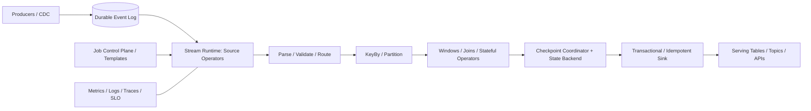

# 04. Design a Large-Scale Stream Processing Platform

**Level:** Principal / Staff Data Engineer  
**Interview duration:** 60 minutes  
**Core themes:** event time, windows, stateful processing, watermarks, checkpoints, exactly-once boundaries, late data, stream-table consistency

## 1. Problem statement

Design a distributed stream-processing platform that consumes events from a durable event backbone and computes real-time aggregates, enrichment, anomaly signals, and materialized views. It must support high throughput, event-time correctness, stateful operations, late and out-of-order events, recovery, and multiple teams.

Principal-level extension: how do you operate a fleet of streaming jobs with different latency, state size, correctness, and cost requirements?

## 2. Clarifying questions

- Event volume, peak, payload, key skew?
- Event-time vs processing-time requirements?
- Window types: tumbling, sliding, session?
- Maximum lateness and correction policy?
- Stateful joins/aggregations and state size?
- Output sinks and transactional capabilities?
- Latency target and acceptable retractions/corrections?
- Replay horizon and source retention?
- Checkpoint interval and recovery objective?
- Number of jobs/tenants and deployment model?

Assumptions example: 500k events/sec average, 2M peak, p99 event-to-output under 5 seconds, 30-minute allowed lateness for selected metrics, 24-hour source replay, and stateful per-customer/session aggregation.

## 3. Requirements

**Functional:** consume streams; parse and validate schema; event-time processing; keyed state; joins/windows; enrichment; output to topics/tables/APIs; replay and backfill; job lifecycle; metrics and lineage.

**Non-functional:** high throughput, low latency, recoverable state, bounded memory/state growth, exactly-defined output semantics, fault isolation, security, and cost control.

## 4. Architecture

## 5. Event time and processing time

- **Event time:** when the event occurred in the source domain.
- **Ingestion time:** when the platform accepted it.
- **Processing time:** when an operator processed it.

Event time is necessary when network delays, retries, or source buffering make arrival order differ from business occurrence. Use processing time only when approximate wall-clock behaviour is acceptable and simplicity is more valuable than event-time correctness.

A robust event includes event timestamp, source identity, event ID, and preferably source sequence/version. Validate timestamp units/timezones and reject or quarantine implausible future timestamps.

## 6. Windows and watermarks

- Tumbling: fixed, non-overlapping intervals.
- Sliding: overlapping windows.
- Session: inactivity-gap windows.
- Global: unbounded logical grouping requiring explicit trigger/retention.

A watermark is the runtime's estimate that events earlier than a timestamp are unlikely to arrive. It is not proof that no earlier event will ever arrive. Configure allowed lateness, side output/quarantine, update/retraction behaviour, and state cleanup.

Example: five-minute event-time window, watermark delay two minutes, allowed lateness ten minutes. The system may emit an initial result, then update it when late events arrive within the correction horizon. Consumers must understand whether outputs are append-only, upsert, or retraction streams.

## 7. Stateful processing and state growth

State includes keyed aggregates, dedupe sets, join buffers, timers, and session data. Estimate:
`state bytes ≈ active keys × average state per key × replication/checkpoint overhead`
Then account for RocksDB/state backend overhead, checkpoint snapshots, compaction, and recovery I/O.

Control state using TTL, event-time cleanup, bounded windows, key cardinality controls, and compaction. TTL changes semantics if data can arrive later than the retention period. Monitor state size, checkpoint duration, restore time, and per-key skew.

## 8. Checkpointing and recovery

A checkpoint captures a consistent point across source offsets and operator state, using the runtime's checkpoint/barrier protocol. On failure, restore operator state and source positions from a completed checkpoint, then replay subsequent input.

Important distinctions:
- Checkpoint interval trades recovery point granularity against overhead.
- Checkpoint timeout and minimum pause affect job stability.
- Unaligned checkpoints can help under backpressure in supported engines but have trade-offs.
- Externalized checkpoints/savepoints support controlled upgrades and rescaling; lifecycle and compatibility matter.
- A completed checkpoint does not by itself make an arbitrary external sink transactional.

## 9. Sink semantics and end-to-end correctness

For a transactional sink, coordinate output commit with checkpoint completion using the sink's supported protocol. For non-transactional sinks, use deterministic keys, idempotent upserts, version checks, or a dedupe ledger. Document duplicate and correction semantics.

Example: aggregate keyed by `(customer_id, window_start)`. Sink writes an upsert with a monotonically increasing revision or source/checkpoint version. Replaying the same checkpoint must not double-count. If late data changes the aggregate, update the same logical key or emit a retraction/correction.

## 10. Backpressure and performance

Backpressure propagates from slow sinks or state operations to upstream operators. Measure busy time, idle time, backpressured time, input/output rates, network buffers, checkpoint duration, and sink latency.

Mitigations: fix slow sink, tune parallelism, rebalance keys, batch writes, optimize serialization, improve state backend, add capacity, and bound downstream calls. Increasing parallelism will not fix a single hot key or a serial sink.

## 11. Joins and enrichment

- Stream-stream joins require state retention and event-time alignment.
- Stream-table joins need a clear consistency model: processing-time lookup, broadcast snapshot, or versioned temporal join.
- External synchronous lookups can create latency and cascading failure; prefer local/broadcast/cache enrichment with bounded refresh and explicit staleness.
- Handle dimension updates, late events, and reprocessing consistently.

## 12. Failure scenarios

| Failure | Recovery |
|---|---|
| Worker/task crash | Restore latest completed checkpoint and replay source |
| Checkpoint failure | Diagnose slow operator/state/backend; avoid overlapping uncontrolled checkpoints |
| Slow sink | Backpressure; scale/tune sink; bound buffers |
| Hot key | Detect skew; redesign key or split independent state |
| Late event beyond watermark | Side output, correction workflow, or explicit drop policy |
| State backend full | Alert on state growth; TTL/cleanup; capacity plan |
| Schema change | Contract validation, compatibility rollout, quarantine |
| Sink duplicate after recovery | Transactional commit or idempotent/versioned sink |
| Region failure | Restore checkpoint/savepoint and source offsets in DR region; reconcile sink |

## 13. Security and multi-tenancy

Isolate job identities, state paths, checkpoints, secrets, network access, and sink permissions. Apply per-job resource quotas and priority classes. Prevent one job's state or logs from exposing another tenant's data. Apply classification and retention to checkpoints and savepoints—they may contain raw sensitive fields.

## 14. SLOs and observability

- Event-to-output p50/p95/p99 latency.
- Input/output throughput and lag age.
- Watermark lag and late-event ratio.
- Checkpoint success rate/duration/size.
- State size and restore duration.
- Backpressure and busy/idle time.
- Restart count and time to recover.
- Sink commit latency and duplicate/correction rate.
- Cost per million events and per streaming job.

Example SLO: 99% of valid events are reflected in the serving view within five seconds, with late corrections measured separately and a defined event-time completeness target.

## 15. Trade-offs

| Decision | Trade-off |
|---|---|
| Event time vs processing time | Correctness under disorder vs simpler lower-latency processing |
| Frequent checkpoints | Lower replay after failure vs checkpoint overhead |
| Large state TTL | More late-data correctness vs state/storage cost |
| Transactional sink | Stronger semantics vs connector/operational complexity |
| Broadcast enrichment | Low lookup latency vs stale/large replicated state |
| Drop late events vs corrections | Simple outputs vs business completeness |

## 16. Evolution roadmap

Start with a supported runtime and a small set of golden-path templates. Add job registry, resource classes, standard checkpoint policy, schema validation, sink libraries, dashboards, savepoint/upgrade runbooks, and cost attribution. Later introduce workload-aware scheduling, automated state growth detection, multi-region recovery, and standardized stream-table contracts.

## 17. Principal-level follow-ups

**Q: Does a watermark mean all earlier events have arrived?**  
A: No. It is an estimate/heuristic of event-time completeness. Define allowed lateness and what happens to events beyond it.

**Q: Why can a job be backpressured with low CPU?**  
A: It may wait on network, sink I/O, state backend, locks, or downstream capacity. Inspect operator metrics and latency, not CPU alone.

**Q: How do you avoid double-counting after recovery?**  
A: Coordinate checkpoint and sink commits where supported; otherwise use idempotent keyed writes/versioning and deduplication. Explain the exact sink guarantee.

**Q: What if one customer key is 30% of traffic?**  
A: A single keyed operator can bottleneck. Determine whether the computation can be decomposed (partial aggregation then merge), whether sub-key parallelism preserves semantics, or whether that tenant needs isolation.

**Q: How do you backfill six months of events?**  
A: Isolate backfill from real-time jobs, replay from archive with controlled rate, use deterministic event-time logic and versioned outputs, compare results, and publish through a controlled cutover.

## 18. Common mistakes
- Confusing watermark with guaranteed completeness.
- Ignoring late-event correction semantics.
- Assuming checkpoints make every sink exactly once.
- Ignoring state growth and restore time.
- Scaling parallelism without diagnosing hot keys.
- Keeping unbounded state or buffers.
- Forgetting sensitive data in checkpoints/savepoints.
- No plan for replay/backfill and output versioning.

## 19. References
- [Apache Flink documentation](https://nightlies.apache.org/flink/flink-docs-stable/)
- [Flink event time and watermarks](https://nightlies.apache.org/flink/flink-docs-stable/docs/concepts/time/)
- [Flink state and fault tolerance](https://nightlies.apache.org/flink/flink-docs-stable/docs/learn-flink/fault_tolerance/)
- [Flink checkpointing](https://nightlies.apache.org/flink/flink-docs-stable/docs/ops/state/checkpoints/)
- [Spark Structured Streaming](https://spark.apache.org/docs/latest/structured-streaming-programming-guide.html)
- [Kafka Streams documentation](https://kafka.apache.org/documentation/streams/)

## Reusable principal-level interview method

### 1. Clarify before designing
Ask about source systems and ownership; event/batch semantics; peak and sustained throughput; payload size; ordering scope; latency and freshness; replay horizon; retention; data sensitivity; regions; consumers; availability; RPO/RTO; budget; and operational ownership. If the interviewer does not provide values, state plausible assumptions and show how the design changes when they move.

### 2. Make semantics explicit
Distinguish event time from processing time; at-least-once delivery from effectively-once business outcomes; ordering per key from global ordering; source acknowledgement from durable sink commit; schema compatibility from semantic compatibility; and replay from backfill. Do not use “exactly once” as an unexplained slogan.

### 3. Structure the answer
1. Requirements and assumptions.
2. Capacity estimates and peak model.
3. High-level architecture and trust/failure boundaries.
4. Data contracts, partitioning, ordering, and delivery semantics.
5. State, checkpoints, offsets, retries, and replay.
6. Backpressure, scaling, and isolation.
7. Security, governance, observability, SLOs, and cost.
8. Failure walkthroughs and recovery.
9. Alternatives, trade-offs, and phased evolution.

### 4. Principal-level evidence
A strong answer identifies who owns each component, what is the source of truth, how correctness is proven, how a failure is contained, how capacity and cost are attributed, how schema changes are governed, and how migration proceeds without breaking consumers.

### 5. Suggested 60-minute pacing
- 0–7 min: clarify scope, requirements, assumptions.
- 7–13 min: capacity and workload model.
- 13–23 min: architecture and end-to-end data flow.
- 23–40 min: deep dive into semantics, state, scale, and failure modes.
- 40–50 min: security, governance, observability, SLOs, and cost.
- 50–57 min: trade-offs and evolution.
- 57–60 min: concise summary and risks.

### 6. Self-scoring rubric
Score each dimension 1–4: 1 = missing, 2 = basic, 3 = sound senior-level, 4 = principal-level with explicit trade-offs and operating model.
- Requirements and assumptions
- Capacity and bottleneck analysis
- Architecture and boundaries
- Correctness and delivery semantics
- Resilience and recovery
- Security and governance
- Observability and SLOs
- Cost and FinOps
- Ownership, migration, and evolution

A good practice target is no dimension below 3, with 4 in correctness, reliability, and trade-offs.

## Practical interview rehearsal

### Whiteboard drill
Draw the architecture without notes in 8 minutes. Label:
- Trust boundaries and identities.
- Durable state and source of truth.
- Retry/replay/checkpoint boundaries.
- Backpressure and isolation controls.
- Observability and ownership.

### Verbal drill
Deliver a 3-minute summary in this order: problem and assumptions; architecture; key correctness decision; biggest failure mode; cost/security trade-off; evolution plan.

### Challenge drill
Change one assumption at a time:
1. Peak throughput increases by 10x.
2. Latency target tightens from minutes to seconds.
3. One tenant generates 40% of traffic.
4. The source or sink is unavailable for six hours.
5. A breaking schema change arrives during a backfill.
Explain which components change, which guarantees weaken, and how you protect existing consumers.

### Interviewer scoring prompts
- Did the candidate quantify peak load and skew?
- Did they identify the real source of truth and durable checkpoint?
- Did they explain duplicate, loss, ordering, and replay semantics?
- Did they identify a failure mode that crosses component boundaries?
- Did they include security, SLOs, cost, and ownership?
- Did they describe a safe incremental migration?
