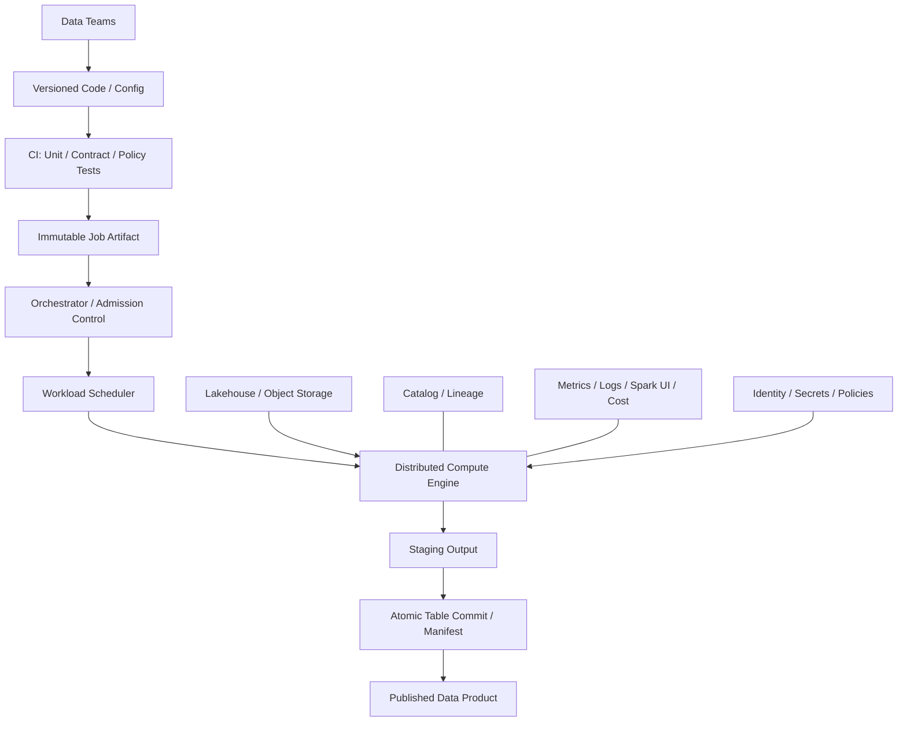

# 05. Design a Fault-Tolerant Distributed ETL Processing Platform

**Level:** Principal / Staff Data Engineer  
**Interview duration:** 60 minutes  
**Core themes:** distributed execution, Spark, shuffle, skew, retries, deterministic transforms, checkpointing, data correctness

## 1. Problem statement

Design a shared distributed ETL platform processing tens of petabytes of historical and daily data using Spark or a comparable distributed engine. Workloads include joins, aggregations, CDC merges, feature generation, and data quality. Jobs run across multiple teams with different SLAs and cost profiles.

The platform must scale, recover from executor/worker failures, avoid duplicate or partial outputs, isolate workloads, and make performance and correctness diagnosable.

Principal-level extension: how do you build a platform that makes the common path reliable while still allowing advanced teams to tune engines and optimize specialized workloads?

## 2. Clarifying questions

- Daily and historical data volume? File/table counts and size distribution?
- Batch SLA, concurrency, and peak schedule?
- Transform types: joins, aggregation, sorting, ML features?
- Data skew and key cardinality?
- Input/output table format and commit semantics?
- Retry and recomputation cost?
- Data correctness requirements and late data?
- Multi-tenant compute and isolation?
- Runtime: Spark on Kubernetes, managed service, Databricks, EMR?
- Cost ceiling and team skill level?

Assumptions example: 40 TB/day, 300 concurrent scheduled pipelines at peak, largest joins over multi-terabyte facts, Tier-1 completion by 6 AM, and 3x annual growth. Treat these as design prompts; benchmark with representative data.

## 3. Requirements

**Functional:** submit/version jobs; access governed datasets; run batch and incremental transforms; manage dependencies; support retries/backfills; publish transactional outputs; test data quality; expose lineage and metrics.

**Non-functional:** horizontal scale; fault tolerance; reproducibility; no partial publication; workload isolation; predictable completion; cost visibility; secure execution; operational debuggability.

## 4. Architecture

## 5. Execution model and fault domains

Explain driver, executors, tasks, stages, shuffle boundaries, cluster manager, storage, and orchestrator responsibilities. A task failure may be retried; executor loss may require recomputing partitions; driver loss may require restarting the application; output commit failure may leave staged files. These are different failure domains and require different recovery.

Avoid conflating orchestrator retry with engine task retry. Excessive nested retries can amplify load and hide persistent failures.

## 6. Data layout and file management

Use columnar formats for analytical scans where appropriate. Design partitioning around common filters and manageable cardinality. Track file-size distribution, small-file count, partition skew, and metadata/listing overhead. Use compaction and clustering/sorting where supported and justified by query patterns.

A partition key should reduce scan cost without creating thousands of tiny partitions. Avoid partitioning by high-cardinality user IDs or random keys without a compelling workload need.

## 7. Spark execution and optimization

Discuss:
- Logical/physical plans and Catalyst optimization.
- Predicate and projection pushdown.
- Join strategy selection: broadcast, sort-merge, shuffle hash where appropriate.
- Shuffle volume, spill, serialization, and network transfer.
- Adaptive Query Execution (AQE) and runtime statistics.
- Partition sizing and task parallelism.
- Dynamic allocation and executor sizing.
- Cache/persist only when reuse justifies memory pressure.
- Data skew detection and mitigation.

For skew, identify hot keys and partition-size imbalance. Techniques include AQE skew handling, salting (only when semantics permit), pre-aggregation, broadcast of genuinely small dimensions, splitting hot keys, and isolating exceptional tenants. Never recommend a blind `repartition()` without understanding the plan and data distribution.

## 8. Correctness and atomic publication

A robust pattern:
1. Read a deterministic input snapshot or bounded source range.
2. Run deterministic transformations with explicit code/config version.
3. Write to run-specific staging output.
4. Validate schema, row counts, uniqueness, and business aggregates.
5. Commit atomically using the table format's supported transaction/manifest mechanism.
6. Record output snapshot/version and run metadata.
7. Mark orchestration run successful only after commit confirmation.

If a driver crashes after commit but before reporting success, the orchestrator must detect the existing commit and avoid duplicate publication. If commit fails, staged files must remain unreferenced and later be cleaned safely.

## 9. Incremental processing and CDC merge

Use stable business keys and source versions/log positions. Define insert/update/delete behaviour, late events, duplicate handling, and conflict resolution. A merge must be deterministic under retries and replay. If multiple source events for one key can arrive out of order, apply only the valid latest version or preserve transaction ordering.

For large merges, consider partition pruning, clustering, change data size, and file rewrite amplification. Measure affected-file count and small-file growth.

## 10. Retries, checkpoints, and backfills

Retry transient infrastructure failures with bounded attempts and jitter. Do not retry deterministic data errors indefinitely. Separate task-level retries, application retries, and orchestrator retries.

Checkpointing is useful for iterative/streaming stateful work, but for many batch ETL jobs the recovery mechanism is deterministic recomputation from immutable inputs and committed output boundaries. Choose the simplest reliable approach.

Backfills need isolated capacity, explicit input snapshot/range, versioned output, validation, and controlled publication. Do not let a backfill overwrite current production partitions before parity checks pass.

## 11. Multi-tenant scheduling and resource governance

Use workload classes, queues/pools, per-team concurrency, executor caps, autoscaling bounds, priority, and admission control. Distinguish resource requests from hard quotas. Protect critical pipelines from ad-hoc queries and historical backfills. Apply fairness without promising every job identical latency.

Track requested vs actual CPU/memory, executor utilization, queue time, spill, shuffle bytes, storage reads/writes, and cost by team/job.

## 12. Reliability and failure handling

| Failure | Detection | Recovery |
|---|---|---|
| Executor loss | Failed tasks, lost executor | Task retry/recompute; inspect repeated node failures |
| Driver crash | Application lost | Orchestrator restart from deterministic inputs/checkpoint |
| Shuffle fetch failure | Stage retry errors | Recompute map outputs; inspect disk/network pressure |
| Skewed partition | Long-tail tasks, uneven bytes | AQE, pre-aggregation, key strategy, isolate hot key |
| Object-store throttling | Slow reads/list/put failures | Bounded retry/backoff, request tuning, workload pacing |
| Partial output | Staging files without commit | Atomic commit protocol; orphan cleanup after safe age |
| Duplicate run | Same logical interval processed twice | Idempotency key, transactional merge, run registry |
| Schema drift | Read/write failures or quality alarms | Contract validation and versioned compatibility path |
| Cluster saturation | Queue delay, executor pending | Admission control, capacity scaling, priority policy |

## 13. Observability and debugging

A principal should describe a layered diagnosis:
1. Is the job queued or executing?
2. Is it CPU-bound, I/O-bound, shuffle-bound, or waiting on external services?
3. Which stage/task is the straggler?
4. Is skew or partition imbalance present?
5. Is spill, GC, executor loss, or object-store throttling occurring?
6. Did input size, code, plan, or concurrency change?
7. Did output commit and quality validation complete?

Capture job/run ID, code and config version, input snapshot, source range, Spark application/stage/task metrics, output snapshot, data quality result, and cost.

## 14. Security and governance

Use workload identity, least privilege, isolated temporary storage, secret references, network controls, approved runtime images/dependencies, data classification, row/column controls, audit, and lineage. Temporary shuffle/staging/checkpoint files may contain sensitive data and need lifecycle and access policies.

## 15. SLOs and cost

SLOs by workload class: completion by deadline, successful commit rate, freshness, recovery time, and quality compliance. Cost measures: compute per TB, cost per successful job, shuffle bytes per input TB, storage read/write amplification, idle capacity, and backfill cost.

Do not optimize solely for cluster utilization: a highly utilized cluster may violate critical completion SLAs. Balance utilization, tail latency, and recovery headroom.

## 16. Trade-offs

| Decision | Trade-off |
|---|---|
| Shared cluster vs per-job cluster | Utilization vs isolation/startup and blast radius |
| Autoscaling vs fixed capacity | Elasticity vs startup variance and cost |
| Broadcast vs shuffle join | Less shuffle vs memory pressure |
| Cache vs recompute | Faster reuse vs memory/storage overhead |
| Full refresh vs incremental merge | Simplicity vs compute and correctness complexity |
| Strict admission control vs queueing | Predictable SLOs vs utilization |
| Atomic table commit vs direct file writes | Consistency vs implementation constraints |

## 17. Evolution roadmap

**0–6 months:** standard job templates, immutable artifacts, run registry, workload classes, output commit protocol, Spark UI retention, and baseline SLOs.

**6–12 months:** adaptive sizing, automated skew diagnostics, data quality gates, cost attribution, isolated backfills, and standardized incremental merge.

**12–24 months:** workload-aware scheduling, platform APIs, automated performance regression detection, lineage-driven impact, and multi-region recovery where justified.

## 18. Principal-level follow-ups

**Q: One Spark job has 1,000 tasks and one takes 40 minutes. What do you inspect?**  
A: Compare input bytes/records per task, key distribution, shuffle read/write, spill, GC, executor locality, and external I/O. Identify skew/straggler before changing partition count. Apply AQE or semantic-preserving skew mitigation.

**Q: Why is a job slow after adding executors?**  
A: More executors may increase shuffle/network pressure, small tasks, object-store requests, or contention. Inspect physical plan, task size, queueing, and bottleneck; scaling is not always linear.

**Q: How do you guarantee no partial table is visible?**  
A: Stage output and publish via a supported atomic table commit/manifest. Validate commit protocol and recovery after driver/orchestrator crash.

**Q: How do you make reruns safe?**  
A: Deterministic inputs, stable run identity, idempotent transformations, output transaction/merge, and detection of already committed output.

**Q: How do you handle a six-month backfill?**  
A: Pin source snapshots/ranges and code version, isolate capacity, write versioned output, reconcile against production, then atomically promote or swap views.

## 19. Common mistakes
- Explaining Spark components but not end-to-end correctness.
- Blindly increasing executors or repartitioning.
- No atomic publication boundary.
- Confusing task retry with full pipeline retry.
- Ignoring skew, shuffle, spill, and stragglers.
- No stable input snapshot or code version for reproducibility.
- Allowing backfills to starve production.
- Ignoring staging and shuffle data security.

## 20. References
- [Apache Spark documentation](https://spark.apache.org/docs/latest/)
- [Spark SQL performance tuning](https://spark.apache.org/docs/latest/sql-performance-tuning.html)
- [Spark monitoring](https://spark.apache.org/docs/latest/monitoring.html)
- [Spark configuration](https://spark.apache.org/docs/latest/configuration.html)
- [Apache Iceberg reliability and concurrency concepts](https://iceberg.apache.org/docs/latest/reliability/)
- [Delta Lake concurrency control](https://docs.delta.io/concurrency-control/)
- [Apache Airflow best practices](https://airflow.apache.org/docs/apache-airflow/stable/best-practices.html)

## Reusable principal-level interview method

### 1. Clarify before designing
Ask about source systems and ownership; event/batch semantics; peak and sustained throughput; payload size; ordering scope; latency and freshness; replay horizon; retention; data sensitivity; regions; consumers; availability; RPO/RTO; budget; and operational ownership. If the interviewer does not provide values, state plausible assumptions and show how the design changes when they move.

### 2. Make semantics explicit
Distinguish event time from processing time; at-least-once delivery from effectively-once business outcomes; ordering per key from global ordering; source acknowledgement from durable sink commit; schema compatibility from semantic compatibility; and replay from backfill. Do not use “exactly once” as an unexplained slogan.

### 3. Structure the answer
1. Requirements and assumptions.
2. Capacity estimates and peak model.
3. High-level architecture and trust/failure boundaries.
4. Data contracts, partitioning, ordering, and delivery semantics.
5. State, checkpoints, offsets, retries, and replay.
6. Backpressure, scaling, and isolation.
7. Security, governance, observability, SLOs, and cost.
8. Failure walkthroughs and recovery.
9. Alternatives, trade-offs, and phased evolution.

### 4. Principal-level evidence
A strong answer identifies who owns each component, what is the source of truth, how correctness is proven, how a failure is contained, how capacity and cost are attributed, how schema changes are governed, and how migration proceeds without breaking consumers.

### 5. Suggested 60-minute pacing
- 0–7 min: clarify scope, requirements, assumptions.
- 7–13 min: capacity and workload model.
- 13–23 min: architecture and end-to-end data flow.
- 23–40 min: deep dive into semantics, state, scale, and failure modes.
- 40–50 min: security, governance, observability, SLOs, and cost.
- 50–57 min: trade-offs and evolution.
- 57–60 min: concise summary and risks.

### 6. Self-scoring rubric
Score each dimension 1–4: 1 = missing, 2 = basic, 3 = sound senior-level, 4 = principal-level with explicit trade-offs and operating model.
- Requirements and assumptions
- Capacity and bottleneck analysis
- Architecture and boundaries
- Correctness and delivery semantics
- Resilience and recovery
- Security and governance
- Observability and SLOs
- Cost and FinOps
- Ownership, migration, and evolution

A good practice target is no dimension below 3, with 4 in correctness, reliability, and trade-offs.

## Practical interview rehearsal

### Whiteboard drill
Draw the architecture without notes in 8 minutes. Label:
- Trust boundaries and identities.
- Durable state and source of truth.
- Retry/replay/checkpoint boundaries.
- Backpressure and isolation controls.
- Observability and ownership.

### Verbal drill
Deliver a 3-minute summary in this order: problem and assumptions; architecture; key correctness decision; biggest failure mode; cost/security trade-off; evolution plan.

### Challenge drill
Change one assumption at a time:
1. Peak throughput increases by 10x.
2. Latency target tightens from minutes to seconds.
3. One tenant generates 40% of traffic.
4. The source or sink is unavailable for six hours.
5. A breaking schema change arrives during a backfill.
Explain which components change, which guarantees weaken, and how you protect existing consumers.

### Interviewer scoring prompts
- Did the candidate quantify peak load and skew?
- Did they identify the real source of truth and durable checkpoint?
- Did they explain duplicate, loss, ordering, and replay semantics?
- Did they identify a failure mode that crosses component boundaries?
- Did they include security, SLOs, cost, and ownership?
- Did they describe a safe incremental migration?
