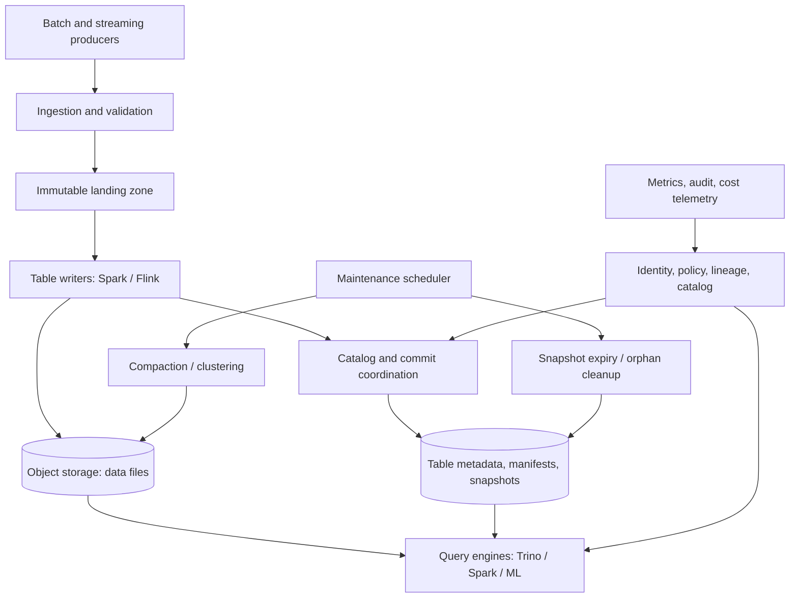

# Scenario 1 — Design a Petabyte-Scale Lake Storage and Table Management Platform

**Interview level:** Staff / Principal Data Engineer  
**Primary themes:** object storage, lakehouse table formats, Iceberg, partitioning, compaction, metadata, retention, governance, cost control  
**Suggested interview time:** 45–60 minutes

## 1. Problem statement

Design a multi-tenant analytical storage platform that stores several petabytes of structured, semi-structured, and event data on cloud object storage. It must support batch and streaming writes, concurrent readers, schema evolution, reproducible snapshots, efficient pruning, retention policies, and multiple compute engines.

Assume an enterprise ingests 80 TB/day compressed across 300 domains and 1,500 tables. The platform retains raw data for 13 months, curated data for 3 years, and selected regulated datasets longer under legal hold. Consumers include Spark, Trino, ML training, BI, and downstream exports.

The objective is not simply to choose S3 and Iceberg. The design must make file layout, metadata growth, commit semantics, maintenance, isolation, and lifecycle behaviour predictable at scale.

## 2. Clarifying questions

Ask before drawing:
1. Is the workload append-only, upsert-heavy, or mixed? What fraction requires deletes?
2. What are daily ingest volume, peak write rate, table count, and largest table size?
3. What are the latency expectations: seconds, minutes, or hours from source to queryable?
4. Which engines must read and write the same tables?
5. Are concurrent writers required for a table? What conflict behaviour is acceptable?
6. Do users need time travel, rollback, auditability, or reproducible training snapshots?
7. What are the retention, legal hold, residency, encryption, and deletion requirements?
8. Are tenants isolated logically, by bucket/prefix, by account/project, or physically?
9. Which query patterns dominate: time range, entity lookup, joins, scans, or aggregations?
10. What is the acceptable recovery point and recovery time after regional or catalog failure?

State assumptions explicitly if the interviewer does not provide answers.

## 3. Requirements

### Functional
- Ingest files and streaming micro-batches from multiple producers.
- Maintain table-level schema, partition specification, snapshots, and atomic commits.
- Support schema and partition evolution without requiring directory rewrites.
- Enable snapshot reads, rollback, incremental consumption where supported, and audit history.
- Compact small files, rewrite poorly clustered data, expire snapshots, and remove orphan files safely.
- Enforce table ownership, access policy, retention, legal hold, and deletion workflows.
- Provide catalog discovery, lineage hooks, data quality signals, and cost attribution.
- Support multiple query and compute engines through interoperable formats.

### Non-functional
- Durable storage with a clearly defined regional and cross-region recovery posture.
- Predictable query planning and metadata operations at very high table/file counts.
- Isolation between tenants and workloads.
- Strong correctness at table commit boundaries; no partially visible table commits.
- Scale-out throughput, bounded maintenance backlog, and transparent cost.
- Measurable freshness, availability, recovery, and deletion SLOs.

## 4. Capacity estimation

Illustrative assumptions:
- 80 TB/day compressed logical data.
- 365 days of raw retention: 29.2 PB before compression changes, replication, and lifecycle tiering.
- Curated copies and derived tables can multiply physical footprint; model them separately rather than assuming one copy.
- 1,500 tables, with a long tail of tiny tables and a few very large fact tables.
- At 256 MB target data-file size, 80 TB/day creates roughly 320,000 files/day if all data is written once at target size. At 16 MB average, it creates about 5 million files/day.
- Metadata and manifest growth must be estimated from file counts, snapshots, partition cardinality, and commit frequency—not only bytes stored.

A useful estimate:
`daily_file_count = daily_bytes / target_file_size`

Then estimate maintenance capacity:
`required_compaction_throughput >= incoming_small_file_bytes + backlog_rewrite_bytes / maintenance_window`

Do not assume every table should use the same target file size. Small dimension tables, streaming tables, and large scan-heavy fact tables have different optimal layouts.

## 5. High-level architecture

## 6. Core design decisions

### 6.1 Object storage and namespace layout

Use object storage as the durable data plane and a table format to manage logical table state. Avoid treating folder names as the authoritative table definition. A possible namespace is:

` s3://company-lake/{environment}/{domain}/{dataset}/ `

The namespace should reflect ownership and security boundaries, not every query dimension. Avoid one bucket per table if it creates operational overhead; avoid one undifferentiated bucket if it prevents meaningful isolation, policy enforcement, or cost attribution.

Separate:
- landing/raw immutable objects,
- managed table data and metadata,
- temporary query/exchange data,
- backup/export locations.

Use separate credentials or scoped roles for writers, readers, maintenance jobs, and deletion services. Enable encryption at rest and TLS in transit. Apply object versioning or replication only where the recovery and compliance design justifies the cost and operational complexity.

### 6.2 Table format and commit protocol

A table format such as Apache Iceberg tracks data files through metadata, manifests, and snapshots. A writer first writes new data files, then commits a metadata change that makes the new snapshot visible. Readers resolve a committed snapshot and read a consistent view. The metadata commit—not the mere presence of a data object—is the logical publication point.

Design implications:
- Uncommitted data files can remain after a failed writer; orphan cleanup must use a conservative age threshold and account for long-running jobs.
- Concurrent writers need conflict detection and retry behaviour.
- A successful object upload is not equivalent to a successful table commit.
- Readers should pin a snapshot for the duration of a query to avoid mixing table versions.
- Cross-table transactions are not automatically guaranteed by a per-table atomic commit protocol.

Apache Iceberg's specification describes serializable isolation for table reads/writes, metadata-based snapshots, and schema/partition evolution. Verify exact behaviour against the deployed Iceberg version and catalog implementation.

### 6.3 Partitioning and file layout

Partition for pruning and manageable maintenance—not to mirror every query predicate. High-cardinality partition keys can create a partition explosion; low-cardinality or overly broad partitions can cause large scans and write contention.

Prefer hidden partition transforms such as day/month transforms where supported rather than requiring users to know physical directory conventions. Use sort order or clustering for common selective predicates that are not suitable partition keys.

A robust design process:
1. Collect representative query predicates and scan statistics.
2. Choose coarse partition transforms that bound data volume and maintenance scope.
3. Choose sort/clustering columns based on filter selectivity and joins.
4. Measure file size distribution and partition skew.
5. Re-evaluate as workload changes; partition evolution should be planned, not improvised.

Do not partition by customer ID merely because queries filter by customer. For a high-cardinality customer population, use clustering, sorting, bucketing where appropriate, or a serving index instead.

### 6.4 Small files, compaction, and clustering

Streaming ingestion naturally produces many small files. Small files increase object requests, planning overhead, metadata size, and task scheduling overhead. Compaction combines files; clustering or sorting can improve data skipping.

Run maintenance as a controlled service:
- prioritize tables by query pain, file count, small-file ratio, and freshness;
- apply per-table concurrency limits;
- avoid competing with ingestion or critical query windows;
- record bytes rewritten and expected benefit;
- make jobs restartable and idempotent;
- use maintenance windows and quotas for expensive rewrites.

A compaction policy should consider target file size, partition boundaries, delete-file accumulation, write amplification, and retention. Do not continuously rewrite a hot table if the rewrite cost exceeds the query benefit.

### 6.5 Metadata and catalog architecture

The catalog is a control-plane dependency. It resolves table identifiers to metadata locations and coordinates commits according to the selected implementation. It should be highly available, monitored, backed up, and protected from unbounded client retry storms.

Monitor:
- commit latency and conflict rate,
- catalog request latency and errors,
- snapshots per table,
- manifests and entries per snapshot,
- planning time,
- metadata file size,
- table load failures.

A catalog outage may leave object data durable but temporarily unavailable to normal table readers/writers. Document this distinction in the recovery plan.

### 6.6 Deletes, updates, and retention

Row-level deletes and updates may create delete files or trigger rewrites depending on format version, engine, and table configuration. The physical cleanup may be deferred. This affects storage cost and query performance.

Define separate policies for:
- logical row deletion,
- physical file removal,
- snapshot expiration,
- legal hold,
- time-travel retention,
- backup/replication retention.

A deletion request is not complete merely because a row is no longer visible in the latest snapshot. Old snapshots, replicas, exports, caches, and backups may still contain the data. Build an auditable deletion workflow with a compliance owner and evidence of completion.

## 7. Data flow and correctness

### Write path
1. Authenticate producer and resolve tenant/table ownership.
2. Validate schema, event-time bounds, and required metadata.
3. Write immutable data files to a staging/table location.
4. Produce statistics and manifest entries.
5. Commit a new table snapshot through the catalog/metadata protocol.
6. Emit lineage, audit, freshness, and cost events.
7. Trigger downstream notification only after commit success.

### Read path
1. Authenticate principal and evaluate table/row/column policy.
2. Resolve the table metadata and snapshot.
3. Apply predicate and projection pushdown.
4. Plan files using partition and file statistics.
5. Read a consistent snapshot and record query provenance.

### Exactly-once discussion
Object storage writes and table commits are separate operations. A producer retry can create duplicate physical files unless the writer and commit protocol are designed carefully. For event ingestion, combine source offsets/checkpoints with deterministic batch identity or idempotent merge semantics. Explain what is exactly-once at the logical table level and what is merely at-least-once physical delivery.

## 8. Failure modes and recovery

| Failure | User-visible impact | Mitigation |
|---|---|---|
| Writer dies before commit | Orphan data files, no new snapshot | Conservative orphan cleanup; retry from checkpoint |
| Commit conflict | One writer fails to publish | Refresh metadata, rebase/retry with bounded attempts |
| Catalog outage | Table resolution/commit unavailable | HA catalog, backups, runbooks, circuit breakers |
| Compaction backlog | Slow scans and metadata growth | Prioritization, quotas, scale maintenance workers |
| Bad schema deployment | Reader failures or incorrect interpretation | Compatibility checks, staged rollout, rollback |
| Accidental snapshot expiry | Time travel/recovery window lost | Guardrails, approval, retention policy, backup |
| Regional outage | Data/control plane unavailable | Tested replication and failover plan |
| Deletion incomplete | Compliance exposure | End-to-end deletion ledger across snapshots, replicas and exports |

Recovery objectives must be defined independently for data objects, catalog metadata, and table commit state.

## 9. Security, governance, and multi-tenancy

- Use workload identity and short-lived credentials.
- Enforce least privilege at catalog, table, object, and query layers.
- Use separate roles for ordinary writes and destructive maintenance.
- Apply row/column policies in a trusted enforcement layer; do not rely on users respecting naming conventions.
- Record access, DDL, policy changes, snapshot expiry, and deletion actions.
- Classify data and attach retention/region policies as metadata.
- Prevent cross-tenant access through policy tests and negative authorization tests.
- Consider dedicated buckets/accounts/projects for tenants with hard isolation or residency requirements.

## 10. Observability and SLOs

Track platform and table-level indicators:
- ingestion-to-queryable freshness,
- successful commit rate and p95 commit latency,
- read availability and query planning latency,
- small-file ratio and median/p95 file size,
- files and manifests per table/snapshot,
- compaction backlog age and bytes pending,
- snapshot count and retained bytes,
- storage cost per domain/TB and rewrite amplification,
- orphan file bytes and deletion completion lag.

Example SLOs (negotiate from business need):
- 99.9% monthly successful table reads for certified production datasets.
- 95% of streaming datasets queryable within 5 minutes.
- 99% of metadata commits complete within a defined latency budget.
- Critical table maintenance backlog remains below 24 hours.

SLOs should distinguish platform availability from freshness and data correctness.

## 11. Cost model

Model:
- object storage by tier and retention,
- request costs and listing patterns,
- data transfer and cross-region replication,
- compaction/clustering compute,
- metadata/catalog infrastructure,
- query scan costs,
- backups and legal holds,
- delete-file and snapshot retention overhead.

Use lifecycle transitions only after validating query access patterns and restore latency. Storage tiering can reduce capacity cost while increasing retrieval latency and operational complexity. Attribute cost to domain, table, environment, and workload.

## 12. Trade-offs and alternatives

| Decision | Option A | Option B | Trade-off |
|---|---|---|---|
| Table format | Iceberg | Delta / Hudi | Engine compatibility, mutation model, ecosystem and operational maturity |
| Storage | Object store | Distributed filesystem | Durability/cost/elasticity vs locality and operational control |
| Partitioning | Fine-grained | Coarse-grained + clustering | Pruning vs metadata and small partition overhead |
| Ingestion | Frequent micro-batches | Larger batches | Freshness vs file count and commit overhead |
| Isolation | Shared namespace | Dedicated account/bucket | Efficiency vs blast-radius and compliance isolation |
| Retention | Long snapshots | Aggressive expiry | Recovery/time travel vs storage cost |

Avoid claiming one table format is universally best. Select based on engines, concurrency, update/delete patterns, catalog, governance, and operational expertise.

## 13. Principal-level follow-up questions and answer guidance

**Q1. How would you stop small-file creation without sacrificing five-minute freshness?**  
Separate ingestion cadence from compaction cadence. Allow small committed micro-batches for freshness, then compact asynchronously with table-aware policies. Bound maintenance lag and avoid overlapping rewrites. For high-volume streams, tune micro-batch size and writer parallelism. Measure end-to-end freshness and query planning, not only file size.

**Q2. What happens if the object write succeeds but the metadata commit fails?**  
The file is not part of the committed table snapshot and should not be visible to normal table scans. Retry must first determine whether the commit actually succeeded; blindly replaying may create duplicates. A conservative orphan cleanup handles abandoned files after a safe retention threshold.

**Q3. Can two Spark jobs update the same table concurrently?**  
Potentially, depending on catalog and table operations. The commit protocol detects conflicts, but application-level retries and operation semantics matter. Concurrent append is different from overlapping overwrite or row-level mutation. Define retry policy and test the exact engine/catalog combination.

**Q4. Why not partition every table by tenant and date?**  
Tenant cardinality can create huge partition counts and small files. Partitioning should bound scan and maintenance work. Use tenant-aware sorting, clustering, bucketing, or serving indexes when that better matches query patterns.

**Q5. How do you prove a GDPR-style deletion is complete?**  
Trace the subject through source, current table state, retained snapshots, replicas, exports, downstream derived datasets, caches, and backups. Define legal hold exceptions, deletion SLAs, and auditable completion evidence. Physical expiry must not race with active readers or valid retention requirements.

**Q6. What is your disaster recovery strategy if catalog metadata is lost?**  
Back up catalog state and table metadata, test restore and pointer consistency, and maintain a documented reconstruction procedure. Object files alone do not necessarily provide enough information to reconstruct all intended table state. Test a restore into an isolated environment.

**Q7. How would you control costs without harming critical workloads?**  
Attribute cost, identify cold datasets, tune file layout, expire snapshots safely, tier storage, and prioritize compaction by measured query benefit. Apply quotas to maintenance and interactive scans. Do not optimize storage cost in isolation from retrieval and compute costs.

**Q8. What would you standardize centrally and what would domain teams own?**  
Central platform owns storage primitives, catalog, policy enforcement, reliability, observability, supported table patterns, and cost controls. Domain teams own semantics, data contracts, quality expectations, and product-specific retention within guardrails.

## 14. Common interview mistakes

- Treating object storage folders as the table catalog.
- Saying “exactly once” without identifying the commit boundary.
- Ignoring catalog availability and metadata growth.
- Partitioning by every filter column.
- Treating compaction as a one-time cleanup.
- Deleting snapshots without considering legal hold and time travel.
- Assuming a successful object upload means the table is committed.
- Giving storage capacity estimates without file-count and maintenance estimates.

## 15. Whiteboard and verbal practice

**Whiteboard drill (12 minutes):** Draw ingestion, object storage, table metadata/catalog, query engines, policy enforcement, and maintenance. Mark the commit boundary and identify where orphan files arise.

**Three-minute executive explanation:** Explain why a table format is needed over raw Parquet folders, how readers get a consistent snapshot, and how the platform prevents small files and metadata sprawl.

**Change-the-assumption drill:** The interviewer changes from 80 TB/day append-only to 20 TB/day with 35% updates/deletes and 2-minute freshness. Revisit file layout, write amplification, compaction, concurrency, and serving strategy.

## 16. References

- [Apache Iceberg specification](https://iceberg.apache.org/spec/)
- [Apache Iceberg maintenance](https://iceberg.apache.org/docs/latest/maintenance/)
- [Amazon S3 performance design patterns](https://docs.aws.amazon.com/AmazonS3/latest/userguide/optimizing-performance-design-patterns.html)
- [Amazon S3 table maintenance](https://docs.aws.amazon.com/AmazonS3/latest/userguide/s3-tables-maintenance.html)

Use the official documentation for the precise deployed version and catalog implementation. Architecture recommendations and capacity values above are design guidance, not vendor guarantees.
