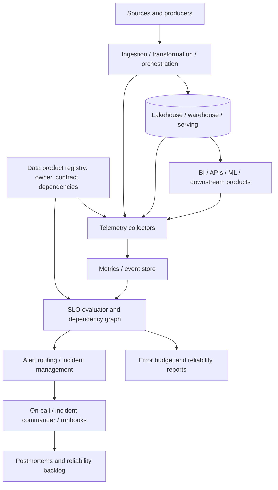

# Scenario 1 — Design a Data Platform Reliability and SLO Engineering Framework

**Interview level:** Staff / Principal Data Engineer  
**Suggested interview time:** 45–60 minutes  
**Core themes:** SLI/SLO/SLA, freshness, correctness, availability, error budgets, observability, incident response, operational excellence

## 1. Problem statement

An enterprise operates hundreds of production data pipelines across batch, CDC, streaming, lakehouse, warehouse, and serving systems. Teams report job success rates, but business users still experience stale dashboards, missing records, duplicate financial events, and broken downstream models. Alerts are noisy, ownership is unclear, and incidents take too long to diagnose.

Design a reliability framework that measures the data products users depend on—not merely whether individual jobs returned exit code zero.

Assume 500 production data products, 4,000 scheduled/streaming pipelines, 30 domain teams, and 10 business-critical data products supporting finance, customer operations, risk, and product analytics.

## 2. Clarifying questions — ask these before designing

1. Who consumes each data product, and what business decision depends on it?
2. What does “available” mean: table exists, query succeeds, or complete and correct data is queryable?
3. What freshness is required by product tier: seconds, minutes, hourly, or daily?
4. Can the platform measure completeness and correctness against an independent source or golden dataset?
5. What are the consequences of stale versus incorrect data?
6. Are SLOs owned centrally, by domains, or jointly?
7. What are the current incident rate, MTTD, MTTR, and recurring failure categories?
8. Which signals can be measured end-to-end across source, pipeline, storage, and consumer?
9. What change policy should apply when an error budget is exhausted?
10. How are maintenance windows, upstream dependencies, and planned data delays represented?

A strong candidate distinguishes pipeline execution health from delivered data-product reliability.

## 3. Requirements

### Functional
- Define a standard reliability contract for every production data product.
- Measure freshness, completeness, correctness, availability, and delivery latency.
- Collect telemetry across orchestrators, stream processors, storage, catalogs, query engines, and consumers.
- Support dependency-aware health and blast-radius analysis.
- Generate actionable alerts and incident tickets.
- Maintain ownership, runbooks, escalation paths, and incident history.
- Track SLO compliance and error budgets over rolling windows.
- Support postmortems and reliability improvement planning.

### Non-functional
- Low-latency monitoring for critical streams and bounded delay for batch products.
- High availability of telemetry and alerting.
- Minimal monitoring overhead and cardinality explosion.
- Clear separation of symptoms from diagnostic signals.
- Consistent definitions across domains without forcing identical SLO targets.
- Auditable SLO changes and ownership.

## 4. Model the data product, not just the job

A pipeline can succeed while publishing incomplete data. Conversely, an upstream source may be late while the pipeline itself is functioning exactly as designed.

Define a data product contract:
- product name and owner,
- business purpose and consumers,
- source dependencies,
- expected schema and grain,
- freshness target,
- completeness/correctness expectations,
- publication schedule or event-time watermark,
- availability definition,
- quality gates,
- retention and classification,
- downstream dependency list,
- escalation and runbook.

Use product-level SLOs and component-level diagnostic metrics. Do not define a separate arbitrary SLO for every internal task unless it affects a user promise.

## 5. SLI, SLO, and SLA

- **SLI (Service Level Indicator):** the measured quantity, such as fraction of expected records available within the freshness window.
- **SLO (Service Level Objective):** the target for that indicator over a defined window.
- **SLA (Service Level Agreement):** an external or contractual commitment with consequences for missing it.

Example data product SLOs:
- Freshness: 99% of hourly partitions queryable within 20 minutes of the scheduled window.
- Completeness: 99.95% of expected source records accounted for by the reconciliation deadline.
- Correctness: fewer than 0.05% of sampled rows fail critical business invariants.
- Availability: 99.9% of supported read requests return the certified product successfully.

Avoid a vague SLO such as “pipeline uptime 99.9%.” Define eligible events, measurement window, exclusions, and failure semantics.

## 6. High-level architecture

## 7. Define data-specific SLIs

### 7.1 Freshness

Freshness is not simply the last successful job timestamp. Use event-time or source watermark where possible.

Example:
`freshness_lag = current_time - latest_complete_event_time`

For scheduled batch data, measure whether the expected partition was complete and queryable by its deadline. For streaming, measure age of the oldest unprocessed event or end-to-end event-to-queryable latency.

Beware of false freshness: a pipeline may continuously write heartbeats or partial data while missing a major source partition.

### 7.2 Completeness

Completeness can be measured through:
- source-to-target record counts,
- partition presence,
- offset/LSN coverage,
- expected key coverage,
- control totals,
- source reconciliation,
- late-arrival and gap detection.

Counts alone are not proof. A duplicate and a missing record can cancel out. Use key-level or aggregate reconciliation where business risk justifies it.

### 7.3 Correctness

Correctness needs explicit invariants:
- uniqueness of business keys,
- valid state transitions,
- referential integrity,
- financial totals reconcile within tolerance,
- domain constraints hold,
- output matches golden test data.

For complex outputs, correctness may be sampled or assessed through independent control totals. Document what is and is not measured.

### 7.4 Availability

Define availability from consumer perspective: can the intended consumer access a valid, certified version within the product contract? Include authorization and query failures where they affect consumers. A table object existing in storage is not necessarily available.

## 8. Error budgets and policy

For an SLO target of 99.9%, the error budget is 0.1% of eligible events in the measurement window. The budget is a decision tool, not just a dashboard metric.

A practical policy:
- healthy budget: normal release cadence;
- budget burn accelerating: review risky changes and increase monitoring;
- budget nearly exhausted: prioritize reliability work and require explicit launch review;
- budget exhausted: pause nonessential risky changes until mitigations are in place, while continuing security fixes and urgent remediation.

For data products, use separate budgets for freshness and correctness. A product can be fresh but wrong. Incorrect data may have a higher business impact than delayed data.

## 9. Telemetry and dependency graph

Collect:
- pipeline run ID, attempt, status, duration, queue time;
- source watermark, offsets, CDC lag, batch window;
- record counts, bytes, rejected rows, duplicate rate;
- table snapshot/commit ID, partition completeness;
- query success, latency, and consumer access;
- schema version, code/config version, deployment time;
- owner, severity, lineage and dependency metadata.

Build a dependency graph from source to published product to consumers. When an upstream source is late, identify affected products and suppress redundant downstream alerts while preserving the primary incident signal.

## 10. Alerting strategy

Page on symptoms requiring immediate human action:
- critical product will miss freshness SLO;
- correctness invariant fails for a high-impact dataset;
- data loss or uncontrolled duplication is suspected;
- critical consumer read path is unavailable;
- error budget burn rate indicates rapid SLO failure.

Create tickets for issues requiring planned attention:
- rising compaction backlog;
- repeated noncritical retries;
- approaching retention/capacity threshold;
- recurring low-severity quality warnings.

Log diagnostic details without paging:
- individual task retries that recover;
- transient latency spikes below user-impact threshold;
- expected late-arriving records within the allowed lateness window.

Alert on user impact, but retain internal metrics to diagnose causes. Avoid paging on every task failure when automatic retries recover without affecting the product SLO.

## 11. Incident response and communication

Establish clear roles:
- Incident Commander: coordinates priorities, decisions, and timeline.
- Operations Lead: investigates and executes mitigation.
- Communications Lead: stakeholder updates and status.
- Subject-matter responders: source, platform, domain, security, or consumer experts.

A practical response sequence:
1. Confirm impact and affected data products/consumers.
2. Declare severity and assign roles.
3. Stop further propagation if data may be incorrect.
4. Choose mitigation: pause publication, serve last known good snapshot, roll back, isolate source, or replay.
5. Communicate impact, workaround, and next update time.
6. Recover and validate data before declaring resolution.
7. Reconcile downstream consumers and publish recovery evidence.
8. Run a blameless postmortem with corrective actions.

For data incidents, “service restored” and “data repaired” are separate milestones.

## 12. Failure modes and mitigations

| Failure | Detection | Mitigation |
|---|---|---|
| Job succeeds with missing partition | Completeness / partition checks | Block publication, backfill |
| Source watermark stalls | Freshness / source lag | Escalate source, hold downstream publication |
| Bad data published | Business invariants / reconciliation | Quarantine, rollback snapshot, notify consumers |
| Alert storm | Correlation and dependency graph | Group by root incident, suppress duplicates |
| Telemetry pipeline fails | Independent heartbeat / dead-man signal | Redundant alert path, local buffering |
| Ownership missing | Registry validation | Block production certification |
| Error budget exhausted repeatedly | Burn-rate reports | Reliability investment and release controls |
| Monitoring too expensive | Cardinality/cost telemetry | Sampling, aggregation, label governance |

## 13. Capacity and cost

Monitor telemetry cardinality. Labels such as user ID, record ID, or arbitrary query text can create unbounded time series. Use stable dimensions: product, domain, environment, pipeline, region, workload class, and severity.

Retain high-resolution telemetry for short periods and aggregated trends longer. Keep audit/event evidence according to compliance requirements. Monitoring cost should be attributed to platform and domains.

## 14. Trade-offs

| Decision | Option A | Option B | Consideration |
|---|---|---|---|
| Job-level vs product-level SLO | Easier to instrument | Better reflects consumer outcome | Use product SLO with job diagnostics |
| Freshness vs correctness | Publish quickly | Hold until validated | Business impact determines policy |
| Central standards vs local targets | Consistency | Domain relevance | Standardize definitions, tailor targets |
| Page on causes vs symptoms | More diagnostic detail | Less noise, user focus | Page on symptoms; retain cause metrics |
| Last-known-good vs fail closed | Continuity | Prevent stale/unsafe use | Product criticality and staleness tolerance |

## 15. Sample interviewer–candidate conversation

**Interviewer:** Your pipelines show 99.9% successful runs. Why are business users still complaining?

**Candidate:** Job success is a component metric, not a data-product SLO. A job can succeed while processing incomplete input, publishing a partial partition, or producing semantically incorrect values. I would start by identifying the affected product and its consumer promise, then measure freshness, completeness, correctness, and queryability end to end.

**Interviewer:** What would you alert on?

**Candidate:** I would page when the consumer-facing SLO is at risk or a critical correctness invariant fails. A recoverable task retry should generally be a metric or ticket, not a page. I would group downstream symptoms using the dependency graph so one upstream failure does not generate hundreds of duplicate alerts.

**Interviewer:** Finance dashboard is stale. The source team says their database is healthy. What next?

**Candidate:** I would trace the last complete source watermark through CDC offsets, Kafka lag, transformation checkpoints, table commits, and dashboard query freshness. I would identify the first boundary where progress stopped. Meanwhile, I would communicate the affected time range and whether the last published snapshot is safe to use. I would not claim data is current merely because the source database is available.

**Interviewer:** The pipeline is fresh but the invoice total is wrong. Do you keep publishing?

**Candidate:** No, not if the invariant is critical. I would stop or quarantine publication, preserve the last known-good snapshot, identify the affected partitions and consumers, and reconcile against an independent control total. Correctness can take precedence over freshness.

**Interviewer:** Leadership wants 100% availability.

**Candidate:** I would explain that 100% is not a practical operational objective and can drive disproportionate cost. We should define a user-relevant target, measure it, and use an error budget to make explicit trade-offs. For the most critical data products, we may choose a tighter target based on business impact and recovery cost.

## 16. Principal-level follow-up questions

**Q1. How do you define freshness for a CDC pipeline?**  
Use source log position or event-time watermark and measure end-to-end visibility in the target, not just consumer lag. Account for source transaction time, connector delay, broker lag, processing, commit, and query visibility.

**Q2. How do you measure correctness without a perfect expected output?**  
Use independent control totals, golden datasets, invariants, referential checks, sampled source-to-target comparisons, and reconciliation with downstream business systems. State the blind spots and risk tier.

**Q3. Should every dataset have the same SLO?**  
No. Standardize SLI definitions and reporting, but set targets by business criticality, consumer needs, architecture, and cost. A daily exploratory dataset should not inherit a financial real-time SLO.

**Q4. How do you avoid alert fatigue?**  
Alert on actionable user-impact symptoms, use dependency-aware grouping, tune thresholds with incident history, and route tickets separately from pages. Every page should have an owner and runbook.

**Q5. What if one upstream dependency causes multiple downstream SLO violations?**  
Declare one coordinated incident, identify all affected products through lineage, prevent duplicate paging, and communicate impact by consumer. Each product's SLO accounting remains transparent.

**Q6. How would you use error budgets to influence teams that do not report to you?**  
Agree on shared product contracts and governance with domain leaders. Publish evidence, establish an escalation process, and connect budget burn to launch risk and prioritization. Principal influence comes through transparent mechanisms, not authority alone.

**Q7. How do you distinguish an incident from a data quality warning?**  
Use impact, severity, and time sensitivity. A minor distribution shift may create a ticket; a failed financial invariant or exposure of sensitive data requires immediate incident handling.

**Q8. What is the most important postmortem output?**  
A prioritized set of owned, measurable changes that reduce impact or recurrence—covering detection, mitigation, recovery, and communication—not a blame assignment.

## 17. Common interview mistakes

- Measuring only DAG success or infrastructure uptime.
- Defining SLOs without eligible-event and measurement-window semantics.
- Treating freshness as correctness.
- Paging on every internal metric.
- Failing to distinguish service recovery from data repair.
- Setting targets without understanding consumer impact.
- Creating error budgets that have no policy consequences.
- Ignoring telemetry cardinality and monitoring-system failure.

## 18. Practice exercise

Design SLOs for three products:
1. A streaming fraud feature with a 30-second freshness expectation.
2. A daily finance mart with strict reconciliation.
3. An exploratory marketing dataset with an eight-hour freshness window.

For each, state SLI, SLO, measurement window, alert policy, error-budget response, and fallback. Then explain which product should fail closed when correctness is uncertain.

## 19. References

- [Google SRE Workbook — Data Processing Pipelines](https://sre.google/workbook/data-processing/)
- [Google SRE — Service Level Objectives](https://sre.google/sre-book/service-level-objectives/)
- [Google SRE — Incident Management Guide](https://sre.google/resources/practices-and-processes/incident-management-guide/)
- [Google SRE Workbook — Implementing SLOs](https://sre.google/workbook/implementing-slos/)

These references provide general SRE principles. Adapt SLI definitions to the data product's business semantics and architecture.
