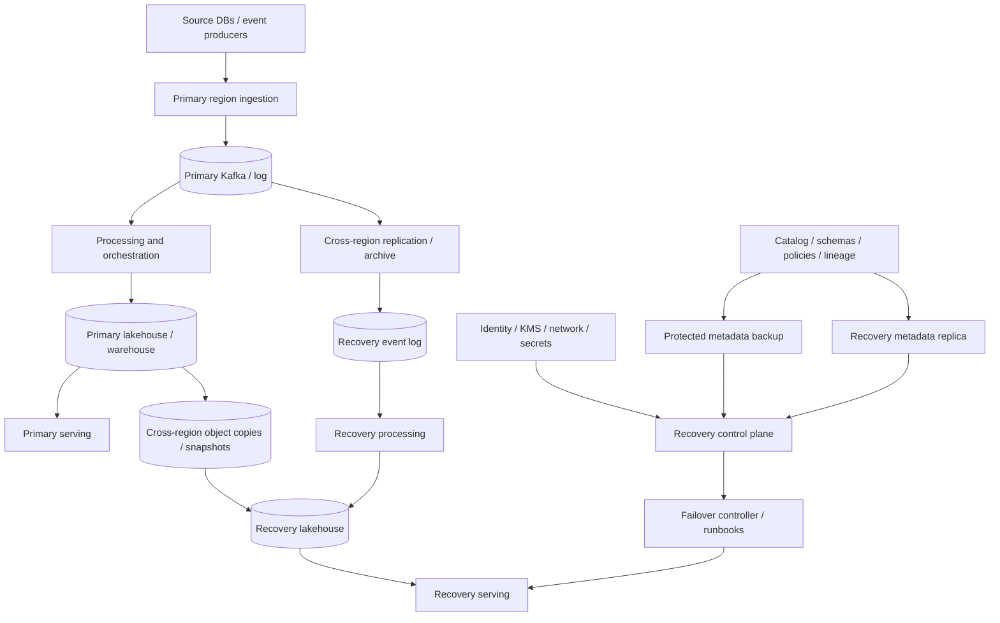

# Scenario 2 — Design Disaster Recovery and Business Continuity for an Enterprise Data Platform

**Interview level:** Staff / Principal Data Engineer  
**Suggested interview time:** 45–60 minutes  
**Core themes:** RPO, RTO, multi-region, backups, replication, replay, failover, restore testing, dependency recovery

## 1. Problem statement

Design a disaster recovery (DR) and business continuity strategy for an enterprise data platform operating across cloud regions. The platform ingests CDC and events, processes batch and streaming data, stores lakehouse tables, serves warehouse/OLAP queries, and supports business-critical reporting and ML features.

Assume:
- 30 business domains and 400 production data products.
- 60 TB/day of new data across raw, curated, and serving layers.
- Critical products support finance, customer operations, and fraud detection.
- Some data can tolerate hours of recovery; selected online features need recovery within minutes.
- The primary region can become unavailable due to cloud, network, identity, or human error.

Design recovery around business impact and dependency order—not simply “copy everything to another region.”

## 2. Clarifying questions

1. Which business processes are critical, and what is the impact of their outage?
2. What RTO and RPO are required per data product and platform component?
3. Is the disaster regional, account-wide, identity-plane, ransomware, or logical corruption?
4. Are source systems and upstream dependencies available in the recovery region?
5. Which data is reconstructable from source logs or archives?
6. Are catalog metadata, secrets, policies, schemas, and orchestration definitions backed up?
7. Is failover active-active, warm standby, pilot light, or backup-and-restore?
8. Can consumers tolerate stale read-only data during recovery?
9. How are DNS, IAM, KMS, networking, quotas, and service limits handled?
10. How often are restores and failovers tested, and who approves declaring disaster?

## 3. Define recovery objectives

- **RPO (Recovery Point Objective):** maximum acceptable data loss measured in time or source position.
- **RTO (Recovery Time Objective):** target time to restore a service to an acceptable operating state.
- **MTD (Maximum Tolerable Downtime):** maximum outage duration the business can tolerate.

Illustrative tiers:

| Tier | Example | RPO target | RTO target | Strategy |
|---|---|---:|---:|---|
| Tier 0 | Critical online fraud features | Seconds/minutes | 5–15 min | Replicated state + tested failover |
| Tier 1 | Finance/operational reporting | 15–60 min | 1–4 hours | Warm standby and replay |
| Tier 2 | Core curated analytics | 4 hours | 8 hours | Cross-region copies and rebuild |
| Tier 3 | Exploratory history | 24 hours | 1–3 days | Backup/restore or recompute |

These are examples, not universal standards. RPO/RTO must be approved by business owners and validated through tests.

## 4. Requirements

### Functional
- Classify data products and dependencies by recovery tier.
- Replicate or back up data, metadata, code, configuration, schemas, and policies.
- Recover ingestion, processing, storage, catalog, orchestration, and serving.
- Replay events and CDC from durable source positions.
- Validate recovered data before reopening consumers.
- Support controlled failover, failback, and audit.
- Run regular restore and game-day exercises.

### Non-functional
- Meet approved RPO/RTO under realistic failure conditions.
- Avoid correlated failure between primary and recovery environments.
- Preserve encryption keys and identity access.
- Protect backups from accidental deletion and ransomware.
- Prevent split-brain writes and duplicate publication.
- Keep DR cost proportionate to business criticality.

## 5. Failure-domain analysis

Model at least these failure classes:
1. Single worker or node failure.
2. Availability-zone failure.
3. Regional outage.
4. Cloud account/project compromise.
5. Identity provider or KMS outage.
6. Catalog/metadata corruption.
7. Accidental deletion or destructive deployment.
8. Ransomware or malicious credential use.
9. Source system outage or log retention expiry.
10. Logical corruption propagated to replicas.

Replication protects against some infrastructure failures but can replicate bad data or deletion. Backups with immutability and point-in-time recovery protect different failure classes.

## 6. High-level architecture

## 7. Recovery architecture choices

### 7.1 Backup and restore

Lowest steady-state cost but longest RTO. Appropriate for lower-tier data products or reconstructable workloads. Back up data and the metadata needed to interpret it. A raw object copy without table metadata, schemas, and catalog pointers may not be a usable recovery point.

### 7.2 Pilot light

Keep core networking, identity, metadata, and minimal infrastructure available; scale compute during disaster. Faster than rebuilding from zero, cheaper than full warm standby, but scale-up and quota limits must be tested.

### 7.3 Warm standby

Maintain a reduced-capacity recovery environment with replicated data and metadata. Faster recovery but incurs ongoing cost and risks configuration drift.

### 7.4 Active-active

Both regions serve traffic. This can reduce failover time but introduces multi-writer conflict, global consistency, data residency, routing, and operational complexity. Do not choose active-active solely because it sounds highly available.

## 8. Recover the entire data platform

A recovery plan must include:

| Layer | Recovery concern |
|---|---|
| Source connectivity | Credentials, firewall, DNS, source log retention |
| Event/CDC log | Replicated offsets, partition mapping, replay window |
| Orchestration | DAG definitions, schedules, variables, secrets, metadata DB |
| Compute | Images, dependencies, runtime versions, capacity quotas |
| Object storage | Cross-region copy, versioning, immutability, lifecycle |
| Table format/catalog | Metadata files, catalog database, pointers, snapshots |
| Warehouse/OLAP | Snapshots, replicas, schema, users, grants |
| Identity and KMS | Principals, policies, keys, key recovery permissions |
| Governance | Catalog, lineage, classification, retention policies |
| Serving/API | DNS, routing, cache, endpoint configuration |
| Observability | Dashboards, alert rules, paging, audit access |

A common failure is recovering data files but not the control plane required to locate and authorize them.

## 9. Event replay and data correctness

For streaming and CDC:
- capture source offsets/LSNs and connector configuration;
- know how long source logs and Kafka retention preserve replay;
- restore consumers from a consistent checkpoint;
- avoid advancing offsets before sink commits;
- use idempotent writes or deterministic deduplication;
- reconcile counts and business control totals after replay.

If source logs have expired, RPO may be impossible even if the target region is healthy. Define the earliest recoverable position and alert before log-retention headroom is exhausted.

For batch:
- preserve immutable source extracts or reproducible snapshots;
- store code and configuration versions;
- make backfills parameterized and idempotent;
- record publication snapshots so downstream consumers can distinguish old and recovered outputs.

## 10. Catalog and metadata recovery

For lakehouse tables, recovery needs a consistent relationship between object files, table metadata, catalog state, and snapshot pointers. Restore catalog databases and metadata files in a tested order. Validate that the restored catalog points to existing metadata and that metadata references available objects.

Do not assume object-store replication alone yields a consistent catalog snapshot. Establish a backup protocol with timestamps/versions and a restore validator.

## 11. Failover sequence

1. Declare incident and activate DR authority.
2. Determine failure scope and whether primary writes are safe.
3. Freeze or fence primary writers to avoid split brain.
4. Confirm recovery region identity, KMS, networking, and quotas.
5. Restore/activate catalog and metadata.
6. Restore event logs, source positions, and processing checkpoints.
7. Start ingestion and processing in controlled mode.
8. Validate critical tables and serving paths.
9. Switch traffic and consumers gradually.
10. Monitor lag, duplicates, freshness, and correctness.
11. Communicate recovery status and residual data gaps.
12. Plan failback only after primary stability and data reconciliation.

Failback is a separate migration project. Do not automatically switch back as soon as the primary region is reachable.

## 12. Security and backup protection

- Use separate accounts/projects and restricted backup roles.
- Apply immutable/WORM retention for critical backups where required.
- Separate production deletion privileges from backup administration.
- Encrypt backups and replicate keys under a controlled recovery process.
- Test restoration when the primary identity plane is unavailable.
- Audit backup access and deletion.
- Ensure recovery credentials are not stored only in the failed region/account.

## 13. Testing and validation

A DR plan is a hypothesis until tested. Run:
- file-level restore tests,
- table/catalog restore tests,
- pipeline replay tests,
- isolated regional failover,
- identity/KMS recovery,
- application endpoint failover,
- full business-process exercise,
- destructive logical-corruption recovery.

Measure actual RPO/RTO, not just whether the runbook completed. Capture bottlenecks, manual steps, missing permissions, quota failures, and data reconciliation gaps.

## 14. Failure modes

| Failure | Risk | Control |
|---|---|---|
| Replication lag exceeds RPO | Data loss | Lag SLO and escalation |
| Corruption replicated | No clean recovery point | Immutable/versioned backups and point-in-time restore |
| Catalog lost | Data inaccessible | Metadata backup and restore test |
| KMS unavailable | Cannot decrypt data | Key recovery and independent access path |
| Source logs expired | Cannot replay CDC | Retention headroom alarms and archive |
| Split-brain writers | Conflicting table state | Fencing and single-writer ownership |
| Recovery region under-provisioned | RTO miss | Capacity/quota testing |
| DNS/client caches stale | Slow traffic switch | TTL strategy and staged routing |
| DR not exercised | Hidden manual dependencies | Scheduled game days |

## 15. Sample interviewer–candidate conversation

**Interviewer:** We have a regional outage. How do you recover the platform?

**Candidate:** I would first classify the impacted products and declare the incident. Before enabling recovery writes, I would fence the primary to prevent split brain. Then I would validate the recovery region's identity, KMS, network, quotas, catalog metadata, and data replication point. I would bring up Tier 0 and Tier 1 products first, replay from known offsets, validate correctness, and switch consumers progressively.

**Interviewer:** We copied all S3 objects to another region. Are we recovered?

**Candidate:** Not necessarily. We need the table metadata, catalog pointers, schemas, policies, and a consistent restore point. We also need to verify that every referenced data file exists and that readers can resolve the table. Object availability alone does not restore the logical table service.

**Interviewer:** Kafka has replicated data, but the consumer offset is uncertain.

**Candidate:** I would restore from the last verified checkpoint or choose a conservative earlier offset, then replay with idempotent sink writes or deduplication. I would reconcile event IDs and business totals. If the sink is not replay-safe, I would isolate the affected output and rebuild it into a new version before publication.

**Interviewer:** Why not active-active across both regions?

**Candidate:** It may be justified for low-latency global serving, but it complicates writes, conflict resolution, data residency, and operational recovery. If the platform can meet business RTO with warm standby, that may be a better cost and complexity trade-off. I would decide per product tier.

**Interviewer:** The recovery environment is healthy, but KMS is not accessible.

**Candidate:** Encrypted data is effectively unavailable. KMS and identity recovery are part of DR, not an afterthought. We need tested key access, key policy restoration, and an independent break-glass procedure with audit.

## 16. Principal-level follow-up questions

**Q1. How do you set RPO for a CDC pipeline?**  
Translate business loss tolerance into source log position/time. Consider source log retention, connector offsets, broker replication, sink commit semantics, and target visibility. Test replay end to end.

**Q2. Does cross-region replication guarantee a consistent table snapshot?**  
Not by itself. Coordinate object, metadata, and catalog recovery points. Restore into isolation and validate metadata references and snapshot state.

**Q3. How do you prevent a bad delete from being replicated?**  
Use versioning/immutable backups, separate backup permissions, retention locks where appropriate, and point-in-time recovery. Replication is not a substitute for backup.

**Q4. What is the difference between HA and DR?**  
HA handles local failures with minimal interruption; DR restores service after a larger failure domain such as region/account loss. They have different architecture, objectives, and tests.

**Q5. How do you prioritize recovery across hundreds of products?**  
Use business criticality, dependency graph, regulatory obligations, and minimum viable business process. Recover foundational control-plane services and critical data products first.

**Q6. How do you validate RPO if source and target clocks differ?**  
Use durable source positions (LSN, offsets, sequence IDs) as well as timestamps. Clock time alone can be misleading.

**Q7. What if the recovery region has insufficient service quotas?**  
Pre-allocate or regularly validate quotas, run capacity tests, and include quota escalation in runbooks. A design that assumes instant quota increases is not a credible RTO plan.

**Q8. Who owns DR?**  
Platform engineering owns technical mechanisms and tests; domain owners define product criticality and validate business outputs; security owns key/control requirements; leadership approves RTO/RPO and residual risk.

## 17. Common interview mistakes

- Treating replication as backup.
- Recovering data but not metadata, IAM, KMS, DNS, or orchestration.
- Failing to fence primary writers.
- Assuming source logs are retained indefinitely.
- Quoting RTO without measuring restore throughput.
- Ignoring failback and reconciliation.
- Testing only infrastructure, not business data correctness.
- Choosing active-active without proving the need.

## 18. Practice exercise

Design recovery for:
- a 30-second fraud feature,
- a 4-hour finance mart,
- a 24-hour exploratory dataset.

For each, state RPO/RTO, recovery topology, source replay strategy, metadata recovery, validation gates, consumer behaviour during outage, and cost implications. Explain why one DR architecture may not fit all three.

## 19. References

- [AWS Well-Architected Framework — Reliability Pillar](https://docs.aws.amazon.com/wellarchitected/latest/reliability-pillar/welcome.html)
- [AWS Disaster Recovery of Workloads on AWS](https://docs.aws.amazon.com/whitepapers/latest/disaster-recovery-workloads-on-aws/disaster-recovery-workloads-on-aws.html)
- [Amazon S3 Replication](https://docs.aws.amazon.com/AmazonS3/latest/userguide/replication.html)
- [Apache Kafka documentation](https://kafka.apache.org/documentation/)

Use provider-specific guidance for exact replication, restore, and consistency behaviour; test the actual services and versions in your architecture.
