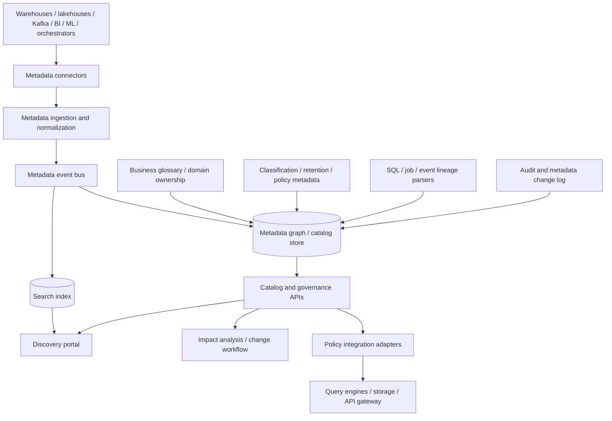

# Scenario 4 — Design an Enterprise Metadata, Lineage and Governance Platform

**Interview level:** Staff / Principal Data Engineer  
**Suggested interview time:** 45–60 minutes  
**Core themes:** metadata architecture, catalog, lineage, ownership, classification, policy, impact analysis, governance operating model

## 1. Problem statement

An enterprise has multiple warehouses, lakehouses, streaming systems, BI tools, ML platforms, and SaaS sources. Users cannot reliably find trusted datasets, determine ownership, understand transformations, identify sensitive columns, or assess the impact of schema changes.

Design an enterprise metadata and governance platform that makes data discoverable, understandable, traceable, and safely usable without requiring every team to abandon its existing tools.

Assume 10,000 datasets, 100,000 tables/views, 50,000 columns, 2,000 pipelines, 1,500 dashboards, and hundreds of ML models across multiple domains.

## 2. Clarifying questions

1. Which metadata is required: technical, operational, business, security, or all?
2. What are the authoritative sources for schemas, owners, policies, and lineage?
3. Is lineage table-level, column-level, job-level, or event-level?
4. Which systems must be integrated first?
5. Is metadata discovery near-real-time or hourly/daily sufficient?
6. Who can edit business definitions and ownership?
7. How are classifications and access policies enforced in query engines?
8. How are data products certified and deprecated?
9. What is the governance model: central, federated, or hybrid?
10. What are the availability and recovery expectations for catalog and policy metadata?

## 3. Requirements

### Functional
- Searchable catalog for datasets, columns, dashboards, pipelines, and models.
- Technical metadata ingestion from databases, object stores, query engines, orchestrators, and BI tools.
- Business glossary, domain ownership, descriptions, and certification.
- Table- and column-level lineage with upstream/downstream impact analysis.
- Data classification and policy metadata.
- Change notifications and deprecation workflows.
- Data product health, freshness, and quality status.
- APIs and integrations for discovery and governance workflows.

### Non-functional
- Scalable metadata graph and search.
- Incremental ingestion and idempotent metadata updates.
- Clear provenance and confidence of metadata.
- Strong access control and audit.
- Resilience to source-system outages.
- Low-friction adoption by domain teams.
- Versioning and history for metadata changes.

## 4. Metadata domains

### Technical metadata
Schemas, types, table locations, partitions, query definitions, jobs, owners from system configuration, and storage properties.

### Operational metadata
Run history, freshness, volume, quality results, query usage, cost, failures, and SLA/SLO status.

### Business metadata
Business definitions, domain, owner, steward, product purpose, certified status, criticality, and consumer expectations.

### Governance metadata
Classification, retention, legal basis/purpose, residency, access policy, data subject categories, and approval history.

Do not collapse all metadata into one free-text description. Define typed attributes, provenance, and ownership.

## 5. High-level architecture

## 6. Ingestion and normalization

Use connectors to extract metadata from source systems. Normalize identifiers and represent relationships consistently:
- dataset contains schema/columns;
- job reads and writes datasets;
- dashboard consumes views/tables;
- model consumes features/tables;
- owner owns data product;
- policy classifies fields and datasets.

Use source-native identifiers where possible. Names alone are not stable identifiers because objects can be renamed or moved.

Metadata ingestion should be incremental, idempotent, and checkpointed. Store source system, extraction timestamp, source version, and confidence/provenance for every imported attribute. Avoid overwriting curated business metadata with an empty or stale connector result.

## 7. Lineage architecture

### Table-level lineage
Identify which jobs or queries read and write which datasets. This is useful for impact analysis and incident blast radius.

### Column-level lineage
Trace how a target column derives from source columns through projections, joins, expressions, and transformations. SQL parsing is difficult with dynamic SQL, stored procedures, UDFs, and runtime-generated queries.

### Runtime lineage
Capture actual executed queries/jobs and their inputs/outputs. Runtime lineage is stronger evidence of execution but may be incomplete for failed or uninstrumented jobs.

### Design lineage
Capture intended dependencies from code, orchestration DAGs, and transformation definitions. It can exist before execution but may differ from actual runtime behaviour.

Combine approaches and label lineage confidence. Never present inferred column lineage as guaranteed when parsing is incomplete.

## 8. Metadata graph and search

Represent entities and relationships as a graph or relational model with graph traversal capabilities. A graph database is not mandatory; relational tables with indexed edges may work at moderate scale. Choose based on query patterns, scale, operational expertise, and consistency requirements.

Search should support:
- names and descriptions,
- domain and owner,
- tags and classifications,
- certified/trusted status,
- freshness and quality,
- downstream consumers,
- frequently used assets.

Ranking should combine text relevance, certification, freshness, ownership completeness, and usage. Do not make popularity equivalent to trust.

## 9. Governance operating model

Use a federated model:
- central platform team provides catalog, metadata standards, lineage, APIs, policy integration, and automation;
- domain owners define business meaning, quality expectations, and product lifecycle;
- data stewards maintain glossary and classifications;
- security/privacy teams define policy requirements and review sensitive use cases;
- consumers provide feedback and declare critical dependencies.

Central governance should set minimum standards and enforce high-risk controls; domain teams should own semantics.

## 10. Policy enforcement integration

A catalog is not a security boundary by itself. Metadata labels must be translated into enforceable policies in query engines, storage, APIs, and export paths.

Example flow:
1. Classify a column as restricted.
2. Attach owner, purpose, and retention metadata.
3. Map classification to policy rules.
4. Push or synchronize rules to enforcement points.
5. Test access with allowed and denied principals.
6. Audit policy version and decision.

Policy synchronization needs versioning, rollback, and drift detection. A catalog label that is not enforced is documentation, not protection.

## 11. Change and impact workflow

When a column is renamed or removed:
1. Detect change from source metadata or code deployment.
2. Compare against registered contract.
3. Traverse lineage to identify affected jobs, tables, dashboards, APIs, and models.
4. Notify owners and consumers.
5. Block or require approval for critical breaking changes.
6. Track migration and deprecation.
7. Verify consumers have moved before final removal.

Impact analysis should indicate confidence and last-seen execution. A dependency declared in code but never executed is different from a heavily used production dependency.

## 12. Security and privacy

Metadata can itself reveal sensitive information through names, descriptions, lineage, query text, and sample values. Protect:
- catalog access,
- sensitive column names and descriptions,
- query text and lineage,
- sample data and profiling results,
- ownership and access audit.

Use role-based access and field-level restrictions for metadata itself. Do not expose raw sample values to all catalog users.

## 13. Failure modes

| Failure | Mitigation |
|---|---|
| Connector outage | Checkpointed ingestion, retry, stale metadata indicator |
| Duplicate metadata events | Idempotent upsert and source IDs |
| Stale owner information | Ownership review and escalation |
| Incorrect lineage | Provenance/confidence labels, parser tests |
| Search index lags graph | Rebuildable index and freshness monitoring |
| Policy sync fails | Drift alert, fail-safe enforcement at runtime |
| Catalog becomes bottleneck | Cache reads, partition ingestion, HA storage |
| Metadata contains secrets/PII | Scanning, redaction, access control |
| Rename creates duplicate asset | Stable IDs and alias/history model |

## 14. Observability and SLOs

Track:
- metadata ingestion lag and connector success,
- percentage of critical assets with owner and description,
- lineage coverage by system and asset tier,
- classification coverage,
- search latency and availability,
- metadata freshness,
- policy synchronization lag and drift,
- impact-analysis precision/recall sampled by owners,
- stale/orphaned asset count.

Example targets:
- 95% of Tier 1 datasets have owner, classification, freshness, and lineage.
- 99% of metadata changes visible in catalog within 15 minutes.
- Critical policy changes propagated within a defined short window.
- Search p95 below an agreed threshold for normal catalog queries.

## 15. Trade-offs

| Decision | Option A | Option B | Consideration |
|---|---|---|---|
| Centralized governance | Uniform standards | Domain autonomy | Federated ownership with central guardrails |
| Batch metadata scan | Simple and robust | Stale between scans | Event/incremental where supported |
| Runtime lineage | Actual execution evidence | May miss uninstrumented paths | Combine with design lineage |
| SQL parser lineage | Detailed columns | Dynamic SQL limitations | Mark confidence and fallback |
| Graph database | Natural relationship traversal | Additional operations | Benchmark graph query needs |
| Automated classification | Scales coverage | False positives/negatives | Human review for high-risk labels |

## 16. Sample interviewer–candidate conversation

**Interviewer:** We already have a catalog. Why do we need a governance platform?

**Candidate:** A catalog is one interface. The platform needs metadata ingestion, ownership, lineage, classification, policy synchronization, change workflows, and audit. Discovery without ownership or enforceable policy does not create governed data products.

**Interviewer:** Can you guarantee column-level lineage for every SQL query?

**Candidate:** Not honestly across arbitrary SQL, dynamic SQL, UDFs, stored procedures, and all engines. I would combine design-time and runtime lineage, measure coverage, label confidence, and prioritize critical systems. We can make strong guarantees for supported execution paths, not every possible query.

**Interviewer:** The catalog says a column is restricted. Is that enough?

**Candidate:** No. The label must map to policy at the query, storage, API, and export enforcement points. I would test propagation and drift, and ensure runtime authorization does not depend solely on catalog availability.

**Interviewer:** Who owns business definitions?

**Candidate:** Domain owners and stewards own semantics. The central platform owns the metadata model, connectors, lineage services, search, and enforcement integrations. This avoids central bottlenecks while maintaining common standards.

**Interviewer:** A column is being dropped tomorrow. What do you do?

**Candidate:** Use lineage and runtime usage to identify consumers, classify criticality, notify owners, and block or gate the breaking change for critical assets. Provide a migration path and only remove it after usage and sign-off criteria are met.

## 17. Principal-level follow-up questions

**Q1. How do you model metadata from multiple systems with conflicting names?**  
Use stable source identifiers and canonical asset IDs, preserve aliases, and record provenance. Do not merge assets based only on matching names.

**Q2. How do you measure lineage completeness?**  
Define coverage by critical assets and execution paths, compare declared dependencies with runtime observations, and sample against known workflows. Report confidence, not only a single percentage.

**Q3. How do you prevent stale metadata from overwriting curated metadata?**  
Use source-of-truth rules by attribute, timestamps/version checks, and field-level ownership. Connector updates should not erase steward-maintained descriptions or classifications.

**Q4. Is a graph database required?**  
No. Use a graph representation and evaluate storage based on scale and traversal workload. Relational edge tables can be sufficient; a graph database adds operational cost.

**Q5. How does lineage support incident management?**  
Trace affected outputs and consumers, estimate blast radius, identify upstream changes, and prioritize recovery. It should also distinguish declared from observed dependencies.

**Q6. How do you govern shadow datasets?**  
Discover from query logs and storage scans, identify owners, assess usage and sensitivity, then register, certify, restrict, or deprecate. Avoid deleting unknown assets without impact analysis.

**Q7. How do you handle policy drift?**  
Version policy metadata, synchronize to enforcement points, continuously compare effective policies, alert on drift, and fail safely for high-risk data.

**Q8. What should a Principal engineer standardize?**  
Canonical identifiers, metadata schemas, ownership, classification taxonomy, lineage interfaces, quality/freshness attributes, and minimum controls. Avoid forcing all domains into one implementation.

## 18. Common interview mistakes

- Treating catalog search as complete governance.
- Claiming perfect column lineage from SQL parsing.
- Using asset names as stable identifiers.
- Allowing connector metadata to overwrite curated definitions.
- Treating classification labels as access enforcement.
- Ignoring metadata privacy and query-text sensitivity.
- Centralizing business semantics in a platform team.
- Measuring coverage without confidence or criticality.

## 19. Practice exercise

Design metadata and lineage for a customer 360 product that combines CDC, streaming events, batch enrichment, a warehouse model, a dashboard, and an ML model. Show how a source column change triggers impact analysis and how a sensitive column classification reaches the serving layer.

## 20. References

- [OpenLineage documentation](https://openlineage.io/docs/)
- [DataHub documentation](https://docs.datahub.com/)
- [OpenMetadata documentation](https://docs.open-metadata.org/)
- [Apache Atlas documentation](https://atlas.apache.org/)
- [AWS Lake Formation](https://docs.aws.amazon.com/lake-formation/latest/dg/what-is-lake-formation.html)

These are examples of metadata and governance ecosystems, not interchangeable products. Evaluate integration coverage, policy enforcement, lineage fidelity, and operational fit.
