# Design a Large-Scale Data Platform for GenAI and RAG Applications

> Principal/Staff-level system design preparation. Capacity numbers are illustrative; validate product guarantees and performance against current versions and representative benchmarks.

## 1. Interview framing and problem statement

**Prompt:** Design a shared enterprise data platform that powers internal GenAI assistants across engineering, support, legal, finance and product teams. It must ingest frequently changing enterprise content, enforce source-system permissions, support grounded answers with citations, and serve interactive workloads at predictable latency and cost.

The key principal-level move is to avoid treating this as “put documents in a vector database.” The system is a governed data product with two independently scalable planes:

- **Knowledge production plane:** connectors, extraction, normalization, classification, chunking, embedding, indexing, validation, publication and deletion.
- **Query serving plane:** identity resolution, authorization, query understanding, retrieval, reranking, context assembly, model invocation, citation validation and response telemetry.

Separate these planes so re-indexing, embedding migrations and backfills do not destabilize interactive traffic.

## 2. Clarifying questions

Ask before drawing:

1. Which sources: object stores, SharePoint/Confluence-like systems, databases, ticketing, code repositories, data warehouse, APIs?
2. Is the corpus multi-tenant? Are there legal entities, regions, data residency boundaries or customer-managed keys?
3. Must source ACLs be enforced at document, folder, row or field level? How quickly must permission revocation propagate?
4. What freshness target applies: seconds, minutes, hours, or daily?
5. What is the query mix: simple lookup, multi-hop research, summarization, structured analytics, multimodal?
6. What are the p95 latency and availability objectives? Is streaming generation required?
7. What is the expected corpus size, update rate, average document size and query QPS?
8. Must answers cite exact source spans and support “I don't know” when evidence is insufficient?
9. What are retention, deletion, audit and regional compliance requirements?
10. Which model providers are allowed, and can prompts or retrieved content leave the organization's cloud boundary?

**State assumptions if the interviewer does not provide them.** Example: 10 million active documents, 100,000 changed documents/day, 500 query requests/second peak, p95 first-token target 2.5 seconds, p95 complete answer 8 seconds, 99.9% monthly availability. Treat these as workload assumptions, not universal benchmarks.

## 3. Requirements and service objectives

### Functional
- Incremental and full ingestion with source-specific connectors.
- Parse PDFs, office documents, HTML, Markdown, email, code and selected structured records.
- Preserve source identity, version, timestamps, ownership, ACLs, sensitivity labels and lineage.
- Support configurable chunking, embedding models, lexical + vector retrieval, reranking and citations.
- Provide tenant-aware search, deletion, re-indexing, replay and index rollback.
- Evaluate retrieval and answer quality before promotion.

### Non-functional
- Strong tenant isolation and fail-closed authorization.
- Bounded freshness lag and query latency.
- Reproducible indexing; idempotent retries.
- Explainability: trace every answer to retrieved source versions.
- Cost controls by tenant, application, model and token budget.
- Graceful degradation when an embedding, vector store or model provider is unavailable.

### SLOs to negotiate
Define separate SLOs for **ingestion freshness**, **retrieval availability**, **answer availability**, **authorization correctness**, and **deletion propagation**. A single “RAG uptime” number hides which subsystem failed. Authorization correctness is a safety invariant, not merely a percentile target.

## 4. Capacity model

Build estimates from workload variables:

- Stored vector count = active chunks × number of simultaneously retained index versions.
- Raw embedding bytes ≈ vector count × dimensions × bytes per component; add index structures, metadata, replicas and headroom.
- Daily embedding work = new/changed chunks + re-embedded chunks for model migrations.
- Query embedding QPS is approximately query QPS unless query caching or batching is used.
- LLM token load = QPS × average input/output tokens × time; concurrency is driven by arrival rate × service time (Little's Law).
- Backfill duration ≈ total chunks / sustainable embedding throughput, adjusted for retries and rate limits.

**Illustrative example:** 10 million documents × 20 chunks/document = 200 million chunks. At 1,024 dimensions and float32, raw vectors alone are about 819 GB before metadata, ANN graph/index overhead, replicas and retained versions. This is why dimension, quantization, index strategy, replication and retention are architecture decisions—not afterthoughts.

Use measured chunk distributions; document count is a poor proxy for vector count.

## 5. Reference architecture

```mermaid
flowchart LR
  A[Enterprise sources] --> B[Connector framework]
  B --> C[Change log and landing zone]
  C --> D[Parse and normalize]
  D --> E[Classify, deduplicate, extract ACLs]
  E --> F[Chunk and enrich]
  F --> G[Embedding workers]
  G --> H[Versioned vector and lexical indexes]
  H --> I[Index validation and publish]
  U[User and application] --> J[API gateway and identity]
  J --> K[Policy and tenant resolver]
  K --> L[Query rewrite]
  L --> M[Hybrid retrieval]
  M --> N[ACL re-check and rerank]
  N --> O[Context and citation builder]
  O --> P[Model gateway]
  P --> Q[Answer validation and response]
  Q --> R[Telemetry and evaluation]
  I --> H
  R --> D
```

## 6. Deep design decisions

### 6.1 Connector and change-capture contract
Each connector emits a canonical event:
`{tenant_id, source_id, object_id, source_version, operation, event_time, observed_at, payload_ref, acl_version, checksum}`.

Use source-native webhooks/change feeds where possible; fall back to bounded polling with watermarks and reconciliation scans. Do not assume webhooks are complete or ordered. Maintain a connector cursor and periodic inventory reconciliation. A source object update should be idempotent on `(tenant_id, source_id, object_id, source_version)`.

Store raw payloads immutably where policy permits. Keep a manifest that records parser version, normalization version, chunker version, embedding model/version and index build ID. This enables forensic replay and reproducibility.

### 6.2 Parsing, chunking and semantic preservation
Parsing is not a trivial pre-processing step. Preserve headings, tables, code blocks, page numbers, section hierarchy, document links and source offsets. For tables, store a textual representation plus structured cells when the query patterns justify it. For code, chunk by syntax-aware boundaries rather than arbitrary token windows.

Compare:
- Fixed token windows: predictable and easy to parallelize; can split semantic units.
- Structure-aware chunking: respects headings and sections; depends on parser quality.
- Semantic chunking: adapts to topic boundaries; higher CPU/model cost and less deterministic.
- Parent-child retrieval: search small child chunks, return parent context; improves local matching while restoring context, but increases storage and prompt tokens.

Do not hard-code one “best” chunk size. Evaluate chunk size, overlap, parent window and metadata using a representative query set. Excessive overlap increases duplicate hits and vector cost.

### 6.3 Embedding and index versioning
Treat an embedding model change as a schema migration. Embeddings from different models or incompatible dimensions should not be mixed in one similarity space. Build a parallel index, dual-write or replay changes, validate recall/latency/cost, shadow queries, then shift traffic. Keep rollback capability until the new index meets acceptance criteria.

Use a version tuple such as `(parser_version, chunker_version, embedding_model_version, normalization_version, index_schema_version)`. Store it with every indexed record. A changed document must invalidate old chunks, not merely append new ones.

### 6.4 Hybrid retrieval and ranking
A robust retrieval path commonly combines:
1. Metadata filtering (tenant, ACL, region, document status, date).
2. Lexical retrieval for exact identifiers, error codes and names.
3. Dense retrieval for semantic similarity.
4. Reciprocal-rank fusion or calibrated score fusion.
5. Cross-encoder reranking on a bounded candidate set.
6. Diversity/near-duplicate suppression and parent expansion.

Do not compare raw BM25 and cosine scores as if they shared a scale. Use rank fusion or a calibrated model. Measure Recall@K, MRR/NDCG, citation precision and answer faithfulness. A high answer score can mask poor retrieval when the model uses prior knowledge.

### 6.5 Authorization is enforced before content reaches the model
Resolve the user's identity and entitlements server-side. Apply tenant and ACL filters within retrieval where supported, then re-check every returned document against an authoritative policy decision point before prompt assembly. Never rely on prompt instructions such as “do not reveal confidential content.”

Handle ACL changes as first-class events. A stale index permission cache can leak data after revocation. Define a revocation propagation SLO and fail closed when authorization state is unknown. Avoid putting sensitive ACLs only in user-controlled metadata filters.

### 6.6 Deletion and right-to-erasure workflow
A delete event must propagate to raw/derived stores, lexical and vector indexes, caches, snapshots, evaluation datasets and retained logs according to policy. Track deletion by object lineage and tombstone. A tombstone must win over late-arriving upserts. Keep auditable completion evidence; distinguish logical unavailability from physical purge where backup retention rules differ.

### 6.7 Query serving and context assembly
Use a stateless API tier with request IDs and per-tenant quotas. Cache only when authorization context and corpus version are part of the cache key. Query rewriting should be bounded; multi-query expansion can improve recall but multiplies retrieval cost. Context assembly should deduplicate, preserve source attribution and fit a token budget. Reserve output tokens and avoid filling the context window with low-value chunks.

### 6.8 Evaluation and release gates
Maintain a versioned golden dataset with query, expected source IDs/spans, relevance grades, acceptable answer claims and policy expectations. Evaluate:
- Retrieval: Recall@K, MRR, NDCG, source coverage.
- Generation: groundedness, answer relevance, completeness, citation correctness.
- Safety: ACL leakage, prompt injection resilience, sensitive-data exposure, refusal quality.
- Operations: p50/p95/p99 latency, timeouts, token usage, cost/request, freshness lag.

Use deterministic checks where possible and human review for high-impact domains. LLM-as-judge can help triage but is not ground truth. Run offline evaluation, shadow traffic, canary release and rollback.

## 7. Failure modes and recovery

| Failure | Detection | Response |
|---|---|---|
| Source webhook gap | Reconciliation mismatch | Re-scan source; replay from cursor |
| Parser regression | Parse error and quality drift | Quarantine parser version; replay affected objects |
| Embedding provider throttling | 429/latency and queue growth | Token bucket, retry with jitter, alternate capacity |
| Partial index build | Manifest/count mismatch | Keep old index serving; rebuild partition |
| ACL service outage | Policy decision unavailable | Fail closed for protected content |
| Stale deletion | Tombstone lag alarm | Deny at serving policy layer; prioritize purge |
| Vector store degradation | Query latency/error | Route to replica/lexical fallback if safe |
| LLM provider outage | Model gateway errors | Route approved fallback model; reduce feature scope |

A fallback must preserve security and semantics. “Return unfiltered cached answer” is not an acceptable availability strategy.

## 8. Security, privacy and governance
- Tenant ID is derived from authenticated identity, never trusted from request body.
- Enforce least privilege for connectors and model gateway.
- Encrypt data and embeddings; embeddings are not automatically anonymous.
- Classify documents before indexing; restrict sensitive corpora and model destinations.
- Prevent prompt injection by treating retrieved text as untrusted data, separating instructions from evidence, and constraining tools/actions.
- Audit source, version, user, policy decision, retrieved IDs, model/version and output metadata without indiscriminately logging secrets or full prompts.
- Apply retention and regional routing to raw documents, chunks, embeddings, traces and evaluation sets.

## 9. Cost and trade-offs
Primary cost levers: parsing/OCR, embedding throughput, vector storage/index memory, reranking, LLM input/output tokens, replicas, network egress and re-indexing. Optimize in this order: remove duplicate/irrelevant content, improve chunking, filter candidates, tune top-K, cache safe results, select smaller rerankers/models for low-risk traffic, quantize where quality allows.

**Managed vs self-managed:** managed knowledge-base services reduce operational burden and accelerate delivery; custom pipelines offer control over parsing, lineage, ranking, ACL semantics and portability. A principal engineer should recommend the managed path for a bounded pilot but preserve explicit interfaces and evaluation so the platform is not coupled irreversibly to one provider.

## 10. Sample interviewer–candidate conversation

**Interviewer:** Why not just use a vector database and cosine similarity?

**Candidate:** Because vector similarity solves only candidate generation. Enterprise correctness also depends on source freshness, exact-match retrieval, permission enforcement, versioning, deletion, ranking and evidence attribution. I would start with hybrid retrieval and measure recall and citation precision on a representative query set. Vector search is one index in a governed retrieval pipeline.

**Interviewer:** A user loses access to a document. What happens?

**Candidate:** The source ACL change becomes an event with an ACL version. We update the policy cache and index metadata, but I would not rely only on asynchronous index mutation. At query time we re-check authorization for every candidate before context assembly. If the authoritative policy service is unavailable, protected content is excluded. We monitor revocation propagation separately from general ingestion freshness.

**Interviewer:** The new embedding model is better. How do you migrate 200 million chunks?

**Candidate:** I would build a parallel versioned index. First benchmark a representative sample, then backfill in rate-limited partitions while dual-writing new source changes. Shadow query traffic compares retrieval metrics and latency. Once coverage and quality gates pass, shift a small traffic percentage, expand gradually, and retain the old index for rollback. I would budget for temporary double storage and embedding throughput.

**Interviewer:** How do you prove the answer is grounded?

**Candidate:** Store source IDs, immutable versions and offsets with retrieved passages. The answer generator receives explicit evidence blocks, and the response validator checks that citations resolve to retrieved evidence. Offline evaluation measures citation precision and faithfulness; for high-impact workflows, we add human review. A citation existing is not proof that the cited passage supports the claim.

## 11. Principal-level follow-up questions

1. **Would you use GraphRAG?** Only when relationships and multi-hop traversal materially improve the query class. Compare graph extraction cost, entity resolution and graph freshness against hybrid retrieval. Avoid adopting it as a universal replacement for text retrieval.
2. **How do you support structured questions?** Route structured aggregations to governed SQL/semantic APIs rather than embedding rows and hoping semantic search computes correctly. Use RAG to explain results, not replace transactional or analytical query engines.
3. **How do you prevent cross-tenant leakage in shared indexes?** Enforce tenant-scoped partitions/namespaces plus server-side authorization filters and post-retrieval policy checks. For strict isolation, use separate indexes/accounts/keys based on threat model and cost.
4. **What is your freshness metric?** Measure source event time to searchable publication time, broken down by connector, parsing, embedding and index stages; report percentile lag and stale-object counts.
5. **What if the source cannot provide change feeds?** Use incremental polling with stable cursors, overlap windows, checksums and periodic full reconciliation; document the achievable freshness bound.
6. **How do you handle a bad chunker release?** Version artifacts, quarantine new build, replay affected objects from raw immutable content and retain the previous index until acceptance gates pass.
7. **How do you make the system cheaper?** Reduce duplicate chunks, filter before reranking, cap query expansion, route by task complexity, cache with authorization-aware keys and negotiate model throughput.
8. **What should not be in RAG?** High-integrity calculations, transactional writes, authorization decisions and data requiring deterministic joins should remain in dedicated systems; expose them through controlled APIs or SQL tools.

## 12. Common interview mistakes
- Starting with a vendor diagram before clarifying workload and security.
- Treating embeddings as harmless or permissions as prompt instructions.
- Ignoring deletion, stale ACLs and model migration.
- Optimizing answer fluency rather than retrieval recall and evidence correctness.
- Failing to separate offline ingestion from online serving.
- Using vector search for exact identifiers or numeric aggregation without evaluation.

## 13. Practice exercise
Design the same platform for a regulated healthcare enterprise. Add patient-level access, region-specific processing, strict audit trails and a 15-minute deletion/permission revocation objective. Explain which components become isolated, what fails closed, and how you prove revocation correctness.

## 14. Official references and further reading
- [Amazon Bedrock Knowledge Bases](https://docs.aws.amazon.com/bedrock/latest/userguide/knowledge-base.html)
- [AWS Prescriptive Guidance: RAG retrievers](https://docs.aws.amazon.com/prescriptive-guidance/latest/retrieval-augmented-generation-options/rag-custom-retrievers.html)
- [AWS Prescriptive Guidance: choosing a vector database](https://docs.aws.amazon.com/prescriptive-guidance/latest/choosing-an-aws-vector-database-for-rag-use-cases/choosing-an-aws-vector-database-for-rag-use-cases.pdf)
- [OpenAI: Building agents and orchestration concepts](https://developers.openai.com/tracks/building-agents)
- [OWASP Top 10 for LLM Applications](https://genai.owasp.org/llm-top-10/)
