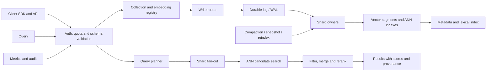

# Design an Enterprise Vector Database and Embedding Retrieval Platform

> Principal/Staff-level system design preparation. Capacity numbers are illustrative; validate product guarantees and performance against current versions and representative benchmarks.

## 1. Interview framing

**Prompt:** Design a shared vector retrieval service for hundreds of internal product teams. It stores billions of embeddings across text, image and selected multimodal workloads; supports tenant isolation, metadata filters, hybrid search, high availability, predictable tail latency, index lifecycle management and embedding model migrations.

Do not answer by naming a vector database. Design the **retrieval platform contract** and explain which capabilities belong in a purpose-built vector engine versus object storage, relational databases, search engines or a managed service.

## 2. Clarifying questions

- Vector count now and in 12–24 months? Dimensions and data types?
- Insert/update/delete rate, query QPS, read/write ratio and burst profile?
- p95/p99 latency target, recall target and availability objective?
- Metadata filter selectivity and cardinality? Are filters applied before ANN search?
- Need exact nearest-neighbor results or approximate search? What recall/latency trade-off is acceptable?
- Workload mix: text, image, audio, recommendations, deduplication?
- Tenant isolation: logical namespace, partition, dedicated cluster or account?
- How often do embedding models, dimensions and distance metrics change?
- Is hybrid lexical + vector search required? Do clients need reranking?
- What are retention, deletion, residency and disaster-recovery objectives?

## 3. Requirements

**Functional:** collection/index creation; schema and embedding-space registry; upsert/delete/bulk load; ANN and exact search; metadata filters; hybrid retrieval; namespaces; snapshots; compaction; reindex and alias swap; query explainability; quotas and audit.

**Non-functional:** high recall at target latency; predictable tail latency; elastic capacity; isolation; durable writes; bounded recovery time; cost transparency; safe index upgrades.

Define separate SLOs for write acknowledgement durability, query availability, recall quality and freshness. A fast query returning stale or low-recall results is not necessarily a successful query.

## 4. Capacity and data layout

Raw vector bytes:
`N_vectors × dimensions × bytes_per_component`.

For 1 billion vectors × 768 dimensions × 2 bytes (FP16), raw vector payload is approximately 1.54 TB. This excludes ANN graph structures, metadata, IDs, replicas, write-ahead logs, compaction headroom and snapshots. With three replicas, raw payload alone is about 4.6 TB. Use the actual engine's index overhead and benchmark; do not present a universal multiplier.

Partitioning dimensions:
- tenant or security boundary,
- collection / embedding-space version,
- hash of vector ID for write distribution,
- time or lifecycle tier where deletion/retention is time-based.

Avoid one partition per tiny tenant if it creates excessive shard overhead. Conversely, a single shared index can create noisy-neighbor and isolation problems. Use tiered isolation: shared pools for low-risk tenants, dedicated pools for large or regulated tenants.

## 5. Architecture

## 6. Storage and index design

### 6.1 Separate logical API from physical engine
Expose a stable API: `create_collection`, `upsert`, `delete`, `query`, `snapshot`, `restore`, `alias`. The control plane stores tenant, schema, embedding model, dimensions, metric, index configuration, lifecycle policy and physical placement. The data plane performs writes and searches.

This abstraction enables engine upgrades and workload-specific backends, but do not pretend every backend has identical semantics. Publish capability profiles: filter behavior, consistency, durability, maximum dimensions, hybrid support, snapshot semantics and deletion guarantees.

### 6.2 ANN index choices
- **HNSW:** strong recall/latency for many in-memory or memory-rich workloads; graph memory and build cost can be significant.
- **IVF / IVF-PQ:** partitions vectors into coarse clusters and can compress vectors; requires training/tuning and may trade recall for memory.
- **Disk-oriented ANN:** can lower RAM footprint for very large collections, with latency and tuning trade-offs.
- **Exact scan:** useful for small collections, filtered subsets or correctness baselines; expensive at large scale.

Never select solely from vendor benchmark charts. Benchmark with the actual dimension, distribution, filter selectivity, concurrency, update/delete pattern and target hardware.

### 6.3 Distance metric and normalization
Cosine similarity, dot product and Euclidean distance are not interchangeable unless embedding normalization and model semantics make them equivalent for the use case. Persist the metric and normalization policy in collection schema. Reject vectors with wrong dimension, NaN or invalid values. A model change that changes the vector space creates a new collection/index version.

### 6.4 Metadata filtering
Pre-filtering can preserve recall but may be expensive if the filter is not index-aware. Post-filtering can return too few results when many ANN candidates are filtered out. Some systems support filter-aware ANN or iterative oversampling. Benchmark with realistic predicates, especially high-cardinality tenant/ACL filters and skewed values.

Use typed metadata with indexed fields and explicit schema evolution. Do not put unbounded arbitrary JSON into every hot filter path. Keep large payloads in object storage and store references in the vector index.

### 6.5 Write path and consistency
A write should be acknowledged only after the durability contract is met (for example, replicated WAL commit). Segment/index visibility may lag durable acknowledgement. Document whether reads are read-after-write consistent, eventually consistent or session-consistent. For updates, use monotonically increasing source versions so late retries cannot overwrite newer records.

A common pattern: durable log/WAL → mutable buffer → immutable segments → background compaction. Compaction must not block interactive queries beyond a defined resource budget.

### 6.6 Query path
1. Authenticate and derive tenant/namespace server-side.
2. Validate query vector dimension and embedding-space version.
3. Plan shard fan-out based on partition metadata and filters.
4. Search local ANN structures with adaptive candidate count.
5. Apply metadata and ACL policy safely.
6. Merge top candidates, optionally lexical-fuse and rerank.
7. Return IDs, scores, metadata allowlist, source version and index version.

Bound fan-out. Querying every shard for every request creates latency and cost amplification. Use routing metadata and partition pruning.

## 7. Rebalancing, lifecycle and migrations

Shard movement should be online: create destination replica, stream snapshot + WAL tail, verify checksums and counts, switch routing, then retire old ownership. Use epochs/fencing tokens to prevent dual owners accepting conflicting writes.

For embedding migrations, create a new collection version. Backfill from canonical source content, dual-write new changes, compare retrieval quality and shift through an alias. Do not transform old embeddings mathematically unless the embedding model explicitly supports a valid transformation.

Deletion is a lifecycle operation across WAL, segments, replicas, caches and snapshots. Tombstones prevent resurrection from delayed replay. State the physical purge guarantee and backup expiry separately.

## 8. Availability and failure handling

| Failure | Design response |
|---|---|
| Node loss | Replicated shard, leader/owner election or replica promotion |
| AZ loss | Placement across failure domains; restore routing quorum |
| Hot tenant | Per-tenant quota, adaptive throttling, dedicated tier |
| Compaction overload | Background I/O budget, pause/slow compaction |
| Skewed shard | Split/reshard, rebalance, hash/range strategy review |
| Bad index build | Immutable index version and alias rollback |
| WAL backlog | Alert on durability/visibility lag; scale consumers |
| Network partition | Explicit consistency policy; fence stale owners |

A multi-region active-active design is not automatically better. Define whether writes are region-local, globally ordered or single-writer. Conflict resolution and replication lag can dominate complexity.

## 9. Observability and evaluation
Measure:
- p50/p95/p99 query latency, QPS, timeout and error rates.
- Recall@K against exact-search sample, filtered recall and NDCG.
- Index freshness lag, WAL lag, segment count, compaction backlog.
- Memory/disk utilization, cache hit ratio, replica health.
- Per-tenant resource consumption, throttles and cost/vector.
- Delete propagation and snapshot age.

A database SLO does not measure semantic quality. Maintain an evaluation corpus and periodically compare ANN results to exact nearest-neighbor ground truth.

## 10. Trade-offs and platform decisions

| Choice | Benefits | Costs / risks |
|---|---|---|
| Managed vector service | Less operations, faster onboarding | Vendor coupling, opaque tuning, cost |
| Self-managed engine | Control and portability | On-call, upgrades, capacity engineering |
| Shared index | Better utilization | Noisy neighbor and blast radius |
| Dedicated tenant index | Strong isolation | More shards, idle capacity, cost |
| HNSW | Strong interactive retrieval | RAM and build overhead |
| IVF/PQ | Compression and scale | Training/tuning and recall trade-off |
| Store payload in index | Simple retrieval | Larger index and duplication |
| Payload in object store | Lower index footprint | Extra fetch latency and consistency work |

## 11. Sample interviewer–candidate conversation

**Interviewer:** We have 1 billion vectors. How much memory do you need?

**Candidate:** I would first ask dimension and representation. At 768 dimensions with FP16, raw vectors are about 1.54 TB. That is only the payload. I would add measured ANN structure overhead, metadata, replicas, WAL and compaction headroom from a benchmark on the selected engine. I would not quote a blanket memory multiplier without the index type and workload.

**Interviewer:** Why not use one giant HNSW index?

**Candidate:** It may be a good baseline for an interactive, memory-rich workload, but I need to test graph memory, build time, update/delete behavior, filter selectivity and shard fan-out. If the corpus is too large for memory or cost dominates, a compressed or disk-oriented index may be more appropriate. The decision is empirical and tied to recall and p99 targets.

**Interviewer:** A tenant's traffic suddenly becomes 10 times higher.

**Candidate:** The platform needs per-tenant concurrency and QPS quotas, fair scheduling and resource attribution. We can isolate large tenants into dedicated pools, apply admission control and scale hot shards. I would protect the shared control plane and other tenants rather than allow one tenant to exhaust all query workers.

**Interviewer:** Can you change embedding models in place?

**Candidate:** Not safely as a casual mutation. The new model may have different dimensions and semantic geometry. I would create a versioned collection, re-embed canonical content, dual-write, shadow queries and switch an alias after quality gates. Keep rollback until the new version is stable.

## 12. Principal-level follow-ups

1. **How do you choose a shard key?** Based on query locality, tenant isolation, write distribution and growth; benchmark skew and fan-out.
2. **What is the consistency contract?** Specify durable acknowledgement, read visibility, update ordering and delete visibility independently.
3. **How do you measure ANN quality?** Compare sampled ANN top-K with exact search; track recall under real filters and query distributions.
4. **When is a relational database with vector extension enough?** When transactional metadata, joins and moderate scale dominate; benchmark concurrency and index behavior before moving to a specialized engine.
5. **How do you avoid hot partitions?** Hashing, adaptive splitting, per-tenant routing, workload isolation and skew dashboards.
6. **What is your DR strategy?** Replication for availability plus independently tested snapshots/backups; validate restore time and index rebuild feasibility.
7. **How do you protect metadata filters?** Schema allowlists, parameterized filters, tenant derivation from identity and policy enforcement outside client-supplied predicates.
8. **What is the rollback unit?** Immutable collection/index version plus alias/routing epoch, not an in-place mutation.

## 13. Common mistakes and practice drill
Mistakes: estimating only raw vector payload; ignoring filter selectivity; assuming all vector engines share semantics; omitting exact-search baselines; ignoring deletes and migrations; treating p99 as an average.

**Drill:** Design a platform with 300 million 1,536-dimensional vectors, 70% reads, 30% writes by operation count, 99.95% query availability and tenant-level ACL filters. State what additional measurements you need before selecting HNSW, IVF-PQ or disk ANN.

## 14. References
- [AWS: Choosing a vector database for RAG use cases](https://docs.aws.amazon.com/prescriptive-guidance/latest/choosing-an-aws-vector-database-for-rag-use-cases/choosing-an-aws-vector-database-for-rag-use-cases.html)
- [AWS Prescriptive Guidance: RAG retrievers](https://docs.aws.amazon.com/prescriptive-guidance/latest/retrieval-augmented-generation-options/rag-custom-retrievers.html)
- [OpenSearch vector search documentation](https://opensearch.org/docs/latest/vector-search/)
- [pgvector documentation](https://github.com/pgvector/pgvector)
- [Milvus documentation](https://milvus.io/docs)
- [Qdrant documentation](https://qdrant.tech/documentation/)
