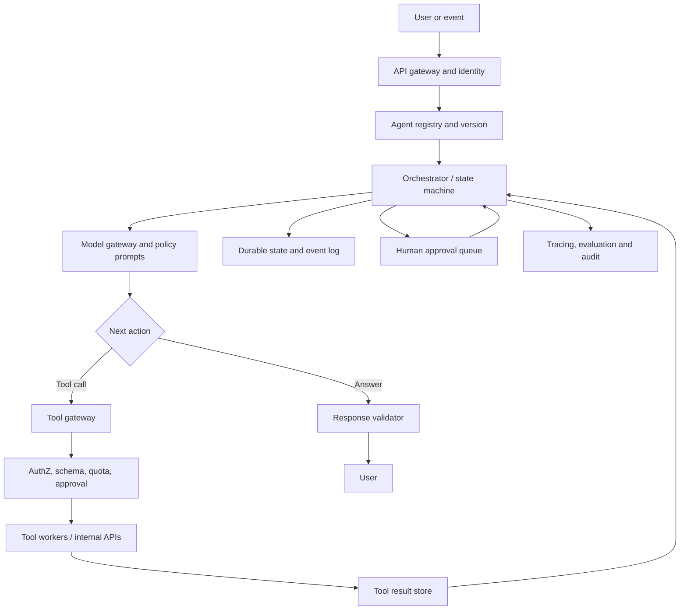

# Design a Production-Grade AI Agent and Tool Orchestration Platform

> Principal/Staff-level system design preparation. Capacity numbers are illustrative; validate product guarantees and performance against current versions and representative benchmarks.

## 1. Interview framing

**Prompt:** Design a multi-tenant enterprise agent platform where teams build agents that reason over approved knowledge, call internal APIs, execute workflows and collaborate with specialist agents. The platform must be secure, observable, resumable, cost-controlled and reliable under model/tool failures.

A principal-level answer distinguishes a **workflow engine** from an unconstrained autonomous loop. Use deterministic orchestration for business-critical steps and bounded model decisions for tasks where language understanding or flexible planning adds value.

## 2. Clarifying questions

- Which tasks are read-only versus actions that mutate systems?
- What is the autonomy level: suggestion, draft, approval-required, or fully automated?
- Which tools and systems are accessible? Are they internal APIs or arbitrary internet endpoints?
- What is the impact of a wrong action? Which actions require human approval?
- Are workflows synchronous, asynchronous or long-running (minutes/hours/days)?
- What are the concurrency, latency, availability and cost targets?
- Must sessions resume after process/node failure?
- How are identities, delegated permissions and tenant boundaries represented?
- Are multi-agent handoffs required, or can a single orchestrator call tools?
- What data can enter model prompts? What retention and audit policies apply?

## 3. Requirements and guardrails

**Functional:** agent definition/versioning; tool registry; workflow orchestration; state persistence; human approval; retries/timeouts; session management; model routing; trace replay; evaluation; deployment and rollback.

**Safety invariants:**
- The model never grants itself permissions.
- Every tool call passes a server-side policy gateway.
- Tool schemas validate arguments; tools enforce authorization again.
- High-impact actions require explicit approval bound to the exact action payload.
- Untrusted retrieved content cannot override system policy.
- A retry cannot duplicate a non-idempotent external side effect.

## 4. Architecture

## 5. Core design

### 5.1 Agent registry and execution contract
An agent version should declare model policy, system instructions, tool allowlist, schemas, retrieval sources, maximum turns, token/cost budget, timeout, approval policy, data classification and owner. Promote versions through dev → test → canary → production. Never silently mutate the behavior of a running long-lived session; pin it to a version or define explicit migration semantics.

### 5.2 Orchestrator: state machine, not a fragile request loop
Represent execution as durable state:
`run_id, tenant_id, agent_version, state, step_id, input_ref, output_ref, tool_call_id, retry_count, deadline, approval_status`.

Persist transitions before/after side effects. Use an append-only event history for audit and replay, plus a materialized current state for fast resume. Define terminal states: succeeded, failed, cancelled, expired, awaiting_approval. Bound maximum turns, tool calls, wall-clock duration and token spend.

For simple assistants, a single model with tools is often easier to reason about than multi-agent choreography. Use multiple agents only when clear domain boundaries, independent context or different tool permissions justify the handoff overhead.

### 5.3 Tool gateway and capability security
The gateway is the enforcement point:
1. Verify user/service identity and tenant.
2. Resolve delegated permissions.
3. Check tool allowlist for this agent version.
4. Validate JSON schema and business constraints.
5. Enforce rate, concurrency and budget quotas.
6. Apply risk policy (read-only, reversible, irreversible).
7. Require approval when needed.
8. Execute with scoped credentials and record audit metadata.

Never pass broad cloud credentials to a model or generic tool worker. Use short-lived credentials, workload identity and per-tool scopes. Avoid generic shell/SQL/browser tools unless sandboxed and explicitly governed.

### 5.4 Idempotency and side effects
For a mutating action, derive an idempotency key from `tenant_id + run_id + step_id + canonical_action_hash`. The downstream service must honor it or the platform must reconcile ambiguous outcomes. If a timeout occurs after a payment/ticket/email request, the system cannot assume the action failed. Query the downstream operation status before retrying.

Use an outbox/inbox or command ledger where possible. Separate “model proposed action” from “approved command executed.” Approval should bind to a hash of the exact arguments; any change invalidates the approval.

### 5.5 Human-in-the-loop
Approval UI should show requester, agent/version, exact action, target resource, expected impact, data used, expiration and rollback option. Approval is a state transition, not a chat message. For high-risk actions require step-up authentication or dual control. Denial and timeout must be explicit terminal/branch states.

### 5.6 Context and memory
Separate:
- turn context (current prompt),
- session state (workflow progress and tool outputs),
- durable business records (system of record),
- optional user/agent memory (curated, consented, policy-governed).

Do not treat a model's conversation history as the source of truth for business state. Store references to large tool results rather than stuffing all output into prompts. Apply TTL and data minimization.

### 5.7 Model gateway and routing
Route by task, latency, quality, privacy and cost. A small model can classify or extract; a stronger model can plan complex work. Maintain provider-specific adapters, structured output validation, token limits, timeout and circuit breakers. Fallback models must be evaluated for behavior compatibility; a cheaper model is not necessarily a safe drop-in replacement.

### 5.8 Prompt injection and untrusted data
Retrieved documents, web pages, emails and tool output are untrusted inputs. Keep them structurally separated from trusted instructions. Tool gateway policy must remain authoritative even if the model is manipulated. Use output validation, allowlisted operations, content scanning and red-team tests. Prompt filters are defense-in-depth, not the security boundary.

### 5.9 Multi-agent orchestration
Choose between:
- **Manager pattern:** central agent delegates subtasks and synthesizes results; easier policy and trace control.
- **Handoff pattern:** specialist takes ownership of a portion of conversation; useful when domain context and tool permissions differ.
- **Deterministic DAG/workflow:** fixed sequence with model calls at selected steps; best for compliance and repeatability.

Avoid agent swarms with unclear ownership, cyclic delegation or unbounded recursive calls. Define handoff schema, budget propagation, shared state contract and cancellation semantics.

## 6. Reliability and recovery

| Failure | Correct handling |
|---|---|
| Model timeout | Bounded retry; fallback only if policy permits |
| Tool timeout after side effect | Reconcile status using idempotency key; do not blind retry |
| Worker crash | Resume from durable checkpoint |
| Duplicate event | Deduplicate by event/run/step key |
| Approval expires | Transition to expired; never execute |
| Tool schema changes | Version contract; reject incompatible call |
| Agent loop | Enforce turn, time and spend budgets |
| Provider outage | Circuit breaker, queue or approved fallback |
| Poisoned tool output | Treat as untrusted; validate and constrain downstream use |

Exactly-once execution across an LLM, orchestrator and arbitrary external API is generally not a realistic end-to-end guarantee. Design at-least-once delivery plus idempotent effects and reconciliation.

## 7. Observability and evaluation
Trace each run across model calls, retrieval, handoffs, tool calls, approvals and external effects. Record latency, token usage, cost, retries, tool success, policy decisions, state transitions and outcome. Redact secrets and sensitive content.

Evaluation layers:
- Task success and completion rate.
- Tool selection and argument correctness.
- Policy violation / unauthorized action rate.
- Human intervention and approval rejection rate.
- Recovery success after injected failures.
- Cost and latency per completed task (not only per model call).
- Regression suite for agent versions and tool schemas.

Use replayable traces with deterministic mocks for regression; live model outputs may be nondeterministic, so compare outcome properties rather than exact text.

## 8. Security and governance
Multi-tenant isolation applies to state, traces, tool credentials, retrieval, memory and evaluation artifacts. Establish agent owners, approved purpose, data categories, model/provider approval, risk tier, retention, kill switch and incident runbook. Support user-level consent and audit for actions. Keep human approval independent of the model that proposed the action.

## 9. Cost and latency
The main cost driver is often repeated reasoning and context growth, not just the selected model's unit price. Cap turns, summarize state, avoid redundant tool calls, cache safe reads, parallelize independent read-only calls and use smaller models for bounded subtasks. Measure cost per successful task and cost of human rework.

## 10. Sample interviewer–candidate conversation

**Interviewer:** How do you stop an agent from deleting a production table?

**Candidate:** The model has no direct credentials. It can propose a typed tool call, but the gateway checks agent allowlist, caller identity, delegated permissions, resource scope and risk tier. Destructive actions are denied by default or require an explicit approval bound to the exact target and arguments. The execution service uses a scoped identity and emits an audit event. Prompt instructions alone are not a control.

**Interviewer:** The tool times out. Do you retry?

**Candidate:** First I determine whether the tool is read-only or mutating. For a mutation, a timeout is ambiguous. I query the downstream system using the idempotency key or operation ID. If the effect is confirmed, mark the step complete; if not, retry under the same key. If the downstream system offers no idempotency or status lookup, I need a reconciliation process and may require human review.

**Interviewer:** Why not build a multi-agent system for every workflow?

**Candidate:** More agents add handoffs, context transfer, latency, cost and failure modes. I would begin with a deterministic workflow and one tool-using agent. Split into specialists only when there is a measurable boundary—separate expertise, context, tools or permissions—and define explicit contracts and budgets.

**Interviewer:** What does exactly-once mean here?

**Candidate:** We can make internal state transitions idempotent and deduplicate events, but cannot guarantee exactly-once across arbitrary external side effects without cooperation from the downstream system. The practical design is at-least-once orchestration, idempotency keys, durable command records and reconciliation.

## 11. Principal-level follow-ups

1. **How would you support long-running tasks?** Durable workflow state, leases, checkpoints, event-driven resume, deadline and cancellation.
2. **How do you implement approval?** Explicit state transition tied to immutable action hash, approver identity, expiry and audit.
3. **Can a model choose its own tool permissions?** No; policy derives from authenticated principal and agent deployment configuration.
4. **How do you safely parallelize tools?** Only independent operations; bound concurrency; preserve dependencies; cancel outstanding work when run is cancelled.
5. **How do you handle model/provider portability?** Adapter contract plus capability tests and per-model evaluation; avoid assuming identical tool semantics.
6. **What is the kill switch?** Disable agent version, revoke tool scopes, stop queued runs and cancel in-flight work where safe.
7. **How do you evaluate agent quality?** Task-level outcome, tool correctness, policy adherence, recovery and cost; not only answer similarity.
8. **What should remain deterministic?** Authorization, financial calculations, schema validation, approval, workflow state and irreversible action execution.

## 12. Common mistakes and exercise
Mistakes: broad credentials, blind retries, unbounded loops, agent swarm by default, no durable state, no approval audit, prompt-only safety.

**Exercise:** Design an agent that triages incidents, queries telemetry, creates a ticket and pages an on-call engineer. Which steps are read-only, which mutate state, what needs approval, and how do you prevent duplicate pages after a timeout?

## 13. References
- [OpenAI: Building agents](https://developers.openai.com/tracks/building-agents)
- [OpenAI Agents SDK documentation](https://openai.github.io/openai-agents-python/)
- [AWS: Govern and architect agentic AI](https://docs.aws.amazon.com/prescriptive-guidance/latest/govern-architect-agentic-ai/)
- [OWASP Top 10 for LLM Applications](https://genai.owasp.org/llm-top-10/)
- [Temporal documentation](https://docs.temporal.io/)
