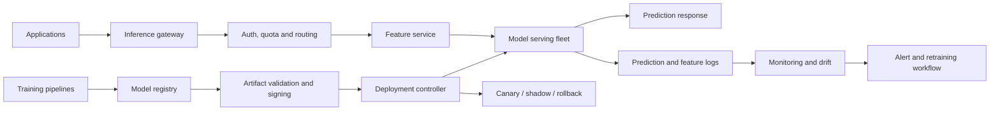

# Design a Real-Time ML Inference and Model-Serving Platform

> Principal/Staff-level system design preparation. Capacity numbers are illustrative; validate product guarantees and performance against current versions and representative benchmarks.

## 1. Interview framing

**Prompt:** Design a shared online inference platform serving fraud detection, recommendations, search ranking and operational predictions. It must support low-latency synchronous APIs, batch and streaming inference, CPU/GPU models, feature retrieval, autoscaling, safe rollouts, model governance and multi-team isolation.

Clarify whether the interviewer wants **model serving infrastructure**, **end-to-end prediction**, or both. The serving platform is not just a REST endpoint around a pickle file: feature correctness, model artifacts, runtime compatibility, traffic management and feedback are part of the design.

## 2. Clarifying questions

- Prediction types: synchronous online, asynchronous, batch, streaming?
- p50/p95/p99 latency and throughput by use case?
- Availability and degradation requirements?
- Model frameworks, artifact sizes, CPU/GPU, accelerator type?
- Feature source and freshness requirements? Online/offline parity?
- Is inference stateless? Does it require session or sequence context?
- What is the rollout policy: shadow, canary, A/B, champion/challenger?
- Data sensitivity, residency and model access constraints?
- Model update frequency and rollback time?
- Are explanations, deterministic reproducibility or audit required?

## 3. Requirements and SLOs

Functional: model registry, artifact validation, deployment, online prediction, feature lookup, traffic splitting, autoscaling, rollback, batch scoring, monitoring and lineage.

Non-functional: latency by percentile, throughput, availability, predictable cost, isolation, reproducibility and safe change management.

Define SLOs per model endpoint and workload class. A fraud endpoint at p99 40 ms has different requirements from a batch propensity scoring job. Avoid a single platform-wide latency objective.

## 4. Architecture

## 5. Detailed design

### 5.1 Model registry and artifact contract
Store immutable model versions with:
- artifact URI and checksum,
- model signature/input-output schema,
- framework/runtime/container digest,
- training dataset and code lineage,
- feature view versions,
- metrics and evaluation report,
- approval status, owner and risk classification.

Do not deploy a mutable “latest” tag. Promotion creates an immutable deployment reference. Sign artifacts and verify provenance at deployment.

### 5.2 Inference gateway
The gateway authenticates caller, enforces endpoint quotas, validates request schema, selects model version, applies traffic policy and propagates deadline/correlation ID. It should not perform expensive feature transformations or hold model state.

Support synchronous REST/gRPC for low-latency requests and asynchronous queue-based inference for workloads that tolerate delay. For bursty traffic, admission control and queue limits are safer than unbounded buffering.

### 5.3 Feature retrieval and online/offline parity
Feature lookup must be consistent with the model's declared feature contract. Retrieve a feature vector by entity key and feature view version. Use a low-latency online store for precomputed features; compute only bounded, deterministic request-time features synchronously.

Avoid training-serving skew:
- share transformation definitions where possible,
- use point-in-time correct historical features in training,
- log feature values or versioned references used at prediction time,
- monitor null/default rates and freshness,
- validate online/offline parity on sampled entities.

If a feature is stale or unavailable, define per-feature behavior: safe default, cached value, alternate model or fail closed. Do not silently substitute arbitrary defaults for critical fraud/risk signals.

### 5.4 Model server and runtime
Package model plus dependencies in a reproducible container or supported model runtime. Warm models before receiving traffic. For GPU serving, account for model weights, activation memory, batch size, KV cache for generative models and fragmentation. Keep model loading out of the request path.

Choose concurrency based on measured service time and resource saturation. Dynamic batching can improve accelerator utilization but adds queueing latency; configure a maximum batch wait and size based on p99 budget. Separate models with incompatible resource profiles.

### 5.5 Autoscaling
Scale on a combination of:
- request queue depth / concurrency,
- in-flight requests,
- tokens per second for generative models,
- CPU/GPU utilization and memory,
- p95/p99 latency,
- model load and cold-start time.

CPU utilization alone is not a reliable signal for GPU-bound inference. Keep minimum warm replicas for latency-sensitive endpoints. Use scale-to-zero only for asynchronous or cold-start-tolerant workloads.

### 5.6 Traffic management and rollout
- **Shadow:** duplicate traffic to candidate model; discard candidate response.
- **Canary:** send small live percentage to candidate and compare operational/business metrics.
- **A/B:** randomized traffic to estimate causal impact, with experiment design and guardrails.
- **Champion/challenger:** compare incumbent and candidate under defined evaluation.

Gate promotion on error rate, latency, feature health, prediction distribution and business metrics. Rollback should be a routing/config change to the last known-good immutable model, not a rebuild.

### 5.7 Batch and streaming inference
Batch scoring should read a consistent dataset snapshot, write outputs idempotently and record model/data versions. Streaming inference requires event-time handling, deduplication, state and late-event policy. Keep these execution modes on a common model/feature contract but separate their compute and failure domains.

### 5.8 Model and data monitoring
Monitor service metrics and model behavior:
- latency, throughput, error, saturation, queue depth;
- input schema violations, null rates, feature freshness;
- prediction distribution, confidence/calibration;
- drift in feature and prediction distributions;
- delayed ground-truth performance and business outcomes;
- segment-level fairness and quality where appropriate.

Drift is a signal to investigate, not an automatic retraining command. Data distribution changes do not necessarily mean model performance degraded; labels may arrive late and seasonality matters.

## 6. Reliability and failure modes

| Failure | Response |
|---|---|
| Model process crash | Restart replica; remove from load balancer |
| Feature store outage | Bounded cache/default/fallback per feature criticality |
| Model load slow | Warm-up before readiness; pre-pull artifacts |
| GPU exhaustion | Admission control, queue, smaller batch or alternate pool |
| Bad model rollout | Automated guardrail rollback |
| Schema incompatibility | Reject deployment at validation stage |
| Dependency vulnerability | Rebuild signed image; block promotion |
| Downstream timeout | Deadline propagation; circuit breaker |
| Traffic spike | Rate limits, priority classes, autoscale and queue caps |

Define graceful degradation per product. For example, recommendation may fall back to popular items, while a high-risk fraud decision may route to a conservative rules engine or manual review.

## 7. Capacity model
Use request rate × measured per-replica sustainable throughput, then add redundancy and headroom. Estimate model memory as weights + runtime overhead + activations + framework buffers; for generative inference, include KV cache and context length. Benchmark warm and cold start separately. Model concurrency is constrained by memory and tail latency, not just nominal GPU FLOPS.

Example: if peak is 8,000 RPS and a replica sustains 400 RPS at the required p99 under realistic feature lookup, the raw need is 20 replicas. Add failure-domain redundancy, rollout capacity and headroom; do not assume linear scaling until tested.

## 8. Security and governance
Use service identity, least-privilege artifact access, signed images, secret management and network segmentation. Do not log raw sensitive inputs by default. Maintain model approval, training lineage, evaluation evidence, owner and rollback contact. Apply tenant-level quotas and prevent one model from exhausting shared GPU capacity.

## 9. Sample interviewer–candidate conversation

**Interviewer:** A model's p99 latency doubles after launch. What do you inspect?

**Candidate:** I break down the end-to-end trace: gateway queueing, feature lookup, model queue, preprocessing, inference and serialization. Then correlate with concurrency, batch wait, CPU/GPU memory, cold starts and feature-store latency. I compare by model version and traffic cohort. If the regression is isolated to the canary, rollback first while preserving traces for diagnosis.

**Interviewer:** How do you ensure the model sees the same features in training and serving?

**Candidate:** We define versioned feature contracts and transformations, build training sets with point-in-time joins, and serve the corresponding feature view online. We log feature values or immutable feature references used for predictions and run parity checks. A shared transformation library helps, but it does not replace point-in-time correctness and production validation.

**Interviewer:** Would you retrain automatically when drift is detected?

**Candidate:** Not directly. Drift can be benign seasonality or upstream instrumentation change. I would alert, validate data quality, compare segment metrics and wait for ground truth where necessary. Retraining is triggered by an approved policy using performance degradation, data freshness and business context—not a single statistical threshold.

**Interviewer:** How do you roll back quickly?

**Candidate:** Keep immutable artifacts and a last-known-good deployment. Traffic routing references a model version, so rollback changes routing and drains the candidate. We also stop any downstream feature or schema migration that is incompatible with the previous version.

## 10. Principal-level follow-ups

1. **How do you isolate GPU workloads?** Resource pools, quotas, node affinity, model-aware scheduling and separate latency classes.
2. **When use dynamic batching?** When throughput gains outweigh queueing latency; benchmark batch wait against p99.
3. **How do you support model portability?** Standard model signature, container/runtime contract and compatibility tests; framework abstraction has limits.
4. **How do you handle delayed labels?** Join predictions to eventual outcomes with stable IDs and label maturity windows.
5. **What is shadow traffic for?** Operational and prediction-distribution comparison without affecting user decisions.
6. **How do you prevent model artifact tampering?** Immutable registry, checksums/signatures, provenance and deployment verification.
7. **What if online features are stale?** Feature-level freshness policy and explicit degraded mode; critical features may fail closed.
8. **How do you control cost?** Right-size hardware, batch where safe, scale warm pools, route by model class and measure cost per successful prediction.

## 11. Common mistakes and exercise
Mistakes: focusing only on the model server; no feature parity; no warm-up; scaling only on CPU; no rollback; confusing drift with performance degradation.

**Exercise:** Design a fraud model endpoint with 25 ms p99 target, 5,000 RPS peak, online features and a conservative rules fallback. Explain admission control, feature timeout budget and canary rollback criteria.

## 12. References
- [KServe documentation](https://kserve.github.io/website/docs/intro)
- [Feast documentation](https://docs.feast.dev/)
- [MLflow Model Registry](https://mlflow.org/docs/latest/ml/model-registry/)
- [Kubernetes Horizontal Pod Autoscaling](https://kubernetes.io/docs/tasks/run-application/horizontal-pod-autoscale/)
- [NVIDIA Triton Inference Server](https://docs.nvidia.com/deeplearning/triton-inference-server/)
