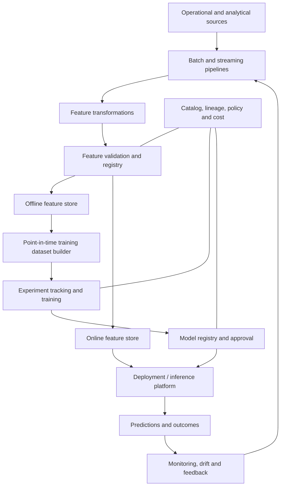

# Design an Enterprise Feature Engineering and MLOps Platform

> Principal/Staff-level system design preparation. Capacity numbers are illustrative; validate product guarantees and performance against current versions and representative benchmarks.

## 1. Interview framing

**Prompt:** Design an enterprise platform that lets hundreds of data science and ML teams define reusable features, build point-in-time correct training datasets, run experiments, register models, deploy them and monitor performance. The platform spans batch, streaming and online serving, with governance, reproducibility and cost controls.

This scenario overlaps with a feature store, but the scope is broader: feature lifecycle, dataset lineage, experiment tracking, model registry, orchestration, deployment and feedback. Explain the boundaries and integration contracts rather than building one monolith.

## 2. Clarifying questions

- Which ML workloads: batch, real-time, ranking, forecasting, GenAI?
- Number of teams, entities, features, models and prediction QPS?
- Feature freshness requirements by feature family?
- Batch, streaming or request-time feature computation?
- Historical retention and point-in-time join requirements?
- Need feature sharing, discovery, ownership and access approvals?
- Which orchestration, compute and model frameworks already exist?
- How are experiments, approvals, deployment and retraining governed?
- What is the audit/reproducibility expectation?
- Which systems are sources of truth for labels and outcomes?

## 3. Requirements and platform contracts

**Feature management:** definitions, entities, owners, schemas, tags, validation, lineage, versioning, access policies and deprecation.

**Training data:** point-in-time joins, reproducible snapshots, label windows, leakage prevention, dataset manifests and backfills.

**MLOps:** experiment tracking, artifact lineage, model registry, approval, deployment, monitoring, retraining and rollback.

**Non-functional:** reproducibility, low-latency online retrieval, bounded freshness, isolation, portability, cost attribution and audit.

## 4. Architecture

## 5. Feature platform design

### 5.1 Feature definition and registry
A feature definition includes:
`name, entity keys, schema, transformation, source, event_time, created_time, TTL, owner, freshness SLO, sensitivity, version, online/offline availability`.

Feature names alone are insufficient. A feature must define its entity key, time semantics, null behavior and transformation version. Changes to semantics require a new version or controlled migration. Enforce ownership and deprecation policies to avoid an unmaintainable feature catalog.

### 5.2 Offline store
Use a columnar lake/warehouse for historical feature data. Partition by event date and appropriate entity/time dimensions; avoid partitioning by high-cardinality entity ID. Store event time and ingestion/availability time to support point-in-time joins and late-arriving corrections.

Training dataset generation must use the feature values that were available at prediction time, not values updated later. This prevents future leakage. The join condition is conceptually:
`feature.event_time <= prediction_time`
plus a validity/TTL constraint and deterministic selection of the latest eligible record. For bitemporal sources, distinguish business-valid time from system-observed time.

### 5.3 Online store
Use a low-latency key-value or serving store keyed by entity and feature view. Precompute features asynchronously for latency-sensitive endpoints. Store feature version and event timestamp with values. Define write ordering, TTL and stale-read behavior. Online/offline parity checks compare sampled entity/time values.

Do not blindly mirror every offline feature online. Online storage is expensive and has different access patterns. Promote only features required by online models and define a freshness SLO per feature group.

### 5.4 Batch, streaming and request-time transformations
- Batch: efficient for large historical windows and slowly changing aggregates.
- Streaming: required for low-latency updates; needs event-time, watermark, deduplication and late-data handling.
- Request-time: useful for request-specific context; must have bounded latency and deterministic behavior.

For a feature such as “transactions in the last 10 minutes,” clarify whether the window is event-time or processing-time, how late events update state and whether a prediction can tolerate a slightly stale aggregate.

### 5.5 Backfills and materialization
Backfills are production workloads. Use partitioned, resumable jobs with checkpoints, idempotent output and bounded concurrency. A backfill should not starve online freshness pipelines. Publish a feature version only after validation; use atomic pointer/manifest updates for consumers to avoid partial reads.

### 5.6 Point-in-time correctness
A common leakage bug: joining a training example at time T to a customer lifetime aggregate calculated using events after T. Use point-in-time joins and label maturity windows. Test with synthetic cases where future events must be excluded. Record dataset snapshot, feature definitions and transformation versions so training can be reproduced.

## 6. MLOps lifecycle

### 6.1 Experiment tracking
Track code commit, parameters, random seeds, training dataset manifest, feature versions, environment/container digest, metrics and artifacts. Reproducibility is not guaranteed by logging a notebook name. Control data access and retain enough lineage to reconstruct the run.

### 6.2 Model registry and promotion
A model version references the exact training run and data manifest. Promotion gates include offline metrics, robustness, fairness or segment checks where applicable, security scan and owner approval. Enforce immutable versions and deployment metadata.

### 6.3 Deployment
Integrate with the inference platform using standard signatures and versioned feature contracts. Support batch scoring, online serving and streaming scoring with the same model lineage. Canary and rollback are covered in the inference design; this platform owns the lifecycle policy and evidence.

### 6.4 Monitoring and feedback
Join predictions to eventual labels using stable prediction IDs. Monitor feature freshness, nulls, distribution shift, prediction drift, calibration and outcome metrics. Distinguish data drift, concept drift, label delay and instrumentation defects. Retraining should be governed by policy and validation, not a blind cron job.

## 7. Failure modes, recovery, data quality and governance

| Risk | Control |
|---|---|
| Feature definition changes | Versioned schema and compatibility checks |
| Late events | Event-time watermark and correction policy |
| Backfill overload | Separate queues and resource quotas |
| Online/offline mismatch | Parity tests and logged feature snapshots |
| Training leakage | Point-in-time join tests |
| Stale online value | Per-feature freshness SLO and TTL |
| Unowned feature | Mandatory owner and deprecation workflow |
| Sensitive feature exposure | Classification, access approval and audit |
| Non-reproducible model | Dataset/code/environment manifest |

Feature access must follow data classification and purpose limitation. A feature store can amplify sensitive data by making it easy to reuse; catalog discoverability is not authorization.

## 8. Capacity and cost model
Estimate:
- offline feature volume = entities × feature count × update frequency × retention;
- online footprint = active entities × online feature bytes × replication;
- streaming compute from event rate and state/window size;
- training cost from dataset size, experiment concurrency and GPU/CPU hours;
- serving cost from QPS, model footprint and latency objective.

Control costs through feature reuse, TTL, tiered historical retention, online materialization only where needed, experiment quotas and automated cleanup of abandoned artifacts.

## 9. Sample interviewer–candidate conversation

**Interviewer:** What is point-in-time correctness and why does it matter?

**Candidate:** For a training example at prediction time T, every feature must reflect information available by T. If we join to a later corrected or aggregated value, the model sees future information and offline performance is inflated. I would store event and availability timestamps, use deterministic as-of joins with TTL, and test leakage using known future events.

**Interviewer:** A feature is fresh in the offline table but stale online.

**Candidate:** I would measure source-to-offline and source-to-online lag separately. The online materialization path may be delayed or failed. The feature contract defines freshness and fallback semantics. We alert by feature view, preserve the last known value only if policy allows, and avoid silently treating stale data as fresh.

**Interviewer:** A data scientist wants to put every feature online.

**Candidate:** I would ask which models need online inference and which features are on the critical path. Online storage has a different cost and latency profile. Promote only required feature views, with TTL, ownership and freshness objectives. Batch-only models should use the offline store.

**Interviewer:** How do you decide whether to retrain?

**Candidate:** We combine matured outcome metrics, data quality, drift, seasonality and business impact. Drift alone is not sufficient. The retraining pipeline produces a candidate model with full lineage, and it must pass the same evaluation and promotion gates as a manually initiated run.

## 10. Principal-level follow-up questions

1. **How do you handle late-arriving data?** Define event-time semantics, watermark, correction/retraction policy and backfill behavior.
2. **How do you avoid duplicate feature computation?** Feature registry, reusable transformations, dependency graph and ownership; avoid centralizing every domain-specific transformation.
3. **When should a feature be online?** Only when online prediction needs it and latency/freshness justify materialization.
4. **How do you support point-in-time joins at scale?** Partition pruning, sorted data, entity/time indexing, snapshot manifests and distributed as-of joins; benchmark skew.
5. **How do you version a feature?** Semantic version with schema and transformation compatibility; dual-publish and migrate consumers.
6. **How do you handle label delay?** Store prediction IDs and label windows; evaluate only after outcome maturity.
7. **What is the difference between data drift and concept drift?** Input distribution shift versus change in relationship between inputs and target; require different evidence.
8. **How do you govern shared features?** Domain ownership, documented semantics, access policy, quality SLO, deprecation window and consumer impact analysis.

## 11. Common mistakes and practice exercise
Mistakes: treating a feature store as a database product only; no event-time semantics; future leakage; mirroring everything online; retraining on drift alone; no dataset manifest.

**Exercise:** Design customer churn features with daily aggregates, a streaming “last 15-minute activity” feature and an online scoring API. Explain how you produce point-in-time training examples and prevent offline/online divergence.

## 12. References
- [Feast: Feature store concepts](https://docs.feast.dev/)
- [Feast: Point-in-time joins](https://docs.feast.dev/getting-started/concepts/point-in-time-joins)
- [MLflow Tracking](https://mlflow.org/docs/latest/ml/tracking/)
- [MLflow Model Registry](https://mlflow.org/docs/latest/ml/model-registry/)
- [KServe documentation](https://kserve.github.io/website/docs/intro)
- [Google Cloud: MLOps architecture](https://cloud.google.com/architecture/mlops-continuous-delivery-and-automation-pipelines-in-machine-learning)
