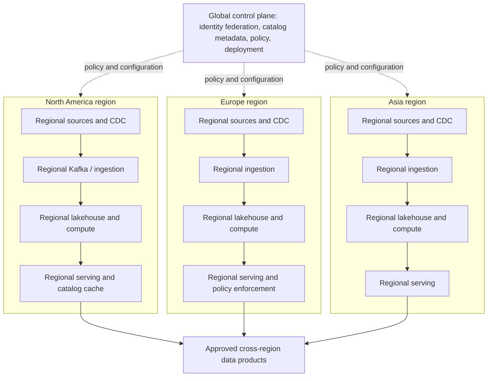

# Design a Global, Multi-Region Enterprise Data Platform

> Staff/Principal-level architecture and leadership interview preparation. Capacity and roadmap figures are illustrative; validate assumptions against the organization's constraints and current platform capabilities.

## 1. Interview framing

**Prompt:** Design a global enterprise data platform serving users and producers across North America, Europe and Asia. It must ingest regional operational data, support global analytics and data products, satisfy data-residency constraints, and survive a regional outage without unacceptable data loss or downtime.

The principal-level challenge is to distinguish **global control plane**, **regional data planes**, and **cross-region data products**. Do not begin with “deploy everything in three regions.” First establish why multiple regions are needed, which data may cross borders, and what consistency and recovery guarantees the business actually requires.

AWS guidance explicitly cautions against adopting multi-Region by default: multi-AZ within one Region may be sufficient for many workloads, while multi-Region adds synchronization, operational and cost complexity. Use a documented driver such as residency, regional disaster recovery, correlated failure isolation or global latency. [AWS multi-Region architecture](https://docs.aws.amazon.com/prescriptive-guidance/latest/security-reference-architecture/multi-region-architecture.html)

## 2. Clarifying questions

1. Is the driver disaster recovery, user latency, data residency, regional autonomy, or all four?
2. Which data classes must remain in a jurisdiction? Can metadata, aggregates or pseudonymized data leave?
3. What are RPO/RTO by workload—not one platform-wide number?
4. Which workloads need global consistency, and which tolerate asynchronous replication?
5. Is the platform read-heavy, write-heavy, or mixed? Where do writes originate?
6. Is there a global identifier and tenant model? Can tenant data be pinned to a home region?
7. Which systems are sources of truth during a network partition?
8. How do we handle conflicting writes and duplicate events?
9. Are analytics global, regional, or federated?
10. What are the operating model, on-call coverage and cost constraints?

**Useful interview move:** split workloads into classes:
- Regional transactional/operational ingestion.
- Regional transformation and serving.
- Global metadata/catalog and policy.
- Global analytics over permitted data.
- Cross-region replication and disaster recovery.

## 3. Requirements and objectives

### Functional
- Regional ingestion and processing.
- Region-aware storage, catalog and identity integration.
- Policy-enforced data residency and cross-border sharing.
- Global discovery with regional authorization.
- Replication, failover and recovery workflows.
- Federated analytics or governed regional aggregation.

### Non-functional
- RPO/RTO by data product.
- Region isolation and blast-radius control.
- Bounded replication lag.
- Strong access-control and audit guarantees.
- Predictable global query latency and cost.
- Repeatable failover tests and operational ownership.

Define SLOs for regional ingestion freshness, local query availability, replication lag, cross-region catalog availability, and recovery execution. Residency and authorization are invariants, not merely availability metrics.

## 4. Capacity and placement model

Estimate independently per region:
- Ingest bytes/sec and peak burst.
- Daily retained data and compaction overhead.
- Stream partitions and consumer parallelism.
- Query concurrency and scan volume.
- Replication bandwidth and backlog drain time.
- Disaster recovery capacity needed to absorb failover traffic.

For a replicated dataset of size `D`, effective transfer time is not simply `D / nominal_bandwidth`; account for compression, encryption, throttling, concurrent writes, retries and destination ingest capacity. For continuous replication, sustainable replication throughput must exceed the long-term change rate, with headroom for catch-up.

A critical distinction: **replicating all raw data everywhere** may violate residency rules and multiply cost. Prefer regional raw zones and explicitly approved cross-region products—aggregates, tokenized records, or curated subsets—where policy permits.

## 5. Reference architecture

## 6. Deep architecture decisions

### 6.1 Regional data plane, global control plane
Keep data processing and storage local to the region when required. The global control plane can manage deployment templates, service catalog metadata, policy definitions and fleet health, but it must not become a synchronous dependency for every data-plane operation. Cache signed policy/configuration bundles regionally with expiry and revocation semantics.

If the global control plane is unavailable, regional workloads should continue within a bounded safe operating mode. Do not let a global metadata outage stop local ingestion if local policy decisions can still be made safely.

### 6.2 Data residency and classification
Classify data at ingestion and attach region, legal entity, sensitivity, purpose and permitted-transfer labels. Enforce policy at multiple layers: connector, storage location, catalog, query engine, export and replication pipeline. A tag alone is not enforcement.

Create an explicit cross-border transfer workflow:
1. Identify source and destination jurisdictions.
2. Confirm permitted purpose and data class.
3. Transform/minimize data if required.
4. Approve destination and retention.
5. Record lineage and transfer evidence.
6. Re-evaluate when source classification or policy changes.

Do not assume hashing or pseudonymization automatically makes data unrestricted.

### 6.3 Replication semantics
Choose semantics per data class:
- Object/table replication for immutable or append-oriented datasets.
- CDC/event replication for mutable source records.
- Aggregation or federation for sensitive data that should remain regional.
- Metadata replication for discovery without moving payloads.

Track source offsets, commit sequence, schema version, event time and replication watermark. Replication must be idempotent. Tombstones and deletes must propagate; otherwise a failover region can resurrect deleted data.

### 6.4 Consistency and conflict handling
Avoid global synchronous writes unless business requirements justify the latency and availability cost. Prefer region-local writes with asynchronous replication for analytics. For globally mutable entities, choose one of:
- Home-region ownership per entity/tenant.
- Single-writer per dataset.
- Explicit conflict-free data type or domain-specific merge.
- Transactional global coordination for a narrow, justified subset.

“Last write wins” is not a universal conflict strategy; clock skew and business semantics can make it wrong.

### 6.5 Global catalog and query federation
Global discovery can expose metadata while data remains regional. Query federation should route to the data location and enforce the caller's regional entitlements. For global analytics, publish approved regional aggregates or use federated query execution where policy permits. Explain that federation trades data movement for runtime network dependency and cross-region latency.

### 6.6 Regional failover
Failover is a controlled state transition:
1. Detect region impairment and distinguish service-level from regional failure.
2. Freeze or fence writers to prevent split brain.
3. Determine the authoritative recovery point.
4. Promote destination services and update routing.
5. Reconcile replication lag and data gaps.
6. Validate access policies and data correctness.
7. Resume ingestion and serving in priority order.
8. Record recovery evidence and communicate status.

A DNS switch alone is not a failover strategy. It does not solve writer ownership, stale catalog state, consumer offsets, secrets, quotas or schema compatibility.

### 6.7 Active-active versus active-passive
- **Active-active:** lower regional latency and better utilization, but demands conflict handling, routing, replication and operational maturity.
- **Active-passive/warm standby:** simpler write ownership and recovery reasoning, but requires tested promotion and sufficient standby capacity.
- **Pilot light/backup restore:** lower cost, slower recovery and more rebuild risk.

Select by workload criticality, RPO/RTO and consistency. A platform can use different patterns for different products.

## 7. Failure modes and recovery

| Failure | Response |
|---|---|
| Regional outage | Promote approved recovery region; fence old writers |
| Inter-region network partition | Continue permitted regional work; queue replication; avoid split brain |
| Replication lag | Alert by dataset; prioritize critical streams; estimate catch-up |
| Global catalog outage | Use regional metadata/policy cache within defined validity |
| Cross-border policy change | Stop affected replication; quarantine and review existing copies |
| Duplicate replay | Idempotent keys and offset-aware processing |
| Schema mismatch | Compatibility gate; quarantine incompatible records |
| Failover region under-capacity | Reserved headroom and periodic load tests |

## 8. Security, governance and operations
- Separate regional keys and service identities where required.
- Apply least privilege to replication roles.
- Log data movement, policy decision, region and principal.
- Maintain region-specific backup retention and deletion.
- Test regional failover and failback, not only infrastructure health.
- Assign a named regional owner and global service owner.
- Publish a regional dependency map and operational runbook.

## 9. Cost and trade-offs
Major cost drivers are duplicated compute/storage, inter-region transfer, replication, backup, idle standby capacity and global query federation. Optimize by replicating only approved data products, using lifecycle tiers, right-sizing standby and avoiding cross-region scans for interactive workloads.

The correct architecture may be deliberately asymmetric: high criticality data receives warm standby; low criticality analytics is restored from backup; regulated data stays region-local with federated aggregation.

## 10. Sample interviewer–candidate conversation

**Interviewer:** Why do we need three regions? Why not one region with three Availability Zones?

**Candidate:** I would first ask what failure and business requirement we are addressing. Multi-AZ protects against many zonal failures. Multi-Region is justified when we need regional disaster recovery, data residency, independent regional operation or lower latency for globally distributed users. It introduces replication and consistency complexity, so I would not deploy it uniformly.

**Interviewer:** Europe cannot export personal data, but leadership wants a global dashboard.

**Candidate:** I would separate global discovery from global data movement. Raw personal data stays in the approved region. We can publish a legally reviewed aggregate or execute a federated query locally and return only permitted results. The transfer policy must be explicit and enforced in the pipeline, not just documented in a catalog.

**Interviewer:** Both regions accept writes during a network partition. What happens?

**Candidate:** That is only safe if the data model supports concurrent writes and conflict resolution. For most enterprise entities I would assign home-region ownership or single-writer semantics. If active-active writes are required, the domain must define merge rules and idempotency. I would not rely on wall-clock last-write-wins for business records.

**Interviewer:** How do you prove disaster recovery works?

**Candidate:** Run game days that include writer fencing, promotion, consumer offset recovery, catalog and policy availability, key access, workload capacity, data reconciliation and failback. Measure achieved RPO/RTO from the last known good business transaction, not only infrastructure recovery.

## 11. Principal-level follow-up questions

1. **When is multi-region not justified?** When multi-AZ meets documented resilience needs and global latency/residency does not require regional deployment.
2. **How do you prevent split brain?** Explicit writer leases/epochs, fencing tokens, authoritative ownership and controlled promotion.
3. **What do you replicate?** Only data classes and products permitted by policy; distinguish raw data, curated aggregates, metadata and control state.
4. **How do you handle regional schema drift?** Central compatibility policy with region-aware rollout and versioned contracts.
5. **How do you test RPO?** Compare source commit positions and recovered data against the last acknowledged durable event.
6. **How do you fail back?** Reconcile writes made in recovery region, establish ownership transition, validate offsets and execute a controlled reverse replication.
7. **What if global identity is unavailable?** Regional cached identity/policy only within an explicit validity window; otherwise fail closed for protected actions.
8. **How do you control cost?** Tier recovery by workload criticality and replicate only what the recovery objective requires.

## 12. Common mistakes and practice exercise
Mistakes: multi-region everywhere by default; no residency model; confusing DNS failover with data recovery; ignoring split brain; assuming replication means backup; using one RPO/RTO for all products.

**Exercise:** Design a platform where EU raw data must remain in the EU, but global leadership needs daily revenue metrics within 30 minutes. Explain the regional aggregation contract, lineage, failure behavior and evidence for compliance.

## 13. References
- [AWS Prescriptive Guidance: Multi-Region architecture](https://docs.aws.amazon.com/prescriptive-guidance/latest/security-reference-architecture/multi-region-architecture.html)
- [Google Cloud: Migrate across regions](https://docs.cloud.google.com/architecture/migrate-across-regions)
- [AWS Well-Architected Framework](https://docs.aws.amazon.com/wellarchitected/latest/framework/welcome.html)
- [AWS disaster recovery options](https://docs.aws.amazon.com/whitepapers/latest/disaster-recovery-workloads-on-aws/disaster-recovery-options-in-the-cloud.html)
