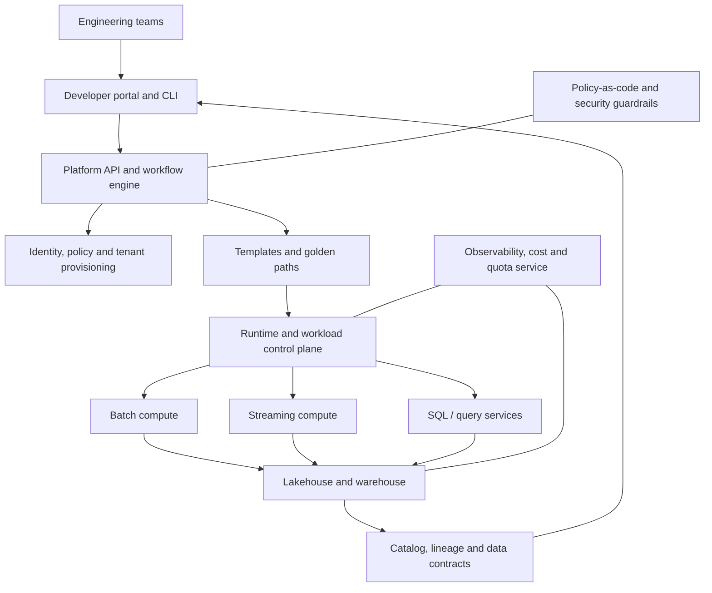

# Design a Data Platform Serving Thousands of Engineering Teams

> Staff/Principal-level architecture and leadership interview preparation. Capacity and roadmap figures are illustrative; validate assumptions against the organization's constraints and current platform capabilities.

## 1. Interview framing

**Prompt:** Design an internal data platform used by 2,000 engineering and analytics teams across a large enterprise. Teams need to onboard sources, publish data products, run batch/stream workloads, manage access, deploy pipelines and observe costs without central tickets for every change.

This is a platform-as-a-product problem. The central engineering organization cannot manually operate every dataset and pipeline. The design must establish **paved roads**, clear ownership boundaries, self-service workflows, safe defaults, tenant isolation and a sustainable operating model.

## 2. Clarifying questions

- How many teams, users, workloads, datasets, pipelines and daily bytes?
- What percentage of teams are expert data engineers versus occasional users?
- Which cloud accounts/projects and business domains exist?
- Which capabilities are centrally managed versus domain-owned?
- What are onboarding time and support ticket targets?
- Are teams allowed to bring their own engines or use only approved runtimes?
- How are costs attributed and budgets enforced?
- What are the security and regulatory boundaries?
- What is the platform's availability and support model?
- How do teams request exceptions and contribute capabilities?

## 3. Requirements

### User-facing capabilities
- Discover approved data products and documentation.
- Provision projects, identities, storage, compute and pipelines.
- Build, test, deploy and monitor data workflows.
- Manage schema/data contracts, access and lineage.
- View cost, quota, reliability and freshness.
- Request exceptions with an auditable approval path.

### Platform requirements
- Multi-tenant isolation and fair scheduling.
- Golden-path templates and versioned APIs.
- Policy-as-code and automated guardrails.
- Self-service onboarding and deprovisioning.
- Extensible plugin/adapter model.
- Developer experience and support at scale.

## 4. Architecture

## 5. Platform product design

### 5.1 Define the platform's product boundary
The platform team owns shared capabilities: identity integration, provisioning, runtime lifecycle, policy enforcement, observability, catalog APIs, templates and reliability. Domain teams own their data semantics, data quality expectations, product documentation and consumer support.

A central team that owns every pipeline becomes a bottleneck. A fully decentralized model creates inconsistent security and duplicated infrastructure. Use a federated model with central guardrails and domain ownership.

### 5.2 Golden paths and templates
Provide tested templates for common workload classes:
- Batch ingestion and transformation.
- CDC and streaming.
- SQL analytics.
- Data product publication.
- ML feature materialization.
- Secure API/serving.

A golden path includes repository scaffold, CI checks, infrastructure-as-code, runtime configuration, identity, data contract, lineage, alerts, cost tags and runbook. Templates must be versioned and upgradeable. Do not make every team copy a static template and fork it forever.

### 5.3 Control plane and data plane
The control plane handles onboarding, policy, metadata, provisioning, deployment and quota. The data plane executes workloads. Avoid synchronous control-plane dependencies in every data read/write. A control-plane outage should not unexpectedly stop healthy running pipelines; define which operations require fresh policy and which can use cached configuration.

### 5.4 Tenant model and isolation tiers
Use a hierarchy such as organization → business unit/domain → team/project → workload. Map it to cloud accounts/projects, namespaces, IAM roles, storage prefixes/buckets, compute pools and budgets.

Isolation options:
- Shared service with logical namespaces and quotas.
- Dedicated namespace/compute pool for noisy or sensitive workloads.
- Dedicated account/project/cluster for high-risk or high-scale tenants.

Do not create a dedicated cluster for every tiny team. Define a tiering policy based on sensitivity, criticality, consumption and noisy-neighbor risk.

### 5.5 Self-service provisioning workflow
A safe workflow:
1. Authenticate team owner and resolve domain.
2. Select workload template and data classification.
3. Validate requested region, identity and budget.
4. Generate infrastructure and repository configuration.
5. Run policy and schema checks.
6. Provision resources idempotently.
7. Register catalog, ownership, lineage and cost tags.
8. Publish operational dashboard and runbook.
9. Apply lifecycle and deprovisioning policies.

Provisioning must be repeatable. A retry should reconcile desired state rather than create duplicate resources.

### 5.6 Policy-as-code and guardrails
Enforce encryption, approved regions, public access restrictions, secret handling, network boundaries, retention, tagging, runtime versions and resource limits. Prefer automated preventive controls for high-risk invariants and detective controls for lower-risk policy.

Avoid “ticket-based security.” Developers should receive actionable errors with remediation guidance. Exceptions need owner, rationale, compensating control, expiry and review date.

### 5.7 Developer experience
Measure time-to-first-pipeline, time-to-first-production-data-product, template adoption, build/deploy success, documentation usefulness and support ticket rate. Provide CLI/API and portal parity for core workflows. Good developer experience is measurable, not a subjective portal redesign.

### 5.8 Cost allocation and fair use
Attribute costs to team/project/workload using tags and runtime telemetry. Show unit economics: cost per TB ingested, pipeline run, query, retained TB-month or successful model prediction. Quotas should protect shared capacity; budget alerts should not be the only control. Use admission control and fair scheduling.

### 5.9 Platform extensibility
Expose stable APIs and event contracts for connectors, engines, catalog and observability integrations. Use capability discovery rather than pretending every engine supports identical semantics. Provide a conformance suite before approving a new runtime.

## 6. Reliability and operating model

| Problem | Platform mechanism |
|---|---|
| One team overloads shared compute | Quotas, fair queues, dedicated tier |
| Template becomes outdated | Versioned templates and automated upgrade PRs |
| Policy violation | Pre-deploy checks and runtime enforcement |
| Control-plane outage | Durable workflow state and cached runtime config |
| Unowned dataset | Publication blocked until owner and support route exist |
| Resource leak | TTL, idle detection and automated cleanup |
| Platform API breaking change | Versioned API, deprecation window and migration tooling |
| Domain team lacks expertise | Office hours, docs, examples and escalation path |

Establish a platform SLO and internal product support model. Use a tiered support structure: self-service documentation, community channel, office hours, incident escalation and dedicated support for critical platform services.

## 7. Governance and decision rights
Use a clear responsibility matrix:
- Central platform: paved roads, guardrails, core service SLOs.
- Domain data product owner: semantics, quality, freshness and consumer contract.
- Security/privacy: policy standards and risk review.
- FinOps: cost allocation and optimization guidance.
- Architecture council: narrow set of cross-domain decisions and exceptions.

Avoid an architecture board that approves every pipeline. Governance should be proportional to risk.

## 8. Principal-level metrics
Adoption alone is not success. Measure:
- Median/p90 onboarding time.
- Percentage of workloads on supported golden paths.
- Deployment lead time and change failure rate.
- Data product freshness and contract compliance.
- Platform availability and incident burden.
- Cost per workload/unit of business value.
- Self-service completion rate and ticket deflection.
- Exception volume, age and expiry compliance.
- Developer satisfaction with concrete task completion.

## 9. Sample interviewer–candidate conversation

**Interviewer:** Two thousand teams want different tools. How do you standardize?

**Candidate:** I would standardize interfaces and guardrails rather than force one engine for every workload. The platform defines supported workload classes, identity, policy, observability and data contracts. Teams choose from approved runtimes based on documented capabilities. A new engine must pass a conformance and operational-readiness review.

**Interviewer:** A central platform team cannot support all teams.

**Candidate:** That is why the operating model must shift ownership to domains. The platform team builds self-service provisioning and golden paths; domain teams own pipeline semantics and data products. We support critical shared services centrally and provide docs, office hours and escalation for edge cases.

**Interviewer:** A team wants an exception to the security policy to ship tomorrow.

**Candidate:** I would classify the risk. If the control protects a hard invariant—such as preventing public exposure or cross-tenant access—there is no informal bypass. For a lower-risk constraint, an exception can have a named owner, compensating control, narrow scope and expiry. The workflow is auditable and automatically re-evaluated.

**Interviewer:** How do you prove the platform improves productivity?

**Candidate:** Baseline onboarding time, deployment lead time, ticket rate and failure rate before launch. Then measure cohort changes by workload type and team maturity. I would also track platform-induced incidents and cognitive load. Adoption is a leading indicator; time-to-safe-production is the outcome.

## 10. Principal-level follow-up questions

1. **What belongs in the control plane?** Provisioning, policy, metadata, deployment and lifecycle; keep hot data paths independent where possible.
2. **How do you avoid template forks?** Versioned modules, automated upgrade PRs, compatibility windows and clear extension points.
3. **How do you support expert teams?** Escape hatches within policy, documented APIs and conformance-tested runtime extensions.
4. **How do you prevent noisy neighbors?** Hierarchical quotas, fair scheduling, workload classes and dedicated pools for justified cases.
5. **What is the platform product metric?** Time-to-safe-production and user outcome metrics, balanced with reliability and cost.
6. **How do you deprecate a runtime?** Inventory consumers, communicate, provide migration tooling, enforce a deadline with exception path.
7. **How do you avoid central bottlenecks?** Domain ownership, automated controls and risk-based review.
8. **How do you charge back?** Attribute shared and direct costs transparently; use showback first if chargeback incentives could distort behavior.

## 11. Common mistakes and practice exercise
Mistakes: treating the portal as the platform; standardizing every engine; central team owns all pipelines; no cost ownership; templates without lifecycle; ticket-based governance.

**Exercise:** The platform has 2,000 teams, but only 35% use approved templates and onboarding takes 3 weeks. Propose a 90-day strategy to increase safe adoption without forcing teams to rewrite all workloads.

## 12. References
- [AWS Well-Architected Framework](https://docs.aws.amazon.com/wellarchitected/latest/framework/welcome.html)
- [Google Cloud Architecture Framework](https://cloud.google.com/architecture/framework)
- [Backstage documentation](https://backstage.io/docs/overview/what-is-backstage/)
- [CNCF Platform Engineering](https://tag-app-delivery.cncf.io/)
- [DORA research](https://dora.dev/)
