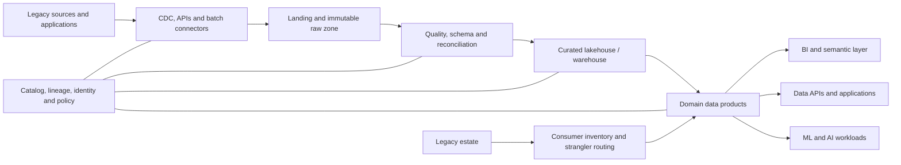

# Modernize a Legacy Enterprise Data Ecosystem

> Staff/Principal-level architecture and leadership interview preparation. Capacity and roadmap figures are illustrative; validate assumptions against the organization's constraints and current platform capabilities.

## 1. Interview framing

**Prompt:** An enterprise operates a fragmented data estate: legacy ETL, on-premises warehouse, Hadoop, departmental databases, scheduled scripts, duplicated BI marts and undocumented integrations. Design a modernization strategy that improves agility, reliability, governance and cost without stopping business reporting.

This is not a “replace everything with a lakehouse” question. A principal engineer must diagnose the current estate, identify business outcomes, sequence changes, preserve critical semantics and avoid a big-bang rewrite.

AWS migration guidance emphasizes assessment, mobilization and migration planning, and recommends selecting migration strategies by workload rather than applying one approach universally. It also highlights the value of separating migration from modernization when deadlines and scope are constrained. [AWS large migration strategy](https://docs.aws.amazon.com/prescriptive-guidance/latest/strategy-large-scale-migrations/introduction.html)

## 2. Requirements and clarifying questions

1. What business outcomes drive change: cost, time-to-market, reliability, compliance, scale, talent or vendor exit?
2. Which systems are business-critical and which are candidates for retirement?
3. What are current data volumes, daily change rates, batch windows and query patterns?
4. Which reports, models and downstream systems depend on current semantics?
5. What is the data quality and lineage baseline?
6. What are licensing, infrastructure and support costs?
7. Which workloads are stable and low-risk versus fragile and poorly understood?
8. Are there contractual, regulatory or data-residency constraints?
9. What is the acceptable coexistence period and migration budget?
10. Who owns business definitions and validates parity?

## 3. Discovery before target architecture

Create an inventory with:
- System, owner, business capability and criticality.
- Source/target dependencies and data lineage.
- Data volume, change rate, SLA and batch windows.
- Consumers: dashboards, extracts, APIs, ML and regulatory reports.
- Security classification, retention and residency.
- Cost, licensing, operational burden and incident history.
- Technology constraints and skills availability.

Build a dependency graph and identify high-centrality components. A small shared dimension or customer master may have far more migration risk than a large isolated fact table.

Profile data quality and semantic drift. Two tables with the same name may encode different business definitions. Reconciliation must compare meaning, not just row counts.

## 4. Modernization strategy: classify each workload

Use a decision matrix rather than one migration pattern:

| Strategy | When appropriate | Main risk |
|---|---|---|
| Retire | No valid consumers or duplicate capability | Hidden downstream dependency |
| Retain | No business case or external constraint | Ongoing maintenance |
| Rehost | Need rapid exit with minimal change | Technical debt moves with it |
| Replatform | Keep behavior, change managed runtime/storage | Semantic/runtime differences |
| Repurchase | SaaS product meets capability | Integration and data portability |
| Refactor/re-architect | Strong business value justifies redesign | Scope, timeline and regression risk |

AWS documents these as the 7 Rs and notes that refactoring during a large migration is usually more complex; for some programs, moving first and modernizing later reduces schedule risk. This is guidance, not a universal rule: if the existing architecture cannot meet a critical requirement, a targeted refactor may be necessary.

## 5. Target-state architecture

## 6. Migration sequencing

### 6.1 Establish a platform foundation
Before migrating many workloads, establish landing zones, identity, network, encryption, policy, catalog, CI/CD, observability, backup and cost allocation. Otherwise every team invents its own implementation and the migration factory scales inconsistency.

### 6.2 Prioritize by value, risk and dependency
Score workloads using business value, technical complexity, dependency centrality, data sensitivity, operational pain and readiness. Start with a low-risk but representative pilot—not a trivial workload that teaches nothing and not the most critical workload.

Build waves that include complete dependency groups. AWS guidance describes migration waves and recommends considering application dependencies, complexity and business drivers; Google Cloud similarly recommends inventorying workloads and dependencies before planning waves.

### 6.3 Strangler pattern for data consumers
Keep legacy and modern systems coexisting. Migrate one producer or consumer slice at a time:
1. Publish canonical contract in the new platform.
2. Replicate or dual-publish data.
3. Run old and new transformations in parallel.
4. Compare business outputs and quality.
5. Move a selected consumer cohort.
6. Monitor and retain rollback.
7. Decommission old path only after dependency evidence is clear.

Avoid indefinite dual-running. Every coexistence path needs an owner and sunset criteria.

### 6.4 Semantic layer and metric consistency
A common modernization failure is moving tables while leaving KPI definitions fragmented. Create governed definitions for revenue, active customer, churn, order status and other shared concepts. Use semantic models or domain-owned metric contracts with versioning and tests. Involve business owners in acceptance.

### 6.5 Data quality and reconciliation
Compare:
- Row counts and distinct keys.
- Aggregates and financial control totals.
- Null/duplicate rates.
- Referential integrity.
- Time-window and late-arrival behavior.
- Business metric values by segment.
- Query result parity for representative consumers.

Set tolerances and investigate differences. Exact equality is not always possible if source systems have corrections, time zones or nondeterministic ordering. Every accepted difference needs a documented explanation.

## 7. Organizational and operating model
Create a modernization office with platform architecture, domain data owners, source-system owners, security, finance, operations and business representatives. Define decision rights:
- Platform team: target patterns and guardrails.
- Domain team: semantic ownership and data product quality.
- Source owner: change access and source correctness.
- Business owner: KPI acceptance and cutover approval.
- Migration lead: wave readiness and dependency coordination.

Train teams on new patterns and provide migration tooling. A technically sound platform that existing teams cannot operate is not a successful modernization.

## 8. Failure modes and risk controls

| Risk | Mitigation |
|---|---|
| Unknown downstream consumer | Access logs, lineage, stakeholder inventory, deprecation window |
| Metric mismatch | Business-owned definitions and reconciliation |
| Big-bang scope creep | Workload-level strategy and wave boundaries |
| Dual-write divergence | One authoritative owner, CDC/outbox, reconciliation |
| Cost increases | Unit economics and workload retirement |
| Skill gap | Enablement, paired migrations and runbooks |
| Vendor lock-in | Stable contracts, export paths and tested portability |
| Legacy source outage | Backfill/replay and recovery plan |

## 9. Cost and value case
Calculate total cost of ownership:
- Infrastructure and storage.
- Licenses and support.
- Engineering and on-call toil.
- Data movement and egress.
- Duplicate systems during coexistence.
- Migration program and training.
- Incident and delay cost.

Value should include faster data-product delivery, reduced failure rates, improved freshness, lower operational effort and retirement of duplicated platforms. Do not claim cloud migration automatically reduces cost; measure cost per query, pipeline, TB and business outcome.

## 10. Sample interviewer–candidate conversation

**Interviewer:** Leadership says replace the warehouse and Hadoop in six months. What do you do?

**Candidate:** I would validate the business driver and inventory dependencies before committing to a technology replacement. I would separate workloads by criticality and migration strategy, establish the target foundation, then run representative pilot waves. If six months is fixed, I would prioritize the highest-value, lowest-risk migration path and explicitly defer modernization that does not fit the deadline.

**Interviewer:** The new platform produces revenue 2% lower than the old dashboard.

**Candidate:** I would not cut over until we understand the difference. We would compare source snapshots, time zones, late-arriving records, deduplication, joins, currency conversion and metric definitions. Business owners define acceptable tolerance. We preserve both outputs and trace differences to source records or transformation rules.

**Interviewer:** A legacy ETL job has no owner, but a critical report depends on it.

**Candidate:** Treat it as high risk until proven otherwise. Identify the report owner and consumers, inspect scheduler and query logs, reverse-engineer inputs/outputs, add observability and assign temporary ownership. Then migrate with a contract and explicit acceptance criteria. “No owner” is not evidence that a workload is unused.

**Interviewer:** Why not modernize while migrating?

**Candidate:** Sometimes we should, particularly if the current design cannot meet a required security, scale or reliability objective. But combining platform migration, semantic redesign and application refactoring multiplies uncertainty. I would isolate essential redesign and defer unrelated improvements until the workload is stable on the new foundation.

## 11. Principal-level follow-up questions

1. **How do you choose the first workload?** Representative, bounded, business-visible and low enough risk to learn safely.
2. **How do you discover hidden dependencies?** Lineage, scheduler metadata, access logs, query history, network flows and stakeholder interviews.
3. **How do you measure parity?** Technical checks plus business metric reconciliation at agreed granularity and tolerance.
4. **What is the strangler pattern?** Incremental replacement behind stable interfaces/routing, moving consumer cohorts gradually.
5. **How do you avoid indefinite dual-running?** Explicit exit criteria, sunset dates, owner and decommission budget.
6. **What if a vendor platform is cheaper?** Compare full TCO, capability, portability, operational burden and exit cost.
7. **How do you protect business continuity?** Parallel run, rollback, source-of-truth control, runbooks and hypercare.
8. **How do you manage resistance?** Involve domain owners early, show workflow improvements and measure migration friction.

## 12. Common mistakes and practice exercise
Mistakes: choosing target technology before inventory; big-bang rewrite; row-count-only parity; no business metric ownership; assuming cost savings; forgetting decommissioning.

**Exercise:** A retailer has 600 ETL jobs, 12 warehouses/marts and 400 dashboards. Build a 12-month modernization strategy with discovery, pilot, migration waves, metric governance and retirement gates.

## 13. References
- [AWS: Strategy and best practices for large migrations](https://docs.aws.amazon.com/prescriptive-guidance/latest/strategy-large-scale-migrations/introduction.html)
- [AWS: 7 migration strategies](https://docs.aws.amazon.com/prescriptive-guidance/latest/large-migration-guide/migration-strategies.html)
- [AWS: Large migration guide](https://docs.aws.amazon.com/prescriptive-guidance/latest/large-migration-guide/)
- [Google Cloud: Migration planning](https://docs.cloud.google.com/migration-center/docs/migration-planning-overview)
- [Google Cloud: Migration and modernization overview](https://docs.cloud.google.com/docs/migration/overview/migrate-modernize-overview)
