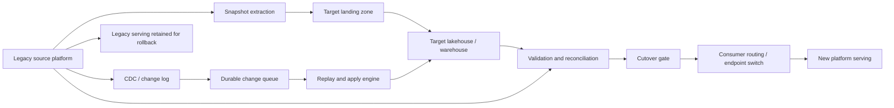

# Lead a Large-Scale Data Platform Migration with Minimal Downtime

> Staff/Principal-level architecture and leadership interview preparation. Capacity and roadmap figures are illustrative; validate assumptions against the organization's constraints and current platform capabilities.

## 1. Interview framing

**Prompt:** Migrate a business-critical data platform from an on-premises warehouse and Kafka/Spark ecosystem to a cloud lakehouse with minimal downtime. The platform processes multi-terabyte daily data, feeds financial and operational dashboards, and has strict freshness and recovery requirements.

“Zero downtime” is often used imprecisely. Clarify whether it means no user-visible query outage, no ingestion pause, no stale data, or no loss of committed records. These are different properties and may require different techniques.

AWS migration guidance distinguishes migration scenarios by scale, time constraints and allowed downtime. Near-zero-downtime database migrations can require continuous synchronization and careful cutover, with materially greater complexity and cost than scheduled maintenance. [AWS migration scenarios](https://docs.aws.amazon.com/prescriptive-guidance/latest/migration-database-rehost-tools/scenarios.html)

## 2. Clarifying questions

1. What is the source and target technology? Database, warehouse, object store, Kafka, Spark, scheduler?
2. Which workloads are read-only versus mutating?
3. What is the acceptable write pause, stale-data window and query outage?
4. What are RPO/RTO and freshness SLOs?
5. Can source systems emit CDC or change logs?
6. Are schemas and business semantics changing during migration?
7. What are daily volume, peak change rate and backlog limits?
8. Can consumers switch endpoints/configuration without code changes?
9. How long can source and target run in parallel?
10. Who approves business parity and final cutover?

## 3. Migration principles

- Define one authoritative writer at every stage.
- Capture every change after the initial snapshot.
- Make replay idempotent and version-aware.
- Validate semantics, not just data volume.
- Separate infrastructure cutover from consumer migration.
- Preserve rollback until the target has proven stable.
- Avoid dual-write unless the consistency protocol is explicit.
- Use a rehearsed runbook with go/no-go criteria.

## 4. Architecture

## 5. Migration execution design

### 5.1 Baseline and dependency mapping
Record source workload behavior: throughput, query patterns, schedules, late-arriving corrections, schema changes, peak windows and downstream dependencies. Capture baseline business outputs for representative dates and segments.

Build a cutover dependency graph. A warehouse may feed extracts, BI, ML training, APIs and regulatory reports. Each consumer needs a migration plan, owner, validation and rollback path.

### 5.2 Choose the synchronization pattern
- **Snapshot + CDC:** consistent initial snapshot plus ordered changes from a source log. Common for mutable databases.
- **Bulk copy + incremental file manifests:** useful for object/table datasets.
- **Dual-publish from producer:** producer emits to both systems; requires idempotency and parity checks.
- **Read-only cutover:** stop source writes while copying; simpler but creates stale-data/downtime constraints.
- **Blue/green serving:** both platforms run; route selected traffic to target.

Choose based on source capabilities and business RPO/RTO. Do not assume every warehouse exposes transactional CDC semantics.

### 5.3 Snapshot and CDC correctness
The snapshot must align with a known source position (LSN/binlog/SCN/offset or equivalent). CDC begins from the corresponding position so no gap exists between snapshot and change stream. If the source connector cannot provide a consistent snapshot boundary, design reconciliation scans and explain the residual risk.

Each change record should carry source identity, primary key, operation, source sequence/offset, transaction metadata, schema version and event timestamp. Apply changes idempotently. Preserve per-key ordering where updates depend on order. Handle deletes with tombstones.

### 5.4 Backfill and replay
Partition snapshot work by stable key or time range. Track progress in a durable manifest. Make each partition restartable. Apply CDC while bulk load runs, but control target write amplification and compaction. Use a bounded queue and measure lag. If target apply throughput is lower than incoming change rate, the migration cannot converge.

### 5.5 Validation framework
Validate at multiple layers:
- Structural: schemas, types, nullability, constraints.
- Completeness: row counts, key coverage, partition counts.
- Content: checksums/hashes on stable columns and sampled records.
- Aggregate: sums, counts, min/max, distinct counts.
- Semantic: business KPIs, time zones, currency, deduplication and late data.
- Consumer: dashboard/query/API output and latency.
- Operational: freshness, failure recovery and alert routing.

Partition validation so mismatches can be isolated. Hashes are useful but do not replace business reconciliation.

### 5.6 Shadow and canary traffic
Mirror read queries to target and compare results without exposing target output to users. Then move low-risk consumers or a percentage of traffic. For dashboards, compare query results and latency. For APIs, compare response schemas and business outcomes. Avoid duplicating side effects during shadowing.

### 5.7 Cutover protocol
A robust cutover checklist:
1. Confirm all consumers and owners are known.
2. Freeze schema/DDL changes or enforce a controlled change window.
3. Verify snapshot completion and CDC lag below threshold.
4. Pause or fence source writes if required by consistency model.
5. Capture final source position.
6. Drain CDC through that position and verify target applied it.
7. Run final reconciliation and business sign-off.
8. Switch consumers and writer ownership atomically where possible.
9. Monitor error, freshness, latency and business metrics.
10. Keep legacy read-only for rollback until acceptance period ends.

The exact sequence depends on whether writes continue and whether the target is allowed to become authoritative. State it explicitly in the interview.

### 5.8 Rollback and roll-forward
Rollback is easy only before the target accepts new writes. Once target writes occur, reverting to source requires reverse replication or reconciliation. Therefore define:
- A short cutover window where target is read-only.
- A period with controlled target writes and reverse CDC.
- Or a forward-fix-only policy after a clear point of no return.

Never promise instant rollback without addressing writes accepted by the target after cutover.

## 6. Failure modes

| Failure | Response |
|---|---|
| Snapshot incomplete | Resume from manifest; do not cut over |
| CDC gap | Stop cutover; recover source position or reconcile |
| CDC lag growing | Increase apply capacity or reduce snapshot contention |
| Schema incompatibility | Pause affected stream; apply versioned transform |
| Duplicate events | Idempotent upsert and source sequence check |
| Out-of-order updates | Per-key ordering/version guard |
| Target compaction pressure | Throttle bulk load and isolate resources |
| Business metric mismatch | Block go-live; trace semantic differences |
| Consumer endpoint issue | Revert routing if no target-only writes |
| Rollback after target writes | Reverse CDC or forward-reconcile; no blind switchback |

## 7. Capacity and convergence calculation
Let:
- `R_in` = source change rate (records/sec or bytes/sec).
- `R_apply` = sustainable target apply rate.
- `B` = backlog.

If `R_apply <= R_in`, backlog does not converge. During catch-up, approximate drain time as:
`B / (R_apply - R_in)`, provided `R_apply > R_in`.

This simplified model ignores burstiness, compaction and skew, but it is useful in an interview. Benchmark with peak rates, not daily averages. Reserve target capacity for query serving and validation.

## 8. Governance and stakeholder management
Create a migration command structure: technical lead, source owner, target owner, business validation owner, operations lead and change manager. Publish readiness dashboard, risks, cutover schedule, communication plan and go/no-go authority. Require named acceptance for critical consumers. Run a rehearsal using production-like data volume.

## 9. Sample interviewer–candidate conversation

**Interviewer:** Can you guarantee zero downtime?

**Candidate:** I would first define downtime. We can often keep read service available through blue/green serving and keep ingestion captured through CDC, but there may be a short writer ownership transition. I would state the achievable query outage, freshness gap and RPO separately. A literal zero pause for every operation may require a more complex dual-write or consensus design.

**Interviewer:** How do you ensure no records are lost between snapshot and CDC?

**Candidate:** The snapshot must be tied to a source log position, and CDC starts from that exact boundary. We track source offsets and applied offsets, verify continuity and use reconciliation. If the connector cannot provide a consistent snapshot boundary, I would not claim a formal no-gap guarantee; I would add overlapping capture and deterministic reconciliation.

**Interviewer:** Target CDC lag is 90 minutes and rising. Cutover is tomorrow.

**Candidate:** We should not cut over. First determine whether source rate exceeds target apply capacity, or if skew, compaction or a downstream bottleneck is limiting throughput. Increase safe capacity, reduce competing load, or revise the cutover date. A fixed date does not make an unconverged replication stream correct.

**Interviewer:** The target has accepted writes and then a serious issue appears. Can you roll back?

**Candidate:** Not by simply pointing consumers back. We need to know which writes were accepted only on target. If reverse CDC was part of the design, we can reconcile them into source. Otherwise we may need forward repair or a controlled restore. The point of no return must be explicit in the cutover plan.

## 10. Principal-level follow-up questions

1. **How do you choose CDC start position?** From a consistent snapshot boundary recorded by the source engine/connector.
2. **What if source cannot expose CDC?** Dual-publish, log-based capture, incremental scans or scheduled freeze; document guarantee limits.
3. **How do you avoid duplicate events?** Stable event identity, source sequence and idempotent target mutation.
4. **How do you handle schema evolution?** Compatibility checks, versioned transformations and coordinated rollout.
5. **What is the go/no-go threshold?** CDC lag, validation mismatch, consumer readiness, latency, security and rollback readiness.
6. **Can you cut over consumers independently?** Yes, if contracts and ownership allow; keep a dependency-aware cohort plan.
7. **What is a point of no return?** The moment target-only writes or irreversible transformations make simple switchback unsafe.
8. **How do you reduce migration risk?** Rehearsals, shadow reads, canaries, explicit rollback, immutable snapshots and business sign-off.

## 11. Common mistakes and practice exercise
Mistakes: “zero downtime” without definition; no snapshot/CDC boundary; cutover with growing lag; row-count-only validation; dual-write without protocol; rollback promise after target writes.

**Exercise:** Migrate a 400 TB warehouse with 2 TB/day change volume and 20 downstream consumers. Define the snapshot, CDC, validation, canary and cutover plan. Explain what changes if the source cannot provide transactionally consistent CDC.

## 12. References
- [AWS: Database migration scenarios](https://docs.aws.amazon.com/prescriptive-guidance/latest/migration-database-rehost-tools/scenarios.html)
- [AWS DMS documentation](https://docs.aws.amazon.com/dms/latest/userguide/Welcome.html)
- [AWS large migration guide](https://docs.aws.amazon.com/prescriptive-guidance/latest/large-migration-guide/)
- [Google Cloud: Prepare data and batch workloads for region migration](https://docs.cloud.google.com/architecture/migrate-across-regions/prepare-data-and-batch-workloads)
- [Debezium documentation](https://debezium.io/documentation/reference/stable/)
