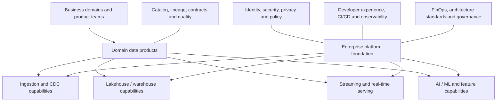

# Define Enterprise-Wide Data Platform Strategy and Technical Governance

> Staff/Principal-level architecture and leadership interview preparation. Capacity and roadmap figures are illustrative; validate assumptions against the organization's constraints and current platform capabilities.

## 1. Interview framing

**Prompt:** You are appointed Principal Data Engineer for an enterprise with multiple business units, inconsistent data stacks, duplicated platforms and rising cloud costs. Define a three-year data platform strategy and technical governance model that improves business outcomes without turning architecture into a centralized approval bottleneck.

This is a strategy and influence interview, not a component-design exercise. Your answer must connect business goals to technical capabilities, investment sequencing, decision rights, measurable outcomes and organizational change.

## 2. Clarifying questions

1. What are the top business priorities: growth, customer experience, regulatory confidence, operational efficiency, AI readiness or cost?
2. What is the current estate and pain: reliability, duplicated data, slow delivery, security gaps, cost or skills?
3. Which business units have independent regulatory or product constraints?
4. What is the current operating model: centralized, federated or decentralized?
5. What is the investment envelope and expected return?
6. Which strategic platforms/vendors are already committed?
7. What capabilities are missing: CDC, lakehouse, governance, self-service, observability, ML/AI?
8. How much standardization is acceptable?
9. Who owns data definitions and quality?
10. What outcomes must improve in 6, 12 and 36 months?

## 3. Strategy structure

A credible strategy contains:
1. **North-star outcomes:** business and user outcomes, not a technology shopping list.
2. **Current-state diagnosis:** architecture, ownership, reliability, cost and skills.
3. **Target capabilities:** ingestion, storage, processing, serving, governance, developer experience and AI readiness.
4. **Principles and guardrails:** a small number of enforceable architecture decisions.
5. **Investment roadmap:** sequenced initiatives, dependencies, owners and funding.
6. **Operating model:** decision rights, domain ownership, platform product teams.
7. **Metrics:** leading and lagging indicators.
8. **Risk register:** vendor, security, migration, skills, reliability and adoption.

## 4. Target capability architecture

## 5. Build the strategy from business outcomes

Translate business goals into platform capabilities:
- Faster product experimentation → self-service data products and governed access.
- Reliable executive metrics → semantic consistency, lineage and data quality.
- Real-time customer experiences → CDC, streaming and low-latency serving.
- AI adoption → trusted data, feature lifecycle, retrieval governance and model operations.
- Regulatory confidence → classification, policy enforcement, audit and deletion.
- Cost control → workload attribution, lifecycle management and capacity governance.

Avoid saying “we will migrate to technology X” as the strategy. Technology selection follows requirements, constraints and capability gaps.

## 6. Architecture principles and decision records

Keep principles few, testable and enforceable:
- Data products have named owners and consumer contracts.
- Sensitive data is classified and access is policy-driven.
- Critical pipelines are observable and have freshness/reliability SLOs.
- Storage and compute are decoupled where the workload benefits.
- Reprocessing is idempotent and lineage-aware.
- Shared capabilities are offered as products with documented APIs.
- Domain autonomy operates within enterprise security and interoperability standards.

Use Architecture Decision Records (ADRs) for material decisions: context, options, decision, consequences, owner, date and revisit trigger. Distinguish principles from implementation standards. A principle should not prescribe a specific vendor without a reason.

## 7. Federated governance and decision rights

A workable model:
- **Enterprise architecture forum:** resolves cross-domain standards and major platform choices.
- **Platform product teams:** own shared capabilities, SLOs, roadmap and developer experience.
- **Domain data councils:** own semantics, quality expectations and product lifecycle.
- **Security/privacy:** define non-negotiable controls and approve risk exceptions.
- **FinOps:** publish unit economics and cost guardrails.
- **Architecture champions:** help teams adopt patterns and surface friction.

Use decision rights, not committee volume. Teams should self-serve when they meet published standards. Escalate only decisions with cross-domain impact, security risk, material cost or irreversible lock-in.

### Example decision matrix

| Decision | Default owner | Escalation trigger |
|---|---|---|
| Domain schema and metric definition | Domain owner | Cross-domain semantic conflict |
| Approved ingestion pattern | Platform team | New source/security capability |
| Data classification | Data owner + privacy | Ambiguous or regulated class |
| Runtime/engine exception | Platform architecture | Material cost or operational risk |
| Cross-region data movement | Privacy/security + domain | Residency or legal uncertainty |
| Platform-wide breaking change | Platform product council | Multiple critical consumers |

## 8. Roadmap and prioritization

Build a roadmap in horizons:
- **0–6 months: stabilize and establish facts.** Inventory, critical SLOs, cost attribution, identity baseline, ownership, top incident fixes and reference architecture.
- **6–18 months: scale paved roads.** Self-service provisioning, CDC/streaming standards, catalog/lineage, data contracts, workload isolation, migration waves and domain product ownership.
- **18–36 months: optimize and enable advanced workloads.** Global data products, advanced governance automation, real-time serving, feature/MLOps and governed GenAI capabilities.

Prioritize by expected business value, risk reduction, adoption reach, dependency unlock, effort and time-to-value. A small reliability investment may outrank a flashy AI platform if current data is not trustworthy.

## 9. Funding and value realization
Use capability-based investment cases. For each initiative state:
- Business problem and affected personas.
- Baseline metric.
- Expected improvement and measurement window.
- One-time and recurring cost.
- Adoption dependency.
- Risks and opportunity cost.
- Owner and stop/continue decision date.

Avoid double-counting savings from decommissioned platforms before actual retirement. Track run cost and change cost separately.

## 10. Principal engineer leadership behaviors
A principal engineer:
- Frames ambiguous problems and exposes assumptions.
- Creates alignment without relying on reporting authority.
- Makes trade-offs visible and records decisions.
- Mentors senior engineers and grows technical ownership.
- Balances local optimization with enterprise consistency.
- Handles disagreement respectfully and escalates with options.
- Communicates risk in business language.
- Measures whether strategy changed outcomes.

A strong answer uses examples with context, personal action, conflict/trade-off, measurable result and lesson learned. Do not claim sole credit for cross-functional outcomes.

## 11. Sample interviewer–candidate conversation

**Interviewer:** Three business units insist on three different data platforms. What do you do?

**Candidate:** I would identify which differences reflect genuine workload or regulatory needs and which are accidental duplication. I would standardize the common contracts—identity, metadata, security, lineage, observability and cost attribution—while allowing different execution engines where justified. I would present total cost and operational risk, then propose a migration path rather than mandate a big-bang consolidation.

**Interviewer:** A VP wants GenAI capabilities delivered in one quarter, but data quality is poor.

**Candidate:** I would propose a narrow, low-risk pilot using a curated corpus with explicit access controls and evaluation. In parallel, I would fund foundational quality, lineage and permission work. I would not claim enterprise-wide readiness from a demo. The release gate should measure retrieval quality, groundedness, ACL correctness and operational cost.

**Interviewer:** A senior architect strongly disagrees with your target design.

**Candidate:** I would ask them to state the constraints and failure scenarios behind their position. We would compare options against agreed criteria—reliability, cost, delivery time, portability and operating complexity—and document the decision. If the decision is reversible, I may propose a time-boxed experiment. If it is irreversible or high risk, I would seek the appropriate decision forum rather than turn it into a personal contest.

**Interviewer:** How do you know your strategy is working?

**Candidate:** I would establish baselines and publish a small scorecard: time-to-production, data freshness, SLO attainment, incident rate, platform adoption, cost per workload and policy exceptions. I would review quarterly with domain leaders and stop or re-sequence initiatives that do not produce measurable value.

## 12. Principal-level follow-up questions

1. **How do you balance standardization and autonomy?** Standardize contracts, security and operability; allow implementation choice where requirements justify it.
2. **How do you influence without authority?** Shared problem framing, evidence, prototypes, transparent trade-offs and trusted relationships.
3. **How do you resolve architecture disagreement?** Criteria, options, reversible experiments, ADR and explicit decision owner.
4. **How do you prevent governance bureaucracy?** Risk-based review, automated policy checks and delegated domain ownership.
5. **How do you prioritize reliability versus innovation?** Risk and business impact, current reliability debt, dependency unlock and cost of delay.
6. **How do you handle a failed strategic bet?** Detect via metrics, communicate, preserve reusable assets, stop investment and document learning.
7. **How do you develop technical leaders?** Delegate ownership, mentor decision-making, create design-review opportunities and share context.
8. **How do you communicate to executives?** Translate latency, reliability and data quality into customer, revenue, regulatory and operating risk.
9. **What is your first 90 days?** Listen and map stakeholders, establish baselines, identify critical risks, agree principles, deliver one visible improvement and publish a sequenced roadmap.
10. **How do you ensure adoption?** Co-design with teams, make paved roads easier than bespoke paths, measure friction and provide migration support.

## 13. Common mistakes and practice exercise
Mistakes: technology-first strategy; too many principles; central committee for every decision; no business baselines; no operating model; roadmap without owners/funding; claiming influence without evidence.

**Exercise:** Prepare a 10-minute executive pitch for a three-year data platform strategy. Include current-state diagnosis, three strategic bets, funding trade-offs, first 90 days, governance model and five measurable outcomes.

## 14. References
- [Google Cloud Architecture Framework](https://cloud.google.com/architecture/framework)
- [AWS Well-Architected Framework](https://docs.aws.amazon.com/wellarchitected/latest/framework/welcome.html)
- [DORA research](https://dora.dev/)
- [CNCF Platform Engineering](https://tag-app-delivery.cncf.io/)
- [AWS governance for large migrations](https://docs.aws.amazon.com/prescriptive-guidance/latest/large-migration-intro-governance/introduction.html)
