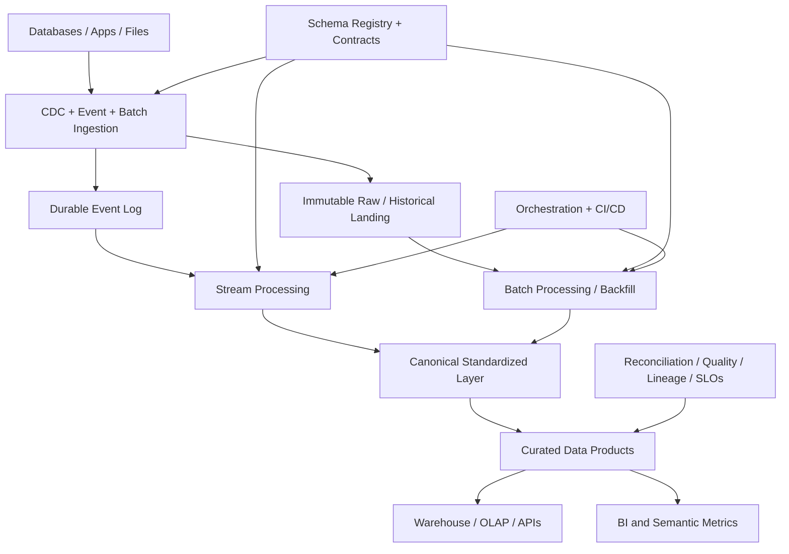

# 31. Design a Unified Batch and Streaming Data Architecture

**Level:** Principal / Staff Data Engineer | **Interview:** 60–75 minutes  
**Themes:** Lambda vs Kappa, event-time correctness, shared business logic, replay, historical correction, batch/stream reconciliation, serving consistency

## 1. Problem statement

An enterprise needs both historical analytics and near-real-time insights. Source systems emit database changes, application events, files, and periodic extracts. Business users expect consistent metrics whether they query the latest streaming view or a historical warehouse table. The design must avoid duplicated business logic, reconcile late and corrected data, and support reprocessing without corrupting live outputs.

The principal-level challenge is to choose a sustainable batch/streaming operating model, define correctness boundaries, and evolve it as latency and scale requirements change.

## 2. Clarifying questions

| Area | Questions | Design impact |
|---|---|---|
| Use cases | Dashboards, fraud, operational alerts, finance, ML features? | Latency and correctness |
| Freshness | Seconds, minutes, hourly, daily? Which metrics truly need streaming? | Streaming scope and cost |
| Sources | CDC, event logs, APIs, files, periodic snapshots? | Ingestion and bootstrap |
| Semantics | Event time, ordering key, duplicate tolerance, correction policy? | State and reconciliation |
| History | How far back can corrections arrive? Can source history be reread? | Replay and retention |
| Metric parity | Must batch and streaming values match exactly? At what point in time? | Shared logic and reconciliation |
| Serving | One serving store or separate operational and analytical stores? | Materialization design |
| Governance | PII, deletion, retention, audit, data residency? | Storage and processing controls |
| Operations | Who owns streaming jobs, batch jobs, and shared definitions? | Operating model |

Do not assume every dataset needs streaming. Ask which business decision is materially improved by lower latency.

## 3. Requirements

**Functional:** ingest events and historical data; support streaming and batch transformations; define reusable business logic; handle late and duplicate events; replay and backfill; publish consistent curated datasets and metrics; reconcile outputs; expose freshness and lineage.

**Non-functional:** bounded end-to-end latency for selected use cases; reproducible historical results; no silent double counting; independent scaling; fault recovery; cost controls; schema evolution; operational simplicity.

## 4. Capacity and workload model

Estimate:
- peak and average events/sec, event size, and daily bytes;
- number of keys and state cardinality;
- late-event distribution (for example, p50/p95/p99 lateness);
- historical backfill size and acceptable completion window;
- batch window size and streaming checkpoint interval;
- number of downstream consumers and serving QPS.

Illustrative calculation: 100,000 events/sec × 1 KB/event is about 100 MB/sec before protocol and replication overhead, or roughly 8.6 TB/day. A 24-hour replay is therefore a material workload and should not compete uncontrolled with live processing.

## 5. Architecture

### Recommended default: shared data contracts and canonical storage

Use one governed event/data contract and a durable raw history. Streaming and batch may use different execution engines, but they should converge on canonical datasets with explicit keys, event-time fields, schema versions, and correction semantics.

Avoid assuming that a single physical execution engine must serve every latency class. The key is semantic consistency, not forced technology uniformity.

## 6. Lambda versus Kappa: choose based on operational reality

| Dimension | Lambda-style | Kappa-style |
|---|---|---|
| Processing paths | Separate batch and speed paths | Primarily one streaming/log-replay path |
| Historical recompute | Batch recomputation is natural | Replay from retained log or rebuild from raw archive |
| Logic duplication | Risk of duplicated logic | Less duplicated execution logic |
| Operational complexity | Two paths and reconciliation | Long retention/replay and state migration complexity |
| Best fit | Mature batch estate plus distinct low-latency needs | Event-centric domain with durable replayable log |
| Main risk | Divergent business logic | Treating an event log as infinite, cheap, and universally replayable |

A practical enterprise design is often hybrid: stream for low-latency products, batch for large-scale historical correction and expensive recomputation, with shared contracts and common transformation definitions where feasible.

## 7. Critical design decisions

### 7.1 Define the canonical event and record model
Include event ID, entity/business key, event time, ingestion time, source system, schema version, operation type, and trace/correlation identifiers. For CDC, preserve source log position or equivalent metadata when useful for ordering and recovery.

Do not confuse event ID with entity key. Event ID supports deduplication; entity key groups changes for state reconstruction.

### 7.2 Decide ordering and deduplication scope
Global ordering is expensive and usually unnecessary. Prefer per-key ordering when business semantics require it. Partition by a stable key, but test skew. Deduplicate using durable IDs and a retention window aligned with replay and lateness policies. If replay can exceed the deduplication window, use sink-side version checks or idempotent writes.

### 7.3 Handle event time and late data
Use event time for business windows when source timestamps are trustworthy. Define watermarks from observed lateness distributions and business tolerance. A watermark is an operational policy, not proof that no older event will ever arrive.

For events beyond the normal lateness threshold, choose explicitly:
- drop and count;
- route to a late-data correction stream;
- update previously materialized aggregates;
- trigger a bounded reprocessing job.

Financial and regulatory use cases often require correction rather than silent dropping.

### 7.4 Avoid divergent business logic
Options include:
- shared SQL or transformation definitions compiled for different engines (verify feature parity);
- shared libraries with strict versioning and deterministic functions;
- canonical intermediate tables/events consumed by both paths;
- batch reconciliation against streaming aggregates.

Do not force one codebase if engine semantics differ materially. Define conformance tests that run representative inputs through both implementations and compare outputs within a documented tolerance.

### 7.5 Reconcile streaming and batch results
Use stable business keys and deterministic aggregation boundaries. Reconciliation can compare:
- counts and sums by partition/time bucket;
- checksums or hash aggregates;
- source-to-target watermarks;
- duplicate and missing-key rates;
- selected row-level samples.

Define which output is authoritative after reconciliation and how corrections are published without exposing partial results.

### 7.6 Publish atomically
Write to staging or versioned output, validate, then atomically switch a pointer/snapshot or publish a completion marker. For table formats, understand the catalog and commit semantics of the exact engine combination. Never assume multi-table atomicity unless the platform actually provides it.

## 8. Failure modes and recovery

| Failure | Detection | Recovery |
|---|---|---|
| Stream processor restarts | Lag, checkpoint failure | Restore compatible checkpoint/state; replay from committed offsets |
| Batch backfill overloads live cluster | Queue delay, SLO burn | Separate pools/queues, quotas, concurrency caps |
| Duplicate replay | Duplicate-key metrics | Idempotent sink, event ID deduplication, version guards |
| Late correction changes aggregate | Reconciliation delta | Correction stream or bounded recomputation |
| Batch and stream logic diverge | Conformance-test mismatch | Block release; version and reconcile definitions |
| Source event lost before durable landing | Source-to-log gap | Source reconciliation, snapshot/CDC bootstrap, repair |
| Schema change breaks one path | Contract validation failure | Compatibility gate, staged rollout, quarantine |

## 9. Security, governance and operations

- Apply identity and authorization consistently across batch and streaming paths.
- Propagate deletion and retention policies to raw history, derived tables, caches, and downstream serving stores.
- Track lineage from source event through transformations to published metrics.
- Define freshness, completeness, correctness, and availability SLOs separately.
- Monitor consumer lag, watermark delay, checkpoint duration, state size, batch backlog, reconciliation drift, and correction volume.
- Assign a single owner for shared metric definitions, even when execution is distributed.
- Keep replay permissions constrained; replay can reintroduce deleted or unauthorized data if governance is not integrated.

## 10. Trade-offs to articulate

1. **Latency versus cost:** streaming everything increases always-on compute, operational burden, and state management. Stream only where the business value warrants it.
2. **One engine versus fit-for-purpose engines:** one engine reduces operational diversity; multiple engines may better fit latency, state, and ecosystem needs.
3. **Replay retention versus storage cost:** retain enough durable history for business recovery and audit, not an arbitrary infinite horizon.
4. **Shared logic versus engine-native optimization:** portability is valuable, but abstraction can hide engine-specific performance and semantics.
5. **Correction versus finality:** fast dashboards may show provisional values; financial reporting may need delayed finalization and controlled restatement.

## 11. Sample interviewer–candidate discussion

**Interviewer:** Why not simply use Kappa and replay Kafka for every historical correction?

**Candidate:** I would first check retention, throughput, source-of-truth requirements, and replay duration. A broker log may not be the right long-term archive for months of history, and replaying a large history can interfere with live traffic. I would keep a durable raw archive and use the event log for operational replay within its retention and throughput envelope. For large corrections, I would run isolated batch recomputation and publish a validated new table snapshot.

**Interviewer:** How do you ensure the dashboard and daily report agree?

**Candidate:** I would define the metric contract, event-time cutoff, late-arrival policy, and finalization point. I would run conformance tests for shared logic and reconcile streaming aggregates against batch outputs by stable time buckets and keys. If late data changes a finalized period, I would publish a controlled correction with lineage and a restatement indicator rather than silently overwriting the meaning.

## 12. Principal-level follow-up questions

1. **A correction arrives 10 days late.** Explain how you update aggregates and preserve auditability.
2. **The streaming path is 3 minutes behind but batch is healthy.** How do you isolate the bottleneck?
3. **A metric differs by 0.4% between engines.** How do you find semantic versus data-loss causes?
4. **The company wants one transformation language.** What criteria determine whether that is realistic?
5. **How do you evolve schemas while old and new stream processors coexist?**

Strong answers identify event-time and version semantics, use reconciliation evidence, and avoid asserting that a single delivery guarantee solves end-to-end correctness.

## 13. Common interview mistakes

- Saying Lambda is obsolete or Kappa is always simpler.
- Ignoring late data, corrections, and restatement.
- Treating the event broker as the only historical source of truth.
- Claiming exactly-once without naming source, processor, and sink boundaries.
- Reimplementing metrics independently with no conformance tests.
- Forgetting governance and deletion during replay.

## 14. Practice exercise

Design a platform that ingests 60,000 events/sec, supports 2-minute operational metrics, and produces finance-grade daily revenue. Events can arrive 48 hours late and corrections may be issued up to 30 days later. Draw the architecture, define provisional/final metric semantics, estimate replay capacity, and explain how a 30-day correction is published safely.

## 15. Further reading

- Apache Kafka: https://kafka.apache.org/documentation/
- Apache Flink: https://nightlies.apache.org/flink/flink-docs-stable/
- Apache Spark Structured Streaming: https://spark.apache.org/docs/latest/streaming/index.html
- Apache Iceberg: https://iceberg.apache.org/docs/latest/
