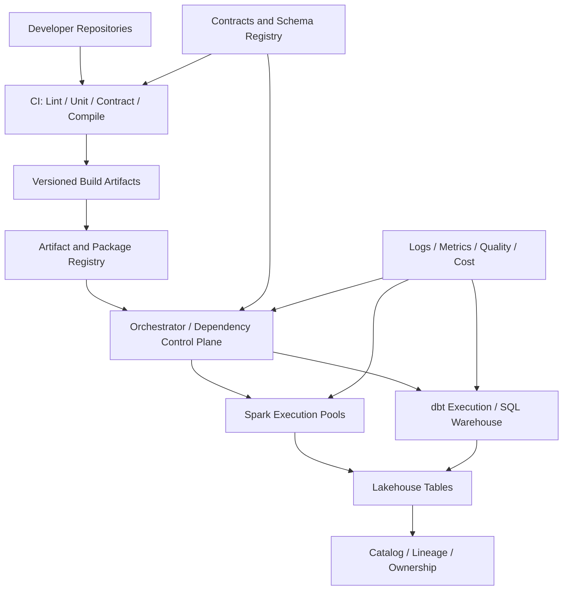

# 32. Design an Enterprise Spark and dbt Transformation Framework

**Level:** Principal / Staff Data Engineer | **Interview:** 60–75 minutes  
**Themes:** reusable transformation framework, Spark execution, dbt models, dependency graphs, incremental processing, testing, CI/CD, backfills, workload isolation

## 1. Problem statement

Hundreds of data engineers and analytics engineers build transformations across a shared platform. Teams use Spark for large-scale distributed processing and dbt for SQL-based modeling, testing, and dependency management. The organization wants consistent development, testing, deployment, observability, and operational standards without preventing teams from choosing appropriate implementation patterns.

Design a framework that makes the paved road easy to use, supports team autonomy, prevents unsafe releases, and scales to thousands of models and pipelines.

## 2. Clarifying questions

| Area | Questions | Design impact |
|---|---|---|
| Workload | Batch, streaming, CDC, SQL ELT, ML preparation? | Engine and framework boundaries |
| Scale | Jobs/day, model count, data volume, concurrency? | Scheduler and compute |
| Tenancy | Team, domain, environment, cost center? | Namespace and isolation |
| Transformations | Python/PySpark, Scala, SQL/dbt, mixed? | SDK and execution contracts |
| Dependencies | Cross-project, cross-domain, external source dependencies? | DAG and release coordination |
| Incrementality | Append, merge/upsert, partition overwrite, stateful? | Correctness and idempotency |
| Quality | Unit, schema, freshness, reconciliation, business tests? | Test gates |
| Deployment | Git workflow, environments, approvals, rollback? | CI/CD |
| Backfills | Size, urgency, production isolation? | Queue and resource policy |

## 3. Requirements

**Functional:** project scaffolding; reusable libraries; Spark job execution; dbt model execution; dependency orchestration; local and CI testing; data contracts; incremental models; environment promotion; backfills; lineage; cost attribution; standardized logs and metrics.

**Non-functional:** reproducible builds; isolation; predictable releases; secure secrets; scalable scheduling; failure recovery; backward compatibility; low developer friction; measurable platform adoption.

## 4. Capacity model

Estimate jobs/day, models/job, DAG depth, task duration distribution, peak concurrent runs, Spark executor-hours, dbt warehouse slots, artifact volume, and CI concurrency.

Illustrative: 1,500 DAGs with 20 tasks each creates 30,000 task instances per full run. If most DAGs run hourly, scheduler metadata and control-plane capacity may become as important as Spark compute. Measure scheduling latency and task-state churn, not only cluster CPU.

## 5. Architecture

### Separate the control plane from execution

The control plane handles project registration, dependency metadata, policy, scheduling, deployment, run state, and observability. Execution occurs in isolated Spark pools or SQL warehouses. This avoids running user code inside the scheduler and makes resource controls enforceable.

## 6. Framework design

### 6.1 Golden-path project structure
Provide a standard repository template:
- project manifest: owner, domain, environment, data classification, criticality;
- source and model definitions;
- Spark application code and reusable libraries;
- dbt project and profiles resolved securely at runtime;
- tests and contract declarations;
- deployment configuration and resource requests;
- runbook and operational ownership.

The template should be opinionated but allow documented exceptions.

### 6.2 Spark execution standards
Standardize:
- supported runtime versions and dependency packaging;
- executor sizing, dynamic allocation boundaries, autoscaling policies;
- partitioning and file output conventions;
- retry and idempotent write patterns;
- checkpoint and state handling for streaming;
- logging, metrics, tracing, and data lineage;
- safe handling of secrets and credentials.

Do not expose arbitrary cluster-wide privileges to every project. Use workload identities and scoped data permissions.

### 6.3 dbt modeling standards
Define conventions for:
- source declarations and freshness;
- staging, intermediate, and mart layers;
- materialization choice: view, table, incremental, ephemeral where appropriate;
- unique keys and incremental predicates;
- tests for uniqueness, not-null, relationships, accepted values, and custom business rules;
- model contracts and documentation;
- exposures and downstream ownership.

Incremental logic must be correct under retries and late-arriving data. A `unique_key` declaration alone does not guarantee a correct merge if the source contains multiple conflicting records or the target adapter has different semantics.

### 6.4 Orchestration and dependency model
Represent dependencies at the appropriate granularity. Avoid a single enormous DAG that couples unrelated teams. Use cross-project data dependencies through published datasets, sensors/events, or explicit asset dependencies. Distinguish:
- code dependency;
- execution dependency;
- data availability dependency;
- contract compatibility dependency.

A model should not start merely because an upstream job succeeded; it should start when the required data version/partition is available and validated.

## 7. CI/CD and release lifecycle

A robust pipeline:

1. Developer creates a branch and runs formatting, static analysis, unit tests, and local compile.
2. CI validates dbt compilation, Spark package build, dependency pinning, contracts, policy, and secrets.
3. Changed models receive targeted tests plus impact-aware downstream checks.
4. Integration tests run against representative ephemeral or isolated data.
5. Artifact is built once, versioned, signed/attested where required, and promoted unchanged.
6. Deployment applies environment-specific configuration and workload identity.
7. Release executes canary models or a limited partition before broad promotion.
8. Runtime checks compare freshness, volume, quality, and output distributions.
9. Rollback restores code/config or republishes a previous known-good output version; data rollback requires explicit handling.

Never treat a successful code deployment as proof that data output is correct.

## 8. Incremental processing and idempotency

Choose an incremental strategy based on source semantics:
- append-only with immutable event IDs;
- merge/upsert using stable business keys and source versions;
- partition overwrite for bounded, deterministic partitions;
- change-data processing using source log positions;
- snapshot rebuild for small dimensions or when correctness is simpler.

Define how to handle late data, deletes, duplicate keys, schema changes, and replay. Use run IDs and input watermarks to make outputs traceable. For table formats, understand atomic commit boundaries and concurrent writer behaviour.

## 9. Backfill and production workload isolation

Backfills should be first-class jobs, not ad hoc edits to production DAGs.

- Require owner, reason, date range, expected bytes, priority, and output target.
- Use separate queues/pools or compute budgets.
- Limit concurrent partitions and enforce per-tenant quotas.
- Make each partition independently restartable and idempotent.
- Record code version, input snapshot/watermark, parameters, and output commit.
- Publish only after validation; use shadow output or isolated table/partition when risk is high.
- Support cancellation without leaving ambiguous partial output.
- Track estimated versus actual cost and completion time.

For a six-month backfill, do not launch every partition at once. Estimate source scan, shuffle, target write, and downstream refresh costs. Use a staged plan and protect production SLOs.

## 10. Failure modes and recovery

| Failure | Detection | Recovery |
|---|---|---|
| Dependency package changes behaviour | CI/integration mismatch | Pin versions, rebuild, rollback artifact |
| dbt incremental model misses late records | Reconciliation/freshness drift | Expand lookback, targeted partition rebuild |
| Spark skew or executor OOM | Stage metrics, spill, retries | Fix key distribution, tune partitions, isolate workload |
| Scheduler overload | Queue/scheduling latency | Partition schedulers, reduce DAG churn, scale control plane |
| Upstream contract breaks | Contract gate | Quarantine producer release, compatibility migration |
| Partial backfill writes | Run ledger and output validation | Resume by partition or clean isolated output and rerun |
| Concurrent writers conflict | Commit conflicts | Retry with bounded policy, serialize conflicting writes, redesign ownership |

## 11. Governance, observability and platform KPIs

Track:
- deployment frequency and lead time;
- failed run and retry rates;
- freshness and completeness SLOs;
- mean time to detect and recover;
- test coverage and escaped data defects;
- scheduler latency and queue wait;
- Spark cost per TB or successful run;
- warehouse credits/compute per model or domain;
- percentage of projects using supported templates;
- onboarding time and developer satisfaction.

Lineage should connect code version, job run, input datasets, output datasets, and downstream assets. A dashboard without ownership and actionable alert routes is not an operating model.

## 12. Trade-offs

- **Central framework versus autonomy:** centralize standards, security, and observability; allow teams to own domain logic.
- **One orchestration platform versus multiple:** standardization lowers support cost; specialized systems may better serve streaming or ML workloads.
- **dbt versus Spark:** use dbt where SQL transformations and warehouse execution fit; use Spark for distributed processing or complex data engineering workloads. Avoid using one tool as a universal hammer.
- **Monorepo versus polyrepo:** monorepos improve shared refactoring but require scalable CI and ownership boundaries; polyrepos offer autonomy but need versioned shared packages and dependency management.
- **Strict release gates versus speed:** risk-tier gates by data criticality and blast radius rather than applying identical ceremony to every model.

## 13. Sample interviewer–candidate discussion

**Interviewer:** How would you prevent a team's backfill from affecting production pipelines?

**Candidate:** I would treat backfills as a separate workload class with its own queue, compute budget, concurrency cap, and priority policy. Each backfill would declare expected data volume and target partitions. The scheduler would enforce tenant quotas and pause or throttle backfills when production SLOs approach their error budget. The job would be restartable by partition and write idempotently.

**Interviewer:** Does dbt solve dependency management across all our pipelines?

**Candidate:** It manages dependencies inside the dbt project and can participate in broader orchestration, but it does not by itself solve every cross-system dependency, data availability contract, or runtime scheduling concern. I would define published data assets and explicit orchestration boundaries across Spark, dbt, and streaming systems.

## 14. Principal-level follow-up questions

1. How would you roll out a breaking shared library upgrade across 150 teams?
2. How do you test a Spark transformation without scanning production-scale data?
3. How do you prevent a dbt model from silently processing incomplete upstream partitions?
4. How would you design cross-project dependencies without a global DAG bottleneck?
5. How do you measure whether the framework improves developer productivity rather than adding bureaucracy?

## 15. Common interview mistakes

- Treating Spark and dbt as interchangeable.
- Assuming orchestration success means data correctness.
- Ignoring dependency/version reproducibility.
- Running backfills on the same unrestricted production pool.
- Treating retries as safe without idempotent outputs.
- Building a central framework that requires platform-team approval for every change.

## 16. Practice exercise

Design a framework for 300 teams, 8,000 dbt models, 2,000 Spark jobs, and 25,000 scheduled task instances per hour. Production pipelines have a 99.5% freshness objective; backfills may span six months. Define the control plane, execution pools, CI gates, dependency semantics, backfill policy, and adoption metrics.

## 17. Further reading

- Apache Spark: https://spark.apache.org/docs/latest/
- dbt documentation: https://docs.getdbt.com/docs/introduction
- Apache Airflow: https://airflow.apache.org/docs/apache-airflow/stable/
- OpenLineage: https://openlineage.io/docs/
