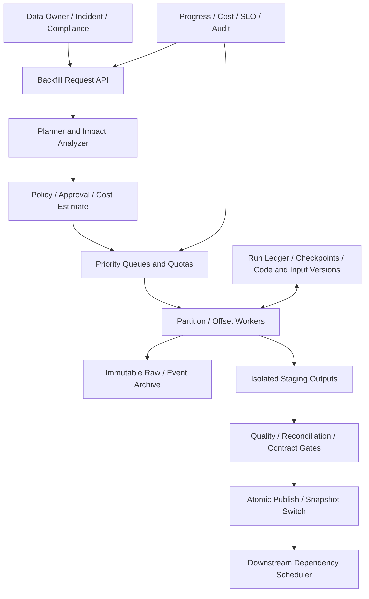

# 33. Design an Enterprise Data Backfill and Replay Platform

**Level:** Principal / Staff Data Engineer | **Interview:** 60–75 minutes  
**Themes:** historical reprocessing, replay, partition planning, restartability, idempotency, versioned transformations, workload isolation, cost controls, auditability

## 1. Problem statement

A business rule changes, a source defect is discovered, or a pipeline outage creates a gap. The organization must reprocess weeks or months of historical data across hundreds of pipelines while live workloads continue to meet their SLOs. Some pipelines are batch, some CDC/streaming, and some produce shared curated datasets.

Design a self-service backfill and replay platform that makes reprocessing safe, observable, resumable, governed, and cost-aware.

## 2. Clarifying questions

| Area | Questions | Design impact |
|---|---|---|
| Trigger | Code change, source repair, data loss, schema migration, compliance deletion? | Workflow and approval |
| Scope | Dataset, table, partition, tenant, source offset, time range? | Planning granularity |
| Volume | TB/PB, partition count, fan-out to downstream assets? | Capacity and isolation |
| Correctness | Recompute from raw, replay events, or patch derived data? | Source of truth |
| Versions | Must old code reproduce old output? Which code version is target? | Reproducibility |
| Writes | Replace partitions, merge keys, publish new snapshot, dual-write? | Atomicity |
| Priority | Regulatory deadline, incident recovery, low-priority correction? | Scheduling |
| Governance | PII deletion, legal hold, residency, audit? | Authorization and propagation |
| Completion | What validates success: counts, checksums, business reconciliation? | Acceptance criteria |

## 3. Requirements

**Functional:** request submission; impact analysis; dependency planning; cost estimation; approval; partition/offset planning; execution; checkpointing; retry/resume; validation; publication; downstream triggering; audit and cancellation.

**Non-functional:** no unbounded impact on production; idempotent execution; reproducibility; strong authorization; clear progress; safe partial-failure handling; predictable cost; data correctness and traceability.

## 4. Architecture

## 5. Core design: request, plan, execute, validate, publish

### 5.1 Request contract
A request should include:
- requester, owning team, approver, reason, ticket/incident reference;
- dataset and downstream impact scope;
- time range or source offset range;
- transformation/code version;
- expected input snapshot or source watermark;
- target environment and output strategy;
- priority, deadline, budget, and data classification.

Reject ambiguous requests. A backfill without a clear target version and publication strategy is an uncontrolled production change.

### 5.2 Impact and dependency planning
Use lineage and orchestration metadata to build a dependency graph. Distinguish direct recomputation from downstream refresh. Detect cycles, shared outputs, and assets owned by other teams. Produce a plan with estimated partitions, bytes scanned, compute, concurrency, and downstream fan-out.

The planner should identify whether the request is:
- replay of retained events;
- source re-extraction;
- deterministic transformation recomputation;
- targeted repair;
- compliance deletion or redaction;
- full rebuild.

Each class has different correctness and approval needs.

### 5.3 Partitioning and execution units
Choose units that can be independently retried and validated: date partitions, tenant partitions, source offsets, key ranges, or bounded file groups. Too-large units reduce parallelism and make recovery expensive; too-small units overload schedulers and metadata stores.

Use adaptive concurrency based on production SLOs, queue depth, and resource availability.

### 5.4 Run ledger and restartability
Persist a durable state machine for each unit:
`PLANNED → QUEUED → RUNNING → VALIDATING → COMMITTED` with explicit `FAILED`, `CANCELLED`, and `RETRY_WAIT` states.

Record:
- request ID and unit ID;
- input range and input snapshot/version;
- code artifact and configuration hash;
- attempt count and worker;
- output location/table snapshot/commit ID;
- validation results;
- timestamps, cost, and failure details.

A worker crash must not lose progress. On restart, inspect the ledger and sink commit state before retrying. A completed write with a lost acknowledgement must not be blindly repeated.

## 6. Safe write and publication patterns

### Pattern A — Partition replacement
Suitable when partitions are independent and fully recomputed. Write to staging, validate, then replace the target partition using supported atomic table operations. Ensure readers do not see a partially written partition.

### Pattern B — Merge/upsert
Suitable for corrections to keyed records. Require deterministic source precedence, stable keys, duplicate resolution, and idempotent merge semantics. Guard against stale versions overwriting newer live data.

### Pattern C — New table snapshot / blue-green publication
Suitable for large rebuilds or risky transformations. Build a new version, validate it, then switch a catalog pointer, view, or consumer contract. This may require explicit downstream cutover and rollback planning.

### Pattern D — Event replay
Suitable when durable events and deterministic processing semantics exist. Replay from a known offset/time with state bootstrap. Ensure the replay does not double-apply side effects and that consumer state/version compatibility is handled.

Never assume every table format, engine, and catalog provides identical atomicity or multi-table transactions. Verify the exact write path.

## 7. Isolation and scheduling

Create separate workload classes:
- critical production;
- normal production;
- urgent incident recovery;
- approved backfill;
- exploratory/research.

Enforce per-team quotas, maximum concurrent backfills, cluster/warehouse pools, queue weights, and preemption/throttling policy. Reserve capacity for critical pipelines. If a production SLO is burning, automatically reduce low-priority backfill concurrency.

Avoid preempting stateful streaming workloads in ways that cause expensive recovery loops. Coordinate with the stream processor's checkpoint and restart behaviour.

## 8. Cost and capacity estimation

Estimate:
- bytes scanned and read amplification;
- shuffle and spill volume;
- output bytes and file counts;
- compute time at expected parallelism;
- downstream recomputation fan-out;
- temporary storage and duplicate retention;
- network/region transfer;
- validation and reconciliation cost.

For a 90-day backfill of a 4 TB/day dataset, raw input is 360 TB before compression and filtering. If downstream models each rescan the full range, total work can multiply quickly. Use partition pruning, incremental dependency propagation, and shared intermediate outputs.

Provide a cost range with assumptions, then reconcile estimate versus actual.

## 9. Correctness, versioning and reproducibility

A reprocessing run must answer: “Which inputs, code, configuration, reference data, and business definitions produced this output?”

Version:
- transformation artifact;
- schema and contract;
- configuration and parameters;
- source snapshot/offset boundary;
- lookup/reference datasets;
- runtime and relevant dependency versions.

For nondeterministic operations, record random seeds or external model versions where possible. If the transformation depends on current time, mutable external APIs, or non-versioned reference data, exact reproducibility may be impossible; disclose and mitigate this.

Use validation gates: row counts, key uniqueness, null rates, aggregates, distribution checks, referential integrity, source-to-target reconciliation, and business-specific invariants.

## 10. Failure modes and recovery

| Failure | Safe response |
|---|---|
| Worker dies mid-partition | Reconcile ledger and sink commit; resume or clean staging output |
| Job writes but acknowledgement is lost | Query commit metadata before retrying |
| Backfill competes with production | Throttle or pause by SLO-aware scheduler |
| One partition is much larger | Split adaptively or process as a special unit |
| Upstream data changes during run | Pin input snapshot/watermark or define a consistent cutoff |
| Validation fails | Do not publish; retain diagnostics and staging data per policy |
| Downstream refresh fails | Keep upstream publication state; resume dependency graph |
| Code is rolled back during execution | Continue with pinned artifact or cancel and re-plan explicitly |
| Deletion request arrives during replay | Apply deletion policy to output and prevent reintroduction |

## 11. Security, governance and operations

- Require dataset-owner authorization and approval for sensitive or shared outputs.
- Enforce row/tenant scope during planning and execution, not only in the request UI.
- Audit requester, approver, input versions, code, output commits, and publication.
- Ensure replay cannot reintroduce data subject to deletion or retention expiry.
- Monitor queue wait, completion time, throughput, retries, cost, validation failure, and production SLO impact.
- Define ownership for abandoned requests and stale staging data.
- Use lifecycle cleanup for temporary outputs, preserving audit evidence as required.

## 12. Trade-offs

- **Replay versus recomputation:** replay preserves event semantics but depends on retained logs and state; recomputation uses durable raw history and current logic but can be expensive.
- **Fine-grained versus coarse-grained units:** smaller units improve restartability and parallelism but increase scheduler and metadata overhead.
- **In-place update versus blue-green:** in-place is cheaper but riskier; blue-green is safer but doubles temporary storage and may complicate downstream cutover.
- **Global queue versus domain queues:** global scheduling improves utilization; domain queues improve autonomy and isolation but can strand capacity.
- **Strict approval versus self-service:** automate low-risk bounded requests; require approvals for sensitive, high-cost, or broad-impact runs.

## 13. Sample interviewer–candidate discussion

**Interviewer:** The backfill fails after 70% of the data has been processed. What happens?

**Candidate:** I would not restart the entire job blindly. Each partition or offset range has a durable ledger state and a deterministic output commit. The planner identifies committed units, verifies their output and validation state, and schedules only incomplete or failed units. If a worker may have committed output but lost the acknowledgement, the coordinator checks the sink's commit metadata before retrying. Publication occurs only after all required units pass validation.

**Interviewer:** What if the new backfill overlaps with live writes?

**Candidate:** I would pin the source cutoff and define precedence. For keyed data, use source versions or event positions so stale backfill rows cannot overwrite newer live changes. Depending on sink capabilities, I would write to isolated staging and merge/publish with a controlled boundary. The design must make the handoff explicit.

## 14. Principal-level follow-up questions

1. How do you backfill 12 months across 500 datasets while preserving critical pipeline SLOs?
2. How do you handle an upstream correction that invalidates already-published downstream aggregates?
3. How do you make a backfill safe when output writes are not transactional?
4. How do you prevent historical replay from reintroducing deleted PII?
5. How do you estimate and cap cost when lineage fan-out is large?
6. When should a backfill be treated as a migration rather than a normal pipeline run?

## 15. Common interview mistakes

- Treating a backfill as a parameterized rerun with no control plane.
- Not pinning code and input versions.
- Assuming retries are idempotent.
- Publishing partially validated outputs.
- Ignoring live-write overlap and stale overwrite risk.
- Forgetting downstream fan-out, governance, and cost.

## 16. Practice exercise

A revenue transformation has a defect affecting 120 days. Input volume is 6 TB/day, 250 downstream models depend on it, and production freshness must remain under 15 minutes. Design request approval, impact analysis, capacity estimates, execution queues, partition strategy, versioning, validation, publication, rollback, and audit.

## 17. Further reading

- Apache Airflow: https://airflow.apache.org/docs/apache-airflow/stable/
- Apache Iceberg: https://iceberg.apache.org/docs/latest/
- Apache Spark: https://spark.apache.org/docs/latest/
- Debezium: https://debezium.io/documentation/reference/stable/
