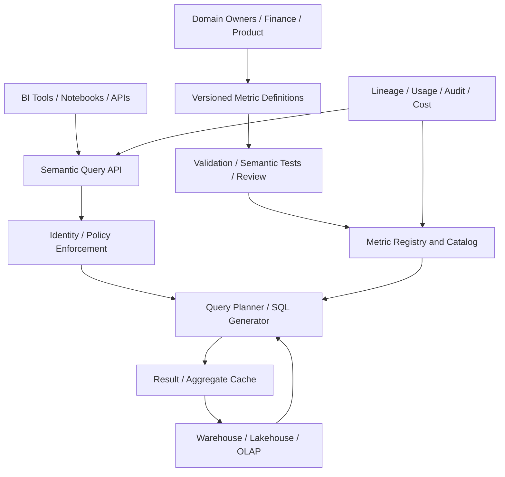

# 34. Design an Enterprise Semantic Layer and Centralized Metrics Platform

**Level:** Principal / Staff Data Engineer | **Interview:** 60–75 minutes  
**Themes:** metric definitions, semantic models, dimensions, metric versioning, governed query generation, BI integration, caching, ownership, backward compatibility

## 1. Problem statement

Different business units calculate revenue, active users, churn, conversion, and retention differently. Definitions vary across dashboards, notebooks, SQL queries, and applications. Executives lose confidence because the same metric produces different values depending on the tool or team.

Design a centralized semantic and metrics platform that provides governed, reusable definitions while supporting different analytical experiences and preserving backward compatibility.

## 2. Clarifying questions

| Area | Questions | Design impact |
|---|---|---|
| Metrics | Which metrics are certified and business-critical? | Governance and rollout |
| Semantics | Grain, dimensions, filters, attribution, timezone, currency? | Metric contract |
| Data | Warehouse/lakehouse engines and source tables? | Query execution |
| Users | BI analysts, finance, product, APIs, applications? | Interfaces |
| Latency | Interactive seconds, scheduled reports, embedded analytics? | Caching/materialization |
| Security | Row/column/tenant policies and sensitive dimensions? | Query enforcement |
| Change | Can definitions change? Must old dashboards retain old meaning? | Versioning |
| Scale | Concurrent users, query complexity, cardinality, QPS? | Serving and caching |
| Ownership | Who approves metric definitions and disputes? | Operating model |

## 3. Requirements

**Functional:** metric registry; semantic models; dimensions and measures; reusable filters; versioning; query/API interface; BI integration; access policies; caching; lineage; documentation; ownership; deprecation and change management.

**Non-functional:** consistent definitions; correct grain and joins; secure query execution; predictable latency and cost; backward compatibility; auditability; discoverability; extensibility across engines.

## 4. Architecture

## 5. Define a metric as a governed contract

A metric definition should include:
- stable metric identifier and human-readable name;
- business description and owner;
- calculation expression and aggregation behaviour;
- base grain and required joins;
- dimensions and allowed filters;
- timezone, currency, attribution, and null semantics;
- source datasets and freshness expectation;
- access classification and row/column policy;
- version, effective date, and deprecation status;
- tests and known limitations.

A metric name alone is insufficient. “Revenue” could mean booked, recognized, gross, net of refunds, invoiced, or cash collected. The definition must make the business meaning explicit.

## 6. Semantic model and grain correctness

The most dangerous semantic-layer defects are often join fan-out and grain mismatch.

Example: orders are at order grain, order items at item grain, and payments at payment grain. Joining all three directly can multiply rows and inflate revenue. Define the metric's base grain and aggregate facts independently before combining them where necessary.

Model:
- facts and dimensions;
- one-to-many and many-to-many relationships;
- slowly changing dimension semantics;
- additive, semi-additive, and non-additive measures;
- distinct-count and approximate aggregation rules;
- time dimensions and fiscal calendars.

Tests should detect fan-out, unexpected null joins, duplicate business keys, and metric drift.

## 7. Query planning and execution

The semantic API translates a requested metric, dimensions, and filters into a safe query plan:
1. authenticate caller and resolve effective identity;
2. authorize metric, dimensions, filters, and underlying data;
3. resolve metric version and effective date;
4. validate dimensional compatibility and grain;
5. select a compatible physical model/materialization;
6. generate parameterized SQL or an engine-native plan;
7. enforce query budgets, timeouts, and row limits;
8. execute through governed warehouse credentials;
9. record lineage, usage, latency, and cost;
10. return values with metric version and freshness metadata.

Do not expose arbitrary SQL interpolation. Parameterize values and allowlist semantic identifiers. Avoid a privileged service account that bypasses user-level policies unless policy is correctly re-enforced by the semantic service.

## 8. Metric versioning and backward compatibility

When a definition changes, determine whether it is:
- a correction to an implementation bug that should restate history;
- a genuine business-definition change;
- a new dimension or segmentation capability;
- a source migration that should preserve semantics.

Use explicit versioning and effective dates. For a breaking definition change:
- create a new version or metric identifier;
- run old and new definitions in parallel;
- compare historical and current outputs;
- identify impacted dashboards, reports, APIs, and decisions using lineage/usage;
- notify owners and set a deprecation window;
- migrate consumers deliberately;
- retire the old version only after adoption and approval.

Do not silently change the meaning of a certified metric while leaving its identifier unchanged.

## 9. Caching and materialization

Caching can reduce latency and warehouse cost but creates freshness and authorization risks.

Cache key dimensions may include metric version, dimensions, filters, tenant/security context, time range, and data snapshot/watermark. Never share cached results across authorization contexts unless the cache is demonstrably policy-safe.

Choose:
- result cache for repeated identical queries;
- aggregate tables/materialized views for common groupings;
- precomputed cubes for predictable high-volume access;
- direct query for exploratory, low-frequency analysis.

Invalidate or version caches when source snapshots, metric definitions, policies, or dimensions change. Include freshness metadata in responses.

## 10. Governance and operating model

Use federated ownership:
- central platform team owns semantic runtime, query API, policy integration, tooling, and reliability;
- domain teams own domain metric definitions and source meaning;
- finance or other authoritative functions approve regulated/financial definitions;
- a metric council resolves cross-domain ambiguity and naming conflicts.

Every certified metric needs an accountable owner, tests, documentation, lineage, freshness target, and change process.

## 11. Failure modes and recovery

| Failure | Detection | Recovery |
|---|---|---|
| Join fan-out inflates measure | Reconciliation and grain tests | Fix model; version and restate |
| Definition changes unexpectedly | Metric diff and approval gate | Roll back version or publish corrected version |
| Cache serves stale values | Freshness metadata and cache-age SLI | Invalidate/version cache |
| Policy differs across BI/API | Authorization conformance tests | Centralize policy decision and test every adapter |
| Query planner generates expensive SQL | Cost estimate, timeout, query telemetry | Rewrite plan, pre-aggregate, cap resources |
| Source schema changes | Contract/compile failure | Compatibility migration |
| Two teams dispute definition | Ownership escalation | Domain/finance decision record and versioned definition |

## 12. Trade-offs

- **Centralized versus federated definitions:** central consistency is valuable, but domain teams understand local meaning. Federate ownership under common standards.
- **Runtime semantic query versus materialization:** runtime flexibility can increase latency/cost; materialization improves predictable access but adds refresh and storage complexity.
- **Strict certification versus experimentation:** allow draft metrics for exploration, but clearly distinguish them from certified metrics.
- **Stable identifier versus versioned identifier:** stable names are convenient; breaking semantic changes require explicit versioning or effective dates.
- **One semantic engine versus multiple:** a single engine simplifies governance; integration breadth and engine-specific capabilities may justify adapters.

## 13. Sample interviewer–candidate discussion

**Interviewer:** Finance changes the revenue definition. How do you avoid breaking 400 dashboards?

**Candidate:** First I classify the change: correction, restatement, or new business definition. I use lineage and usage to identify impacted consumers. I publish a new metric version, run it alongside the old definition, compare historical periods, and notify owners. Consumers migrate on an agreed timeline. I keep the old version available during the deprecation window and do not silently alter certified metric meaning.

**Interviewer:** How do you stop a semantic layer from becoming a slow central bottleneck?

**Candidate:** Keep the control plane centralized but distribute execution to the appropriate warehouse or OLAP engine. Cache common safe queries, materialize high-value aggregates, apply query budgets, and scale stateless API components. Domain teams should own metric content through versioned workflows rather than submitting every change to the platform team.

## 14. Principal-level follow-up questions

1. How do you model metrics that have different definitions by geography or accounting standard?
2. How do you prevent double counting across many-to-many dimensions?
3. How do you implement row-level security when the BI tool and semantic API have different identity models?
4. How do you invalidate caches without creating a thundering herd?
5. How do you measure adoption and trust in certified metrics?
6. How do you handle a metric whose definition changes retroactively?

## 15. Common interview mistakes

- Treating the semantic layer as a thin SQL templating service.
- Ignoring grain, fan-out, and slowly changing dimensions.
- Changing metric meaning without versioning.
- Caching without security context or freshness semantics.
- Assuming BI-tool permissions automatically protect API consumers.
- Centralizing all metric authoring in a platform team.

## 16. Practice exercise

Design a metrics platform for 12 business domains, 3 BI tools, 2 warehouses, and 5,000 concurrent business users at peak. Certified revenue must have one approved definition, while product teams can create experimental metrics. Explain semantic contracts, query execution, caching, authorization, version migration, and ownership.

## 17. Further reading

- dbt Semantic Layer: https://docs.getdbt.com/docs/use-dbt-semantic-layer/dbt-sl
- dbt documentation: https://docs.getdbt.com/docs/introduction
- Apache Calcite: https://calcite.apache.org/
- OpenLineage: https://openlineage.io/docs/
