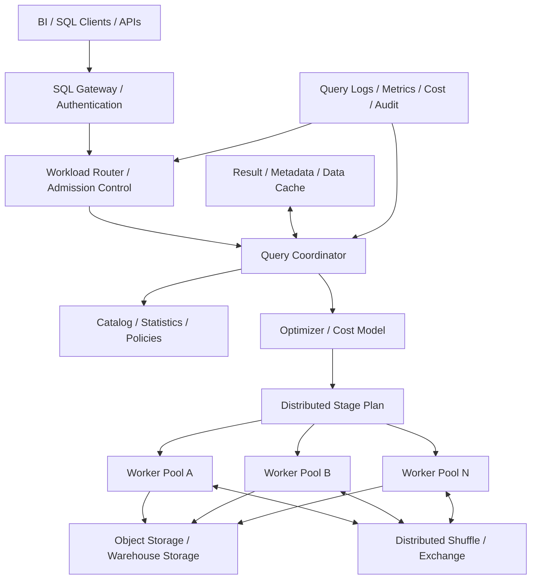

# 35. Design a Distributed MPP Analytical Query-Serving Platform

**Level:** Principal / Staff Data Engineer | **Interview:** 60–75 minutes  
**Themes:** MPP architecture, query coordinator, distributed execution, joins and aggregations, partition pruning, memory management, concurrency, workload isolation, elastic scale

## 1. Problem statement

Thousands of analysts, BI dashboards, and applications query large analytical datasets with low-latency expectations. Workloads range from short interactive queries to large joins and scheduled reports. A single poorly behaved query must not destabilize the platform.

Design a massively parallel processing (MPP) query-serving architecture that distributes work across nodes, controls resource consumption, optimizes query plans, and scales with workload demand.

## 2. Clarifying questions

| Area | Questions | Design impact |
|---|---|---|
| Data | Row/columnar, lakehouse tables, warehouse-native storage? | Storage and scan model |
| Scale | TB/PB, table count, data growth, hot/cold data? | Partitioning and metadata |
| Workload | BI, ad-hoc, dashboard, API, ETL, ML? | Pools and priorities |
| Latency | p50/p95/p99 targets by workload? | Cache and execution design |
| Concurrency | Active users, query rate, long-running queries? | Admission and scheduling |
| SQL | Complex joins, windows, UDFs, high-cardinality group-bys? | Optimizer and memory |
| Isolation | Tenant boundaries and noisy-neighbour requirements? | Resource governance |
| Elasticity | Scale compute independently? Cold-start tolerance? | Architecture |
| Security | Row/column/tenant policy, audit, data residency? | Planner and execution |
| Cost | Budget, chargeback, idle capacity? | Autoscaling and quotas |

## 3. Requirements

**Functional:** SQL interface; query parsing and planning; distributed execution; joins, aggregations, sorting and windows; metadata/catalog integration; caching; workload queues; cancellation; observability; authorization; elastic capacity.

**Non-functional:** predictable latency; high concurrency; fault tolerance; resource fairness; tenant isolation; efficient scans; bounded memory; cost attribution; secure access.

## 4. Capacity estimation

Estimate:
- data scanned/query and scan amplification;
- query arrival rate and concurrency;
- CPU-seconds, memory per stage, shuffle bytes;
- join build-side sizes and cardinality;
- cache hit ratio and freshness;
- worker count and usable resources after system reserve;
- peak-to-average load and autoscaling delay.

Illustrative: 400 concurrent queries averaging 20 GB scanned implies 8 TB of concurrent logical scan demand if all are active at once. Actual physical reads depend on pruning, caching, compression, and column projection. Estimate per workload class; averages hide expensive tails.

## 5. Architecture

The exact coordinator/worker topology varies by engine. Some systems use multiple coordinators, distributed planning, shared-nothing storage, shared storage, or disaggregated compute. Explain the chosen engine model rather than assuming all MPP engines behave identically.

## 6. Query lifecycle

1. **Connection and authentication:** resolve user, tenant, roles, and session settings.
2. **Admission control:** classify workload, check quotas, concurrency, queue capacity, and estimated cost.
3. **Parsing and semantic analysis:** validate SQL, object names, types, and privileges.
4. **Optimization:** apply predicate/projection pushdown, join reordering, statistics, partition pruning, and cost-based choices.
5. **Fragmentation:** split plan into stages connected by exchanges/shuffles.
6. **Scheduling:** assign fragments to workers with locality and resource constraints.
7. **Execution:** scan, filter, join, aggregate, sort, spill, and exchange intermediate data.
8. **Result delivery:** stream or materialize results, enforce row limits, and cancel abandoned work.
9. **Accounting:** record runtime, bytes scanned, CPU, memory, spill, queue time, cache use, and user/tenant attribution.

## 7. Distributed execution fundamentals

### 7.1 Partition pruning and column projection
Push filters close to storage and read only required columns. Partition pruning reduces file/segment scans, while columnar projection reduces I/O. Poor partition design or functions applied to partition columns can prevent pruning.

### 7.2 Join strategies
Common strategies:
- broadcast/hash join when one side is safely small;
- repartitioned hash join for large relations;
- sort-merge join when data is suitably distributed/sorted or memory constraints favour it;
- colocated/local join when compatible partitioning avoids exchange.

A broadcast join can become catastrophic if the supposedly small side is larger than estimates or multiplied by many workers. Use statistics, runtime safeguards, and size thresholds.

### 7.3 Aggregation
Use partial/local aggregation to reduce network traffic before global aggregation. High-cardinality group-bys can create large hash tables and memory pressure. Approximate algorithms may be acceptable for explicitly approximate metrics, but not for financial correctness without business approval.

### 7.4 Shuffle and exchange
Shuffle redistributes data between workers and is often a major bottleneck. Monitor bytes, skew, spill, network saturation, and task duration. Mitigate with better partitioning, pre-aggregation, skew-aware joins, adaptive execution, and avoiding unnecessary wide transformations.

## 8. Coordinator and worker resource management

The coordinator is responsible for planning, admission, scheduling, and query state; it must not become a bottleneck. Scale or partition coordinator responsibilities where supported. Protect it from excessive query submission, metadata storms, and very large plans.

Workers need:
- CPU and memory reservations;
- per-query and per-tenant limits;
- spill-to-disk thresholds and disk isolation;
- network and storage bandwidth monitoring;
- task cancellation and heartbeat handling;
- graceful drain and replacement;
- autoscaling with warm capacity for latency-sensitive workloads.

Do not allocate all node memory to query operators. Reserve capacity for JVM/runtime, OS, caches, buffers, and safety margin.

## 9. Workload management and noisy-neighbour prevention

Classify workloads, for example:
- critical dashboards and product APIs;
- interactive analyst queries;
- scheduled reporting;
- ELT/ETL;
- exploratory or ad-hoc heavy queries.

Use separate resource groups or pools, weighted fair scheduling, concurrency limits, queue timeouts, per-query memory caps, scan limits, and priorities. Protect critical pools with reserved capacity. Apply per-tenant budgets and chargeback.

A single global queue is simple but can allow one tenant to dominate. Fully isolated clusters improve blast-radius control but increase idle capacity and operational overhead. Choose isolation tiers based on criticality and sensitivity.

## 10. Caching and elastic scaling

Caching options:
- metadata/statistics cache;
- data/page/segment cache;
- result cache;
- materialized views and aggregate tables.

Cache correctness depends on data snapshot, query semantics, user identity, policy, and freshness. Invalidate or version safely after writes and policy changes.

Autoscaling should use queue wait, CPU, memory pressure, active fragments, and workload forecasts—not CPU alone. Scale-out delay means some warm capacity may be needed for strict p95 latency. Scale-in must drain workers safely and avoid killing long-running queries unexpectedly.

## 11. Failure modes and recovery

| Failure | Detection | Recovery |
|---|---|---|
| Worker crashes | Heartbeat/task failure | Retry fragment if safe; reschedule on healthy worker |
| Coordinator fails | Query/session loss, health checks | HA coordinator or client retry; define query restart semantics |
| Network partition | Exchange timeout, retries | Fail affected query or retry stage where supported |
| Bad cardinality estimate | Unexpected spill/latency | Runtime statistics, adaptive plan, stats refresh |
| Memory-heavy query | Per-query memory threshold | Spill, throttle, kill query, or isolate pool |
| Hot partition/skew | Straggler tasks | Skew handling, salting, repartition, query rewrite |
| Metadata/catalog outage | Planning failures | HA catalog/cache with bounded staleness and clear failure mode |
| Cache stale or policy leak | Version/policy mismatch | Invalidate cache; fail closed for authorization |
| Autoscaling lag | Queue wait and saturation | Warm pool, predictive scaling, admission control |

## 12. Security and governance

- Authenticate users and services at the gateway.
- Propagate identity or enforce equivalent policy in the query layer.
- Apply row/column/tenant filters before results are exposed.
- Treat cached results as protected data; cache keys must include security context or use policy-safe cache partitioning.
- Audit query text/normalized fingerprints, accessed datasets, identity, and cost while protecting sensitive literals.
- Restrict dangerous functions, external connectors, and untrusted UDFs.
- Use network boundaries and workload identities for storage access.

## 13. Trade-offs

- **Shared-nothing versus shared-storage/disaggregated:** shared-nothing can provide locality and predictable scaling; shared storage can simplify compute elasticity and data sharing but shifts pressure to storage/network/cache.
- **Single cluster versus workload pools:** one cluster improves utilization; pools improve isolation and predictable latency.
- **Broadcast versus shuffle join:** broadcast saves network for small inputs but risks memory explosion.
- **Result cache versus materialization:** result cache is easy for repeat queries; materialized views serve broader patterns but require refresh and dependency management.
- **Aggressive autoscaling versus warm capacity:** aggressive scaling saves cost but may harm cold-start latency.
- **Exact versus approximate analytics:** approximate methods improve speed for selected metrics but require explicit accuracy contracts.

## 14. Sample interviewer–candidate discussion

**Interviewer:** One query consumes most of the memory and slows down every tenant. What do you do?

**Candidate:** I would first identify whether the issue is a single query, a workload pool, or a systemic plan/statistics issue. Admission control should estimate and cap resource use before execution. At runtime, enforce per-query memory limits, spill thresholds, and cancellation. Put ad-hoc workloads in a lower-priority pool and reserve capacity for critical dashboards. Then inspect the plan for bad cardinality estimates, broadcast explosion, skew, or unbounded joins and fix the root cause.

**Interviewer:** Would you simply add more workers?

**Candidate:** Not automatically. More workers may increase parallelism but can also increase shuffle, coordination, and small-task overhead. I would check whether the bottleneck is CPU, memory, network, storage, coordinator planning, or skew. Scale the constrained resource and address the query shape.

## 15. Principal-level follow-up questions

1. How do you handle a 10 TB join where one key accounts for 35% of rows?
2. How would you isolate 3,000 tenants without provisioning 3,000 dedicated clusters?
3. How do you safely support long-running queries during scale-in?
4. What metrics would you use to distinguish coordinator saturation from worker saturation?
5. How do you maintain cache correctness when row-level security policies change?
6. When would you choose Trino, StarRocks, Snowflake, Redshift, or another MPP/query engine? Compare workload fit and operating model rather than brand names.

## 16. Common interview mistakes

- Describing only the coordinator and workers without the query lifecycle.
- Ignoring query planning, statistics, and cardinality estimation.
- Treating more nodes as the answer to every performance problem.
- Ignoring admission control, memory limits, and workload isolation.
- Caching results without considering identity, policy, and freshness.
- Assuming all MPP engines share the same storage and failure architecture.

## 17. Practice exercise

Design a SQL analytics platform over 8 PB of compressed data with 2,000 concurrent users, 100 critical dashboards under a 5-second p95 target, and ad-hoc queries that may scan several TB. Define workload classes, admission policy, worker pools, join strategy, cache design, autoscaling, failure handling, and cost attribution.

## 18. Further reading

- Trino documentation: https://trino.io/docs/current/
- StarRocks documentation: https://docs.starrocks.io/
- Apache Calcite: https://calcite.apache.org/
- Apache Spark SQL performance tuning: https://spark.apache.org/docs/latest/sql-performance-tuning.html
- AWS Redshift performance and query design: https://docs.aws.amazon.com/redshift/latest/dg/c_designing-queries-best-practices.html
